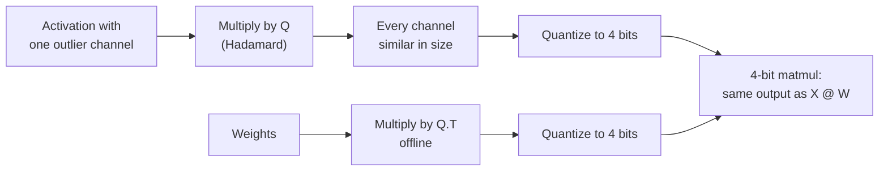

# Lección 15. Rotaciones

**Vínculo con la misión:** Las rotaciones son lo que llevó la cuantización de pesos y activaciones de 8 bits a 4, y ahora son una opción en las herramientas de cuantización habituales, así que juzgar una afirmación de W4A4 significa saber qué hizo la rotación.
**Fuente principal:** [Paper: "QuaRot: Outlier-Free 4-Bit Inference in Rotated LLMs", Ashkboos et al., 2024](https://arxiv.org/abs/2404.00456)
**Requisitos previos:** [Lección 14](0014-smoothquant.md), [Rotación](../GLOSSARY.md), [Outlier feature](../GLOSSARY.md)

## Calentamiento

1. ▢ El SmoothQuant de la lección 14 movió la dificultad de las activaciones a los pesos con un scale por canal. ¿Cuál es la identidad de una línea que mantiene la salida sin cambios?

<details markdown="1"><summary>Comprobación</summary>

`X @ W = (X @ diag(s)^-1) @ (diag(s) @ W)`. Los canales de activación se dividen por `s` y las filas de pesos correspondientes se multiplican por él.

</details>

2. ▢ La lección 6 comparó scales per-tensor y per-group. Con un scale per-tensor, ¿qué fija el tamaño del paso, y qué pasa con los valores ordinarios cuando un valor es 60 veces el resto?

<details markdown="1"><summary>Comprobación</summary>

El mayor valor absoluto fija el paso. Con un valor 60 veces el resto, el paso es tan grueso que los valores ordinarios caen en muy pocos niveles, muchos de ellos en cero.

</details>

3. ▢ La lección 8 nombró cuatro familias de soluciones para los outliers. ¿A qué familia pertenece SmoothQuant, y cuál cubre esta lección?

<details markdown="1"><summary>Comprobación</summary>

SmoothQuant migra la dificultad de las activaciones a los pesos. Esta lección cubre rotar los outliers para dispersarlos.

</details>

## Qué debes saber

### La identidad

Una matriz cuadrada `Q` es ortogonal cuando `Q @ Q.T = I`. Insértala entre las activaciones y los pesos de una capa:

```text
X @ W = (X @ Q) @ (Q.T @ W)
```

La salida no cambia en aritmética exacta, igual que con el scale de SmoothQuant. La diferencia es lo que `Q` hace a las activaciones. Un scale diagonal reduce un canal. Una rotación mezcla cada canal con todos los demás, así que un valor de 60 en un canal se convierte en una pequeña contribución a todos ellos. El vector rotado tiene la misma longitud pero ninguna coordenada destaca, y un scale per-tensor o per-token deja de fijarlo un solo outlier.

### Por qué Hadamard

Una matriz de Hadamard tiene entradas de +1 y -1, escaladas por `1 / sqrt(n)`, y es ortogonal. Dos propiedades la convierten en la elección habitual:

- Reparte un único pico de forma perfectamente uniforme: un vector que es cero salvo en una entrada se convierte en un vector cuyas entradas tienen todas la misma magnitud.
- Es barata. Un tamaño que es potencia de dos puede construirse de forma recursiva, y multiplicar por ella cuesta `n log n` sumas en lugar de un producto de matrices completo.

QuaRot rota las entradas "usando transformadas de Hadamard aleatorizadas", y se apoya en lo que llama invarianza computacional, una idea de trabajos anteriores sobre poda: muchas de las rotaciones pueden fusionarse offline en las matrices de pesos, dejando una red equivalente sin outlier features.

### Dónde van las rotaciones

No toda rotación puede absorberse. QuaRot fusiona una rotación global en los pesos alrededor del residual stream, y añade unas pocas transformadas de Hadamard online que corren en tiempo de inferencia:

- una dentro del bloque feed-forward, antes de la proyección de bajada, implementada con un kernel rápido y cancelada fusionando una matriz de Hadamard en los pesos de la proyección de bajada;
- rotaciones por cabeza de las queries y las keys, porque el rotary position embedding queda entre la proyección y el producto de atención e impide fusionar la rotación en los pesos. Esto es también lo que hace cuantizable la KV cache.

El resultado, según el resumen: todos los pesos, las activaciones y la KV cache en 4 bits, toda multiplicación de matrices en 4 bits y ningún canal conservado en mayor precisión. El Llama 2 70B de 4 bits pierde como mucho 0.47 de perplexity en WikiText-2 y conserva el 99% de su rendimiento zero-shot. A 6 y 8 bits, QuaRot informa de modelos sin pérdida con round-to-nearest simple y sin datos de calibración.

### No todas las rotaciones son iguales

SpinQuant encuentra que "algunas rotaciones aleatorias llevan a una cuantización mucho mejor que otras", con hasta 13 puntos de diferencia en razonamiento zero-shot en tareas posteriores, y aprende las matrices de rotación en lugar de sortearlas. Con pesos, activaciones y KV cache de 4 bits en Llama 2 7B, reduce la brecha zero-shot respecto de la precisión completa a 2.9 puntos, y en Llama 3 8B reduce hasta un 45.1% la brecha que deja QuaRot ([Liu et al., 2024](https://arxiv.org/abs/2405.16406)). La lectura práctica: un resultado basado en rotaciones depende de qué rotación, así que una afirmación de W4A4 debería decir cómo se eligió.



## Práctica

1. ▢ ¿Por qué insertar `Q` y `Q.T` entre las activaciones y los pesos de una capa deja sin cambios su salida en precisión completa?

<details markdown="1"><summary>Comprobación</summary>

Porque `Q @ Q.T = I` para una matriz ortogonal, así que `(X @ Q) @ (Q.T @ W) = X @ (Q @ Q.T) @ W = X @ W`. Cualquier matriz ortogonal sirve para la identidad; la elección de `Q` solo importa para lo bien que se cuantizan los tensores rotados.

</details>

2. ▢ Predice y luego ejecuta. Predice la razón entre el mayor valor y el valor cuadrático medio (RMS) antes y después de una rotación de Hadamard, y qué pasa con el error a 4 bits.

    ```python
    import numpy as np
    rng = np.random.default_rng(0)
    x = rng.normal(0, 1, 64)            # one token's activations, 64 channels
    x[5] = 60.0                         # one outlier channel

    H = np.array([[1.0]])
    while H.shape[0] < 64:              # Sylvester construction
        H = np.block([[H, H], [H, -H]])
    H /= np.sqrt(64)                    # orthogonal: H @ H.T = I

    def q4(t):                          # symmetric per-tensor int4
        s = np.abs(t).max() / 7
        return np.clip(np.round(t / s), -7, 7) * s

    for name, v in [("original", x), ("rotated ", x @ H)]:
        ratio = np.abs(v).max() / np.sqrt((v ** 2).mean())
        print(name, "max/rms =", round(ratio, 1))
    print("error, original:", round(np.abs(q4(x) - x).mean(), 3))
    print("error, rotated :", round(np.abs(q4(x @ H) @ H.T - x).mean(), 3))
    ```

<details markdown="1"><summary>Pista</summary>

¿Qué hace una matriz de Hadamard a un vector que es cero en todas partes salvo en una entrada grande? El vector real es eso más un poco de ruido.

</details>

<details markdown="1"><summary>Comprobación</summary>

```text
original max/rms = 7.9
rotated  max/rms = 1.2
error, original: 0.741
error, rotated : 0.326
```

El outlier dominaba el vector original, así que su máximo era ocho veces su RMS y el paso de 4 bits era grueso. Tras la rotación el pico se reparte casi uniformemente entre los 64 canales, el máximo queda cerca del RMS, y el error a 4 bits, medido tras rotar de vuelta, baja a menos de la mitad. Fíjate en la rotación de vuelta con `H.T`: en una capa real eso ocurre de forma implícita, porque los pesos se multiplicaron por `Q.T`.

</details>

3. ▢ QuaRot fusiona la mayoría de las rotaciones en los pesos offline pero ejecuta un Hadamard por cabeza sobre las queries y las keys en tiempo de inferencia. ¿Por qué no puede fusionarse esa?

<details markdown="1"><summary>Pista</summary>

Mira qué hay entre la proyección de las keys y el producto de atención.

</details>

<details markdown="1"><summary>Comprobación</summary>

El rotary position embedding se aplica después de las proyecciones de queries y keys y depende de la posición, así que una rotación fusionada en los pesos de la proyección se aplicaría antes de él y no conmutaría con él. La rotación tiene que ocurrir después del position embedding, online, lo que además deja las keys de la KV cache rotadas y más fáciles de cuantizar.

</details>

4. ▢ Un paper informa de W4A4 con "una rotación de Hadamard aleatoria" y una pequeña caída de accuracy en un modelo. ¿Qué sugiere el hallazgo de SpinQuant que preguntes antes de fiarte de ese resultado para un modelo distinto?

    - a) Si la rotación se fijó con semilla, se varió o se aprendió por modelo
    - b) Si el tamaño del Hadamard de cada capa era una potencia de dos
    - c) Si el modelo se entrenó con rotaciones desde el principio
    - d) Si las activaciones se almacenaban en fp8 antes de la rotación

<details markdown="1"><summary>Comprobación</summary>

**a)** SpinQuant encontró hasta 13 puntos de diferencia zero-shot entre rotaciones aleatorias, así que un solo sorteo aleatorio en un modelo dice poco sobre el siguiente; aprender la rotación redujo la brecha. (b) concierne a cómo se calcula la rotación de forma rápida, no a lo bien que cuantiza. (c) es incorrecta porque las rotaciones se aplican post-entrenamiento. (d) no tiene relación: la rotación se aplica antes de cuantizar a 4 bits.

</details>

## Prácticas en el mundo real

- [ ] En el fragmento de la práctica, mueve el outlier a otro canal y pon dos outliers en lugar de uno. Predice, y luego comprueba, si la razón max/rms rotada se mantiene cerca de 1.
- [ ] Lee el resumen de QuaRot y la figura 1, y anota qué tensores acaban en 4 bits y qué operaciones siguen corriendo en mayor precisión.
- [ ] Mañana: sin apuntes, escribe la identidad de la rotación, nombra dos razones por las que una matriz de Hadamard es la elección habitual y di por qué la rotación de queries y keys corre online.

## Para profundizar

- [Activaciones y KV cache](../reference/activations-and-kv-cache.md)
- [Paper: "SpinQuant: LLM Quantization with Learned Rotations", Liu et al., 2024](https://arxiv.org/abs/2405.16406)
- [Recursos](../RESOURCES.md)

---

¿No termina de quedar claro? Vuelve a leer la fuente primaria de arriba, ya que esta lección la comprime y en la compresión es donde se escapa la comprensión. Consulta el [glosario](../GLOSSARY.md) por si algún término te resultó resbaladizo.

Si lo poco claro es la propia lección y no el material, eso es un defecto: [abre un issue](https://github.com/TokenCemetery/teach/issues).
