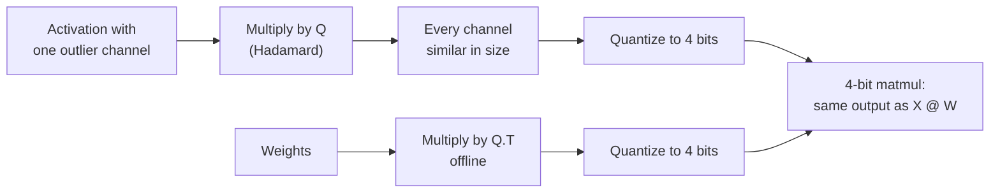

# Leçon 15. Les rotations

**Lien avec la mission :** Les rotations sont ce qui a fait passer la quantification poids-et-activations de 8 à 4 bits, et elles sont désormais une option des outils de quantification courants, donc juger une affirmation W4A4 demande de savoir ce qu'a fait la rotation.
**Source primaire :** [Article : "QuaRot: Outlier-Free 4-Bit Inference in Rotated LLMs", Ashkboos et al., 2024](https://arxiv.org/abs/2404.00456)
**Prérequis :** [Leçon 14](0014-smoothquant.md), [Rotation](../GLOSSARY.md), [Feature outlier](../GLOSSARY.md)

## Échauffement

1. ▢ Le SmoothQuant de la leçon 14 a déplacé la difficulté des activations vers les poids avec un scale par canal. Quelle est l'identité en une ligne qui garde la sortie inchangée ?

<details markdown="1"><summary>Vérifier</summary>

`X @ W = (X @ diag(s)^-1) @ (diag(s) @ W)`. Les canaux d'activation sont divisés par `s` et les lignes de poids correspondantes multipliées par lui.

</details>

2. ▢ La leçon 6 a comparé les scales par tenseur et par groupe. Avec un seul scale par tenseur, qu'est-ce qui fixe la taille du pas, et que deviennent les valeurs ordinaires quand une valeur vaut 60 fois les autres ?

<details markdown="1"><summary>Vérifier</summary>

La plus grande valeur absolue fixe le pas. Avec une valeur 60 fois supérieure aux autres, le pas est si grossier que les valeurs ordinaires tombent sur très peu de niveaux, beaucoup sur zéro.

</details>

3. ▢ La leçon 8 a nommé quatre familles de parades aux outliers. À quelle famille appartient SmoothQuant, et laquelle couvre cette leçon ?

<details markdown="1"><summary>Vérifier</summary>

SmoothQuant migre la difficulté des activations vers les poids. Cette leçon couvre le fait de faire pivoter les outliers hors du chemin.

</details>

## À savoir

### L'identité

Une matrice carrée `Q` est orthogonale quand `Q @ Q.T = I`. Insérez-la entre les activations et les poids d'une couche :

```text
X @ W = (X @ Q) @ (Q.T @ W)
```

La sortie est inchangée en arithmétique exacte, exactement comme avec le scale de SmoothQuant. La différence est ce que `Q` fait aux activations. Un scale diagonal fait rétrécir un canal. Une rotation mélange chaque canal dans tous les autres, donc une valeur de 60 dans un canal devient une petite contribution à tous. Le vecteur pivoté a la même longueur mais aucune coordonnée ne se détache, et un scale par tenseur ou par token n'est plus fixé par un seul outlier.

### Pourquoi Hadamard

Une matrice de Hadamard a des entrées valant +1 et -1, mises à l'échelle `1 / sqrt(n)`, et est orthogonale. Deux propriétés en font le choix habituel :

- Elle répartit un pic isolé parfaitement uniformément : un vecteur nul sauf une entrée devient un vecteur dont toutes les entrées ont la même grandeur.
- Elle est bon marché. Une taille qui est une puissance de deux peut se construire récursivement, et multiplier par elle coûte `n log n` additions plutôt qu'un produit matriciel complet.

QuaRot fait pivoter les entrées « à l'aide de transformées de Hadamard randomisées », et s'appuie sur ce qu'il appelle l'invariance computationnelle, une idée issue de travaux antérieurs sur l'élagage : de nombreuses rotations peuvent être fusionnées hors ligne dans les matrices de poids, ce qui laisse un réseau équivalent sans features outlier.

### Où vont les rotations

Toutes les rotations ne peuvent pas être absorbées. QuaRot fusionne une rotation globale dans les poids autour du flux résiduel, et ajoute quelques transformées de Hadamard en ligne qui tournent à l'inférence :

- une à l'intérieur du bloc feed-forward, avant la projection descendante, mise en œuvre avec un kernel rapide et annulée en fusionnant une matrice de Hadamard dans les poids de la projection descendante ;
- des rotations par tête des requêtes et des clés, parce que l'embedding de position rotatif se place entre la projection et le produit d'attention et empêche de fusionner la rotation dans les poids. C'est aussi ce qui rend le KV cache quantifiable.

Le résultat, d'après le résumé : tous les poids, activations et le KV cache en 4 bits, chaque multiplication de matrices en 4 bits, et aucun canal gardé en plus haute précision. Le Llama 2 70B en 4 bits perd au plus 0.47 de perplexity WikiText-2 et conserve 99 % de ses performances zero-shot. À 6 et 8 bits, QuaRot rapporte des modèles sans perte avec l'arrondi au plus proche simple et aucune donnée de calibration.

### Toutes les rotations ne se valent pas

SpinQuant constate que « certaines rotations aléatoires conduisent à une bien meilleure quantification que d'autres », avec jusqu'à 13 points d'écart en raisonnement zero-shot en aval, et apprend les matrices de rotation au lieu de les tirer. Avec des poids, des activations et un KV cache en 4 bits sur Llama 2 7B, il réduit à 2.9 points l'écart zero-shot avec la pleine précision, et sur Llama 3 8B il réduit jusqu'à 45.1 % l'écart laissé par QuaRot ([Liu et al., 2024](https://arxiv.org/abs/2405.16406)). La lecture pratique : un résultat fondé sur les rotations dépend de la rotation choisie, donc une affirmation W4A4 devrait dire comment elle a été choisie.



## Pratique

1. ▢ Pourquoi insérer `Q` et `Q.T` entre les activations et les poids d'une couche laisse-t-il inchangée sa sortie en pleine précision ?

<details markdown="1"><summary>Vérifier</summary>

Parce que `Q @ Q.T = I` pour une matrice orthogonale, donc `(X @ Q) @ (Q.T @ W) = X @ (Q @ Q.T) @ W = X @ W`. N'importe quelle matrice orthogonale convient pour l'identité ; le choix de `Q` ne compte que pour la qualité de quantification des tenseurs pivotés.

</details>

2. ▢ Prédisez, puis exécutez. Prédisez le rapport entre la plus grande valeur et la valeur quadratique moyenne avant et après une rotation de Hadamard, et ce qui arrive à l'erreur en 4 bits.

    ```python
    import numpy as np
    rng = np.random.default_rng(0)
    x = rng.normal(0, 1, 64)            # one token's activations, 64 channels
    x[5] = 60.0                         # one outlier channel

    H = np.array([[1.0]])
    while H.shape[0] < 64:              # Sylvester construction
        H = np.block([[H, H], [H, -H]])
    H /= np.sqrt(64)                    # orthogonal: H @ H.T = I

    def q4(t):                          # symmetric per-tensor int4
        s = np.abs(t).max() / 7
        return np.clip(np.round(t / s), -7, 7) * s

    for name, v in [("original", x), ("rotated ", x @ H)]:
        ratio = np.abs(v).max() / np.sqrt((v ** 2).mean())
        print(name, "max/rms =", round(ratio, 1))
    print("error, original:", round(np.abs(q4(x) - x).mean(), 3))
    print("error, rotated :", round(np.abs(q4(x @ H) @ H.T - x).mean(), 3))
    ```

<details markdown="1"><summary>Indice</summary>

Que fait une matrice de Hadamard à un vecteur nul partout sauf en une grande entrée ? Le vrai vecteur est cela plus un petit bruit.

</details>

<details markdown="1"><summary>Vérifier</summary>

```text
original max/rms = 7.9
rotated  max/rms = 1.2
error, original: 0.741
error, rotated : 0.326
```

L'outlier dominait le vecteur d'origine, donc son maximum valait huit fois son RMS et le pas de 4 bits était grossier. Après rotation, le pic est réparti presque uniformément sur les 64 canaux, le maximum est proche du RMS, et l'erreur en 4 bits, mesurée après avoir refait pivoter dans l'autre sens, tombe de plus de moitié. Notez la rotation inverse avec `H.T` : dans une vraie couche, elle se fait implicitement, parce que les poids ont été multipliés par `Q.T`.

</details>

3. ▢ QuaRot fusionne la plupart des rotations dans les poids hors ligne mais exécute à l'inférence une Hadamard par tête sur les requêtes et les clés. Pourquoi celle-là ne peut-elle pas être fusionnée ?

<details markdown="1"><summary>Indice</summary>

Regardez ce qui se trouve entre la projection des clés et le produit d'attention.

</details>

<details markdown="1"><summary>Vérifier</summary>

L'embedding de position rotatif est appliqué après les projections des requêtes et des clés et dépend de la position, donc une rotation fusionnée dans les poids de projection serait appliquée avant lui et ne commuterait pas avec lui. La rotation doit se faire après l'embedding de position, en ligne, ce qui laisse aussi les clés du KV cache pivotées et plus faciles à quantifier.

</details>

4. ▢ Un article rapporte du W4A4 avec « une rotation de Hadamard aléatoire » et une petite baisse de précision sur un modèle. Que suggère la constatation de SpinQuant de demander avant de s'appuyer sur ce résultat pour un autre modèle ?

    - a) Si la rotation a été fixée par seed, variée ou apprise pour chaque modèle
    - b) Si la taille de la Hadamard de chaque couche était une puissance de deux
    - c) Si le modèle a été entraîné avec des rotations dès le départ
    - d) Si les activations étaient stockées en fp8 avant la rotation

<details markdown="1"><summary>Vérifier</summary>

**a)** SpinQuant a trouvé jusqu'à 13 points d'écart zero-shot entre des rotations aléatoires, donc un tirage aléatoire sur un modèle dit peu de chose du suivant ; apprendre la rotation a réduit l'écart. (b) concerne la façon de calculer rapidement la rotation, pas la qualité de quantification qu'elle donne. (c) est faux parce que les rotations sont appliquées après l'entraînement. (d) est sans rapport : la rotation est appliquée avant la quantification en 4 bits.

</details>

## Exercices en situation réelle

- [ ] Dans l'extrait de la pratique, déplacez l'outlier vers un autre canal et mettez deux outliers au lieu d'un. Prédisez, puis vérifiez, si le rapport max/rms après rotation reste proche de 1.
- [ ] Lisez le résumé de QuaRot et sa figure 1, et notez quels tenseurs finissent en 4 bits et quelles opérations tournent encore en plus haute précision.
- [ ] Demain : sans notes, écrivez l'identité de rotation, nommez deux raisons pour lesquelles une matrice de Hadamard est le choix habituel, et dites pourquoi la rotation des requêtes et des clés se fait en ligne.

## Pour aller plus loin

- [Activations et KV cache](../reference/activations-and-kv-cache.md)
- [Article : "SpinQuant: LLM Quantization with Learned Rotations", Liu et al., 2024](https://arxiv.org/abs/2405.16406)
- [Ressources](../RESOURCES.md)

---

Ça ne passe pas ? Relisez la source primaire en haut de page, car cette leçon la condense et c'est dans la condensation que la compréhension s'échappe. Consultez le [glossaire](../GLOSSARY.md) pour tout terme qui vous a paru glissant.

Si c'est la leçon elle-même qui n'est pas claire plutôt que la matière, c'est un défaut : [ouvrez une issue](https://github.com/TokenCemetery/teach/issues).
