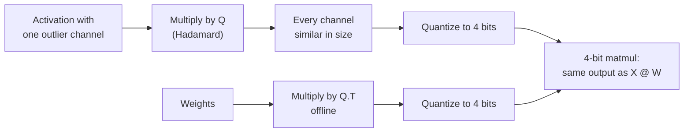

# पाठ 15. Rotations

**मिशन से संबंध:** Rotations ने weight-और-activation quantization को 8 bits से 4 पर पहुँचाया, और अब वे मुख्यधारा के quantization tools में एक विकल्प हैं, इसलिए W4A4 दावे को परखने का मतलब जानना है कि rotation ने क्या किया।
**मुख्य स्रोत:** [पेपर: "QuaRot: Outlier-Free 4-Bit Inference in Rotated LLMs", Ashkboos et al., 2024](https://arxiv.org/abs/2404.00456)
**पूर्व-आवश्यकताएँ:** [पाठ 14](0014-smoothquant.md), [Rotation](../GLOSSARY.md), [Outlier feature](../GLOSSARY.md)

## वार्म-अप

1. ▢ पाठ 14 के SmoothQuant ने per-channel scale से कठिनाई को activations से weights में खिसकाया। वह एक पंक्ति का identity क्या है जो output को अपरिवर्तित रखता है?

<details markdown="1"><summary>जाँचें</summary>

`X @ W = (X @ diag(s)^-1) @ (diag(s) @ W)`। Activation channels को `s` से भाग दिया जाता है और संबंधित weight rows को उससे गुणा।

</details>

2. ▢ पाठ 6 ने per-tensor और per-group scales की तुलना की। एक per-tensor scale के साथ, step size किससे तय होता है, और जब एक value बाक़ी से 60 गुना हो तो सामान्य values का क्या होता है?

<details markdown="1"><summary>जाँचें</summary>

सबसे बड़ी absolute value step तय करती है। बाक़ी से 60 गुना बड़ी value के साथ, step इतना मोटा है कि सामान्य values बहुत कम levels पर गिरती हैं, कई zero पर।

</details>

3. ▢ पाठ 8 ने outlier इलाज के चार परिवार गिनाए। SmoothQuant किस परिवार का है, और यह पाठ कौन-सा कवर करता है?

<details markdown="1"><summary>जाँचें</summary>

SmoothQuant कठिनाई को activations से weights में migrate करता है। यह पाठ outliers को rotate करके हटाना कवर करता है।

</details>

## यह जानें

### Identity

वर्ग matrix `Q` orthogonal तब है जब `Q @ Q.T = I`। उसे किसी layer की activations और weights के बीच डालें:

```text
X @ W = (X @ Q) @ (Q.T @ W)
```

सटीक arithmetic में output अपरिवर्तित रहता है, ठीक SmoothQuant के scale की तरह। फ़र्क़ इसमें है कि `Q` activations के साथ क्या करता है। Diagonal scale एक channel को सिकोड़ता है। Rotation हर channel को हर दूसरे channel में मिला देता है, इसलिए एक channel में 60 की value सभी में छोटा योगदान बन जाती है। Rotate किया गया vector उतना ही लंबा है पर कोई एक coordinate अलग नहीं दिखता, और per-tensor या per-token scale अब एक outlier से तय नहीं होता।

### Hadamard क्यों

Hadamard matrix की entries +1 और -1 हैं, `1 / sqrt(n)` से scale की हुई, और वह orthogonal है। दो गुण उसे आम चुनाव बनाते हैं:

- वह एक अकेले spike को बिल्कुल बराबर फैला देती है: जो vector एक entry को छोड़कर zero है वह ऐसा vector बन जाता है जिसकी सारी entries की magnitude एक जैसी है।
- वह सस्ती है। दो की घात वाला आकार recursively बनाया जा सकता है, और उससे गुणा करने की लागत पूरे matrix product की जगह `n log n` जोड़ हैं।

QuaRot inputs को "randomized Hadamard transformations का इस्तेमाल करके" rotate करता है, और वह उस पर निर्भर करता है जिसे वह computational invariance कहता है, जो pruning पर पहले के काम से आया विचार है: कई rotations को offline weight matrices में मिलाया जा सकता है, जिससे outlier features से मुक्त समतुल्य network बचता है।

### Rotations कहाँ जाते हैं

हर rotation को ग़ायब नहीं किया जा सकता। QuaRot residual stream के आसपास weights में एक global rotation मिलाता है, और कुछ online Hadamard transforms जोड़ता है जो inference के समय चलते हैं:

- एक feed-forward block के भीतर, down-projection से पहले, जो तेज़ kernel से लागू होता है और down-projection weights में Hadamard matrix मिलाकर कटता है;
- queries और keys के head-wise rotations, क्योंकि rotary position embedding projection और attention product के बीच बैठता है और rotation को weights में मिलाने से रोकता है। इसी से KV cache भी quantize करने लायक़ बनता है।

नतीजा, abstract से: सारे weights, activations और KV cache 4 bits में, हर matrix multiplication 4 bits में, और कोई channel ऊँची precision में नहीं रखा गया। 4-bit Llama 2 70B ज़्यादा से ज़्यादा 0.47 WikiText-2 perplexity खोता है और अपने zero-shot प्रदर्शन का 99% बनाए रखता है। 6 और 8 bits पर, QuaRot सादे round-to-nearest और बिना calibration data के lossless models बताता है।

### हर rotation बराबर नहीं होता

SpinQuant पाता है कि "कुछ random rotations दूसरों से कहीं बेहतर quantization देते हैं", downstream zero-shot reasoning में 13 अंक तक के अंतर के साथ, और rotation matrices को खींचने की जगह सीखता है। Llama 2 7B पर 4-bit weights, activations और KV cache के साथ, वह full precision से zero-shot फ़ासले को 2.9 अंक तक घटाता है, और Llama 3 8B पर वह QuaRot के छोड़े फ़ासले को 45.1% तक घटाता है ([Liu et al., 2024](https://arxiv.org/abs/2405.16406))। व्यावहारिक पाठ: rotation-आधारित नतीजा इस पर निर्भर करता है कि कौन-सा rotation, इसलिए W4A4 दावे को बताना चाहिए कि वह कैसे चुना गया।



## अभ्यास

1. ▢ किसी layer की activations और weights के बीच `Q` और `Q.T` डालने से उसका full-precision output अपरिवर्तित क्यों रहता है?

<details markdown="1"><summary>जाँचें</summary>

क्योंकि orthogonal matrix के लिए `Q @ Q.T = I` है, इसलिए `(X @ Q) @ (Q.T @ W) = X @ (Q @ Q.T) @ W = X @ W`। Identity के लिए कोई भी orthogonal matrix चलता है; `Q` का चुनाव सिर्फ़ इसके लिए मायने रखता है कि rotate हुए tensors कितना अच्छा quantize होते हैं।

</details>

2. ▢ पहले अनुमान लगाएँ, फिर चलाएँ। Hadamard rotation से पहले और बाद में सबसे बड़ी value और root-mean-square value का अनुपात अनुमानित करें, और बताएँ कि 4-bit error का क्या होता है।

    ```python
    import numpy as np
    rng = np.random.default_rng(0)
    x = rng.normal(0, 1, 64)            # one token's activations, 64 channels
    x[5] = 60.0                         # one outlier channel

    H = np.array([[1.0]])
    while H.shape[0] < 64:              # Sylvester construction
        H = np.block([[H, H], [H, -H]])
    H /= np.sqrt(64)                    # orthogonal: H @ H.T = I

    def q4(t):                          # symmetric per-tensor int4
        s = np.abs(t).max() / 7
        return np.clip(np.round(t / s), -7, 7) * s

    for name, v in [("original", x), ("rotated ", x @ H)]:
        ratio = np.abs(v).max() / np.sqrt((v ** 2).mean())
        print(name, "max/rms =", round(ratio, 1))
    print("error, original:", round(np.abs(q4(x) - x).mean(), 3))
    print("error, rotated :", round(np.abs(q4(x @ H) @ H.T - x).mean(), 3))
    ```

<details markdown="1"><summary>संकेत</summary>

Hadamard matrix उस vector के साथ क्या करती है जो एक बड़ी entry को छोड़कर हर जगह zero है? असली vector वह जमा छोटा noise है।

</details>

<details markdown="1"><summary>जाँचें</summary>

```text
original max/rms = 7.9
rotated  max/rms = 1.2
error, original: 0.741
error, rotated : 0.326
```

Outlier मूल vector पर हावी था, इसलिए उसका maximum उसके RMS का आठ गुना था और 4-bit step मोटा था। Rotation के बाद spike सभी 64 channels पर लगभग बराबर फैल जाता है, maximum RMS के क़रीब है, और 4-bit error, वापस rotate करने के बाद नापी गई, आधे से ज़्यादा गिर जाती है। `H.T` से वापस rotation पर ध्यान दें: असली layer में वह अपने-आप हो जाता है, क्योंकि weights को `Q.T` से गुणा किया गया था।

</details>

3. ▢ QuaRot ज़्यादातर rotations को offline weights में मिलाता है पर queries और keys पर head-wise Hadamard inference के समय चलाता है। वह वाला क्यों नहीं मिलाया जा सकता?

<details markdown="1"><summary>संकेत</summary>

देखें कि key projection और attention product के बीच क्या बैठा है।

</details>

<details markdown="1"><summary>जाँचें</summary>

Rotary position embedding query और key projections के बाद लगता है और position पर निर्भर करता है, इसलिए projection weights में मिलाया गया rotation उससे पहले लगता और उसके साथ commute नहीं करता। Rotation को position embedding के बाद, online, होना पड़ता है, जो KV cache की keys को भी rotate हुआ और quantize करने में आसान छोड़ता है।

</details>

4. ▢ कोई पेपर "random Hadamard rotation" के साथ W4A4 और एक model पर थोड़ी accuracy गिरावट बताता है। किसी दूसरे model पर उस नतीजे पर भरोसा करने से पहले SpinQuant की खोज आपको क्या पूछने का सुझाव देती है?

    - a) क्या rotation को seed किया गया था, बदला गया था या हर model के लिए सीखा गया था
    - b) क्या हर layer के Hadamard का आकार दो की घात था
    - c) क्या model शुरू से ही rotations के साथ train हुआ था
    - d) क्या rotation से पहले activations fp8 में store थीं

<details markdown="1"><summary>जाँचें</summary>

**a)** SpinQuant को random rotations के बीच zero-shot में 13 अंक तक का फ़र्क़ मिला, इसलिए एक model पर एक random draw अगले के बारे में कम बताता है; rotation को सीखने से फ़ासला घटा। (b) इस बारे में है कि rotation तेज़ी से कैसे compute होता है, यह नहीं कि वह कितना अच्छा quantize करता है। (c) ग़लत है क्योंकि rotations post-training लगाए जाते हैं। (d) असंबंधित है: rotation 4 bits पर quantize करने से पहले लगता है।

</details>

## असली दुनिया का अभ्यास

- [ ] अभ्यास के snippet में outlier को किसी दूसरे channel में ले जाएँ और एक की जगह दो outliers रखें। अनुमान लगाएँ, फिर जाँचें, कि rotate हुआ max/rms अनुपात 1 के क़रीब रहता है या नहीं।
- [ ] QuaRot का abstract और figure 1 पढ़ें, और लिखें कि कौन-से tensors 4 bits में आते हैं और कौन-से operations अब भी ऊँची precision में चलते हैं।
- [ ] कल: बिना नोट्स के rotation identity लिखें, Hadamard matrix के आम चुनाव होने के दो कारण बताएँ, और बताएँ कि query और key का rotation online क्यों चलता है।

## आगे बढ़ने के लिए

- [Activations और KV Cache शीट](../reference/activations-and-kv-cache.md)
- [पेपर: "SpinQuant: LLM Quantization with Learned Rotations", Liu et al., 2024](https://arxiv.org/abs/2405.16406)
- [संसाधन](../RESOURCES.md)

---

बात नहीं बन रही? ऊपर दिए मुख्य स्रोत को दोबारा पढ़ें, क्योंकि यह पाठ उसे संक्षिप्त करता है और समझ संक्षेप में ही रिसती है। जो शब्द फिसलन भरा लगे, उसके लिए [शब्दावली](../GLOSSARY.md) देखें।

अगर दिक़्क़त सामग्री की नहीं बल्कि पाठ की ही है, तो वह एक खोट है: [issue खोलें](https://github.com/TokenCemetery/teach/issues)।
