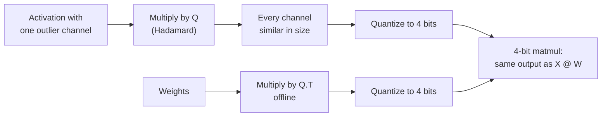

# Lesson 15. Rotations

**Mission link:** Rotations are what took weight-and-activation quantization from 8 bits to 4, and they are now an option in mainstream quantization tools, so judging a W4A4 claim means knowing what the rotation did.
**Primary source:** [Paper: "QuaRot: Outlier-Free 4-Bit Inference in Rotated LLMs", Ashkboos et al., 2024](https://arxiv.org/abs/2404.00456)
**Prerequisites:** [Lesson 14](0014-smoothquant.md), [Rotation](../GLOSSARY.md), [Outlier feature](../GLOSSARY.md)

## Warm-up

1. ▢ Lesson 14's SmoothQuant moved difficulty from activations to weights with a per-channel scale. What is the one-line identity that keeps the output unchanged?

<details markdown="1"><summary>Check</summary>

`X @ W = (X @ diag(s)^-1) @ (diag(s) @ W)`. The activation channels are divided by `s` and the matching weight rows multiplied by it.

</details>

2. ▢ Lesson 6 compared per-tensor and per-group scales. With one per-tensor scale, what sets the step size, and what happens to the ordinary values when one value is 60 times the rest?

<details markdown="1"><summary>Check</summary>

The largest absolute value sets the step. With a value 60 times the rest, the step is so coarse that ordinary values land on very few levels, many of them on zero.

</details>

3. ▢ Lesson 8 named four families of outlier fix. Which family does SmoothQuant belong to, and which one does this lesson cover?

<details markdown="1"><summary>Check</summary>

SmoothQuant migrates the difficulty from activations to weights. This lesson covers rotating the outliers away.

</details>

## Know this

### The identity

A square matrix `Q` is orthogonal when `Q @ Q.T = I`. Insert it between a layer's activations and weights:

```text
X @ W = (X @ Q) @ (Q.T @ W)
```

The output is unchanged in exact arithmetic, exactly as with SmoothQuant's scale. The difference is what `Q` does to the activations. A diagonal scale shrinks one channel. A rotation mixes every channel into every other, so a value of 60 in one channel becomes a small contribution to all of them. The rotated vector has the same length but no single coordinate stands out, and a per-tensor or per-token scale is no longer set by one outlier.

### Why Hadamard

A Hadamard matrix has entries of +1 and -1, scaled by `1 / sqrt(n)`, and is orthogonal. Two properties make it the usual choice:

- It spreads a single spike perfectly evenly: a vector that is zero except for one entry becomes a vector whose entries all have the same magnitude.
- It is cheap. A size that is a power of two can be built recursively, and multiplying by it costs `n log n` additions rather than a full matrix product.

QuaRot rotates the inputs "using randomized Hadamard transformations", and it relies on what it calls computational invariance, an idea from earlier work on pruning: many of the rotations can be fused into the weight matrices offline, leaving an equivalent network without outlier features.

### Where the rotations go

Not every rotation can be folded away. QuaRot fuses a global rotation into the weights around the residual stream, and adds a few online Hadamard transforms that run at inference time:

- one inside the feed-forward block, before the down-projection, implemented with a fast kernel and cancelled by fusing a Hadamard matrix into the down-projection weights;
- head-wise rotations of the queries and keys, because the rotary position embedding sits between the projection and the attention product and prevents fusing the rotation into the weights. This is also what makes the KV cache quantizable.

The result, from the abstract: all weights, activations and the KV cache in 4 bits, every matrix multiplication in 4 bits, and no channels kept in higher precision. The 4-bit Llama 2 70B loses at most 0.47 WikiText-2 perplexity and retains 99% of its zero-shot performance. At 6 and 8 bits, QuaRot reports lossless models with plain round-to-nearest and no calibration data.

### Not every rotation is equal

SpinQuant finds that "some random rotations lead to much better quantization than others", with up to a 13-point difference in downstream zero-shot reasoning, and learns the rotation matrices instead of drawing them. With 4-bit weights, activations and KV cache on Llama 2 7B, it narrows the zero-shot gap to full precision to 2.9 points, and on Llama 3 8B it reduces the gap left by QuaRot by up to 45.1% ([Liu et al., 2024](https://arxiv.org/abs/2405.16406)). The practical reading: a rotation-based result depends on which rotation, so a W4A4 claim should say how it was chosen.



## Practice

1. ▢ Why does inserting `Q` and `Q.T` between a layer's activations and weights leave its full-precision output unchanged?

<details markdown="1"><summary>Check</summary>

Because `Q @ Q.T = I` for an orthogonal matrix, so `(X @ Q) @ (Q.T @ W) = X @ (Q @ Q.T) @ W = X @ W`. Any orthogonal matrix works for the identity; the choice of `Q` only matters for how well the rotated tensors quantize.

</details>

2. ▢ Predict, then run. Predict the ratio of the largest value to the root-mean-square value before and after a Hadamard rotation, and what happens to the 4-bit error.

    ```python
    import numpy as np
    rng = np.random.default_rng(0)
    x = rng.normal(0, 1, 64)            # one token's activations, 64 channels
    x[5] = 60.0                         # one outlier channel

    H = np.array([[1.0]])
    while H.shape[0] < 64:              # Sylvester construction
        H = np.block([[H, H], [H, -H]])
    H /= np.sqrt(64)                    # orthogonal: H @ H.T = I

    def q4(t):                          # symmetric per-tensor int4
        s = np.abs(t).max() / 7
        return np.clip(np.round(t / s), -7, 7) * s

    for name, v in [("original", x), ("rotated ", x @ H)]:
        ratio = np.abs(v).max() / np.sqrt((v ** 2).mean())
        print(name, "max/rms =", round(ratio, 1))
    print("error, original:", round(np.abs(q4(x) - x).mean(), 3))
    print("error, rotated :", round(np.abs(q4(x @ H) @ H.T - x).mean(), 3))
    ```

<details markdown="1"><summary>Hint</summary>

What does a Hadamard matrix do to a vector that is zero everywhere except one large entry? The real vector is that plus small noise.

</details>

<details markdown="1"><summary>Check</summary>

```text
original max/rms = 7.9
rotated  max/rms = 1.2
error, original: 0.741
error, rotated : 0.326
```

The outlier dominated the original vector, so its maximum was eight times its RMS and the 4-bit step was coarse. After rotation the spike is spread almost evenly over all 64 channels, the maximum is close to the RMS, and the 4-bit error, measured after rotating back, falls by more than half. Note the rotation back with `H.T`: in a real layer that happens implicitly, because the weights were multiplied by `Q.T`.

</details>

3. ▢ QuaRot fuses most rotations into the weights offline but runs a head-wise Hadamard on the queries and keys at inference time. Why can that one not be fused?

<details markdown="1"><summary>Hint</summary>

Look at what sits between the key projection and the attention product.

</details>

<details markdown="1"><summary>Check</summary>

The rotary position embedding is applied after the query and key projections and depends on the position, so a rotation fused into the projection weights would be applied before it and would not commute with it. The rotation has to happen after the position embedding, online, which also leaves the keys in the KV cache rotated and easier to quantize.

</details>

4. ▢ A paper reports W4A4 with "a random Hadamard rotation" and a small accuracy drop on one model. What does SpinQuant's finding suggest you ask before relying on that result for a different model?

    - a) Whether the rotation was seeded, varied or learned per model
    - b) Whether every layer's Hadamard size was a power of two
    - c) Whether the model was trained with rotations from the start
    - d) Whether the activations were stored in fp8 before the rotation

<details markdown="1"><summary>Check</summary>

**a)** SpinQuant found up to 13 points of zero-shot difference between random rotations, so one random draw on one model says little about the next; learning the rotation narrowed the gap. (b) concerns how the rotation is computed fast, not how well it quantizes. (c) is wrong because rotations are applied post-training. (d) is unrelated: the rotation is applied before quantizing to 4 bits.

</details>

## Real-world reps

- [ ] In the practice snippet, move the outlier to a different channel and set two outliers instead of one. Predict, then check, whether the rotated max/rms ratio stays close to 1.
- [ ] Read the QuaRot abstract and figure 1, and write down which tensors end up in 4 bits and which operations still run in higher precision.
- [ ] Tomorrow: without notes, write the rotation identity, name two reasons a Hadamard matrix is the usual choice, and say why the query and key rotation runs online.

## Going further

- [Activations and the KV Cache](../reference/activations-and-kv-cache.md)
- [Paper: "SpinQuant: LLM Quantization with Learned Rotations", Liu et al., 2024](https://arxiv.org/abs/2405.16406)
- [Resources](../RESOURCES.md)

---

Not landing? Reread the primary source at the top, since this lesson compresses it and compression is where understanding leaks. Check the [glossary](../GLOSSARY.md) for any term that felt slippery.

If the lesson itself is unclear rather than the material, that is a defect: [open an issue](https://github.com/TokenCemetery/teach/issues).
