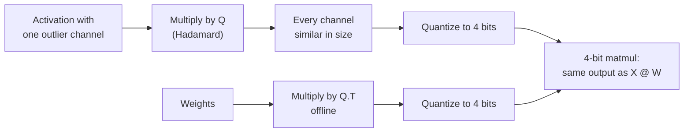

# Lição 15. Rotações

**Ligação com a missão:** As rotações são o que levou a quantização de pesos e ativações de 8 para 4 bits, e agora são uma opção em ferramentas de quantização convencionais, então julgar uma alegação de W4A4 significa saber o que a rotação fez.
**Fonte principal:** [Artigo científico: "QuaRot: Outlier-Free 4-Bit Inference in Rotated LLMs", Ashkboos et al., 2024](https://arxiv.org/abs/2404.00456)
**Pré-requisitos:** [Lição 14](0014-smoothquant.md), [Rotação](../GLOSSARY.md), [Feature outlier](../GLOSSARY.md)

## Aquecimento

1. ▢ O SmoothQuant da lição 14 moveu a dificuldade das ativações para os pesos com uma scale por canal. Qual é a identidade em uma linha que mantém a saída inalterada?

<details markdown="1"><summary>Verificação</summary>

`X @ W = (X @ diag(s)^-1) @ (diag(s) @ W)`. Os canais de ativação são divididos por `s` e as linhas de pesos correspondentes são multiplicadas por ela.

</details>

2. ▢ A lição 6 comparou scales per-tensor e per-group. Com uma única scale per-tensor, o que define o tamanho do passo, e o que acontece com os valores comuns quando um valor é 60 vezes o resto?

<details markdown="1"><summary>Verificação</summary>

O maior valor absoluto define o passo. Com um valor 60 vezes o resto, o passo é tão grosseiro que os valores comuns caem em pouquíssimos níveis, muitos deles no zero.

</details>

3. ▢ A lição 8 nomeou quatro famílias de correção de outliers. A qual família o SmoothQuant pertence, e qual esta lição cobre?

<details markdown="1"><summary>Verificação</summary>

O SmoothQuant migra a dificuldade das ativações para os pesos. Esta lição cobre eliminar os outliers por rotação.

</details>

## Saiba isto

### A identidade

Uma matriz quadrada `Q` é ortogonal quando `Q @ Q.T = I`. Insira-a entre as ativações e os pesos de uma camada:

```text
X @ W = (X @ Q) @ (Q.T @ W)
```

A saída fica inalterada em aritmética exata, exatamente como com a scale do SmoothQuant. A diferença é o que `Q` faz com as ativações. Uma scale diagonal encolhe um canal. Uma rotação mistura cada canal em todos os outros, então um valor de 60 em um canal se torna uma pequena contribuição para todos eles. O vetor rotacionado tem o mesmo comprimento, mas nenhuma coordenada isolada se destaca, e uma scale per-tensor ou per-token deixa de ser definida por um único outlier.

### Por que Hadamard

Uma matriz de Hadamard tem entradas +1 e -1, escaladas por `1 / sqrt(n)`, e é ortogonal. Duas propriedades fazem dela a escolha usual:

- Ela espalha um único pico de forma perfeitamente uniforme: um vetor que é zero exceto por uma entrada se torna um vetor cujas entradas têm todas a mesma magnitude.
- Ela é barata. Um tamanho que é potência de dois pode ser construído recursivamente, e multiplicar por ela custa `n log n` adições em vez de um produto de matrizes completo.

O QuaRot rotaciona as entradas "usando transformações de Hadamard aleatorizadas" e se apoia no que chama de invariância computacional, uma ideia de trabalhos anteriores sobre poda: muitas das rotações podem ser fundidas nas matrizes de pesos offline, deixando uma rede equivalente sem features outliers.

### Onde as rotações ficam

Nem toda rotação pode ser absorvida. O QuaRot funde uma rotação global nos pesos em torno do residual stream e acrescenta algumas transformadas de Hadamard online que rodam em tempo de inferência:

- uma dentro do bloco feed-forward, antes da projeção de descida, implementada com um kernel rápido e cancelada ao fundir uma matriz de Hadamard nos pesos da projeção de descida;
- rotações head a head das queries e keys, porque o rotary position embedding fica entre a projeção e o produto de atenção e impede fundir a rotação nos pesos. Isso também é o que torna o KV cache quantizável.

O resultado, do resumo do artigo: todos os pesos, ativações e o KV cache em 4 bits, toda multiplicação de matrizes em 4 bits e nenhum canal mantido em precisão maior. O Llama 2 70B em 4 bits perde no máximo 0.47 de perplexity no WikiText-2 e retém 99% do seu desempenho zero-shot. Em 6 e 8 bits, o QuaRot relata modelos sem perdas com round-to-nearest simples e sem dados de calibração.

### Nem toda rotação é igual

O SpinQuant descobre que "algumas rotações aleatórias levam a uma quantização muito melhor que outras", com até 13 pontos de diferença em raciocínio zero-shot downstream, e aprende as matrizes de rotação em vez de sorteá-las. Com pesos, ativações e KV cache de 4 bits no Llama 2 7B, ele reduz a diferença zero-shot para a precisão total a 2.9 pontos, e no Llama 3 8B reduz em até 45.1% a diferença que o QuaRot deixa ([Liu et al., 2024](https://arxiv.org/abs/2405.16406)). A leitura prática: um resultado baseado em rotação depende de qual rotação, então uma alegação de W4A4 deveria dizer como ela foi escolhida.



## Prática

1. ▢ Por que inserir `Q` e `Q.T` entre as ativações e os pesos de uma camada deixa a sua saída em precisão total inalterada?

<details markdown="1"><summary>Verificação</summary>

Porque `Q @ Q.T = I` para uma matriz ortogonal, então `(X @ Q) @ (Q.T @ W) = X @ (Q @ Q.T) @ W = X @ W`. Qualquer matriz ortogonal serve para a identidade; a escolha de `Q` só importa para o quão bem os tensores rotacionados quantizam.

</details>

2. ▢ Preveja e depois execute. Preveja a razão entre o maior valor e o valor quadrático médio (RMS) antes e depois de uma rotação de Hadamard, e o que acontece com o erro de 4 bits.

    ```python
    import numpy as np
    rng = np.random.default_rng(0)
    x = rng.normal(0, 1, 64)            # one token's activations, 64 channels
    x[5] = 60.0                         # one outlier channel

    H = np.array([[1.0]])
    while H.shape[0] < 64:              # Sylvester construction
        H = np.block([[H, H], [H, -H]])
    H /= np.sqrt(64)                    # orthogonal: H @ H.T = I

    def q4(t):                          # symmetric per-tensor int4
        s = np.abs(t).max() / 7
        return np.clip(np.round(t / s), -7, 7) * s

    for name, v in [("original", x), ("rotated ", x @ H)]:
        ratio = np.abs(v).max() / np.sqrt((v ** 2).mean())
        print(name, "max/rms =", round(ratio, 1))
    print("error, original:", round(np.abs(q4(x) - x).mean(), 3))
    print("error, rotated :", round(np.abs(q4(x @ H) @ H.T - x).mean(), 3))
    ```

<details markdown="1"><summary>Dica</summary>

O que uma matriz de Hadamard faz com um vetor que é zero em toda parte exceto por uma entrada grande? O vetor real é isso mais um pequeno ruído.

</details>

<details markdown="1"><summary>Verificação</summary>

```text
original max/rms = 7.9
rotated  max/rms = 1.2
error, original: 0.741
error, rotated : 0.326
```

O outlier dominava o vetor original, então o seu máximo era oito vezes o seu RMS e o passo de 4 bits era grosseiro. Depois da rotação, o pico fica espalhado quase uniformemente pelos 64 canais, o máximo fica perto do RMS e o erro de 4 bits, medido depois de rotacionar de volta, cai mais da metade. Note a rotação de volta com `H.T`: em uma camada real isso acontece de forma implícita, porque os pesos foram multiplicados por `Q.T`.

</details>

3. ▢ O QuaRot funde a maioria das rotações nos pesos offline, mas roda uma Hadamard head a head nas queries e keys em tempo de inferência. Por que essa não pode ser fundida?

<details markdown="1"><summary>Dica</summary>

Olhe o que fica entre a projeção das keys e o produto de atenção.

</details>

<details markdown="1"><summary>Verificação</summary>

O rotary position embedding é aplicado depois das projeções de query e key e depende da posição, então uma rotação fundida nos pesos da projeção seria aplicada antes dele e não comutaria com ele. A rotação precisa acontecer depois do position embedding, online, o que também deixa as keys no KV cache rotacionadas e mais fáceis de quantizar.

</details>

4. ▢ Um artigo relata W4A4 com "uma rotação de Hadamard aleatória" e uma pequena queda de acurácia em um modelo. O que a descoberta do SpinQuant sugere que você pergunte antes de confiar nesse resultado para um modelo diferente?

    - a) Se a rotação foi fixada por seed, variada ou aprendida por modelo
    - b) Se o tamanho da Hadamard de cada camada era uma potência de dois
    - c) Se o modelo foi treinado com rotações desde o início
    - d) Se as ativações foram armazenadas em fp8 antes da rotação

<details markdown="1"><summary>Verificação</summary>

**a)** O SpinQuant encontrou até 13 pontos de diferença zero-shot entre rotações aleatórias, então um sorteio aleatório em um modelo diz pouco sobre o próximo; aprender a rotação reduziu a diferença. (b) diz respeito a como a rotação é calculada rápido, não a quão bem ela quantiza. (c) está errada porque as rotações são aplicadas post-training. (d) não tem relação: a rotação é aplicada antes de quantizar para 4 bits.

</details>

## Prática no mundo real

- [ ] No trecho da prática, mova o outlier para outro canal e defina dois outliers em vez de um. Preveja e depois confira se a razão max/rms rotacionada continua perto de 1.
- [ ] Leia o resumo e a figura 1 do QuaRot e anote quais tensores acabam em 4 bits e quais operações ainda rodam em precisão maior.
- [ ] Amanhã: sem consultar anotações, escreva a identidade da rotação, nomeie dois motivos de a matriz de Hadamard ser a escolha usual e diga por que a rotação de query e key roda online.

## Para ir além

- [Ativações e o KV Cache](../reference/activations-and-kv-cache.md)
- [Artigo científico: "SpinQuant: LLM Quantization with Learned Rotations", Liu et al., 2024](https://arxiv.org/abs/2405.16406)
- [Recursos](../RESOURCES.md)

---

Não ficou claro? Releia a fonte principal no topo, já que esta lição a comprime e é na compressão que o entendimento escapa. Consulte o [glossário](../GLOSSARY.md) para qualquer termo que pareceu escorregadio.

Se o problema é a lição em si, e não o material, isso é um defeito: [abra uma issue](https://github.com/TokenCemetery/teach/issues).
