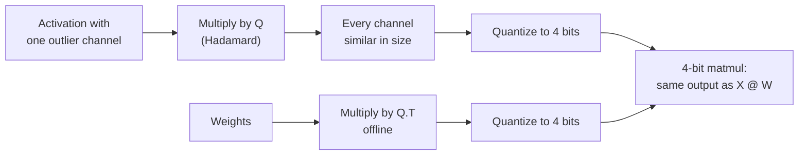

# Урок 15. Повороты

**Связь с целью курса:** Повороты это то, что перевело квантизацию весов и активаций с 8 бит на 4, и теперь они есть среди вариантов в основных инструментах квантизации, поэтому, чтобы оценить заявление о W4A4, нужно знать, что сделал поворот.
**Первоисточник:** [Научная статья: "QuaRot: Outlier-Free 4-Bit Inference in Rotated LLMs", Ashkboos et al., 2024](https://arxiv.org/abs/2404.00456)
**Предварительные требования:** [Урок 14](0014-smoothquant.md), [Поворот](../GLOSSARY.md), [Признак-выброс](../GLOSSARY.md)

## Разминка

1. ▢ SmoothQuant из урока 14 переносил сложность из активаций в веса масштабом по каналам. Каково однострочное тождество, сохраняющее выход неизменным?

<details markdown="1"><summary>Проверка</summary>

`X @ W = (X @ diag(s)^-1) @ (diag(s) @ W)`. Каналы активаций делятся на `s`, а соответствующие строки весов умножаются на него.

</details>

2. ▢ Урок 6 сравнивал масштабы per-tensor и per-group. Что задаёт размер шага при одном масштабе per-tensor и что происходит с обычными значениями, когда одно значение в 60 раз больше остальных?

<details markdown="1"><summary>Проверка</summary>

Размер шага задаёт наибольшее абсолютное значение. Если одно значение в 60 раз больше остальных, шаг так груб, что обычные значения попадают на очень малое число уровней, многие из них на ноль.

</details>

3. ▢ Урок 8 назвал четыре семейства исправления выбросов. К какому семейству относится SmoothQuant и какое охватывает этот урок?

<details markdown="1"><summary>Проверка</summary>

SmoothQuant переносит сложность из активаций в веса. Этот урок охватывает поворот выбросов прочь.

</details>

## Что нужно знать

### Тождество

Квадратная матрица `Q` ортогональна, когда `Q @ Q.T = I`. Вставим её между активациями и весами слоя:

```text
X @ W = (X @ Q) @ (Q.T @ W)
```

Выход не меняется в точной арифметике, точно так же, как с масштабом SmoothQuant. Различие в том, что `Q` делает с активациями. Диагональный масштаб уменьшает один канал. Поворот смешивает каждый канал с каждым другим, так что значение 60 в одном канале становится малым вкладом во все они. У повёрнутого вектора та же длина, но ни одна координата не выделяется, и масштаб per-tensor или per-token больше не задаётся одним выбросом.

### Почему Адамар

У матрицы Адамара элементы +1 и -1, масштабированные на `1 / sqrt(n)`, и она ортогональна. Два свойства делают её обычным выбором:

- Она распределяет один пик совершенно равномерно: вектор, равный нулю везде, кроме одной записи, становится вектором, у которого все записи имеют одинаковую величину.
- Она дешёвая. Размер, равный степени двойки, можно построить рекурсивно, а умножение на неё стоит `n log n` сложений, а не полного матричного произведения.

QuaRot поворачивает входы «с помощью рандомизированных преобразований Адамара» и опирается на то, что называет вычислительной инвариантностью, идею из более ранней работы по прунингу: многие повороты можно офлайн слить в матрицы весов, оставив эквивалентную сеть без признаков-выбросов.

### Куда идут повороты

Не каждый поворот можно свернуть. QuaRot сливает глобальный поворот в веса вокруг остаточного потока и добавляет несколько онлайн-преобразований Адамара, которые выполняются во время инференса:

- одно внутри блока прямого распространения, перед понижающей проекцией, реализованное быстрым ядром и гасимое слиянием матрицы Адамара в веса понижающей проекции;
- повороты запросов и ключей по головам, потому что ротационное позиционное вложение стоит между проекцией и произведением внимания и не позволяет слить поворот в веса. Это же делает KV-кеш пригодным к квантизации.

Результат, по аннотации: все веса, активации и KV-кеш в 4 битах, каждое умножение матриц в 4 битах и ни одного канала, оставленного в более высокой точности. 4-битная Llama 2 70B теряет не более 0,47 перплексии на WikiText-2 и сохраняет 99% своей zero-shot-производительности. В 6 и 8 битах QuaRot сообщает о моделях без потерь с обычным округлением к ближайшему и без калибровочных данных.

### Не все повороты равны

SpinQuant обнаруживает, что «некоторые случайные повороты приводят к гораздо лучшей квантизации, чем другие», с разницей до 13 пунктов в нисходящих zero-shot-задачах на рассуждение, и обучает матрицы поворота, а не рисует их. С 4-битными весами, активациями и KV-кешем на Llama 2 7B он сужает zero-shot-разрыв с полной точностью до 2,9 пункта, а на Llama 3 8B сокращает разрыв, оставленный QuaRot, до 45,1% ([Liu et al., 2024](https://arxiv.org/abs/2405.16406)). Практическое прочтение: результат на основе поворота зависит от того, какой именно поворот, поэтому заявление о W4A4 должно говорить, как он был выбран.



## Практика

1. ▢ Почему вставка `Q` и `Q.T` между активациями и весами слоя оставляет его выход в полной точности неизменным?

<details markdown="1"><summary>Проверка</summary>

Потому что `Q @ Q.T = I` для ортогональной матрицы, так что `(X @ Q) @ (Q.T @ W) = X @ (Q @ Q.T) @ W = X @ W`. Для тождества подходит любая ортогональная матрица; выбор `Q` важен лишь для того, насколько хорошо повёрнутые тензоры квантизуются.

</details>

2. ▢ Предскажите, затем запустите. Предскажите отношение наибольшего значения к среднеквадратичному до и после поворота Адамара и что произойдёт с 4-битной ошибкой.

    ```python
    import numpy as np
    rng = np.random.default_rng(0)
    x = rng.normal(0, 1, 64)            # one token's activations, 64 channels
    x[5] = 60.0                         # one outlier channel

    H = np.array([[1.0]])
    while H.shape[0] < 64:              # Sylvester construction
        H = np.block([[H, H], [H, -H]])
    H /= np.sqrt(64)                    # orthogonal: H @ H.T = I

    def q4(t):                          # symmetric per-tensor int4
        s = np.abs(t).max() / 7
        return np.clip(np.round(t / s), -7, 7) * s

    for name, v in [("original", x), ("rotated ", x @ H)]:
        ratio = np.abs(v).max() / np.sqrt((v ** 2).mean())
        print(name, "max/rms =", round(ratio, 1))
    print("error, original:", round(np.abs(q4(x) - x).mean(), 3))
    print("error, rotated :", round(np.abs(q4(x @ H) @ H.T - x).mean(), 3))
    ```

<details markdown="1"><summary>Подсказка</summary>

Что делает матрица Адамара с вектором, равным нулю везде, кроме одной большой записи? Настоящий вектор это он плюс небольшой шум.

</details>

<details markdown="1"><summary>Проверка</summary>

```text
original max/rms = 7.9
rotated  max/rms = 1.2
error, original: 0.741
error, rotated : 0.326
```

Выброс доминировал в исходном векторе, поэтому его максимум был в восемь раз больше среднеквадратичного, а 4-битный шаг был груб. После поворота пик распределён почти равномерно по всем 64 каналам, максимум близок к среднеквадратичному, а 4-битная ошибка, измеренная после обратного поворота, падает более чем вдвое. Обратите внимание на поворот обратно через `H.T`: в настоящем слое это происходит неявно, потому что веса были умножены на `Q.T`.

</details>

3. ▢ QuaRot сливает большинство поворотов в веса офлайн, но выполняет поворот Адамара по головам над запросами и ключами во время инференса. Почему этот не удаётся слить?

<details markdown="1"><summary>Подсказка</summary>

Посмотрите, что стоит между проекцией ключей и произведением внимания.

</details>

<details markdown="1"><summary>Проверка</summary>

Ротационное позиционное вложение применяется после проекций запросов и ключей и зависит от позиции, поэтому поворот, слитый в веса проекции, применялся бы до него и не коммутировал бы с ним. Поворот должен происходить после позиционного вложения, онлайн, что заодно оставляет ключи в KV-кеше повёрнутыми и более удобными для квантизации.

</details>

4. ▢ Статья сообщает о W4A4 со «случайным поворотом Адамара» и небольшим падением точности на одной модели. Что вывод SpinQuant подсказывает спросить, прежде чем полагаться на этот результат для другой модели?

    - a) Был ли поворот зафиксирован через seed, варьировался или обучался под каждую модель
    - b) Был ли размер Адамара в каждом слое степенью двойки
    - c) Обучалась ли модель с поворотами с самого начала
    - d) Хранились ли активации в fp8 до поворота

<details markdown="1"><summary>Проверка</summary>

**a)** SpinQuant нашёл до 13 пунктов разницы в zero-shot между случайными поворотами, поэтому один случайный выбор на одной модели мало говорит о следующей; обучение поворота сузило разрыв. (b) касается того, как быстро вычисляется поворот, а не того, насколько хорошо он квантизует. (c) неверно, потому что повороты применяются после обучения. (d) не относится к делу: поворот применяется до квантизации в 4 бита.

</details>

## Практика в реальной работе

- [ ] Во фрагменте практики переместите выброс в другой канал и задайте два выброса вместо одного. Предскажите, затем проверьте, остаётся ли отношение max/rms повёрнутого вектора близким к 1.
- [ ] Прочитайте аннотацию и рисунок 1 QuaRot и запишите, какие тензоры оказываются в 4 битах, а какие операции всё ещё выполняются в более высокой точности.
- [ ] Завтра, без заметок, запишите тождество поворота, назовите две причины, по которым матрица Адамара это обычный выбор, и скажите, почему поворот запросов и ключей выполняется онлайн.

## Что почитать дальше

- [Активации и KV-кеш](../reference/activations-and-kv-cache.md)
- [Научная статья: "SpinQuant: LLM Quantization with Learned Rotations", Liu et al., 2024](https://arxiv.org/abs/2405.16406)
- [Ресурсы](../RESOURCES.md)

---

Не доходит? Перечитайте первоисточник в начале: этот урок его сжимает, а при сжатии понимание как раз и теряется. Загляните в [глоссарий](../GLOSSARY.md), если какой-то термин показался скользким.

Если неясен сам урок, а не материал, это дефект: [откройте issue](https://github.com/TokenCemetery/teach/issues).
