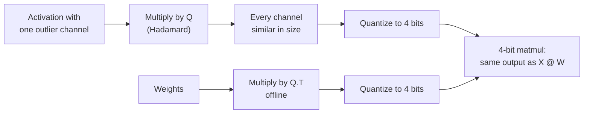

# 第 15 课：旋转

**使命关联:** 旋转让权重加激活值量化从 8 位走到了 4 位，如今它已是主流量化工具里的一个选项，所以要评判一项 W4A4 的声明，就得知道旋转做了什么。
**主要来源:** [论文：“QuaRot: Outlier-Free 4-Bit Inference in Rotated LLMs”，Ashkboos 等，2024](https://arxiv.org/abs/2404.00456)
**前置知识:** [第 14 课](0014-smoothquant.md)、[旋转](../GLOSSARY.md)、[离群特征](../GLOSSARY.md)

## 热身

1. ▢ 第 14 课的 SmoothQuant 用逐通道的缩放因子，把难度从激活值转移到权重上。保持输出不变的那个一行恒等式是什么？

<details markdown="1"><summary>检查</summary>

`X @ W = (X @ diag(s)^-1) @ (diag(s) @ W)`。激活值通道除以 `s`，对应的权重行乘以它。

</details>

2. ▢ 第 6 课比较了逐张量和逐组的缩放因子。只用一个逐张量缩放因子时，什么决定步长？当有一个值是其余值的 60 倍时，普通的值会怎样？

<details markdown="1"><summary>检查</summary>

最大绝对值决定步长。当有一个值是其余的 60 倍时，步长粗到普通的值只落在极少的几个档位上，其中许多落在零上。

</details>

3. ▢ 第 8 课列出了四类离群值修复办法。SmoothQuant 属于哪一类？本课讲的是哪一类？

<details markdown="1"><summary>检查</summary>

SmoothQuant 把难度从激活值迁移到权重上。本课讲的是把离群值旋转掉。

</details>

## 要点

### 恒等式

一个方阵 `Q` 满足 `Q @ Q.T = I` 时是正交的。把它插到一层的激活值和权重之间：

```text
X @ W = (X @ Q) @ (Q.T @ W)
```

在精确算术中输出不变，与 SmoothQuant 的缩放因子完全一样。区别在于 `Q` 对激活值做了什么。对角的缩放因子缩小一个通道。旋转则把每个通道都混进其他每个通道，所以一个通道里的 60 变成对所有通道的一点点贡献。旋转后的向量长度不变，但没有哪个坐标特别突出，逐张量或逐 token 的缩放因子不再由某一个离群值决定。

### 为什么用哈达玛

哈达玛矩阵的元素是 +1 和 -1，再乘以 `1 / sqrt(n)`，它是正交的。有两条性质使它成为常见的选择：

- 它把单个尖峰分散得完全均匀：一个只有一个元素非零的向量，变成了所有元素幅值都相同的向量。
- 它很便宜。大小为 2 的幂时可以递归地构造，乘以它只需要 `n log n` 次加法，而不是一次完整的矩阵乘法。

QuaRot “使用随机化的哈达玛变换”来旋转输入，并依靠它所说的计算不变性，这是来自早期剪枝工作的思路：许多旋转可以离线融合进权重矩阵，留下一个没有离群特征的等价网络。

### 旋转放在哪里

并不是每一个旋转都能折叠掉。QuaRot 把一个全局旋转融合进残差流周围的权重里，另外加了几个在推理时在线运行的哈达玛变换：

- 一个在前馈块内部，位于下投影之前，用一个快速内核实现，并通过把一个哈达玛矩阵融合进下投影的权重来抵消；
- 对查询和键做逐头的旋转，因为旋转位置嵌入位于投影和注意力乘积之间，使旋转无法融合进权重。这也正是让 KV 缓存可以量化的原因。

摘要中给出的结果是：所有权重、激活值和 KV 缓存都是 4 位，每一次矩阵乘法都是 4 位，没有任何通道保留在更高精度。4 位的 Llama 2 70B 在 WikiText-2 上最多损失 0.47 的困惑度，并保留 99% 的零样本性能。在 6 位和 8 位时，QuaRot 报告说，用普通的就近舍入，不用校准数据，模型就是无损的。

### 并非每个旋转都一样

SpinQuant 发现，“有些随机旋转带来的量化效果比另一些好得多”，在下游零样本推理上最多相差 13 个点，于是它学习旋转矩阵，而不是随机抽取。在 Llama 2 7B 上，权重、激活值和 KV 缓存都用 4 位时，它把与全精度的零样本差距缩小到 2.9 个点，在 Llama 3 8B 上，它把 QuaRot 留下的差距最多缩小了 45.1%（[Liu 等，2024](https://arxiv.org/abs/2405.16406)）。实际的解读是：基于旋转的结果取决于用的是哪一个旋转，所以一项 W4A4 的声明应当说明它是怎么选定的。



## 练习

1. ▢ 为什么在一层的激活值和权重之间插入 `Q` 和 `Q.T`，不会改变它的全精度输出？

<details markdown="1"><summary>检查</summary>

因为对正交矩阵有 `Q @ Q.T = I`，所以 `(X @ Q) @ (Q.T @ W) = X @ (Q @ Q.T) @ W = X @ W`。任何正交矩阵都满足这个恒等式；`Q` 的选择只关系到旋转后的张量量化得好不好。

</details>

2. ▢ 先预测，再运行。预测哈达玛旋转前后，最大值与均方根值之比，以及 4 位误差会怎样。

    ```python
    import numpy as np
    rng = np.random.default_rng(0)
    x = rng.normal(0, 1, 64)            # one token's activations, 64 channels
    x[5] = 60.0                         # one outlier channel

    H = np.array([[1.0]])
    while H.shape[0] < 64:              # Sylvester construction
        H = np.block([[H, H], [H, -H]])
    H /= np.sqrt(64)                    # orthogonal: H @ H.T = I

    def q4(t):                          # symmetric per-tensor int4
        s = np.abs(t).max() / 7
        return np.clip(np.round(t / s), -7, 7) * s

    for name, v in [("original", x), ("rotated ", x @ H)]:
        ratio = np.abs(v).max() / np.sqrt((v ** 2).mean())
        print(name, "max/rms =", round(ratio, 1))
    print("error, original:", round(np.abs(q4(x) - x).mean(), 3))
    print("error, rotated :", round(np.abs(q4(x @ H) @ H.T - x).mean(), 3))
    ```

<details markdown="1"><summary>提示</summary>

哈达玛矩阵对一个除了一个大元素之外处处为零的向量做了什么？真实的向量就是它再加上小的噪声。

</details>

<details markdown="1"><summary>检查</summary>

```text
original max/rms = 7.9
rotated  max/rms = 1.2
error, original: 0.741
error, rotated : 0.326
```

离群值主导了原来的向量，所以它的最大值是均方根的八倍，4 位的步长很粗。旋转之后，尖峰几乎均匀地分散到全部 64 个通道上，最大值接近均方根，4 位误差（旋转回来之后度量）降到了一半以下。请注意用 `H.T` 旋转回来这一步：在真实的层里，这是隐含完成的，因为权重已经乘过 `Q.T`。

</details>

3. ▢ QuaRot 把大部分旋转离线融合进权重，却在推理时对查询和键运行逐头的哈达玛变换。为什么那一个不能融合？

<details markdown="1"><summary>提示</summary>

看看键投影和注意力乘积之间有什么东西。

</details>

<details markdown="1"><summary>检查</summary>

旋转位置嵌入是在查询和键的投影之后应用的，并且取决于位置，所以融合进投影权重的旋转会在它之前应用，并且与它不可交换。旋转必须发生在位置嵌入之后，也就是在线进行，这也让 KV 缓存里的键处于旋转后的状态，更容易量化。

</details>

4. ▢ 一篇论文报告用“随机哈达玛旋转”做 W4A4，在一个模型上精度下降很小。在把这个结果用到另一个模型之前，SpinQuant 的发现提示你该先问什么？

    - a) 旋转是设了种子、有变化，还是针对每个模型学出来的
    - b) 每一层的哈达玛大小是否都是 2 的幂
    - c) 模型是否从一开始就是带着旋转训练的
    - d) 激活值在旋转之前是否存成了 fp8

<details markdown="1"><summary>检查</summary>

**a)** SpinQuant 发现不同的随机旋转之间，零样本相差多达 13 个点，所以在一个模型上的一次随机抽取，对下一个模型说明不了多少；学习旋转缩小了这个差距。(b) 关系到旋转怎样算得快，而不是它量化得好不好。(c) 是错的，因为旋转是在训练后应用的。(d) 无关：旋转是在量化到 4 位之前应用的。

</details>

## 实战练习

- [ ] 在练习代码片段中，把离群值换到另一个通道，并设两个离群值而不是一个。预测并检查旋转后的最大值与均方根之比是否仍然接近 1。
- [ ] 阅读 QuaRot 的摘要和图 1，写下哪些张量最终是 4 位，哪些运算仍然以更高精度运行。
- [ ] 明天：不看笔记，写出旋转恒等式，说出哈达玛矩阵成为常见选择的两个原因，并说明为什么查询和键的旋转是在线运行的。

## 延伸阅读

- [激活值与 KV 缓存](../reference/activations-and-kv-cache.md)
- [论文：“SpinQuant: LLM Quantization with Learned Rotations”，Liu 等，2024](https://arxiv.org/abs/2405.16406)
- [资源](../RESOURCES.md)

---

没学明白？请重读顶部的主要来源，因为本课是对它的压缩，而理解正是在压缩中流失的。如果有哪个术语觉得含糊，可以查看[术语表](../GLOSSARY.md)。

如果问题出在课程本身，而不是学习材料，那就是一个缺陷：[提交 issue](https://github.com/TokenCemetery/teach/issues)。
