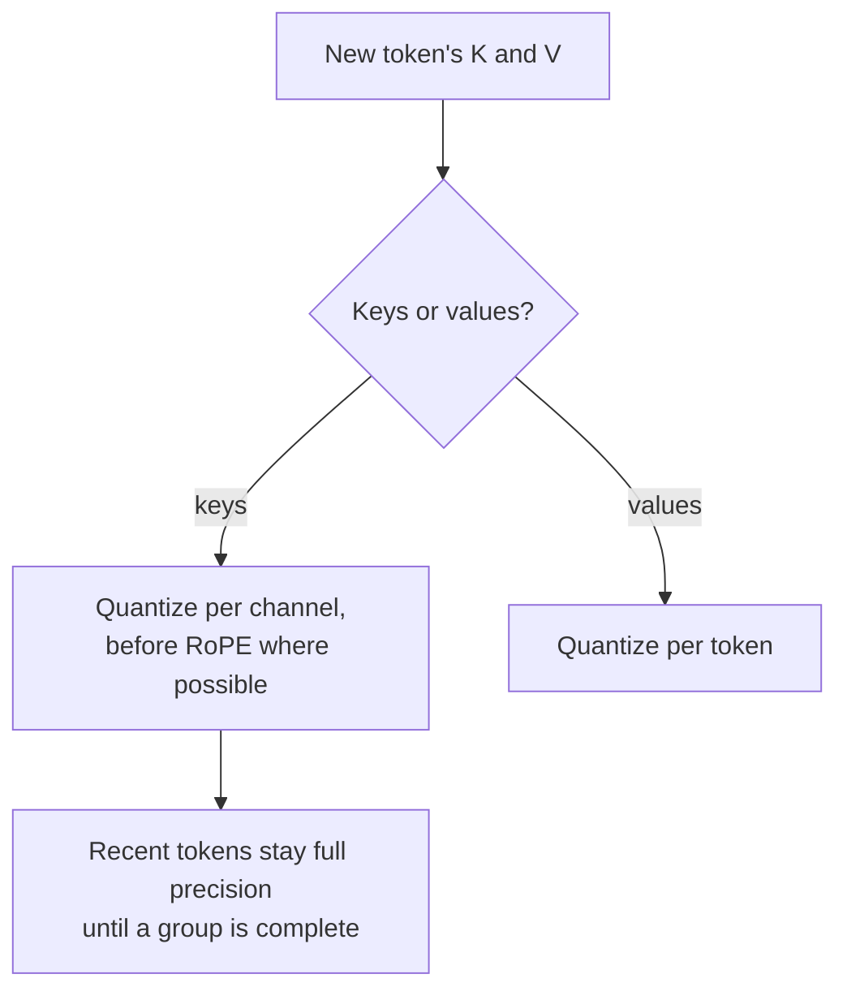

# Lección 16. Cuantización de la KV cache

**Vínculo con la misión:** Con contexto largo y lote grande, la KV cache, y no los pesos, decide cuántas solicitudes caben en una GPU, así que a menudo es lo siguiente que vale la pena cuantizar una vez hechos los pesos.
**Fuente principal:** [Paper: "KIVI: A Tuning-Free Asymmetric 2bit Quantization for KV Cache", Liu et al., 2024](https://arxiv.org/abs/2402.02750)
**Requisitos previos:** [Lección 15](0015-rotations.md), [Cuantización de la KV cache](../GLOSSARY.md), [Granularidad](../GLOSSARY.md)

## Calentamiento

1. ▢ La lección 1 dijo que cuantizar los pesos deja intacto a un gran consumidor de memoria. ¿Cuál, y con qué crece su tamaño?

<details markdown="1"><summary>Comprobación</summary>

La KV cache. Crece con la longitud del contexto y el tamaño de lote, así que con contexto largo o lote grande puede pesar más que los pesos.

</details>

2. ▢ La lección 13 encontró que un scale por token no puede aislar un canal outlier que aparece en todos los tokens. ¿Por qué no?

<details markdown="1"><summary>Comprobación</summary>

El scale de cada token lo fija el mayor valor de ese token, que es el canal outlier en todas las filas. Los canales ordinarios reciben pasos gruesos en todos los tokens.

</details>

3. ▢ La lección 15 rotó las queries y las keys online en lugar de en los pesos. ¿Qué lo impedía?

<details markdown="1"><summary>Comprobación</summary>

El rotary position embedding, que se aplica tras la proyección de las keys y depende de la posición, así que una rotación fusionada en los pesos vendría antes de él.

</details>

## Qué debes saber

### Cuán grande se hace la caché

Cada token generado almacena un vector key y un vector value por cada capa y cada cabeza KV. Por token:

```text
KV bytes per token = 2 x layers x kv_heads x head_dim x bytes_per_value
```

Llama 3 8B tiene 32 capas y 8 cabezas KV de dimensión 128 (según su `config.json`). En bf16 son 2 x 32 x 8 x 128 x 2 bytes = 131,072 bytes, 128 KiB por token. Una secuencia de 32,768 tokens guarda 4 GiB de caché; 16 de ellas guardan 64 GiB, cuatro veces los 16 GB de pesos del modelo en bf16. Reducir a la mitad los bytes por valor reduce eso a la mitad, y cada byte ahorrado es espacio para más secuencias o para secuencias más largas. El resumen de KIVI hace la misma observación: con lotes más grandes y contextos más largos, la KV cache "se convierte en el nuevo cuello de botella de velocidad y de uso de memoria".

La hoja [KV cache](../../inference/reference/kv-cache.md) cubre cómo un motor de servicio pagina y comparte esta memoria. Esta lección trata de almacenarla en menos bits.

### Keys por canal, values por token

KIVI estudió la distribución de las keys y los values en caché y encontró que necesitan ejes distintos:

- Las **keys** tienen unos pocos canales fijos con magnitudes muy grandes, el mismo patrón que los outliers de activaciones de la lección 7. Cuantizar **por canal**, agrupando los valores de un canal a lo largo de los tokens, confina el error de cada canal outlier a ese canal.
- Los **values** no muestran un patrón consistente de outliers, y son lo que promedian los pesos de atención. Medido sobre la salida de atención, KIVI informa de un error de cuantización por token casi 15 veces menor que por canal. Así que los values se cuantizan **por token**.

El agrupamiento por canal para las keys necesita que exista un grupo de tokens antes de poder cuantizarse. Por eso KIVI mantiene los tokens más recientes en precisión completa como residual (128 tokens en sus experimentos, con grupos de 32) y los cuantiza una vez acumulado un grupo completo. Con keys y values ambos a 2 bits, KIVI mantiene los modelos Llama, Falcon y Mistral con casi la misma calidad usando 2.6 veces menos memoria máxima, incluidos los pesos, lo que permite lotes de hasta 4 veces mayores y de 2.35 a 3.47 veces el throughput.

### Antes o después del position embedding

KVQuant añade un refinamiento para las keys: cuantizarlas **antes** de aplicar el rotary position embedding, porque la rotación mezcla los pares de canales y difumina el patrón por canal. Con keys por canal y pre-RoPE, tipos de datos no uniformes y manejo de outliers por vector, informa de menos de 0.1 de degradación de perplexity a 3 bits en WikiText-2 y C4, y de servir LLaMA-7B con un contexto de hasta un millón de tokens en una A100 de 80 GB ([Hooper et al., 2024](https://arxiv.org/abs/2401.18079)).

### Qué suelen ofrecer los motores de servicio

Los métodos de investigación llegan a 2 o 3 bits. Lo que un motor de servicio suele exponer es una caché de 8 bits. vLLM, por ejemplo, documenta una KV cache en fp8 con un scale por tensor o uno por cabeza de atención. Sin calibración sus scales valen 1.0 por defecto, y recomienda estimarlos a partir de un dataset de calibración con llm-compressor ([documentación de vLLM](https://docs.vllm.ai/en/latest/features/quantization/quantized_kvcache/)). Un scale de 1.0 solo es seguro cuando los valores en caché ya caben en el rango de fp8, que es el tipo de suposición que una revisión debería comprobar.



## Práctica

1. ▢ Un modelo tiene 40 capas, 8 cabezas KV de dimensión 128 y sirve secuencias de 8,192 tokens en bf16. ¿Cuánta KV cache ocupa una secuencia, y cuánta con una caché de 8 bits?

<details markdown="1"><summary>Comprobación</summary>

Por token: 2 x 40 x 8 x 128 x 2 bytes = 163,840 bytes, 160 KiB. Para 8,192 tokens: 1,310,720 KiB, que son 1.25 GiB. Con un byte por valor es la mitad: 0.625 GiB, más una pequeña cantidad para los scales. Olvidar el factor 2 de keys y values es el despiste habitual.

</details>

2. ▢ ¿Por qué KIVI cuantiza las keys por canal pero los values por token?

<details markdown="1"><summary>Comprobación</summary>

Las keys tienen unos pocos canales outlier fijos, así que un scale por canal mantiene el error de cada outlier dentro de su propio canal, la misma razón por la que los pesos reciben scales por canal. Los values no tienen ese patrón, y la cuantización por token dio casi 15 veces menos error en la salida de atención, así que cada token recibe su propio scale.

</details>

3. ▢ Predice. KIVI mantiene los tokens más recientes de la caché de keys en precisión completa. Predice por qué un esquema por canal no puede cuantizar de inmediato el token más nuevo, como sí puede uno por token.

<details markdown="1"><summary>Pista</summary>

Por canal significa un scale para un canal a lo largo de un grupo de tokens. ¿Cuántos tokens contiene el grupo cuando llega el más nuevo?

</details>

<details markdown="1"><summary>Comprobación</summary>

Un grupo por canal abarca varios tokens, y su scale depende de todos ellos, así que solo puede calcularse cuando el grupo está lleno. Un scale por token depende solo del propio token. KIVI mantiene el grupo incompleto, hasta su longitud residual, en precisión completa y lo cuantiza una vez completo.

</details>

4. ▢ Un equipo activa una KV cache de 8 bits en su motor de servicio sin calibración, y las respuestas de contexto largo empeoran mientras que las cortas parecen bien. ¿Qué explicación encaja mejor con lo que enseñó esta lección?

    - a) Los scales por defecto recortan los valores en caché que superan el rango del formato
    - b) Una caché de 8 bits almacena solo el bloque de tokens más reciente
    - c) Cuantizar la caché cuantiza también los pesos a ocho bits
    - d) El motor descarta los tokens residuales cuando el contexto se alarga

<details markdown="1"><summary>Comprobación</summary>

**a)** Los scales sin calibrar de 1.0 suponen que las keys y los values en caché caben en el formato; los valores fuera de ese rango se recortan o se desbordan, y un contexto largo da más tokens, y más oportunidades, para que ese error se acumule en la atención. Calibrar los scales es la solución documentada. (b) es incorrecta porque la caché sigue almacenando todos los tokens, solo que en menos bits. (c) confunde la KV cache con los pesos. (d) no describe ningún mecanismo real: los tokens residuales en precisión completa son un diseño de KIVI, no algo que un motor descarte.

</details>

## Prácticas en el mundo real

- [ ] Abre el `config.json` de un modelo que uses, encuentra su número de capas, su número de cabezas KV y su dimensión de cabeza, y calcula su KV cache por token y para tu solicitud típica más larga.
- [ ] Lee la página de KV cache cuantizada de vLLM y anota qué granularidades de scale soporta y qué recomienda para la calibración.
- [ ] Mañana: sin apuntes, escribe la fórmula del tamaño de la KV cache y explica a lo largo de qué eje se cuantizan las keys y los values, y por qué.

## Para profundizar

- [Activaciones y KV cache](../reference/activations-and-kv-cache.md)
- Inferencia: [KV cache](../../inference/reference/kv-cache.md), para ver cómo un motor de servicio asigna y comparte la caché
- [Paper: "KVQuant: Towards 10 Million Context Length LLM Inference with KV Cache Quantization", Hooper et al., 2024](https://arxiv.org/abs/2401.18079)
- [Recursos](../RESOURCES.md)

---

¿No termina de quedar claro? Vuelve a leer la fuente primaria de arriba, ya que esta lección la comprime y en la compresión es donde se escapa la comprensión. Consulta el [glosario](../GLOSSARY.md) por si algún término te resultó resbaladizo.

Si lo poco claro es la propia lección y no el material, eso es un defecto: [abre un issue](https://github.com/TokenCemetery/teach/issues).
