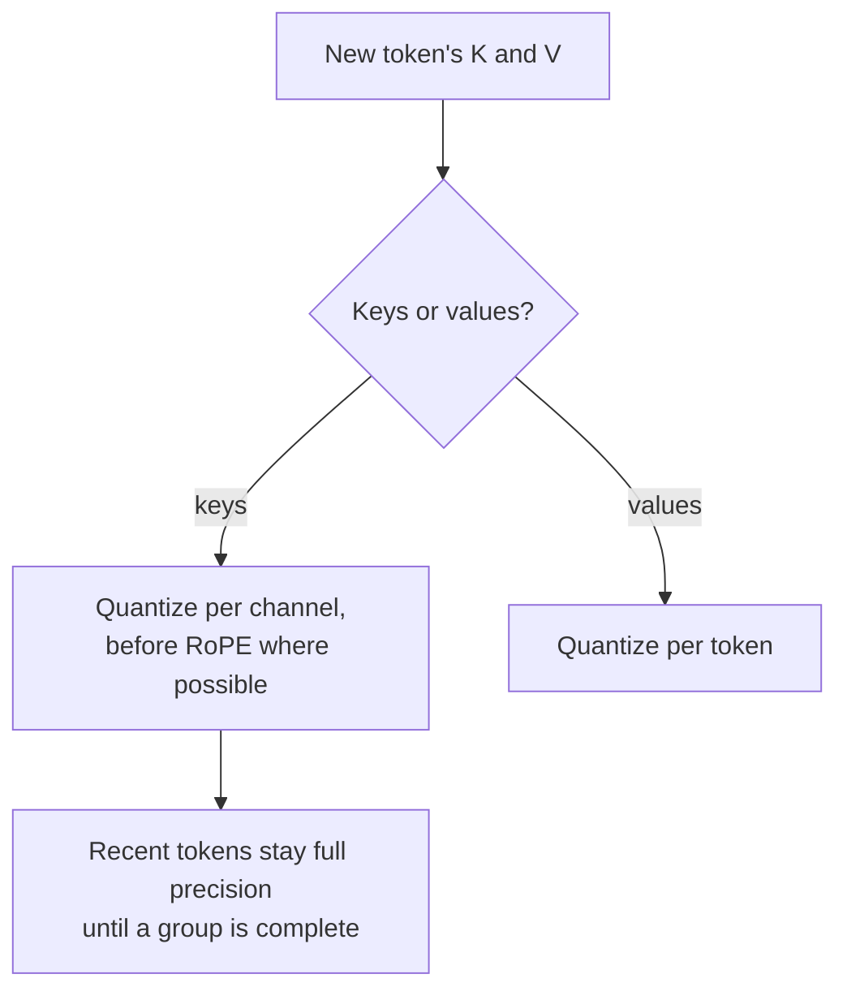

# Leçon 16. Quantification du KV cache

**Lien avec la mission :** À contexte long et à grand batch, c'est le KV cache, et pas les poids, qui décide du nombre de requêtes qui tiennent sur un GPU, donc c'est souvent la prochaine chose à quantifier une fois les poids faits.
**Source primaire :** [Article : "KIVI: A Tuning-Free Asymmetric 2bit Quantization for KV Cache", Liu et al., 2024](https://arxiv.org/abs/2402.02750)
**Prérequis :** [Leçon 15](0015-rotations.md), [Quantification du KV cache](../GLOSSARY.md), [Granularité](../GLOSSARY.md)

## Échauffement

1. ▢ La leçon 1 disait que quantifier les poids laisse intact un gros consommateur de mémoire. Lequel, et avec quoi sa taille croît-elle ?

<details markdown="1"><summary>Vérifier</summary>

Le KV cache. Il croît avec la longueur de contexte et la taille de batch, donc à contexte long ou à grand batch il peut peser plus que les poids.

</details>

2. ▢ La leçon 13 a constaté qu'un scale par token ne peut pas isoler un canal outlier qui apparaît dans chaque token. Pourquoi pas ?

<details markdown="1"><summary>Vérifier</summary>

Le scale de chaque token est fixé par la plus grande valeur de ce token, qui est le canal outlier dans chaque ligne. Les canaux ordinaires reçoivent des pas grossiers dans chaque token.

</details>

3. ▢ La leçon 15 a fait pivoter les requêtes et les clés en ligne plutôt que dans les poids. Qu'est-ce qui gênait ?

<details markdown="1"><summary>Vérifier</summary>

L'embedding de position rotatif, appliqué après la projection des clés et dépendant de la position, donc une rotation fusionnée dans les poids viendrait avant lui.

</details>

## À savoir

### À quelle taille le cache monte

Chaque token généré stocke un vecteur de clé et un vecteur de valeur pour chaque couche et chaque tête KV. Par token :

```text
KV bytes per token = 2 x layers x kv_heads x head_dim x bytes_per_value
```

Llama 3 8B a 32 couches et 8 têtes KV de dimension 128 (d'après son `config.json`). En bf16, cela fait 2 x 32 x 8 x 128 x 2 octets = 131,072 octets, soit 128 KiB par token. Une séquence de 32,768 tokens contient 4 GiB de cache ; 16 d'entre elles en contiennent 64 GiB, quatre fois les 16 GB de poids en bf16 du modèle. Diviser par deux les octets par valeur divise cela par deux, et chaque octet économisé est de la place pour plus de séquences ou des séquences plus longues. Le résumé de KIVI fait la même remarque : avec des batchs plus grands et des contextes plus longs, le KV cache « devient le nouveau goulot d'étranglement en vitesse et en mémoire ».

La fiche [KV cache](../../inference/reference/kv-cache.md) de l'inférence couvre la façon dont un moteur de serving pagine et partage cette mémoire. Cette leçon porte sur son stockage en moins de bits.

### Clés par canal, valeurs par token

KIVI a étudié la distribution des clés et des valeurs en cache et a trouvé qu'elles demandent des axes différents :

- Les **clés** ont quelques canaux fixes de très grande grandeur, le même motif que les outliers d'activation de la leçon 7. Quantifier **par canal**, en regroupant les valeurs d'un canal sur plusieurs tokens, confine l'erreur de chaque canal outlier à ce canal.
- Les **valeurs** ne montrent aucun motif d'outlier cohérent, et ce sont elles que les poids d'attention moyennent. Mesurée sur la sortie de l'attention, KIVI rapporte une erreur de quantification par token presque 15 fois plus petite que par canal. Donc les valeurs sont quantifiées **par token**.

Le regroupement par canal pour les clés exige qu'un groupe de tokens existe avant de pouvoir être quantifié. KIVI garde donc les tokens les plus récents en pleine précision comme résidu (128 tokens dans ses expériences, avec des groupes de 32) et les quantifie une fois qu'un groupe complet s'est accumulé. Avec les clés et les valeurs toutes deux en 2 bits, KIVI garde des modèles Llama, Falcon et Mistral à presque la même qualité en utilisant 2.6 fois moins de mémoire de pointe, poids compris, ce qui permet des batchs jusqu'à 4 fois plus grands et un débit de 2.35 à 3.47 fois supérieur.

### Avant ou après l'embedding de position

KVQuant ajoute un raffinement pour les clés : les quantifier **avant** l'application de l'embedding de position rotatif, parce que la rotation mélange les paires de canaux et brouille le motif par canal. Avec des clés par canal avant RoPE, des types de données non uniformes et un traitement des outliers par vecteur, il rapporte moins de 0.1 de dégradation de perplexity en 3 bits sur WikiText-2 et C4, et le serving de LLaMA-7B avec un contexte allant jusqu'à un million de tokens sur un seul A100 de 80 GB ([Hooper et al., 2024](https://arxiv.org/abs/2401.18079)).

### Ce qu'offrent d'ordinaire les moteurs de serving

Les méthodes de recherche vont à 2 ou 3 bits. Ce qu'un moteur de serving expose couramment, c'est un cache en 8 bits. vLLM, par exemple, documente un KV cache en fp8 avec soit un scale par tenseur, soit un par tête d'attention. Sans calibration, ses scales valent 1.0 par défaut, et il recommande de les estimer à partir d'un jeu de données de calibration avec llm-compressor ([docs de vLLM](https://docs.vllm.ai/en/latest/features/quantization/quantized_kvcache/)). Un scale de 1.0 n'est sûr que si les valeurs en cache tiennent déjà dans la plage du fp8, le genre d'hypothèse qu'une relecture doit vérifier.



## Pratique

1. ▢ Un modèle a 40 couches, 8 têtes KV de dimension 128, et sert des séquences de 8,192 tokens en bf16. Combien de KV cache une séquence prend-elle, et combien avec un cache en 8 bits ?

<details markdown="1"><summary>Vérifier</summary>

Par token : 2 x 40 x 8 x 128 x 2 octets = 163,840 octets, soit 160 KiB. Pour 8,192 tokens : 1,310,720 KiB, soit 1.25 GiB. Avec un octet par valeur, c'est la moitié : 0.625 GiB, plus un peu pour les scales. Oublier le facteur 2 des clés et des valeurs est le lapsus habituel.

</details>

2. ▢ Pourquoi KIVI quantifie-t-il les clés par canal mais les valeurs par token ?

<details markdown="1"><summary>Vérifier</summary>

Les clés ont quelques canaux outlier fixes, donc un scale par canal garde l'erreur de chaque outlier à l'intérieur de son propre canal, pour la même raison que les poids reçoivent des scales par canal. Les valeurs n'ont pas un tel motif, et la quantification par token a donné presque 15 fois moins d'erreur sur la sortie de l'attention, donc chaque token reçoit son propre scale.

</details>

3. ▢ Prédisez. KIVI garde les tokens les plus récents du cache de clés en pleine précision. Prédisez pourquoi un schéma par canal ne peut pas quantifier immédiatement le token le plus récent, comme le peut un schéma par token.

<details markdown="1"><summary>Indice</summary>

Par canal signifie un scale pour un canal sur un groupe de tokens. Combien de tokens le groupe contient-il quand le plus récent arrive ?

</details>

<details markdown="1"><summary>Vérifier</summary>

Un groupe par canal couvre plusieurs tokens, et son scale dépend de tous, donc il ne peut être calculé qu'une fois le groupe plein. Un scale par token ne dépend que du token lui-même. KIVI garde le groupe incomplet, jusqu'à sa longueur de résidu, en pleine précision et le quantifie une fois complet.

</details>

4. ▢ Une équipe active un KV cache en 8 bits dans son moteur de serving sans calibration, et les réponses à contexte long se dégradent tandis que les courtes semblent correctes. Quelle explication s'accorde le mieux avec ce qu'a enseigné cette leçon ?

    - a) Les scales par défaut écrêtent les valeurs en cache qui dépassent la plage du format
    - b) Un cache en 8 bits ne stocke que le bloc de tokens le plus récent
    - c) Quantifier le cache quantifie aussi les poids en huit bits
    - d) Le moteur abandonne les tokens résiduels quand le contexte devient long

<details markdown="1"><summary>Vérifier</summary>

**a)** Des scales non calibrés de 1.0 supposent que les clés et valeurs en cache tiennent dans le format ; les valeurs hors de cette plage sont écrêtées ou débordent, et un contexte long donne plus de tokens, et plus d'occasions, pour que cette erreur s'accumule dans l'attention. Calibrer les scales est le remède documenté. (b) est faux parce que le cache stocke toujours chaque token, simplement en moins de bits. (c) confond le KV cache avec les poids. (d) ne décrit aucun mécanisme réel : les tokens résiduels en pleine précision sont une conception de KIVI, pas quelque chose qu'un moteur abandonne.

</details>

## Exercices en situation réelle

- [ ] Ouvrez le `config.json` d'un modèle que vous utilisez, trouvez son nombre de couches, son nombre de têtes KV et sa dimension de tête, et calculez son KV cache par token et pour votre plus longue requête typique.
- [ ] Lisez la page vLLM sur le KV cache quantifié et notez quelles granularités de scale elle prend en charge et ce qu'elle recommande pour la calibration.
- [ ] Demain : sans notes, écrivez la formule de la taille du KV cache et expliquez selon quel axe les clés et les valeurs sont chacune quantifiées, et pourquoi.

## Pour aller plus loin

- [Activations et KV cache](../reference/activations-and-kv-cache.md)
- Inférence : [KV cache](../../inference/reference/kv-cache.md), pour voir comment un moteur de serving alloue et partage le cache
- [Article : "KVQuant: Towards 10 Million Context Length LLM Inference with KV Cache Quantization", Hooper et al., 2024](https://arxiv.org/abs/2401.18079)
- [Ressources](../RESOURCES.md)

---

Ça ne passe pas ? Relisez la source primaire en haut de page, car cette leçon la condense et c'est dans la condensation que la compréhension s'échappe. Consultez le [glossaire](../GLOSSARY.md) pour tout terme qui vous a paru glissant.

Si c'est la leçon elle-même qui n'est pas claire plutôt que la matière, c'est un défaut : [ouvrez une issue](https://github.com/TokenCemetery/teach/issues).
