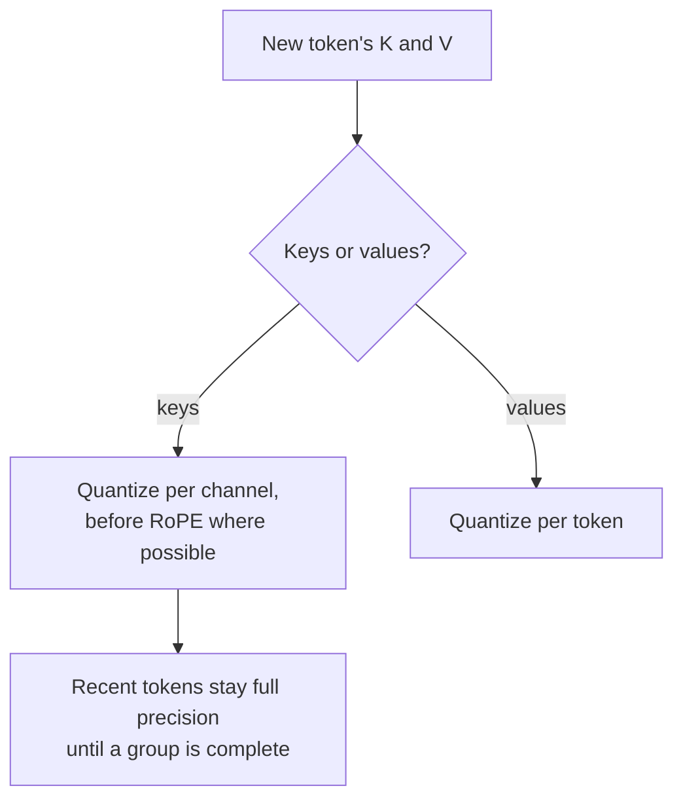

# पाठ 16. KV-Cache Quantization

**मिशन से संबंध:** लंबे context और बड़े batch पर weights नहीं बल्कि KV cache तय करता है कि GPU पर कितने requests समाते हैं, इसलिए weights हो जाने के बाद अक्सर यही अगली चीज़ है जिसे quantize करना सार्थक है।
**मुख्य स्रोत:** [पेपर: "KIVI: A Tuning-Free Asymmetric 2bit Quantization for KV Cache", Liu et al., 2024](https://arxiv.org/abs/2402.02750)
**पूर्व-आवश्यकताएँ:** [पाठ 15](0015-rotations.md), [KV-cache quantization](../GLOSSARY.md), [Granularity](../GLOSSARY.md)

## वार्म-अप

1. ▢ पाठ 1 ने कहा था कि weights को quantize करने से memory का एक बड़ा उपभोक्ता अछूता रहता है। कौन-सा, और उसका आकार किसके साथ बढ़ता है?

<details markdown="1"><summary>जाँचें</summary>

KV cache। वह context length और batch size के साथ बढ़ता है, इसलिए लंबे context या बड़े batch पर वह weights से ज़्यादा भारी हो सकता है।

</details>

2. ▢ पाठ 13 ने पाया कि per-token scale उस outlier channel को अलग नहीं कर सकता जो हर token में दिखता है। क्यों नहीं?

<details markdown="1"><summary>जाँचें</summary>

हर token का scale उस token की सबसे बड़ी value से तय होता है, जो हर row में outlier channel है। सामान्य channels को हर token में मोटे steps मिलते हैं।

</details>

3. ▢ पाठ 15 ने queries और keys को weights में नहीं बल्कि online rotate किया था। रास्ते में क्या अड़चन थी?

<details markdown="1"><summary>जाँचें</summary>

Rotary position embedding, जो key projection के बाद लगता है और position पर निर्भर करता है, इसलिए weights में मिलाया गया rotation उससे पहले आता।

</details>

## यह जानें

### Cache कितना बड़ा हो जाता है

हर generate हुआ token हर layer और हर KV head के लिए एक key और एक value vector store करता है। प्रति token:

```text
KV bytes per token = 2 x layers x kv_heads x head_dim x bytes_per_value
```

Llama 3 8B में 32 layers और dimension 128 वाले 8 KV heads हैं (उसके `config.json` से)। bf16 में वह 2 x 32 x 8 x 128 x 2 bytes = 131,072 bytes है, यानी प्रति token 128 KiB। 32,768 tokens की एक sequence 4 GiB cache रखती है; ऐसी 16 sequences 64 GiB रखती हैं, जो model के bf16 weights के 16 GB का चार गुना है। प्रति value bytes आधे करने से वह आधा हो जाता है, और बचाया गया हर byte ज़्यादा sequences या लंबी sequences के लिए जगह है। KIVI का abstract यही बात कहता है: बड़े batches और लंबे contexts के साथ, KV cache "speed और memory के इस्तेमाल में नई अड़चन बन जाता है"।

[Inference KV Cache शीट](../../inference/reference/kv-cache.md) बताती है कि serving engine इस memory को कैसे page और साझा करता है। यह पाठ उसे कम bits में store करने के बारे में है।

### Keys per channel, values per token

KIVI ने cache किए गए keys और values का distribution पढ़ा और पाया कि उन्हें अलग axes चाहिए:

- **Keys** में कुछ तय channels की magnitude बहुत बड़ी होती है, वही pattern जो पाठ 7 के activation outliers का है। **Per channel** quantize करना, यानी tokens के पार एक channel की values को group करना, हर outlier channel की error को उसी channel तक सीमित रखता है।
- **Values** में कोई एकसार outlier pattern नहीं दिखता, और attention weights उन्हीं का औसत लेते हैं। Attention output पर मापने पर, KIVI per-token quantization error को per-channel से लगभग 15 गुना छोटा बताता है। इसलिए values को **per token** quantize किया जाता है।

Keys के लिए per-channel grouping को quantize होने से पहले tokens के एक group का मौजूद होना चाहिए। इसलिए KIVI सबसे हाल के tokens को residual के रूप में full precision में रखता है (उसके experiments में 128 tokens, 32 के groups के साथ) और जब पूरा group जमा हो जाए तब उन्हें quantize करता है। Keys और values दोनों 2 bits पर, KIVI Llama, Falcon और Mistral models को लगभग उतनी ही quality पर रखता है जबकि weights समेत 2.6 गुना कम peak memory इस्तेमाल करता है, जिससे 4 गुना तक बड़े batches और 2.35 से 3.47 गुना throughput संभव है।

### Position embedding से पहले या बाद

KVQuant keys के लिए एक सुधार जोड़ता है: उन्हें rotary position embedding लगने से **पहले** quantize करें, क्योंकि rotation channel जोड़ों को मिला देता है और per-channel pattern को धुँधला कर देता है। Per-channel, pre-RoPE keys, non-uniform data types और per-vector outlier handling के साथ, वह WikiText-2 और C4 पर 3 bits पर 0.1 से कम perplexity गिरावट, और एक 80 GB A100 पर एक million tokens तक के context के साथ LLaMA-7B की serving बताता है ([Hooper et al., 2024](https://arxiv.org/abs/2401.18079))।

### Serving engines आम तौर पर क्या देते हैं

Research methods 2 या 3 bits तक जाते हैं। Serving engine जो आम तौर पर देता है वह 8-bit cache है। उदाहरण के लिए vLLM fp8 KV cache को documented करता है, जिसमें या तो प्रति tensor एक scale होता है या प्रति attention head एक। Calibration के बिना उसके scales default रूप से 1.0 होते हैं, और वह उन्हें llm-compressor से calibration dataset पर अनुमानित करने की सिफ़ारिश करता है ([vLLM दस्तावेज़](https://docs.vllm.ai/en/latest/features/quantization/quantized_kvcache/))। 1.0 का scale तभी सुरक्षित है जब cache की values पहले से fp8 की range में आती हों, जो वैसी धारणा है जिसे समीक्षा को जाँचना चाहिए।



## अभ्यास

1. ▢ किसी model में 40 layers हैं, dimension 128 वाले 8 KV heads हैं, और वह bf16 में 8,192 tokens की sequences serve करता है। एक sequence कितना KV cache लेती है, और 8-bit cache के साथ कितना?

<details markdown="1"><summary>जाँचें</summary>

प्रति token: 2 x 40 x 8 x 128 x 2 bytes = 163,840 bytes, यानी 160 KiB। 8,192 tokens के लिए: 1,310,720 KiB, जो 1.25 GiB है। प्रति value एक byte के साथ वह आधा है: 0.625 GiB, और scales के लिए थोड़ा-सा और। Keys और values के लिए 2 का गुणक भूल जाना आम चूक है।

</details>

2. ▢ KIVI keys को per channel पर values को per token क्यों quantize करता है?

<details markdown="1"><summary>जाँचें</summary>

Keys में कुछ तय outlier channels हैं, इसलिए हर channel का scale हर outlier की error को उसके अपने channel के भीतर रखता है, वही कारण जिससे weights को per-channel scales मिलते हैं। Values में ऐसा कोई pattern नहीं है, और per-token quantization ने attention output पर लगभग 15 गुना कम error दी, इसलिए हर token को अपना scale मिलता है।

</details>

3. ▢ अनुमान लगाएँ। KIVI key cache के सबसे हाल के tokens को full precision में रखता है। अनुमान लगाएँ कि per-channel scheme सबसे नए token को तुरंत quantize क्यों नहीं कर सकती, जैसा per-token scheme कर सकती है।

<details markdown="1"><summary>संकेत</summary>

Per channel का मतलब है tokens के एक group के पार एक channel का एक scale। जब सबसे नया token आता है तब group में कितने tokens हैं?

</details>

<details markdown="1"><summary>जाँचें</summary>

Per-channel group कई tokens में फैला है, और उसका scale उन सब पर निर्भर करता है, इसलिए वह तभी compute हो सकता है जब group भर जाए। Per-token scale सिर्फ़ token पर ही निर्भर करता है। KIVI अधूरे group को, अपनी residual length तक, full precision में रखता है और पूरा होने पर quantize करता है।

</details>

4. ▢ कोई team अपने serving engine में बिना calibration के 8-bit KV cache चालू करती है, और लंबे-context के जवाब बदतर हो जाते हैं जबकि छोटे ठीक दिखते हैं। इस पाठ ने जो सिखाया उससे कौन-सी व्याख्या सबसे अच्छी बैठती है?

    - a) Default scales उन cache values को clip करते हैं जो format की range से ऊपर हैं
    - b) 8-bit cache सिर्फ़ सबसे हाल का token block store करता है
    - c) Cache को quantize करने से weights भी आठ bits पर quantize हो जाते हैं
    - d) Context लंबा होने पर engine residual tokens को गिरा देता है

<details markdown="1"><summary>जाँचें</summary>

**a)** 1.0 के uncalibrated scales मानते हैं कि cache किए गए keys और values format में समाते हैं; उस range के बाहर की values clip होती हैं या overflow होती हैं, और लंबा context ज़्यादा tokens देता है, और उस error के attention में जमा होने के ज़्यादा मौक़े। Scales को calibrate करना documented इलाज है। (b) ग़लत है क्योंकि cache अब भी हर token store करता है, बस कम bits में। (c) KV cache को weights से उलझाता है। (d) कोई असली तंत्र नहीं बताता: residual full-precision tokens KIVI की डिज़ाइन हैं, ऐसी चीज़ नहीं जिसे engine गिरा दे।

</details>

## असली दुनिया का अभ्यास

- [ ] किसी ऐसे model का `config.json` खोलें जो आप इस्तेमाल करते हैं, उसकी layers की संख्या, KV-heads की संख्या और head dimension खोजें, और प्रति token और अपने सबसे लंबे आम request के लिए उसका KV cache निकालें।
- [ ] vLLM के quantized KV cache का पन्ना पढ़ें और लिखें कि वह कौन-सी scale granularities support करता है और calibration के लिए क्या सुझाता है।
- [ ] कल: बिना नोट्स के KV-cache आकार का formula लिखें और समझाएँ कि keys और values हर एक किस axis पर quantize होते हैं, और क्यों।

## आगे बढ़ने के लिए

- [Activations और KV Cache शीट](../reference/activations-and-kv-cache.md)
- [Inference: KV Cache](../../inference/reference/kv-cache.md), यह देखने के लिए कि serving engine cache को कैसे allocate और साझा करता है
- [पेपर: "KVQuant: Towards 10 Million Context Length LLM Inference with KV Cache Quantization", Hooper et al., 2024](https://arxiv.org/abs/2401.18079)
- [संसाधन](../RESOURCES.md)

---

बात नहीं बन रही? ऊपर दिए मुख्य स्रोत को दोबारा पढ़ें, क्योंकि यह पाठ उसे संक्षिप्त करता है और समझ संक्षेप में ही रिसती है। जो शब्द फिसलन भरा लगे, उसके लिए [शब्दावली](../GLOSSARY.md) देखें।

अगर दिक़्क़त सामग्री की नहीं बल्कि पाठ की ही है, तो वह एक खोट है: [issue खोलें](https://github.com/TokenCemetery/teach/issues)।
