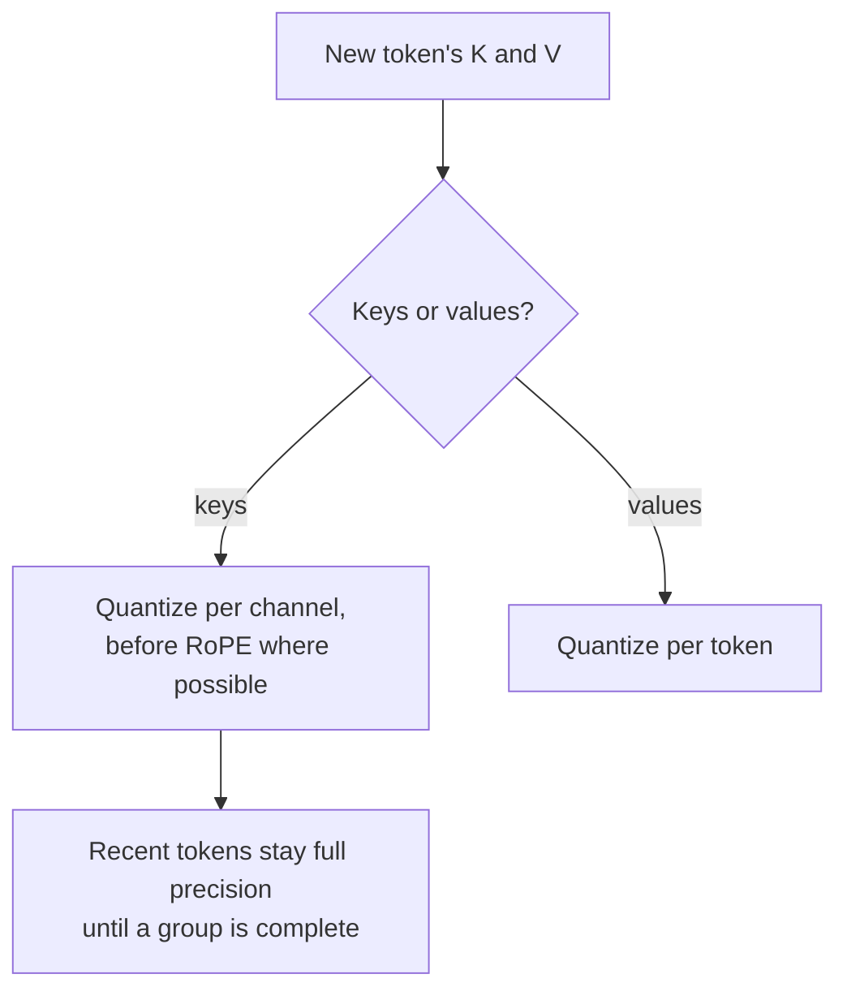

# Lesson 16. KV-Cache Quantization

**Mission link:** At long context and large batch the KV cache, not the weights, decides how many requests fit on a GPU, so it is often the next thing worth quantizing once the weights are done.
**Primary source:** [Paper: "KIVI: A Tuning-Free Asymmetric 2bit Quantization for KV Cache", Liu et al., 2024](https://arxiv.org/abs/2402.02750)
**Prerequisites:** [Lesson 15](0015-rotations.md), [KV-cache quantization](../GLOSSARY.md), [Granularity](../GLOSSARY.md)

## Warm-up

1. ▢ Lesson 1 said quantizing the weights leaves one large memory consumer untouched. Which one, and what does its size grow with?

<details markdown="1"><summary>Check</summary>

The KV cache. It grows with context length and batch size, so at long context or large batch it can outweigh the weights.

</details>

2. ▢ Lesson 13 found that a per-token scale cannot isolate an outlier channel that appears in every token. Why not?

<details markdown="1"><summary>Check</summary>

Each token's scale is set by the largest value in that token, which is the outlier channel in every row. The ordinary channels get coarse steps in every token.

</details>

3. ▢ Lesson 15 rotated the queries and keys online rather than in the weights. What was in the way?

<details markdown="1"><summary>Check</summary>

The rotary position embedding, applied after the key projection and dependent on position, so a rotation fused into the weights would come before it.

</details>

## Know this

### How big the cache gets

Every generated token stores a key and a value vector for every layer and every KV head. Per token:

```text
KV bytes per token = 2 x layers x kv_heads x head_dim x bytes_per_value
```

Llama 3 8B has 32 layers and 8 KV heads of dimension 128 (from its `config.json`). In bf16 that is 2 x 32 x 8 x 128 x 2 bytes = 131,072 bytes, 128 KiB per token. One sequence of 32,768 tokens holds 4 GiB of cache; 16 of them hold 64 GiB, four times the model's 16 GB of bf16 weights. Halving the bytes per value halves that, and every byte saved is room for more sequences or longer ones. KIVI's abstract makes the same point: with larger batches and longer contexts, the KV cache "becomes the new bottleneck in speed and memory usage".

The [Inference KV Cache sheet](../../inference/reference/kv-cache.md) covers how a serving engine pages and shares this memory. This lesson is about storing it in fewer bits.

### Keys per channel, values per token

KIVI studied the distribution of cached keys and values and found they need different axes:

- **Keys** have a few fixed channels with very large magnitudes, the same pattern as the activation outliers of lesson 7. Quantizing **per channel**, grouping the values of one channel across tokens, confines each outlier channel's error to that channel.
- **Values** show no consistent outlier pattern, and they are what the attention weights average. Measured on the attention output, KIVI reports per-token quantization error almost 15 times smaller than per-channel. So values are quantized **per token**.

Per-channel grouping for keys needs a group of tokens to exist before it can be quantized. KIVI therefore keeps the most recent tokens in full precision as a residual (128 tokens in its experiments, with groups of 32) and quantizes them once a full group has accumulated. With keys and values both at 2 bits, KIVI keeps Llama, Falcon and Mistral models at almost the same quality while using 2.6 times less peak memory, including the weights, which allows up to 4 times larger batches and 2.35 to 3.47 times the throughput.

### Before or after the position embedding

KVQuant adds a refinement for keys: quantize them **before** the rotary position embedding is applied, because the rotation mixes the channel pairs and smears the per-channel pattern. With per-channel, pre-RoPE keys, non-uniform data types and per-vector outlier handling, it reports under 0.1 perplexity degradation at 3 bits on WikiText-2 and C4, and serving LLaMA-7B with a context of up to a million tokens on one 80 GB A100 ([Hooper et al., 2024](https://arxiv.org/abs/2401.18079)).

### What serving engines usually offer

Research methods go to 2 or 3 bits. What a serving engine commonly exposes is an 8-bit cache. vLLM, for example, documents an fp8 KV cache with either one scale per tensor or one per attention head. Without calibration its scales default to 1.0, and it recommends estimating them from a calibration dataset with llm-compressor ([vLLM docs](https://docs.vllm.ai/en/latest/features/quantization/quantized_kvcache/)). A scale of 1.0 is only safe when the cached values already fit fp8's range, which is the kind of assumption a review should check.



## Practice

1. ▢ A model has 40 layers, 8 KV heads of dimension 128, and serves sequences of 8,192 tokens in bf16. How much KV cache does one sequence take, and how much with an 8-bit cache?

<details markdown="1"><summary>Check</summary>

Per token: 2 x 40 x 8 x 128 x 2 bytes = 163,840 bytes, 160 KiB. For 8,192 tokens: 1,310,720 KiB, which is 1.25 GiB. With one byte per value it is half: 0.625 GiB, plus a small amount for scales. Forgetting the factor of 2 for keys and values is the usual slip.

</details>

2. ▢ Why does KIVI quantize keys per channel but values per token?

<details markdown="1"><summary>Check</summary>

Keys have a few fixed outlier channels, so a scale per channel keeps each outlier's error inside its own channel, the same reason weights get per-channel scales. Values have no such pattern, and per-token quantization gave almost 15 times less error on the attention output, so each token gets its own scale.

</details>

3. ▢ Predict. KIVI keeps the most recent tokens of the key cache in full precision. Predict why a per-channel scheme cannot quantize the newest token immediately, as a per-token scheme can.

<details markdown="1"><summary>Hint</summary>

Per channel means one scale for a channel across a group of tokens. How many tokens does the group contain when the newest one arrives?

</details>

<details markdown="1"><summary>Check</summary>

A per-channel group spans several tokens, and its scale depends on all of them, so it can only be computed once the group is full. A per-token scale depends only on the token itself. KIVI holds the incomplete group, up to its residual length, in full precision and quantizes it once complete.

</details>

4. ▢ A team turns on an 8-bit KV cache in their serving engine without calibration, and long-context answers get worse while short ones look fine. Which explanation best fits what this lesson taught?

    - a) Default scales clip cached values that exceed the format's range
    - b) An 8-bit cache stores only the most recent token block
    - c) Quantizing the cache also quantizes the weights to eight bits
    - d) The engine drops the residual tokens when context grows long

<details markdown="1"><summary>Check</summary>

**a)** Uncalibrated scales of 1.0 assume the cached keys and values fit the format; values outside that range are clipped or overflow, and a long context gives more tokens, and more chances, for that error to accumulate in attention. Calibrating the scales is the documented fix. (b) is wrong because the cache still stores every token, just in fewer bits. (c) confuses the KV cache with the weights. (d) describes no real mechanism: residual full-precision tokens are a KIVI design, not something an engine drops.

</details>

## Real-world reps

- [ ] Open the `config.json` of a model you use, find its layer count, KV-head count and head dimension, and compute its KV cache per token and for your longest typical request.
- [ ] Read the vLLM quantized KV cache page and write down which scale granularities it supports and what it recommends for calibration.
- [ ] Tomorrow: without notes, write the KV-cache size formula and explain which axis keys and values are each quantized along, and why.

## Going further

- [Activations and the KV Cache](../reference/activations-and-kv-cache.md)
- [Inference: KV Cache](../../inference/reference/kv-cache.md), for how a serving engine allocates and shares the cache
- [Paper: "KVQuant: Towards 10 Million Context Length LLM Inference with KV Cache Quantization", Hooper et al., 2024](https://arxiv.org/abs/2401.18079)
- [Resources](../RESOURCES.md)

---

Not landing? Reread the primary source at the top, since this lesson compresses it and compression is where understanding leaks. Check the [glossary](../GLOSSARY.md) for any term that felt slippery.

If the lesson itself is unclear rather than the material, that is a defect: [open an issue](https://github.com/TokenCemetery/teach/issues).
