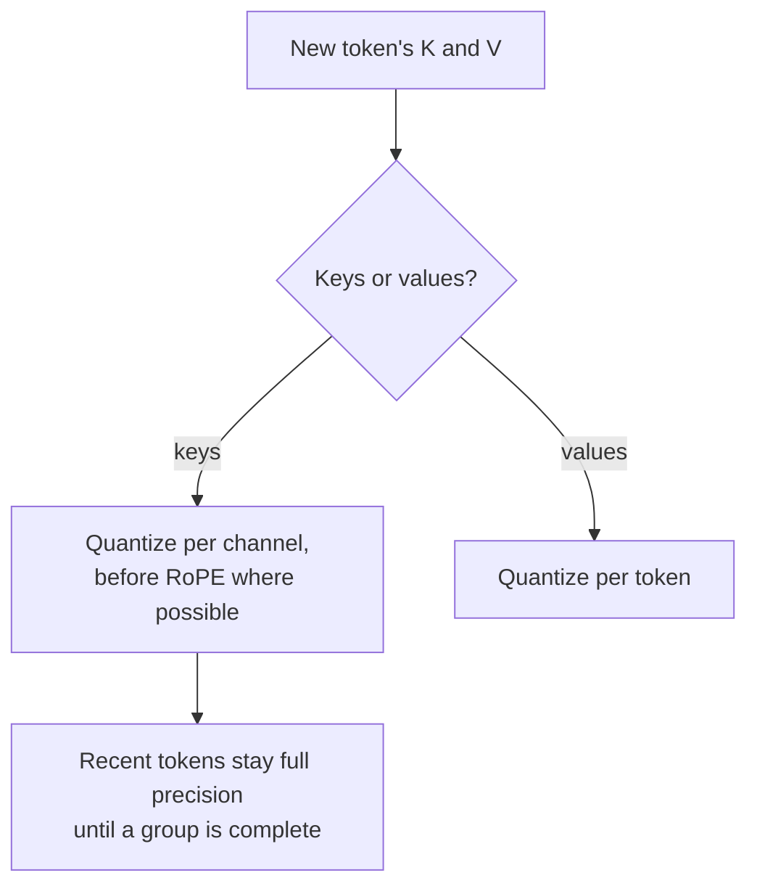

# Lição 16. Quantização do KV cache

**Ligação com a missão:** Em contexto longo e batch grande, o KV cache, e não os pesos, decide quantas requisições cabem em uma GPU, então ele costuma ser a próxima coisa que vale a pena quantizar depois que os pesos estão prontos.
**Fonte principal:** [Artigo científico: "KIVI: A Tuning-Free Asymmetric 2bit Quantization for KV Cache", Liu et al., 2024](https://arxiv.org/abs/2402.02750)
**Pré-requisitos:** [Lição 15](0015-rotations.md), [Quantização do KV cache](../GLOSSARY.md), [Granularidade](../GLOSSARY.md)

## Aquecimento

1. ▢ A lição 1 disse que quantizar os pesos deixa um grande consumidor de memória intocado. Qual, e com o que o seu tamanho cresce?

<details markdown="1"><summary>Verificação</summary>

O KV cache. Ele cresce com o tamanho do contexto e o batch size, então em contexto longo ou batch grande pode pesar mais que os pesos.

</details>

2. ▢ A lição 13 descobriu que uma scale per-token não consegue isolar um canal outlier que aparece em todo token. Por que não?

<details markdown="1"><summary>Verificação</summary>

A scale de cada token é definida pelo maior valor naquele token, que é o canal outlier em toda linha. Os canais comuns recebem passos grosseiros em todo token.

</details>

3. ▢ A lição 15 rotacionou as queries e as keys online e não nos pesos. O que estava no caminho?

<details markdown="1"><summary>Verificação</summary>

O rotary position embedding, aplicado depois da projeção das keys e dependente da posição, então uma rotação fundida nos pesos viria antes dele.

</details>

## Saiba isto

### O quão grande o cache fica

Cada token gerado armazena um vetor de key e um de value para cada camada e cada KV head. Por token:

```text
KV bytes per token = 2 x layers x kv_heads x head_dim x bytes_per_value
```

O Llama 3 8B tem 32 camadas e 8 KV heads de dimensão 128 (do seu `config.json`). Em bf16 isso é 2 x 32 x 8 x 128 x 2 bytes = 131.072 bytes, 128 KiB por token. Uma sequência de 32.768 tokens guarda 4 GiB de cache; 16 delas guardam 64 GiB, quatro vezes os 16 GB de pesos em bf16 do modelo. Reduzir pela metade os bytes por valor reduz isso pela metade, e cada byte economizado é espaço para mais sequências ou sequências mais longas. O resumo do KIVI faz o mesmo ponto: com batches maiores e contextos mais longos, o KV cache "se torna o novo gargalo de velocidade e uso de memória".

A [folha KV cache de Inferência](../../inference/reference/kv-cache.md) cobre como um motor de serving pagina e compartilha essa memória. Esta lição trata de armazená-la em menos bits.

### Keys por canal, values por token

O KIVI estudou a distribuição das keys e dos values em cache e descobriu que eles precisam de eixos diferentes:

- As **keys** têm alguns canais fixos com magnitudes muito grandes, o mesmo padrão dos outliers de ativação da lição 7. Quantizar **por canal**, agrupando os valores de um canal entre tokens, confina o erro de cada canal outlier a esse canal.
- Os **values** não mostram um padrão de outliers consistente, e são o que os pesos de atenção promediam. Medido na saída da atenção, o KIVI relata um erro de quantização per-token quase 15 vezes menor que o per-channel. Então os values são quantizados **por token**.

O agrupamento por canal das keys precisa que um grupo de tokens exista antes de poder ser quantizado. O KIVI, portanto, mantém os tokens mais recentes em precisão total como um resíduo (128 tokens nos seus experimentos, com grupos de 32) e os quantiza quando um grupo completo se acumulou. Com keys e values ambos em 2 bits, o KIVI mantém os modelos Llama, Falcon e Mistral com qualidade quase igual enquanto usa 2.6 vezes menos memória de pico, incluindo os pesos, o que permite batches até 4 vezes maiores e de 2.35 a 3.47 vezes o throughput.

### Antes ou depois do position embedding

O KVQuant acrescenta um refinamento para as keys: quantizá-las **antes** de o rotary position embedding ser aplicado, porque a rotação mistura os pares de canais e borra o padrão por canal. Com keys per-channel e pré-RoPE, tipos de dados não uniformes e tratamento de outliers por vetor, ele relata menos de 0.1 de degradação de perplexity em 3 bits no WikiText-2 e no C4, e servir o LLaMA-7B com um contexto de até um milhão de tokens em uma única A100 de 80 GB ([Hooper et al., 2024](https://arxiv.org/abs/2401.18079)).

### O que os motores de serving costumam oferecer

Os métodos de pesquisa vão a 2 ou 3 bits. O que um motor de serving comumente expõe é um cache de 8 bits. O vLLM, por exemplo, documenta um KV cache em fp8 com uma scale por tensor ou uma por attention head. Sem calibração, as suas scales têm padrão 1.0, e ele recomenda estimá-las a partir de um dataset de calibração com o llm-compressor ([docs do vLLM](https://docs.vllm.ai/en/latest/features/quantization/quantized_kvcache/)). Uma scale de 1.0 só é segura quando os valores em cache já cabem na faixa do fp8, que é o tipo de suposição que uma revisão deve conferir.



## Prática

1. ▢ Um modelo tem 40 camadas, 8 KV heads de dimensão 128 e serve sequências de 8.192 tokens em bf16. Quanto KV cache uma sequência ocupa, e quanto com um cache de 8 bits?

<details markdown="1"><summary>Verificação</summary>

Por token: 2 x 40 x 8 x 128 x 2 bytes = 163.840 bytes, 160 KiB. Para 8.192 tokens: 1.310.720 KiB, que são 1.25 GiB. Com um byte por valor é metade: 0.625 GiB, mais uma pequena quantidade para as scales. Esquecer o fator 2 de keys e values é o deslize usual.

</details>

2. ▢ Por que o KIVI quantiza as keys por canal mas os values por token?

<details markdown="1"><summary>Verificação</summary>

As keys têm alguns canais outliers fixos, então uma scale por canal mantém o erro de cada outlier dentro do seu próprio canal, o mesmo motivo de os pesos receberem scales per-channel. Os values não têm esse padrão, e a quantização per-token deu quase 15 vezes menos erro na saída da atenção, então cada token recebe a sua própria scale.

</details>

3. ▢ Preveja. O KIVI mantém os tokens mais recentes do cache de keys em precisão total. Preveja por que um esquema per-channel não consegue quantizar o token mais novo imediatamente, como um esquema per-token consegue.

<details markdown="1"><summary>Dica</summary>

Per-channel significa uma scale para um canal ao longo de um grupo de tokens. Quantos tokens o grupo contém quando o mais novo chega?

</details>

<details markdown="1"><summary>Verificação</summary>

Um grupo per-channel abrange vários tokens, e a sua scale depende de todos eles, então só pode ser calculada quando o grupo está cheio. Uma scale per-token depende apenas do próprio token. O KIVI mantém o grupo incompleto, até o seu comprimento de resíduo, em precisão total e o quantiza quando ele se completa.

</details>

4. ▢ Uma equipe liga um KV cache de 8 bits no seu motor de serving sem calibração, e as respostas de contexto longo pioram enquanto as curtas parecem bem. Qual explicação melhor se encaixa no que esta lição ensinou?

    - a) As scales padrão aplicam clipping aos valores em cache que excedem a faixa do formato
    - b) Um cache de 8 bits armazena apenas o bloco de tokens mais recente
    - c) Quantizar o cache também quantiza os pesos para oito bits
    - d) O motor descarta os tokens residuais quando o contexto fica longo

<details markdown="1"><summary>Verificação</summary>

**a)** Scales não calibradas de 1.0 pressupõem que as keys e os values em cache cabem no formato; valores fora dessa faixa sofrem clipping ou overflow, e um contexto longo dá mais tokens, e mais chances, para esse erro se acumular na atenção. Calibrar as scales é a correção documentada. (b) está errada porque o cache ainda armazena todo token, só que em menos bits. (c) confunde o KV cache com os pesos. (d) não descreve nenhum mecanismo real: os tokens residuais em precisão total são um projeto do KIVI, não algo que um motor descarta.

</details>

## Prática no mundo real

- [ ] Abra o `config.json` de um modelo que você usa, encontre a sua contagem de camadas, de KV heads e a dimensão do head e calcule o seu KV cache por token e para a sua requisição típica mais longa.
- [ ] Leia a página de KV cache quantizado do vLLM e anote quais granularidades de scale ela suporta e o que recomenda para a calibração.
- [ ] Amanhã: sem consultar anotações, escreva a fórmula do tamanho do KV cache e explique ao longo de qual eixo keys e values são quantizados cada um, e por quê.

## Para ir além

- [Ativações e o KV Cache](../reference/activations-and-kv-cache.md)
- [Inferência: KV cache](../../inference/reference/kv-cache.md), para ver como um motor de serving aloca e compartilha o cache
- [Artigo científico: "KVQuant: Towards 10 Million Context Length LLM Inference with KV Cache Quantization", Hooper et al., 2024](https://arxiv.org/abs/2401.18079)
- [Recursos](../RESOURCES.md)

---

Não ficou claro? Releia a fonte principal no topo, já que esta lição a comprime e é na compressão que o entendimento escapa. Consulte o [glossário](../GLOSSARY.md) para qualquer termo que pareceu escorregadio.

Se o problema é a lição em si, e não o material, isso é um defeito: [abra uma issue](https://github.com/TokenCemetery/teach/issues).
