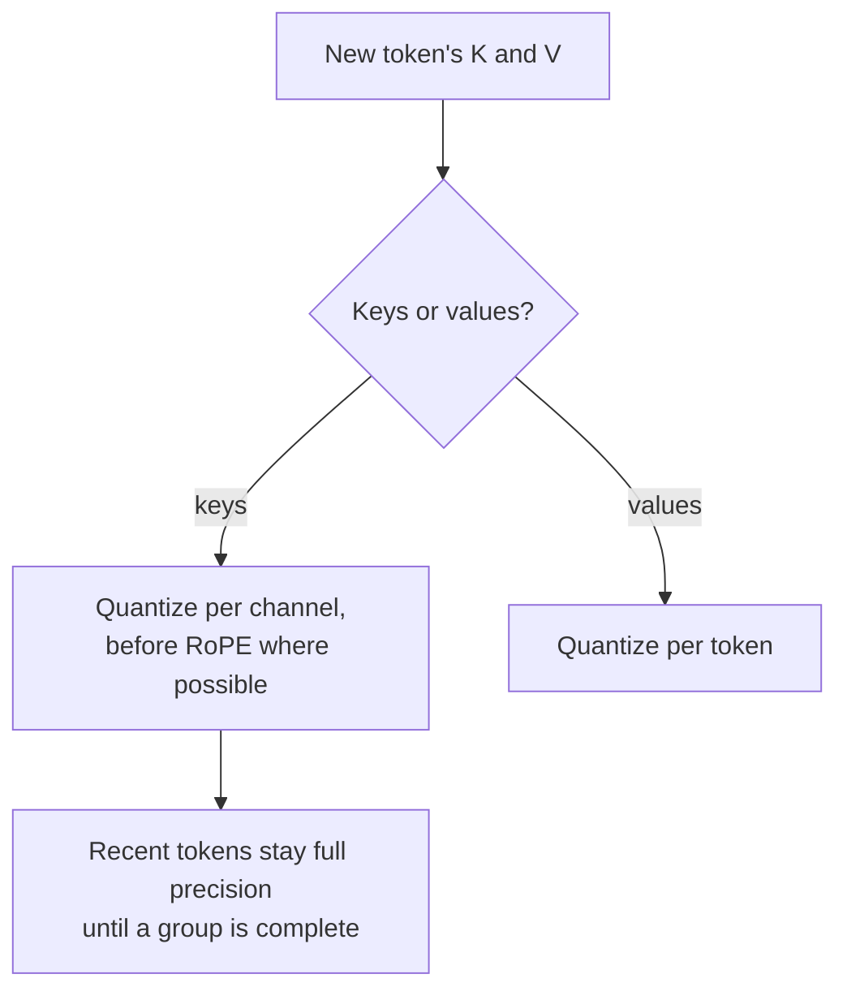

# Урок 16. Квантизация KV-кеша

**Связь с целью курса:** При длинном контексте и большом батче именно KV-кеш, а не веса, определяет, сколько запросов помещается на GPU, поэтому после весов он часто становится следующим, что стоит квантизовать.
**Первоисточник:** [Научная статья: "KIVI: A Tuning-Free Asymmetric 2bit Quantization for KV Cache", Liu et al., 2024](https://arxiv.org/abs/2402.02750)
**Предварительные требования:** [Урок 15](0015-rotations.md), [Квантизация KV-кеша](../GLOSSARY.md), [Гранулярность](../GLOSSARY.md)

## Разминка

1. ▢ Урок 1 говорил, что квантизация весов оставляет нетронутым одного крупного потребителя памяти. Какого и с чем растёт его размер?

<details markdown="1"><summary>Проверка</summary>

KV-кеш. Он растёт с длиной контекста и размером батча, поэтому при длинном контексте или большом батче может весить больше, чем веса.

</details>

2. ▢ Урок 13 обнаружил, что масштаб per-token не может изолировать канал-выброс, который появляется в каждом токене. Почему нет?

<details markdown="1"><summary>Проверка</summary>

Масштаб каждого токена задаётся наибольшим значением в этом токене, а это канал-выброс в каждой строке. Обычные каналы получают грубые шаги в каждом токене.

</details>

3. ▢ Урок 15 поворачивал запросы и ключи онлайн, а не в весах. Что мешало?

<details markdown="1"><summary>Проверка</summary>

Ротационное позиционное вложение, применяемое после проекции ключей и зависящее от позиции, так что поворот, слитый в веса, оказался бы перед ним.

</details>

## Что нужно знать

### Насколько велик становится кеш

Каждый сгенерированный токен хранит вектор ключа и вектор значения для каждого слоя и каждой головы KV. На токен:

```text
KV bytes per token = 2 x layers x kv_heads x head_dim x bytes_per_value
```

У Llama 3 8B 32 слоя и 8 голов KV размерности 128 (из её `config.json`). В bf16 это 2 x 32 x 8 x 128 x 2 байта = 131 072 байта, 128 КиБ на токен. Одна последовательность из 32 768 токенов держит 4 ГиБ кеша; 16 таких держат 64 ГиБ, вчетверо больше 16 ГБ весов модели в bf16. Сокращение байт на значение вдвое сокращает и это, а каждый сэкономленный байт это место для большего числа последовательностей или более длинных. Аннотация KIVI делает то же замечание: при больших батчах и длинных контекстах KV-кеш «становится новым узким местом по скорости и использованию памяти».

Лист [KV-кеш](../../inference/reference/kv-cache.md) курса по инференсу описывает, как движок обслуживания страничит и делит эту память. Этот урок о том, как хранить её в меньшем числе бит.

### Ключи по каналам, значения по токенам

KIVI изучила распределение кешированных ключей и значений и обнаружила, что им нужны разные оси:

- **Ключи** имеют несколько фиксированных каналов с очень большой величиной, тот же паттерн, что у выбросов активаций из урока 7. Квантизация **по каналам**, когда группируются значения одного канала по токенам, ограничивает ошибку каждого канала-выброса этим каналом.
- **Значения** не показывают устойчивого паттерна выбросов, и именно их усредняют веса внимания. Измеряя на выходе внимания, KIVI сообщает ошибку квантизации per-token почти в 15 раз меньше, чем per-channel. Поэтому значения квантизуются **по токенам**.

Группировке ключей по каналам нужно, чтобы группа токенов существовала, прежде чем её можно квантизовать. Поэтому KIVI держит самые свежие токены в полной точности как остаток (128 токенов в её экспериментах, с группами по 32) и квантизует их, когда накопилась полная группа. При ключах и значениях в 2 битах KIVI сохраняет модели Llama, Falcon и Mistral почти с тем же качеством, используя в 2,6 раза меньше пиковой памяти, включая веса, что допускает батчи до 4 раз больше и пропускную способность в 2,35-3,47 раза выше.

### До или после позиционного вложения

KVQuant добавляет усовершенствование для ключей: квантизовать их **до** применения ротационного позиционного вложения, потому что поворот смешивает пары каналов и размазывает паттерн по каналам. С ключами per-channel до RoPE, неравномерными типами данных и обработкой выбросов на вектор она сообщает о деградации перплексии менее 0,1 при 3 битах на WikiText-2 и C4 и об обслуживании LLaMA-7B с контекстом до миллиона токенов на одном A100 на 80 ГБ ([Hooper et al., 2024](https://arxiv.org/abs/2401.18079)).

### Что обычно предлагают движки обслуживания

Исследовательские методы идут до 2 или 3 бит. Движок обслуживания обычно предоставляет 8-битный кеш. Например, vLLM описывает KV-кеш в fp8 с одним масштабом на тензор или одним на голову внимания. Без калибровки его масштабы по умолчанию равны 1,0, и он рекомендует оценивать их по калибровочному датасету с помощью llm-compressor ([документация vLLM](https://docs.vllm.ai/en/latest/features/quantization/quantized_kvcache/)). Масштаб 1,0 безопасен, только когда кешированные значения уже укладываются в диапазон fp8, а это как раз то предположение, которое ревью должно проверять.



## Практика

1. ▢ У модели 40 слоёв, 8 голов KV размерности 128, и она обслуживает последовательности по 8192 токена в bf16. Сколько KV-кеша занимает одна последовательность и сколько с 8-битным кешем?

<details markdown="1"><summary>Проверка</summary>

На токен: 2 x 40 x 8 x 128 x 2 байта = 163 840 байт, 160 КиБ. На 8192 токена: 1 310 720 КиБ, то есть 1,25 ГиБ. С одним байтом на значение вдвое меньше: 0,625 ГиБ плюс небольшая добавка на масштабы. Обычная ошибка это забыть множитель 2 для ключей и значений.

</details>

2. ▢ Почему KIVI квантизует ключи по каналам, а значения по токенам?

<details markdown="1"><summary>Проверка</summary>

У ключей есть несколько фиксированных каналов-выбросов, поэтому масштаб на канал удерживает ошибку каждого выброса внутри его канала, по той же причине, по какой весам дают масштабы per-channel. У значений такого паттерна нет, а квантизация per-token дала почти в 15 раз меньшую ошибку на выходе внимания, поэтому каждый токен получает собственный масштаб.

</details>

3. ▢ Предскажите. KIVI держит самые свежие токены кеша ключей в полной точности. Предскажите, почему схема per-channel не может квантизовать новейший токен сразу, как это может схема per-token.

<details markdown="1"><summary>Подсказка</summary>

Per-channel означает один масштаб на канал по группе токенов. Сколько токенов содержит группа, когда приходит новейший?

</details>

<details markdown="1"><summary>Проверка</summary>

Группа per-channel охватывает несколько токенов, и её масштаб зависит от всех них, поэтому его можно вычислить, только когда группа заполнена. Масштаб per-token зависит только от самого токена. KIVI держит неполную группу, до длины остатка, в полной точности и квантизует её, когда она завершена.

</details>

4. ▢ Команда включает 8-битный KV-кеш в своём движке обслуживания без калибровки, и ответы на длинном контексте становятся хуже, а на коротком выглядят нормально. Какое объяснение лучше всего согласуется с тем, чему учил этот урок?

    - a) Масштабы по умолчанию отсекают кешированные значения, выходящие за диапазон формата
    - b) 8-битный кеш хранит только самый свежий блок токенов
    - c) Квантизация кеша заодно квантизует веса в восемь бит
    - d) Движок отбрасывает токены остатка, когда контекст становится длинным

<details markdown="1"><summary>Проверка</summary>

**a)** Некалиброванные масштабы 1,0 предполагают, что кешированные ключи и значения укладываются в формат; значения вне этого диапазона отсекаются или переполняются, а длинный контекст даёт больше токенов, а значит и больше шансов этой ошибке накопиться во внимании. Калибровка масштабов это документированное исправление. (b) неверно, потому что кеш по-прежнему хранит каждый токен, просто в меньшем числе бит. (c) путает KV-кеш с весами. (d) не описывает никакого настоящего механизма: остаточные токены в полной точности это дизайн KIVI, а не то, что движок отбрасывает.

</details>

## Практика в реальной работе

- [ ] Откройте `config.json` модели, которой вы пользуетесь, найдите число её слоёв, число голов KV и размерность головы и посчитайте её KV-кеш на токен и для вашего самого длинного типичного запроса.
- [ ] Прочитайте страницу vLLM о квантизованном KV-кеше и запишите, какие гранулярности масштабов она поддерживает и что рекомендует для калибровки.
- [ ] Завтра, без заметок, запишите формулу размера KV-кеша и объясните, по какой оси квантизуются ключи и по какой значения и почему.

## Что почитать дальше

- [Активации и KV-кеш](../reference/activations-and-kv-cache.md)
- [Инференс: KV-кеш](../../inference/reference/kv-cache.md), о том, как движок обслуживания выделяет кеш и делит его
- [Научная статья: "KVQuant: Towards 10 Million Context Length LLM Inference with KV Cache Quantization", Hooper et al., 2024](https://arxiv.org/abs/2401.18079)
- [Ресурсы](../RESOURCES.md)

---

Не доходит? Перечитайте первоисточник в начале: этот урок его сжимает, а при сжатии понимание как раз и теряется. Загляните в [глоссарий](../GLOSSARY.md), если какой-то термин показался скользким.

Если неясен сам урок, а не материал, это дефект: [откройте issue](https://github.com/TokenCemetery/teach/issues).
