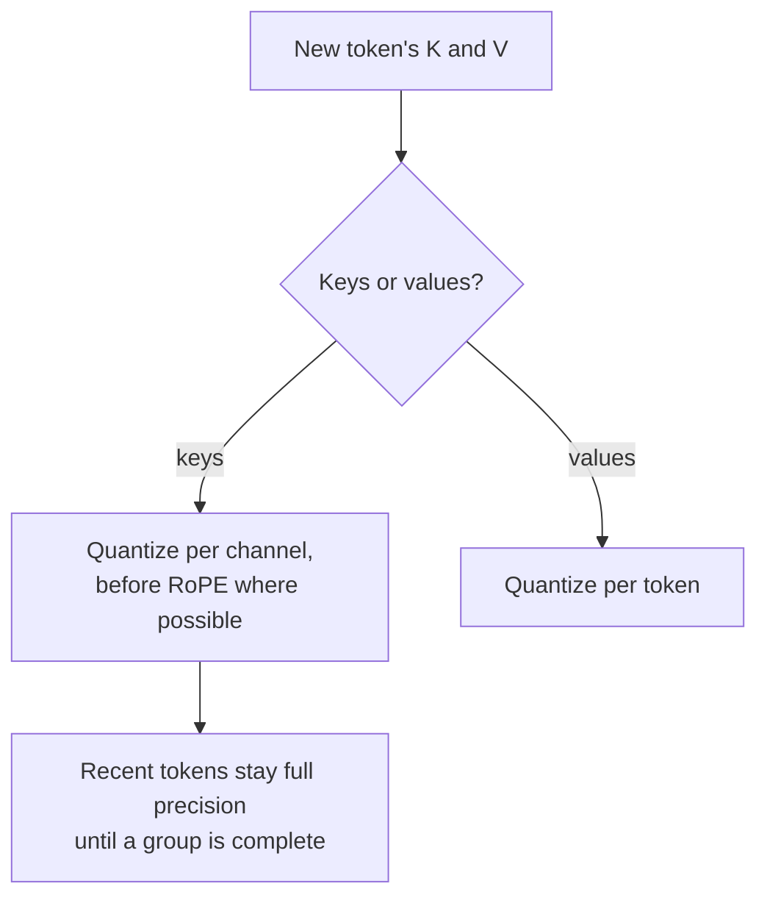

# 第 16 课：KV 缓存量化

**使命关联:** 在长上下文和大批量下，决定一块 GPU 能放下多少请求的是 KV 缓存，而不是权重，所以权重量化完之后，它常常是下一个值得量化的东西。
**主要来源:** [论文：“KIVI: A Tuning-Free Asymmetric 2bit Quantization for KV Cache”，Liu 等，2024](https://arxiv.org/abs/2402.02750)
**前置知识:** [第 15 课](0015-rotations.md)、[KV 缓存量化](../GLOSSARY.md)、[量化粒度](../GLOSSARY.md)

## 热身

1. ▢ 第 1 课说，量化权重会留下一个很大的内存消耗者不去动它。是哪一个？它的大小随什么增长？

<details markdown="1"><summary>检查</summary>

KV 缓存。它随上下文长度和批大小增长，所以在长上下文或大批量下，它可能比权重还大。

</details>

2. ▢ 第 13 课发现，逐 token 的缩放因子无法隔离出现在每个 token 里的离群通道。为什么？

<details markdown="1"><summary>检查</summary>

每个 token 的缩放因子由该 token 里的最大值决定，而在每一行里，那个最大值都是离群通道。普通通道在每个 token 里都得到粗的步长。

</details>

3. ▢ 第 15 课对查询和键是在线旋转，而不是融合在权重里。是什么挡了路？

<details markdown="1"><summary>检查</summary>

旋转位置嵌入，它在键投影之后应用，并且取决于位置，所以融合进权重的旋转会出现在它之前。

</details>

## 要点

### 缓存会变得多大

每生成一个 token，就要为每一层、每一个 KV 头存一个键向量和一个值向量。每个 token：

```text
KV bytes per token = 2 x layers x kv_heads x head_dim x bytes_per_value
```

Llama 3 8B 有 32 层和 8 个维度为 128 的 KV 头（来自它的 `config.json`）。在 bf16 下，就是 2 x 32 x 8 x 128 x 2 字节 = 131,072 字节，每个 token 128 KiB。一条 32,768 个 token 的序列占 4 GiB 缓存；16 条就占 64 GiB，是该模型 16 GB bf16 权重的四倍。每个值的字节数减半，缓存就减半，而每省下一个字节，就是为更多的序列或更长的序列腾出空间。KIVI 的摘要说了同样的意思：随着批越来越大、上下文越来越长，KV 缓存“成为速度和内存使用上新的瓶颈”。

[推理：KV 缓存](../../inference/reference/kv-cache.md)参考表讲的是服务引擎如何对这块内存分页和共享。本课讲的是用更少的位数去存储它。

### 键逐通道，值逐 token

KIVI 研究了缓存的键和值的分布，发现它们需要不同的轴：

- **键**有少数几个固定的通道，幅值非常大，与第 7 课的激活值离群值是同样的模式。**逐通道**量化，也就是把同一个通道在各个 token 上的值分为一组，能把每个离群通道的误差限制在那个通道里。
- **值**没有一致的离群值模式，而且注意力权重对它们取的是加权平均。以注意力输出来度量，KIVI 报告说逐 token 量化的误差，比逐通道小将近 15 倍。所以值是**逐 token** 量化的。

键的逐通道分组，要先有一组 token 才能量化。因此 KIVI 把最近的若干 token 以全精度保留为残差（实验中是 128 个 token，每 32 个一组），等累积满一整组之后再量化。键和值都用 2 位时，KIVI 让 Llama、Falcon 和 Mistral 模型保持几乎相同的质量，同时峰值内存（包括权重）减少为原来的 1/2.6，这允许最多 4 倍大的批，并带来 2.35 到 3.47 倍的吞吐量。

### 在位置嵌入之前还是之后

KVQuant 为键增加了一项改进：在应用旋转位置嵌入**之前**量化它们，因为这个旋转会把通道成对混合，抹掉逐通道的模式。它采用逐通道、RoPE 之前的键，非均匀数据类型，以及逐向量的离群值处理，报告在 WikiText-2 和 C4 上，3 位时困惑度下降不到 0.1，并在一块 80 GB 的 A100 上以最长一百万个 token 的上下文来服务 LLaMA-7B（[Hooper 等，2024](https://arxiv.org/abs/2401.18079)）。

### 服务引擎通常提供什么

研究方法走到 2 位或 3 位。服务引擎通常提供的是 8 位缓存。以 vLLM 为例，它的文档记载了 fp8 的 KV 缓存，缩放因子可以每个张量一个，也可以每个注意力头一个。不做校准时，它的缩放因子默认为 1.0，它建议用 llm-compressor 根据校准数据集来估计它们（[vLLM 文档](https://docs.vllm.ai/en/latest/features/quantization/quantized_kvcache/)）。只有当缓存的值本来就落在 fp8 的范围之内，1.0 的缩放因子才是安全的，这正是评审时该核查的那类假设。



## 练习

1. ▢ 一个模型有 40 层、8 个维度为 128 的 KV 头，以 bf16 为 8,192 个 token 的序列提供服务。一条序列占多少 KV 缓存？用 8 位缓存又是多少？

<details markdown="1"><summary>检查</summary>

每个 token：2 x 40 x 8 x 128 x 2 字节 = 163,840 字节，160 KiB。8,192 个 token：1,310,720 KiB，也就是 1.25 GiB。每个值一个字节，就是它的一半：0.625 GiB，外加少量的缩放因子。忘掉键和值的那个因子 2，是常见的失误。

</details>

2. ▢ 为什么 KIVI 对键逐通道量化，而对值逐 token 量化？

<details markdown="1"><summary>检查</summary>

键有少数几个固定的离群通道，所以逐通道的缩放因子把每个离群值的误差限制在它自己的通道里，与权重用逐通道缩放因子是同一个道理。值没有这样的模式，逐 token 量化在注意力输出上给出的误差几乎小 15 倍，所以每个 token 各有自己的缩放因子。

</details>

3. ▢ 先预测。KIVI 把键缓存中最近的 token 保留为全精度。预测为什么逐通道的方案不能像逐 token 的方案那样，立刻量化最新的 token。

<details markdown="1"><summary>提示</summary>

逐通道指的是一个通道在一组 token 上共用一个缩放因子。最新的 token 到来时，这个组里有多少个 token？

</details>

<details markdown="1"><summary>检查</summary>

一个逐通道的组横跨若干个 token，它的缩放因子取决于所有这些 token，所以只能在这个组满了之后才能算出来。逐 token 的缩放因子只取决于这个 token 本身。KIVI 把不完整的组（最多到它的残差长度）保留为全精度，等它完整了再量化。

</details>

4. ▢ 一个团队在服务引擎里打开了 8 位 KV 缓存，没有做校准，长上下文的回答变差了，而短的看起来正常。下面哪种解释最符合本课所讲的内容？

    - a) 默认的缩放因子把超出格式范围的缓存值截断了
    - b) 8 位缓存只存储最近的那个 token 块
    - c) 量化缓存的同时也把权重量化到了八位
    - d) 上下文变长时，引擎丢掉了残差 token

<details markdown="1"><summary>检查</summary>

**a)** 未校准的 1.0 缩放因子假定缓存的键和值都落在格式的范围内；超出这个范围的值被截断或溢出，而长上下文有更多的 token，这种误差在注意力中积累的机会也更多。校准缩放因子是文档中记载的修复办法。(b) 是错的，因为缓存仍然存储每一个 token，只是位数更少。(c) 把 KV 缓存和权重混为一谈。(d) 描述的不是任何真实的机制：残差的全精度 token 是 KIVI 的设计，不是引擎会丢掉的东西。

</details>

## 实战练习

- [ ] 打开你在用的某个模型的 `config.json`，找出它的层数、KV 头数和头维度，算出它每个 token 的 KV 缓存，以及你最长的典型请求的 KV 缓存。
- [ ] 阅读 vLLM 的量化 KV 缓存页面，写下它支持哪些缩放因子粒度，以及它对校准给出了什么建议。
- [ ] 明天：不看笔记，写出 KV 缓存大小的公式，并解释键和值各自沿哪根轴量化，以及为什么。

## 延伸阅读

- [激活值与 KV 缓存](../reference/activations-and-kv-cache.md)
- [推理：KV 缓存](../../inference/reference/kv-cache.md)，服务引擎如何分配和共享缓存
- [论文：“KVQuant: Towards 10 Million Context Length LLM Inference with KV Cache Quantization”，Hooper 等，2024](https://arxiv.org/abs/2401.18079)
- [资源](../RESOURCES.md)

---

没学明白？请重读顶部的主要来源，因为本课是对它的压缩，而理解正是在压缩中流失的。如果有哪个术语觉得含糊，可以查看[术语表](../GLOSSARY.md)。

如果问题出在课程本身，而不是学习材料，那就是一个缺陷：[提交 issue](https://github.com/TokenCemetery/teach/issues)。
