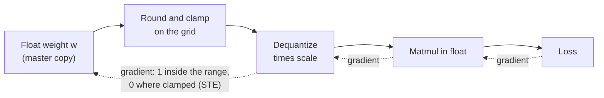

# Lección 17. Fake quantization y el STE

**Vínculo con la misión:** El quantization-aware training es la otra manera de obtener un modelo de pocos bits, y no puedes decir cuándo se gana su costo hasta que puedas decir cómo sobrevive un bucle de entrenamiento a un paso de redondeo.
**Fuente principal:** [Paper: "A White Paper on Neural Network Quantization", Nagel et al., 2021](https://arxiv.org/abs/2106.08295), sección 4.1
**Requisitos previos:** [Lección 16](0016-kv-cache-quantization.md), [Fake quantization](../GLOSSARY.md), [Straight-through estimator](../GLOSSARY.md), [Scale](../GLOSSARY.md), [Rango de recorte](../GLOSSARY.md)

## Calentamiento

1. ▢ Cuantizar un valor y luego descuantizarlo no devuelve el número original. ¿Cuál es el mayor error que round-to-nearest puede añadir a un valor dentro del rango de recorte, para un scale dado?

<details markdown="1"><summary>Comprobación</summary>

Medio paso, que es `scale / 2` (la cota del [error de redondeo](../GLOSSARY.md) de las lecciones 4 y 5). Con un scale de 0.25 el peor caso es 0.125. Un valor fuera del rango de recorte se mueve en cambio al extremo más cercano del rango, y ese error de recorte no tiene tal cota.

</details>

2. ▢ Tras la lección 16 existen un esquema de solo pesos y un esquema que cuantiza también la KV cache. ¿Cuál de los dos cambia lo que el modelo calcula durante la atención en tiempo de inferencia, y cuál solo cambia lo que se almacena?

<details markdown="1"><summary>Comprobación</summary>

La cuantización de la KV cache cambia lo que lee la atención: las keys y los values vuelven de la caché con error de redondeo. La cuantización solo de pesos cambia los pesos por los que multiplica cada capa. Ambas cambian los números con los que calcula el modelo, y por eso ambas necesitan una medición de calidad y no solo una comprobación de tamaño.

</details>

## Qué debes saber

### Fake quantization: cuantizar, descuantizar y seguir calculando en float

Los métodos post-entrenamiento (lecciones 9 a 12) cuantizan un modelo terminado. El **quantization-aware training**, en cambio, entrena con el redondeo ya puesto, de modo que los pesos puedan moverse a valores que lo sobrevivan. Lo hace con **fake quantization**: en el forward pass cada peso se cuantiza y se descuantiza de inmediato, y la multiplicación de matrices corre luego sobre esos valores redondeados en punto flotante ordinario. Para un cuantizador simétrico con scale `s` y límites enteros de la rejilla `n` y `p`, el valor del forward es:

```text
x_hat = s * clamp(round(x / s), n, p)
```

El equipo de PyTorch describe lo mismo: el QAT simula la numérica de la cuantización durante el entrenamiento manteniendo los pesos y las activaciones en su tipo de datos original, así que en realidad no se convierte nada a un tipo de pocos bits ([blog de PyTorch](https://pytorch.org/blog/quantization-aware-training/)). Los pesos de precisión completa siguen siendo la copia maestra que actualiza el optimizador, y la pérdida ve el error de redondeo y de clamping, que es todo el punto.

### El problema del gradiente

El entrenamiento necesita el gradiente de la pérdida respecto de cada peso. Nagel et al. señalan que la derivada de round-to-nearest es "cero o indefinida en todas partes", lo que hace imposible el entrenamiento basado en gradientes si derivas el paso de redondeo con honestidad. Entre dos puntos de la rejilla, mover un peso una pequeña cantidad no cambia nada, así que la pendiente real es cero. En una frontera de redondeo la salida salta, así que no hay pendiente alguna.

### El straight-through estimator

La solución es el **straight-through estimator** (STE), atribuido a [Bengio et al., 2013](https://arxiv.org/abs/1308.3432): en el backward pass, copia el gradiente desde la salida del paso duro directamente a su entrada, como si el paso no estuviera. Nagel et al. lo aplican a la cuantización aproximando la derivada del redondeo como 1, de modo que el backward pass se salta por completo el bloque de redondeo.

En PyTorch el truco cabe en una línea, `x + (round(x) - x).detach()`. Su valor es `round(x)`, porque los términos `x` se cancelan. Su gradiente es 1, porque autograd no mira dentro de `detach()`. Es una aproximación, no el gradiente verdadero: dice que mover un peso 0.1 mueve la salida 0.1, cuando la salida real se mueve a saltos. Funciona porque el peso y su valor redondeado se mantienen cerca.

### Fuera del rango, el gradiente es cero

El clamp no se omite. Un peso fuera del rango de recorte queda retenido en el extremo del rango hagas lo que hagas con él, y el gradiente lo refleja. Nagel et al. dan el gradiente de todo el cuantizador respecto de su entrada: 1 cuando el valor está dentro del rango, 0 en caso contrario. Un peso recortado no recibe señal de aprendizaje de la pérdida hasta que otra cosa lo devuelva al rango.



Las flechas continuas son el forward pass. Las punteadas son el backward pass: el STE es lo que permite que el gradiente cruce el bloque de redondeo, y el clamp es lo que lo detiene para los valores recortados.

### El scale también puede aprender

El mismo truco da un gradiente para el scale. Nagel et al. señalan que trabajos posteriores (citan a Esser et al., 2020, entre otros) usan el STE para calcular el gradiente respecto de los parámetros de cuantización, de modo que el rango de recorte se entrena junto con los pesos en lugar de fijarse primero. Para el scale, el gradiente de un valor dentro del rango es `round(x / s) - x / s`, que es menos su propio error de redondeo en unidades de la rejilla, y un valor recortado aporta su límite de la rejilla, `n` o `p`. El scale se actualiza entonces con el mismo optimizador que los pesos.

### Qué cuesta

Nagel et al. dicen que el mayor accuracy del QAT "viene con los costos habituales del entrenamiento de redes neuronales": entrenamiento más largo, necesidad de datos y una búsqueda de hiperparámetros. La fake quantization añade además su propia sobrecarga, que la lección 18 pone en cifras para un LLM.

## Práctica

1. ▢ La fake quantization mantiene los tensores en float y solo redondea sus valores, en lugar de almacenar pesos reales en int4 durante el entrenamiento. ¿Por qué es ese el diseño correcto para un bucle de entrenamiento?

<details markdown="1"><summary>Comprobación</summary>

El optimizador necesita sumar actualizaciones diminutas a los pesos, y un peso en int4 no puede contener una actualización menor que un paso de la rejilla. Mantener una copia maestra en float permite que las actualizaciones se acumulen hasta ser lo bastante grandes como para cambiar el valor redondeado, mientras el forward pass sigue viendo el error de redondeo. El costo es que nada de la ejecución de entrenamiento es más rápido ni más pequeño: solo el modelo final convertido es de pocos bits.

</details>

2. ▢ Predice y luego ejecuta. ¿Qué muestra cada una de las dos líneas impresas: el gradiente de `torch.round(x).sum()` y el gradiente de la versión straight-through?

    ```python
    import torch

    x = torch.tensor([0.2, 1.4, 2.6], requires_grad=True)

    torch.round(x).sum().backward()
    print("round grad:", x.grad)

    x.grad = None
    y = x + (torch.round(x) - x).detach()
    y.sum().backward()
    print("ste value:", y.detach())
    print("ste grad:", x.grad)
    ```

<details markdown="1"><summary>Comprobación</summary>

```text
round grad: tensor([0., 0., 0.])
ste value: tensor([0., 1., 3.])
ste grad: tensor([1., 1., 1.])
```

El propio `round` de PyTorch tiene un gradiente cero en todas partes, así que una pérdida construida sobre él nunca actualizaría los pesos. La versión STE tiene los mismos valores en el forward (0, 1, 3) pero un gradiente de 1 para cada elemento.

</details>

3. ▢ Predice y luego ejecuta. Una rejilla con signo de 4 bits va de -8 a 7, y el scale es 0.25. ¿Qué peso recibe un gradiente cero, y cuáles son los valores del forward?

    ```python
    import torch

    def fake_quant(x, scale, qmin=-8, qmax=7):
        q = torch.clamp(x / scale, qmin, qmax)
        q = q + (torch.round(q) - q).detach()
        return q * scale

    w = torch.tensor([0.30, -0.47, 1.90, 0.06], requires_grad=True)
    wq = fake_quant(w, 0.25)
    print("values:", wq.detach())
    wq.sum().backward()
    print("grad:", w.grad)
    ```

<details markdown="1"><summary>Pista</summary>

Divide cada peso por el scale y compáralo con los límites de la rejilla.

</details>

<details markdown="1"><summary>Comprobación</summary>

```text
values: tensor([ 0.2500, -0.5000,  1.7500,  0.0000])
grad: tensor([1., 1., 0., 1.])
```

1.90 / 0.25 = 7.6, que está por encima del mayor nivel 7, así que se fija en 7 * 0.25 = 1.75 y recibe gradiente 0. El peso 0.06 se redondea al nivel 0 y su valor es 0, pero su gradiente sigue siendo 1: un peso que se redondea a cero está dentro del rango, así que el STE lo mantiene entrenable.

</details>

4. ▢ En una ejecución de QAT, un peso queda muy por encima del rango de recorte. ¿Qué gradiente le da la pérdida a través del cuantizador, y por qué?

    - a) Uno, porque el STE ignora el clamp
    - b) Cero, porque el STE bloquea todos los gradientes
    - c) Cero, porque el clamp es plano ahí
    - d) Uno, porque los valores recortados siguen siendo pesos

<details markdown="1"><summary>Comprobación</summary>

**c)** La salida del cuantizador es la misma haga lo que haga el peso más allá del rango, así que el gradiente es cero allí. (a) es incorrecta porque el STE sustituye solo la derivada del redondeo, no la del clamp. (b) es incorrecta porque el STE existe para dejar pasar gradientes, y estos pasan dentro del rango. (d) es incorrecta porque ser un parámetro entrenable no da a la pérdida un camino hasta él: el gradiente se calcula a través de las operaciones, no de la variable.

</details>

5. ▢ Predice y luego ejecuta, usando las fórmulas de "El scale también puede aprender". Los pesos son los mismos cuatro valores, el scale es 0.25, y el objetivo es lo que nos gustaría que fueran los pesos cuantizados. Primero calcula a mano el gradiente por elemento de la salida del cuantizador respecto del scale, luego el signo del gradiente de la pérdida respecto del scale, y luego ejecútalo.

    ```python
    import torch

    def fake_quant(x, scale, qmin=-8, qmax=7):
        q = torch.clamp(x / scale, qmin, qmax)
        q = q + (torch.round(q) - q).detach()
        return q * scale

    w = torch.tensor([0.30, -0.47, 1.90, 0.06])
    target = torch.tensor([0.28, -0.52, 1.75, 0.10])
    scale = torch.tensor(0.25, requires_grad=True)
    loss = ((fake_quant(w, scale) - target) ** 2).sum()
    loss.backward()
    print("loss:", round(loss.item(), 4))
    print("d loss / d scale:", round(scale.grad.item(), 4))
    ```

<details markdown="1"><summary>Pista</summary>

Para cada peso, `x / s` es 1.2, -1.88, 7.6 y 0.24. El primero, el segundo y el cuarto están dentro del rango, así que su gradiente es `round(x / s) - x / s`. El tercero está recortado a 7.

</details>

<details markdown="1"><summary>Comprobación</summary>

```text
loss: 0.0113
d loss / d scale: 0.0552
```

Los gradientes por elemento del valor cuantizado respecto del scale son -0.2, -0.12, 7 y -0.24. Los valores cuantizados son 0.25, -0.5, 1.75 y 0, así que los errores frente al objetivo son -0.03, +0.02, 0 y -0.10. El gradiente de la pérdida es la suma de `2 * error * gradient`: 0.012 - 0.0048 + 0 + 0.048 = 0.0552. El peso recortado no aporta nada aquí solo porque su error resulta ser cero. El gradiente es positivo, así que un paso de descenso por gradiente reduciría el scale.

</details>

## Prácticas en el mundo real

- [ ] Escribe la función `fake_quant` del ejercicio 3 para una rejilla sin signo de 4 bits (0 a 15) con un zero-point, ejecútala sobre cinco pesos que elijas y comprueba a mano que los valores del forward coinciden con lo que dan las fórmulas de cuantizar y descuantizar de la lección 4.
- [ ] Abre el código de ejemplo del blog de QAT de PyTorch y encuentra dónde `prepare` inserta la fake quantization y dónde `convert` la sustituye por operaciones reales de cuantizar y descuantizar. Escribe una frase sobre por qué los dos pasos están separados.
- [ ] Mañana: sin apuntes, escribe el truco STE de una línea, el valor del forward de la fake quantization y la regla del gradiente para un valor dentro y fuera del rango de recorte.

## Para profundizar

- [QAT y hardware](../reference/qat-and-hardware.md)
- [Paper: "A White Paper on Neural Network Quantization", Nagel et al., 2021](https://arxiv.org/abs/2106.08295), sección 4 para el pipeline completo de QAT
- [Paper: "Estimating or Propagating Gradients Through Stochastic Neurons for Conditional Computation", Bengio et al., 2013](https://arxiv.org/abs/1308.3432)
- [Recursos](../RESOURCES.md)

---

¿No termina de quedar claro? Vuelve a leer la fuente primaria de arriba, ya que esta lección la comprime y en la compresión es donde se escapa la comprensión. Consulta el [glosario](../GLOSSARY.md) por si algún término te resultó resbaladizo.

Si lo poco claro es la propia lección y no el material, eso es un defecto: [abre un issue](https://github.com/TokenCemetery/teach/issues).
