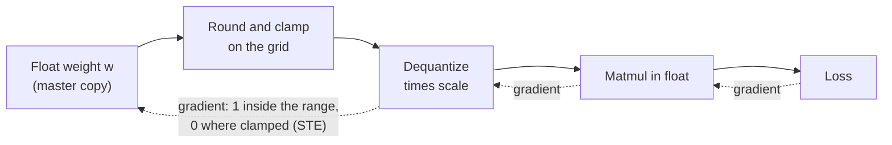

# Leçon 17. Fake quantization et STE

**Lien avec la mission :** Le quantization-aware training est l'autre manière d'obtenir un modèle en faible nombre de bits, et vous ne pouvez pas dire quand il vaut son coût tant que vous ne savez pas dire comment une boucle d'entraînement survit à une étape d'arrondi.
**Source primaire :** [Article : "A White Paper on Neural Network Quantization", Nagel et al., 2021](https://arxiv.org/abs/2106.08295), section 4.1
**Prérequis :** [Leçon 16](0016-kv-cache-quantization.md), [Fake quantization](../GLOSSARY.md), [Estimateur straight-through](../GLOSSARY.md), [Scale](../GLOSSARY.md), [Plage d'écrêtage](../GLOSSARY.md)

## Échauffement

1. ▢ Quantifier une valeur puis la déquantifier ne rend pas le nombre d'origine. Quelle est la plus grande erreur que l'arrondi au plus proche peut ajouter à une valeur située dans la plage d'écrêtage, pour un scale donné ?

<details markdown="1"><summary>Vérifier</summary>

Un demi-pas, soit `scale / 2` (la borne de l'[erreur d'arrondi](../GLOSSARY.md) des leçons 4 et 5). Avec un scale de 0.25, le pire cas est 0.125. Une valeur en dehors de la plage d'écrêtage est ramenée à l'extrémité la plus proche de la plage, et cette erreur d'écrêtage n'a pas une telle borne.

</details>

2. ▢ Un schéma weight-only et un schéma qui quantifie aussi le KV cache existent tous deux après la leçon 16. Lequel des deux change ce que le modèle calcule pendant l'attention à l'inférence, et lequel ne change que ce qui est stocké ?

<details markdown="1"><summary>Vérifier</summary>

La quantification du KV cache change ce que lit l'attention : les clés et les valeurs reviennent du cache avec de l'erreur d'arrondi. La quantification weight-only change les poids par lesquels chaque couche multiplie. Les deux changent les nombres avec lesquels le modèle calcule, ce qui explique que les deux demandent une mesure de qualité et pas seulement une vérification de taille.

</details>

## À savoir

### Fake quantization : quantifier, déquantifier, continuer à calculer en float

Les méthodes post-entraînement (leçons 9 à 12) quantifient un modèle terminé. Le **quantization-aware training** entraîne au contraire avec l'arrondi déjà en place, pour que les poids puissent aller vers des valeurs qui y survivent. Il le fait avec la **fake quantization** : dans la passe avant, chaque poids est quantifié et aussitôt déquantifié, et la multiplication de matrices tourne ensuite sur ces valeurs arrondies en virgule flottante ordinaire. Pour un quantificateur symétrique de scale `s` et de limites de grille entières `n` et `p`, la valeur en passe avant est :

```text
x_hat = s * clamp(round(x / s), n, p)
```

L'équipe PyTorch décrit la même chose : le QAT simule les valeurs numériques de la quantification pendant l'entraînement tout en gardant les poids et les activations dans leur type de données d'origine, donc rien n'est réellement converti vers un type à faible nombre de bits ([billet PyTorch](https://pytorch.org/blog/quantization-aware-training/)). Les poids en pleine précision restent la copie maître que l'optimizer met à jour, et la loss voit l'erreur d'arrondi et d'écrêtage, ce qui est tout l'intérêt.

### Le problème du gradient

L'entraînement a besoin du gradient de la loss par rapport à chaque poids. Nagel et al. soulignent que la dérivée de l'arrondi au plus proche est « soit nulle, soit indéfinie partout », ce qui rend l'entraînement par gradient impossible si on dérive honnêtement l'étape d'arrondi. Entre deux points de la grille, pousser un poids d'une petite quantité ne change rien, donc la vraie pente est nulle. À une frontière d'arrondi, la sortie saute, donc il n'y a aucune pente.

### L'estimateur straight-through

Le contournement est l'**estimateur straight-through** (STE), attribué à [Bengio et al., 2013](https://arxiv.org/abs/1308.3432) : dans la passe arrière, copier le gradient de la sortie de l'étape dure directement vers son entrée, comme si l'étape n'était pas là. Nagel et al. l'appliquent à la quantification en approchant la dérivée de l'arrondi par 1, de sorte que la passe arrière saute entièrement le bloc d'arrondi.

En PyTorch, l'astuce tient sur une ligne, `x + (round(x) - x).detach()`. Sa valeur est `round(x)`, parce que les termes en `x` s'annulent. Son gradient est 1, parce qu'autograd ne regarde pas à l'intérieur de `detach()`. C'est une approximation, pas le vrai gradient : elle dit que déplacer un poids de 0.1 déplace la sortie de 0.1, alors que la vraie sortie bouge par paliers. Elle fonctionne parce que le poids et sa valeur arrondie restent proches.

### Hors de la plage, le gradient est nul

Le clamp n'est pas sauté. Un poids hors de la plage d'écrêtage est maintenu à l'extrémité de la plage quoi qu'on lui fasse, et le gradient le dit. Nagel et al. donnent le gradient de tout le quantificateur par rapport à son entrée : 1 quand la valeur est dans la plage, 0 sinon. Un poids écrêté ne reçoit aucun signal d'apprentissage de la loss tant que quelque chose d'autre ne le ramène pas dans la plage.



Les flèches pleines sont la passe avant. Les pointillées sont la passe arrière : le STE est ce qui permet au gradient de traverser le bloc d'arrondi, et le clamp est ce qui l'arrête pour les valeurs écrêtées.

### Le scale peut aussi apprendre

La même astuce donne un gradient pour le scale. Nagel et al. notent que des travaux ultérieurs (ils citent Esser et al., 2020, entre autres) utilisent le STE pour calculer le gradient par rapport aux paramètres de quantification, de sorte que la plage d'écrêtage est entraînée avec les poids au lieu d'être fixée d'abord. Pour le scale, le gradient d'une valeur dans la plage est `round(x / s) - x / s`, c'est-à-dire moins sa propre erreur d'arrondi en unités de grille, et une valeur écrêtée contribue par sa limite de grille, `n` ou `p`. Le scale est ensuite mis à jour par le même optimizer que les poids.

### Ce que cela coûte

Nagel et al. disent que la meilleure précision du QAT « s'accompagne des coûts habituels de l'entraînement de réseaux de neurones » : un entraînement plus long, le besoin de données et une recherche d'hyperparamètres. La fake quantization ajoute son propre surcoût par-dessus, que la leçon 18 chiffre pour un LLM.

## Pratique

1. ▢ La fake quantization garde les tenseurs en float et n'arrondit que leurs valeurs, au lieu de stocker de vrais poids int4 pendant l'entraînement. Pourquoi est-ce la bonne conception pour une boucle d'entraînement ?

<details markdown="1"><summary>Vérifier</summary>

L'optimizer a besoin d'ajouter de minuscules mises à jour aux poids, et un poids int4 ne peut pas contenir une mise à jour plus petite qu'un pas de grille. Garder une copie maître en float permet aux mises à jour de s'accumuler jusqu'à être assez grandes pour changer la valeur arrondie, tandis que la passe avant voit toujours l'erreur d'arrondi. Le coût est que rien dans l'exécution de l'entraînement n'est plus rapide ni plus petit : seul le modèle final converti est en faible nombre de bits.

</details>

2. ▢ Prédisez, puis exécutez. Que montre chacune des deux lignes affichées : le gradient de `torch.round(x).sum()`, et le gradient de la version straight-through ?

    ```python
    import torch

    x = torch.tensor([0.2, 1.4, 2.6], requires_grad=True)

    torch.round(x).sum().backward()
    print("round grad:", x.grad)

    x.grad = None
    y = x + (torch.round(x) - x).detach()
    y.sum().backward()
    print("ste value:", y.detach())
    print("ste grad:", x.grad)
    ```

<details markdown="1"><summary>Vérifier</summary>

```text
round grad: tensor([0., 0., 0.])
ste value: tensor([0., 1., 3.])
ste grad: tensor([1., 1., 1.])
```

Le `round` propre de PyTorch a un gradient nul partout, donc une loss construite dessus ne mettrait jamais à jour les poids. La version STE a les mêmes valeurs en passe avant (0, 1, 3) mais un gradient de 1 pour chaque élément.

</details>

3. ▢ Prédisez, puis exécutez. Une grille signée de 4 bits va de -8 à 7, et le scale est 0.25. Quel poids reçoit un gradient nul, et quelles sont les valeurs en passe avant ?

    ```python
    import torch

    def fake_quant(x, scale, qmin=-8, qmax=7):
        q = torch.clamp(x / scale, qmin, qmax)
        q = q + (torch.round(q) - q).detach()
        return q * scale

    w = torch.tensor([0.30, -0.47, 1.90, 0.06], requires_grad=True)
    wq = fake_quant(w, 0.25)
    print("values:", wq.detach())
    wq.sum().backward()
    print("grad:", w.grad)
    ```

<details markdown="1"><summary>Indice</summary>

Divisez chaque poids par le scale et comparez-le aux limites de la grille.

</details>

<details markdown="1"><summary>Vérifier</summary>

```text
values: tensor([ 0.2500, -0.5000,  1.7500,  0.0000])
grad: tensor([1., 1., 0., 1.])
```

1.90 / 0.25 = 7.6, ce qui dépasse le plus grand niveau 7, donc il est ramené à 7 * 0.25 = 1.75 et reçoit un gradient 0. Le poids 0.06 est arrondi au niveau 0 et sa valeur est 0, mais son gradient reste 1 : un poids qui est arrondi à zéro est dans la plage, donc le STE le garde entraînable.

</details>

4. ▢ Dans un run de QAT, un poids se trouve bien au-dessus de la plage d'écrêtage. Quel gradient la loss lui donne-t-elle à travers le quantificateur, et pourquoi ?

    - a) Un, parce que le STE ignore le clamp
    - b) Zéro, parce que le STE bloque tous les gradients
    - c) Zéro, parce que le clamp est plat à cet endroit
    - d) Un, parce que les valeurs écrêtées sont toujours des poids

<details markdown="1"><summary>Vérifier</summary>

**c)** La sortie du quantificateur est la même quoi que fasse le poids au-delà de la plage, donc le gradient y est nul. (a) est faux parce que le STE ne remplace que la dérivée de l'arrondi, pas celle du clamp. (b) est faux parce que le STE existe pour laisser passer les gradients, et ils passent bien dans la plage. (d) est faux parce qu'être un paramètre entraînable ne donne pas à la loss un chemin jusqu'à lui : le gradient se calcule à travers les opérations, pas à travers la variable.

</details>

5. ▢ Prédisez, puis exécutez, avec les formules de « Le scale peut aussi apprendre ». Les poids sont les mêmes quatre valeurs, le scale est 0.25, et la cible est ce que nous voudrions que soient les poids quantifiés. Calculez d'abord à la main le gradient par élément de la sortie du quantificateur par rapport au scale, puis le signe du gradient de la loss par rapport au scale, puis exécutez.

    ```python
    import torch

    def fake_quant(x, scale, qmin=-8, qmax=7):
        q = torch.clamp(x / scale, qmin, qmax)
        q = q + (torch.round(q) - q).detach()
        return q * scale

    w = torch.tensor([0.30, -0.47, 1.90, 0.06])
    target = torch.tensor([0.28, -0.52, 1.75, 0.10])
    scale = torch.tensor(0.25, requires_grad=True)
    loss = ((fake_quant(w, scale) - target) ** 2).sum()
    loss.backward()
    print("loss:", round(loss.item(), 4))
    print("d loss / d scale:", round(scale.grad.item(), 4))
    ```

<details markdown="1"><summary>Indice</summary>

Pour chaque poids, `x / s` vaut 1.2, -1.88, 7.6 et 0.24. Le premier, le deuxième et le quatrième sont dans la plage, donc leur gradient est `round(x / s) - x / s`. Le troisième est écrêté à 7.

</details>

<details markdown="1"><summary>Vérifier</summary>

```text
loss: 0.0113
d loss / d scale: 0.0552
```

Les gradients par élément de la valeur quantifiée par rapport au scale sont -0.2, -0.12, 7 et -0.24. Les valeurs quantifiées sont 0.25, -0.5, 1.75 et 0, donc les erreurs par rapport à la cible sont -0.03, +0.02, 0 et -0.10. Le gradient de la loss est la somme de `2 * error * gradient` : 0.012 - 0.0048 + 0 + 0.048 = 0.0552. Le poids écrêté ne contribue ici à rien seulement parce que son erreur se trouve être nulle. Le gradient est positif, donc un pas de descente de gradient réduirait le scale.

</details>

## Exercices en situation réelle

- [ ] Écrivez la fonction `fake_quant` de l'exercice 3 pour une grille non signée de 4 bits (0 à 15) avec un zero-point, exécutez-la sur cinq poids de votre choix, et vérifiez à la main que les valeurs en passe avant correspondent à ce que donnent les formules de quantification et de déquantification de la leçon 4.
- [ ] Ouvrez l'exemple de code du billet PyTorch sur le QAT et trouvez où `prepare` insère la fake quantization et où `convert` la remplace par de vraies opérations de quantification et de déquantification. Écrivez une phrase sur la raison pour laquelle les deux étapes sont séparées.
- [ ] Demain : sans notes, écrivez l'astuce STE en une ligne, la valeur en passe avant de la fake quantization, et la règle de gradient pour une valeur dans et hors de la plage d'écrêtage.

## Pour aller plus loin

- [QAT et matériel](../reference/qat-and-hardware.md)
- [Article : "A White Paper on Neural Network Quantization", Nagel et al., 2021](https://arxiv.org/abs/2106.08295), section 4 pour le pipeline QAT complet
- [Article : "Estimating or Propagating Gradients Through Stochastic Neurons for Conditional Computation", Bengio et al., 2013](https://arxiv.org/abs/1308.3432)
- [Ressources](../RESOURCES.md)

---

Ça ne passe pas ? Relisez la source primaire en haut de page, car cette leçon la condense et c'est dans la condensation que la compréhension s'échappe. Consultez le [glossaire](../GLOSSARY.md) pour tout terme qui vous a paru glissant.

Si c'est la leçon elle-même qui n'est pas claire plutôt que la matière, c'est un défaut : [ouvrez une issue](https://github.com/TokenCemetery/teach/issues).
