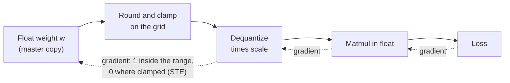

# पाठ 17. Fake Quantization और STE

**मिशन से संबंध:** Quantization-aware training low-bit model पाने का दूसरा तरीक़ा है, और आप यह नहीं बता सकते कि वह अपनी लागत कब वसूल करती है जब तक यह न बता सकें कि training loop rounding step से कैसे बचकर निकलता है।
**मुख्य स्रोत:** [पेपर: "A White Paper on Neural Network Quantization", Nagel et al., 2021](https://arxiv.org/abs/2106.08295), section 4.1
**पूर्व-आवश्यकताएँ:** [पाठ 16](0016-kv-cache-quantization.md), [Fake quantization](../GLOSSARY.md), [Straight-through estimator](../GLOSSARY.md), [Scale](../GLOSSARY.md), [Clipping range](../GLOSSARY.md)

## वार्म-अप

1. ▢ किसी value को quantize करके फिर dequantize करने से मूल संख्या वापस नहीं मिलती। दिए गए scale के लिए, clipping range के भीतर की value में round-to-nearest सबसे बड़ी कितनी error जोड़ सकता है?

<details markdown="1"><summary>जाँचें</summary>

आधा step, यानी `scale / 2` (पाठ 4 और 5 की [rounding error](../GLOSSARY.md) की सीमा)। 0.25 के scale पर सबसे ख़राब हालत 0.125 है। Clipping range के बाहर की value इसके बजाय range के सबसे नज़दीकी सिरे पर खिसका दी जाती है, और उस clipping error की ऐसी कोई सीमा नहीं।

</details>

2. ▢ पाठ 16 के बाद weight-only scheme और वह scheme जो KV cache को भी quantize करती है, दोनों मौजूद हैं। दोनों में से कौन inference के समय attention के दौरान model जो compute करता है उसे बदलती है, और कौन सिर्फ़ यह बदलती है कि क्या store होता है?

<details markdown="1"><summary>जाँचें</summary>

KV-cache quantization बदलती है कि attention क्या पढ़ता है: keys और values cache से अपनी rounding error के साथ वापस आते हैं। Weight-only quantization उन weights को बदलती है जिनसे हर layer गुणा करती है। दोनों उन संख्याओं को बदलती हैं जिनसे model compute करता है, इसीलिए दोनों को सिर्फ़ आकार की जाँच नहीं बल्कि quality का माप चाहिए।

</details>

## यह जानें

### Fake quantization: quantize करें, dequantize करें, float में compute करते रहें

Post-training methods (पाठ 9 से 12) तैयार model को quantize करते हैं। **Quantization-aware training** इसके बजाय rounding को पहले से जगह पर रखकर train करती है, ताकि weights उन values पर जा सकें जो उससे बच जाएँ। वह यह **fake quantization** से करती है: forward pass में हर weight quantize होकर तुरंत dequantize हो जाता है, और matrix multiplication फिर उन rounded values पर सामान्य floating point में चलता है। Scale `s` और integer grid सीमाओं `n` और `p` वाले symmetric quantizer के लिए, forward value है:

```text
x_hat = s * clamp(round(x / s), n, p)
```

PyTorch team यही बात बताती है: QAT training के दौरान quantization के संख्यात्मक व्यवहार का simulation करती है जबकि weights और activations अपने मूल data type में रहते हैं, इसलिए असल में कुछ भी low-bit type में cast नहीं होता ([PyTorch ब्लॉग](https://pytorch.org/blog/quantization-aware-training/))। Full-precision weights master copy के रूप में रहते हैं जिसे optimizer update करता है, और loss rounding और clamping की error देखता है, जो पूरा मक़सद है।

### Gradient की समस्या

Training को loss का हर weight के सापेक्ष gradient चाहिए। Nagel et al. ध्यान दिलाते हैं कि round-to-nearest का derivative "हर जगह या तो zero है या अपरिभाषित" है, जिससे rounding step को ईमानदारी से differentiate करने पर gradient-आधारित training असंभव हो जाती है। दो grid बिंदुओं के बीच, weight को थोड़ा खिसकाने से कुछ नहीं बदलता, इसलिए असली ढलान zero है। Rounding की सीमा पर output कूदता है, इसलिए कोई ढलान है ही नहीं।

### Straight-through estimator

इसका उपाय **straight-through estimator** (STE) है, जिसका श्रेय [Bengio et al., 2013](https://arxiv.org/abs/1308.3432) को जाता है: backward pass में, gradient को कठोर step के output से सीधे उसके input तक नक़ल कर दें, मानो वह step वहाँ हो ही नहीं। Nagel et al. इसे quantization पर rounding के derivative को 1 मानकर लागू करते हैं, इसलिए backward pass rounding block को पूरी तरह छोड़ देता है।

PyTorch में यह तरकीब एक line में आ जाती है, `x + (round(x) - x).detach()`। उसकी value `round(x)` है, क्योंकि `x` वाले terms कट जाते हैं। उसका gradient 1 है, क्योंकि autograd `detach()` के भीतर नहीं देखता। यह एक सन्निकटन है, असली gradient नहीं: यह कहता है कि weight को 0.1 खिसकाने से output 0.1 खिसकता है, जबकि असली output सीढ़ियों में खिसकता है। यह इसलिए चलता है क्योंकि weight और उसकी rounded value पास रहते हैं।

### Range के बाहर, gradient zero है

Clamping को छोड़ा नहीं जाता। Clipping range के बाहर का weight आप उसके साथ कुछ भी करें, range के सिरे पर थमा रहता है, और gradient यही कहता है। Nagel et al. पूरे quantizer का उसके input के सापेक्ष gradient देते हैं: value range के भीतर हो तो 1, वरना 0। Clip हुए weight को loss से कोई सीखने का signal नहीं मिलता जब तक कुछ और उसे वापस range में न ले आए।



ठोस तीर forward pass हैं। बिंदुदार तीर backward pass हैं: STE ही gradient को rounding block पार करने देता है, और clamp ही clip हुई values के लिए उसे रोकता है।

### Scale भी सीख सकता है

यही तरकीब scale के लिए भी gradient देती है। Nagel et al. ध्यान दिलाते हैं कि बाद का काम (वे अन्य के साथ Esser et al., 2020 का हवाला देते हैं) quantization parameters के सापेक्ष gradient compute करने के लिए STE इस्तेमाल करता है, इसलिए clipping range पहले तय करने की जगह weights के साथ train होती है। Scale के लिए, range के भीतर की value का gradient `round(x / s) - x / s` है, जो grid इकाइयों में उसकी अपनी rounding error का ऋणात्मक है, और clip हुई value अपनी grid सीमा, `n` या `p`, का योगदान देती है। Scale फिर उसी optimizer से update होता है जिससे weights।

### इसकी क्या क़ीमत है

Nagel et al. कहते हैं कि QAT की ऊँची accuracy "neural network training की आम क़ीमतों के साथ आती है": लंबी training, data की ज़रूरत, और hyper-parameter search। Fake quantization अपना अलग overhead ऊपर से जोड़ती है, जिसकी क़ीमत पाठ 18 LLM के लिए आँकता है।

## अभ्यास

1. ▢ Fake quantization tensors को float में रखती है और सिर्फ़ उनकी values को round करती है, training के दौरान असली int4 weights store करने की जगह। यह training loop के लिए सही डिज़ाइन क्यों है?

<details markdown="1"><summary>जाँचें</summary>

Optimizer को weights में नन्हे updates जोड़ने होते हैं, और int4 weight एक grid step से छोटा update नहीं रख सकता। Float master copy रखने से updates तब तक जमा होते रहते हैं जब तक वे rounded value बदलने जितने बड़े न हो जाएँ, जबकि forward pass अब भी rounding error देखता है। क़ीमत यह है कि training run में कुछ भी तेज़ या छोटा नहीं होता: सिर्फ़ अंतिम, बदला हुआ model low-bit होता है।

</details>

2. ▢ पहले अनुमान लगाएँ, फिर चलाएँ। छापी गई दोनों lines में से हर एक क्या दिखाती है: `torch.round(x).sum()` का gradient, और straight-through version का gradient?

    ```python
    import torch

    x = torch.tensor([0.2, 1.4, 2.6], requires_grad=True)

    torch.round(x).sum().backward()
    print("round grad:", x.grad)

    x.grad = None
    y = x + (torch.round(x) - x).detach()
    y.sum().backward()
    print("ste value:", y.detach())
    print("ste grad:", x.grad)
    ```

<details markdown="1"><summary>जाँचें</summary>

```text
round grad: tensor([0., 0., 0.])
ste value: tensor([0., 1., 3.])
ste grad: tensor([1., 1., 1.])
```

PyTorch के अपने `round` का gradient हर जगह zero है, इसलिए उस पर बना loss weights को कभी update नहीं करता। STE version के forward values वही हैं (0, 1, 3) पर हर element के लिए gradient 1 है।

</details>

3. ▢ पहले अनुमान लगाएँ, फिर चलाएँ। 4-bit signed grid -8 से 7 तक चलती है, और scale 0.25 है। किस weight को zero gradient मिलता है, और forward values क्या हैं?

    ```python
    import torch

    def fake_quant(x, scale, qmin=-8, qmax=7):
        q = torch.clamp(x / scale, qmin, qmax)
        q = q + (torch.round(q) - q).detach()
        return q * scale

    w = torch.tensor([0.30, -0.47, 1.90, 0.06], requires_grad=True)
    wq = fake_quant(w, 0.25)
    print("values:", wq.detach())
    wq.sum().backward()
    print("grad:", w.grad)
    ```

<details markdown="1"><summary>संकेत</summary>

हर weight को scale से भाग दें और उसकी grid सीमाओं से तुलना करें।

</details>

<details markdown="1"><summary>जाँचें</summary>

```text
values: tensor([ 0.2500, -0.5000,  1.7500,  0.0000])
grad: tensor([1., 1., 0., 1.])
```

1.90 / 0.25 = 7.6 है, जो सबसे बड़े level 7 से ऊपर है, इसलिए वह 7 * 0.25 = 1.75 पर clamp हो जाता है और उसे gradient 0 मिलता है। Weight 0.06 level 0 पर round होता है और उसकी value 0 है, पर उसका gradient अब भी 1 है: जो weight zero पर round होता है वह range के भीतर है, इसलिए STE उसे trainable रखता है।

</details>

4. ▢ QAT run में, कोई weight clipping range से बहुत ऊपर है। Loss उसे quantizer के ज़रिए कौन-सा gradient देता है, और क्यों?

    - a) एक, क्योंकि STE clamp को अनदेखा करता है
    - b) Zero, क्योंकि STE सारे gradients रोकता है
    - c) Zero, क्योंकि वहाँ clamp समतल है
    - d) एक, क्योंकि clip हुई values भी weights हैं

<details markdown="1"><summary>जाँचें</summary>

**c)** Quantizer का output वही रहता है चाहे weight range के आगे कुछ भी करे, इसलिए वहाँ gradient zero है। (a) ग़लत है क्योंकि STE सिर्फ़ rounding के derivative की जगह लेता है, clamp के नहीं। (b) ग़लत है क्योंकि STE gradients को निकलने देने के लिए ही है, और range के भीतर वे गुज़रते हैं। (d) ग़लत है क्योंकि trainable parameter होना loss को उस तक कोई रास्ता नहीं देता: gradient operations से compute होता है, variable से नहीं।

</details>

5. ▢ पहले अनुमान लगाएँ, फिर चलाएँ, "Scale भी सीख सकता है" के formulas का इस्तेमाल करके। Weights वही चार values हैं, scale 0.25 है, और target वह है जो हम चाहेंगे कि quantized weights हों। पहले हाथ से quantizer output का scale के सापेक्ष प्रति-element gradient निकालें, फिर loss के gradient का scale के सापेक्ष sign, फिर चलाएँ।

    ```python
    import torch

    def fake_quant(x, scale, qmin=-8, qmax=7):
        q = torch.clamp(x / scale, qmin, qmax)
        q = q + (torch.round(q) - q).detach()
        return q * scale

    w = torch.tensor([0.30, -0.47, 1.90, 0.06])
    target = torch.tensor([0.28, -0.52, 1.75, 0.10])
    scale = torch.tensor(0.25, requires_grad=True)
    loss = ((fake_quant(w, scale) - target) ** 2).sum()
    loss.backward()
    print("loss:", round(loss.item(), 4))
    print("d loss / d scale:", round(scale.grad.item(), 4))
    ```

<details markdown="1"><summary>संकेत</summary>

हर weight के लिए, `x / s` 1.2, -1.88, 7.6 और 0.24 है। पहला, दूसरा और चौथा range के भीतर हैं, इसलिए उनका gradient `round(x / s) - x / s` है। तीसरा 7 पर clip हुआ है।

</details>

<details markdown="1"><summary>जाँचें</summary>

```text
loss: 0.0113
d loss / d scale: 0.0552
```

Quantized value का scale के सापेक्ष प्रति-element gradient -0.2, -0.12, 7 और -0.24 है। Quantized values 0.25, -0.5, 1.75 और 0 हैं, इसलिए target के मुक़ाबले errors -0.03, +0.02, 0 और -0.10 हैं। Loss का gradient `2 * error * gradient` का योग है: 0.012 - 0.0048 + 0 + 0.048 = 0.0552। Clip हुआ weight यहाँ कुछ योगदान नहीं देता सिर्फ़ इसलिए कि उसकी error संयोग से zero है। Gradient धनात्मक है, इसलिए gradient-descent का एक क़दम scale को सिकोड़ेगा।

</details>

## असली दुनिया का अभ्यास

- [ ] अभ्यास 3 का `fake_quant` function zero point के साथ 4-bit unsigned grid (0 से 15) के लिए लिखें, अपनी चुनी पाँच weights पर चलाएँ, और हाथ से जाँचें कि forward values वही हैं जो पाठ 4 के quantize और dequantize formulas देते हैं।
- [ ] PyTorch QAT ब्लॉग का code sample खोलें और ढूँढें कि `prepare` fake quantization कहाँ डालता है और `convert` उसे असली quantize और dequantize operations से कहाँ बदलता है। एक वाक्य में लिखें कि दोनों चरण अलग क्यों हैं।
- [ ] कल: बिना नोट्स के एक-line वाली STE तरकीब, fake quantization की forward value, और clipping range के भीतर और बाहर की value के लिए gradient का नियम लिखें।

## आगे बढ़ने के लिए

- [QAT और Hardware शीट](../reference/qat-and-hardware.md)
- [पेपर: "A White Paper on Neural Network Quantization", Nagel et al., 2021](https://arxiv.org/abs/2106.08295), पूरी QAT pipeline के लिए section 4
- [पेपर: "Estimating or Propagating Gradients Through Stochastic Neurons for Conditional Computation", Bengio et al., 2013](https://arxiv.org/abs/1308.3432)
- [संसाधन](../RESOURCES.md)

---

बात नहीं बन रही? ऊपर दिए मुख्य स्रोत को दोबारा पढ़ें, क्योंकि यह पाठ उसे संक्षिप्त करता है और समझ संक्षेप में ही रिसती है। जो शब्द फिसलन भरा लगे, उसके लिए [शब्दावली](../GLOSSARY.md) देखें।

अगर दिक़्क़त सामग्री की नहीं बल्कि पाठ की ही है, तो वह एक खोट है: [issue खोलें](https://github.com/TokenCemetery/teach/issues)।
