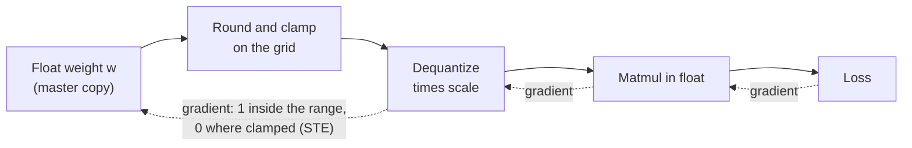

# Lesson 17. Fake Quantization and the STE

**Mission link:** Quantization-aware training is the other way to get a low-bit model, and you cannot say when it earns its cost until you can say how a training loop survives a rounding step.
**Primary source:** [Paper: "A White Paper on Neural Network Quantization", Nagel et al., 2021](https://arxiv.org/abs/2106.08295), section 4.1
**Prerequisites:** [Lesson 16](0016-kv-cache-quantization.md), [Fake quantization](../GLOSSARY.md), [Straight-through estimator](../GLOSSARY.md), [Scale](../GLOSSARY.md), [Clipping range](../GLOSSARY.md)

## Warm-up

1. ▢ Quantizing a value and then dequantizing it does not return the original number. What is the largest error that round-to-nearest can add to a value inside the clipping range, for a given scale?

<details markdown="1"><summary>Check</summary>

Half a step, which is `scale / 2` (the [rounding error](../GLOSSARY.md) bound from lessons 4 and 5). With a scale of 0.25 the worst case is 0.125. A value outside the clipping range is moved to the nearest end of the range instead, and that clipping error has no such bound.

</details>

2. ▢ A weight-only scheme and a scheme that also quantizes the KV cache both exist after lesson 16. Which of the two changes what the model computes during attention at inference time, and which only changes what is stored?

<details markdown="1"><summary>Check</summary>

KV-cache quantization changes what attention reads: keys and values come back from the cache with rounding error in them. Weight-only quantization changes the weights every layer multiplies by. Both change the numbers the model computes with, which is why both need a quality measurement and not just a size check.

</details>

## Know this

### Fake quantization: quantize, dequantize, keep computing in float

Post-training methods (lessons 9 to 12) quantize a finished model. **Quantization-aware training** instead trains with the rounding already in place, so the weights can move to values that survive it. It does that with **fake quantization**: in the forward pass each weight is quantized and immediately dequantized, and the matrix multiplication then runs on those rounded values in ordinary floating point. For a symmetric quantizer with scale `s` and integer grid limits `n` and `p`, the forward value is:

```text
x_hat = s * clamp(round(x / s), n, p)
```

The PyTorch team describes the same thing: QAT simulates quantization numerics during training while keeping the weights and activations in their original data type, so nothing is actually cast to a low-bit type ([PyTorch blog](https://pytorch.org/blog/quantization-aware-training/)). The full-precision weights stay as the master copy that the optimizer updates, and the loss sees the rounding and clamping error, which is the whole point.

### The gradient problem

Training needs the gradient of the loss with respect to each weight. Nagel et al. point out that the derivative of round-to-nearest is "either zero or undefined everywhere", which makes gradient-based training impossible if you differentiate the rounding step honestly. Between two grid points, nudging a weight by a small amount changes nothing, so the true slope is zero. At a rounding boundary the output jumps, so there is no slope at all.

### The straight-through estimator

The workaround is the **straight-through estimator** (STE), credited to [Bengio et al., 2013](https://arxiv.org/abs/1308.3432): in the backward pass, copy the gradient from the output of the hard step straight to its input, as if the step were not there. Nagel et al. apply it to quantization by approximating the derivative of rounding as 1, so the backward pass skips the rounding block entirely.

In PyTorch the trick fits on one line, `x + (round(x) - x).detach()`. Its value is `round(x)`, because the `x` terms cancel. Its gradient is 1, because autograd does not look inside `detach()`. This is an approximation, not the true gradient: it says moving a weight by 0.1 moves the output by 0.1, when the real output moves in steps. It works because the weight and its rounded value stay close.

### Outside the range, the gradient is zero

Clamping is not skipped. A weight outside the clipping range is held at the end of the range whatever you do to it, and the gradient says so. Nagel et al. give the gradient of the whole quantizer with respect to its input: 1 when the value is inside the range, 0 otherwise. A clipped weight gets no learning signal from the loss until something else moves it back in range.



The solid arrows are the forward pass. The dotted ones are the backward pass: the STE is what lets the gradient cross the rounding block, and the clamp is what stops it for clipped values.

### The scale can learn too

The same trick gives a gradient for the scale. Nagel et al. note that later work (they cite Esser et al., 2020, among others) uses the STE to compute the gradient with respect to the quantization parameters, so the clipping range is trained along with the weights instead of being fixed first. For the scale, the gradient of a value inside the range is `round(x / s) - x / s`, which is minus its own rounding error in grid units, and a clipped value contributes its grid limit, `n` or `p`. The scale is then updated by the same optimizer as the weights.

### What it costs

Nagel et al. say QAT's higher accuracy "comes with the usual costs of neural network training": longer training, the need for data, and a hyper-parameter search. Fake quantization adds its own overhead on top, which lesson 18 prices for an LLM.

## Practice

1. ▢ Fake quantization keeps the tensors in float and only rounds their values, instead of storing real int4 weights during training. Why is that the right design for a training loop?

<details markdown="1"><summary>Check</summary>

The optimizer needs to add tiny updates to the weights, and an int4 weight cannot hold an update smaller than one grid step. Keeping a float master copy lets updates accumulate until they are big enough to change the rounded value, while the forward pass still sees the rounding error. The cost is that nothing about the training run is faster or smaller: only the final, converted model is low-bit.

</details>

2. ▢ Predict, then run. What does each of the two printed lines show: the gradient of `torch.round(x).sum()`, and the gradient of the straight-through version?

    ```python
    import torch

    x = torch.tensor([0.2, 1.4, 2.6], requires_grad=True)

    torch.round(x).sum().backward()
    print("round grad:", x.grad)

    x.grad = None
    y = x + (torch.round(x) - x).detach()
    y.sum().backward()
    print("ste value:", y.detach())
    print("ste grad:", x.grad)
    ```

<details markdown="1"><summary>Check</summary>

```text
round grad: tensor([0., 0., 0.])
ste value: tensor([0., 1., 3.])
ste grad: tensor([1., 1., 1.])
```

PyTorch's own `round` has a zero gradient everywhere, so a loss built on it would never update the weights. The STE version has the same forward values (0, 1, 3) but a gradient of 1 for every element.

</details>

3. ▢ Predict, then run. A 4-bit signed grid runs from -8 to 7, and the scale is 0.25. Which weight gets a zero gradient, and what are the forward values?

    ```python
    import torch

    def fake_quant(x, scale, qmin=-8, qmax=7):
        q = torch.clamp(x / scale, qmin, qmax)
        q = q + (torch.round(q) - q).detach()
        return q * scale

    w = torch.tensor([0.30, -0.47, 1.90, 0.06], requires_grad=True)
    wq = fake_quant(w, 0.25)
    print("values:", wq.detach())
    wq.sum().backward()
    print("grad:", w.grad)
    ```

<details markdown="1"><summary>Hint</summary>

Divide each weight by the scale and compare it with the grid limits.

</details>

<details markdown="1"><summary>Check</summary>

```text
values: tensor([ 0.2500, -0.5000,  1.7500,  0.0000])
grad: tensor([1., 1., 0., 1.])
```

1.90 / 0.25 = 7.6, which is above the largest level 7, so it is clamped to 7 * 0.25 = 1.75 and gets gradient 0. The weight 0.06 rounds to level 0 and its value is 0, but its gradient is still 1: a weight that rounds to zero is inside the range, so the STE keeps it trainable.

</details>

4. ▢ In a QAT run, a weight lies far above the clipping range. What gradient does the loss give it through the quantizer, and why?

    - a) One, because the STE ignores the clamp
    - b) Zero, because the STE blocks all gradients
    - c) Zero, because the clamp is flat there
    - d) One, because clipped values are still weights

<details markdown="1"><summary>Check</summary>

**c)** The quantizer's output is the same whatever the weight does beyond the range, so the gradient is zero there. (a) is wrong because the STE replaces the derivative of rounding only, not of the clamp. (b) is wrong because the STE exists to let gradients through, and they do pass inside the range. (d) is wrong because being a trainable parameter does not give the loss a path to it: the gradient is computed through the operations, not the variable.

</details>

5. ▢ Predict, then run, using the formulas in "The scale can learn too". The weights are the same four values, the scale is 0.25, and the target is what we would like the quantized weights to be. First work out by hand the per-element gradient of the quantizer output with respect to the scale, then the sign of the loss gradient with respect to the scale, then run it.

    ```python
    import torch

    def fake_quant(x, scale, qmin=-8, qmax=7):
        q = torch.clamp(x / scale, qmin, qmax)
        q = q + (torch.round(q) - q).detach()
        return q * scale

    w = torch.tensor([0.30, -0.47, 1.90, 0.06])
    target = torch.tensor([0.28, -0.52, 1.75, 0.10])
    scale = torch.tensor(0.25, requires_grad=True)
    loss = ((fake_quant(w, scale) - target) ** 2).sum()
    loss.backward()
    print("loss:", round(loss.item(), 4))
    print("d loss / d scale:", round(scale.grad.item(), 4))
    ```

<details markdown="1"><summary>Hint</summary>

For each weight, `x / s` is 1.2, -1.88, 7.6 and 0.24. The first, second and fourth are inside the range, so their gradient is `round(x / s) - x / s`. The third is clipped to 7.

</details>

<details markdown="1"><summary>Check</summary>

```text
loss: 0.0113
d loss / d scale: 0.0552
```

The per-element gradients of the quantized value with respect to the scale are -0.2, -0.12, 7 and -0.24. The quantized values are 0.25, -0.5, 1.75 and 0, so the errors against the target are -0.03, +0.02, 0 and -0.10. The loss gradient is the sum of `2 * error * gradient`: 0.012 - 0.0048 + 0 + 0.048 = 0.0552. The clipped weight contributes nothing here only because its error happens to be zero. The gradient is positive, so a gradient-descent step would shrink the scale.

</details>

## Real-world reps

- [ ] Write the `fake_quant` function from item 3 for a 4-bit unsigned grid (0 to 15) with a zero point, run it on five weights you choose, and check by hand that the forward values match what lesson 4's quantize and dequantize formulas give.
- [ ] Open the PyTorch QAT blog's code sample and find where `prepare` inserts fake quantization and where `convert` replaces it with real quantize and dequantize operations. Write one sentence on why the two steps are separate.
- [ ] Tomorrow: without notes, write the one-line STE trick, the forward value of fake quantization, and the gradient rule for a value inside and outside the clipping range.

## Going further

- [QAT and Hardware](../reference/qat-and-hardware.md)
- [Paper: "A White Paper on Neural Network Quantization", Nagel et al., 2021](https://arxiv.org/abs/2106.08295), section 4 for the full QAT pipeline
- [Paper: "Estimating or Propagating Gradients Through Stochastic Neurons for Conditional Computation", Bengio et al., 2013](https://arxiv.org/abs/1308.3432)
- [Resources](../RESOURCES.md)

---

Not landing? Reread the primary source at the top, since this lesson compresses it and compression is where understanding leaks. Check the [glossary](../GLOSSARY.md) for any term that felt slippery.

If the lesson itself is unclear rather than the material, that is a defect: [open an issue](https://github.com/TokenCemetery/teach/issues).
