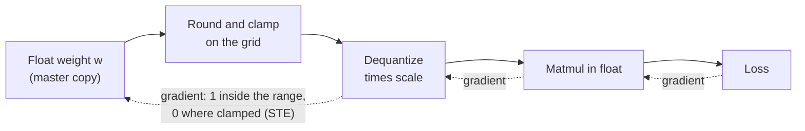

# Lição 17. Quantização fake e o STE

**Ligação com a missão:** O treinamento ciente de quantização é a outra forma de obter um modelo de poucos bits, e você não consegue dizer quando ele compensa o seu custo até conseguir dizer como um loop de treinamento sobrevive a uma etapa de arredondamento.
**Fonte principal:** [Artigo científico: "A White Paper on Neural Network Quantization", Nagel et al., 2021](https://arxiv.org/abs/2106.08295), seção 4.1
**Pré-requisitos:** [Lição 16](0016-kv-cache-quantization.md), [Quantização fake](../GLOSSARY.md), [Straight-through estimator](../GLOSSARY.md), [Scale](../GLOSSARY.md), [Faixa de clipping](../GLOSSARY.md)

## Aquecimento

1. ▢ Quantizar um valor e depois dequantizá-lo não devolve o número original. Qual é o maior erro que o round-to-nearest pode acrescentar a um valor dentro da faixa de clipping, para uma dada scale?

<details markdown="1"><summary>Verificação</summary>

Meio passo, que é `scale / 2` (o limite do [erro de arredondamento](../GLOSSARY.md) das lições 4 e 5). Com uma scale de 0.25 o pior caso é 0.125. Um valor fora da faixa de clipping é movido para a extremidade da faixa mais próxima, e esse erro de clipping não tem tal limite.

</details>

2. ▢ Um esquema somente de pesos e um esquema que também quantiza o KV cache existem depois da lição 16. Qual dos dois muda o que o modelo calcula durante a atenção em tempo de inferência, e qual só muda o que é armazenado?

<details markdown="1"><summary>Verificação</summary>

A quantização do KV cache muda o que a atenção lê: keys e values voltam do cache com erro de arredondamento neles. A quantização somente de pesos muda os pesos pelos quais cada camada multiplica. Ambas mudam os números com que o modelo calcula, e é por isso que ambas precisam de uma medição de qualidade e não apenas de uma verificação de tamanho.

</details>

## Saiba isto

### Quantização fake: quantizar, dequantizar, continuar calculando em float

Os métodos post-training (lições 9 a 12) quantizam um modelo pronto. O **treinamento ciente de quantização**, em vez disso, treina com o arredondamento já presente, para que os pesos possam se mover para valores que sobrevivam a ele. Ele faz isso com a **quantização fake**: no forward pass, cada peso é quantizado e imediatamente dequantizado, e a multiplicação de matrizes então roda sobre esses valores arredondados em ponto flutuante comum. Para um quantizador simétrico com scale `s` e limites de grade inteiros `n` e `p`, o valor no forward é:

```text
x_hat = s * clamp(round(x / s), n, p)
```

A equipe do PyTorch descreve a mesma coisa: o QAT simula a numérica da quantização durante o treinamento enquanto mantém os pesos e as ativações no seu tipo de dado original, então nada é de fato convertido para um tipo de poucos bits ([blog do PyTorch](https://pytorch.org/blog/quantization-aware-training/)). Os pesos em precisão total ficam como a cópia master que o otimizador atualiza, e a loss enxerga o erro de arredondamento e de clamping, que é todo o ponto.

### O problema do gradiente

O treinamento precisa do gradiente da loss em relação a cada peso. Nagel et al. apontam que a derivada do round-to-nearest é "zero ou indefinida em toda parte", o que torna o treinamento baseado em gradiente impossível se você diferenciar a etapa de arredondamento honestamente. Entre dois pontos da grade, empurrar um peso por uma pequena quantidade não muda nada, então a inclinação verdadeira é zero. Em uma fronteira de arredondamento a saída dá um salto, então não há inclinação alguma.

### O straight-through estimator

A solução alternativa é o **straight-through estimator** (STE), creditado a [Bengio et al., 2013](https://arxiv.org/abs/1308.3432): no backward pass, copie o gradiente da saída da etapa rígida direto para a sua entrada, como se a etapa não estivesse ali. Nagel et al. o aplicam à quantização aproximando a derivada do arredondamento como 1, de modo que o backward pass pula o bloco de arredondamento por inteiro.

No PyTorch o truque cabe em uma linha, `x + (round(x) - x).detach()`. O seu valor é `round(x)`, porque os termos `x` se cancelam. O seu gradiente é 1, porque o autograd não olha dentro de `detach()`. Isso é uma aproximação, não o gradiente verdadeiro: ele diz que mover um peso em 0.1 move a saída em 0.1, quando a saída real se move em degraus. Funciona porque o peso e o seu valor arredondado ficam próximos.

### Fora da faixa, o gradiente é zero

O clamping não é pulado. Um peso fora da faixa de clipping é mantido na extremidade da faixa, não importa o que você faça com ele, e o gradiente diz isso. Nagel et al. dão o gradiente do quantizador inteiro em relação à sua entrada: 1 quando o valor está dentro da faixa, 0 caso contrário. Um peso com clipping não recebe nenhum sinal de aprendizado da loss até que alguma outra coisa o traga de volta à faixa.



As setas sólidas são o forward pass. As pontilhadas são o backward pass: o STE é o que deixa o gradiente atravessar o bloco de arredondamento, e o clamp é o que o detém para valores com clipping.

### A scale também pode aprender

O mesmo truque dá um gradiente para a scale. Nagel et al. observam que trabalhos posteriores (eles citam Esser et al., 2020, entre outros) usam o STE para calcular o gradiente em relação aos parâmetros de quantização, de modo que a faixa de clipping seja treinada junto com os pesos em vez de fixada antes. Para a scale, o gradiente de um valor dentro da faixa é `round(x / s) - x / s`, que é menos o seu próprio erro de arredondamento em unidades da grade, e um valor com clipping contribui com o seu limite da grade, `n` ou `p`. A scale é então atualizada pelo mesmo otimizador que os pesos.

### O que custa

Nagel et al. dizem que a maior acurácia do QAT "vem com os custos usuais do treinamento de redes neurais": treinamento mais longo, a necessidade de dados e uma busca de hiperparâmetros. A quantização fake acrescenta o seu próprio overhead por cima, que a lição 18 precifica para um LLM.

## Prática

1. ▢ A quantização fake mantém os tensores em float e só arredonda os seus valores, em vez de armazenar pesos int4 reais durante o treinamento. Por que esse é o projeto certo para um loop de treinamento?

<details markdown="1"><summary>Verificação</summary>

O otimizador precisa somar pequenas atualizações aos pesos, e um peso int4 não consegue guardar uma atualização menor que um passo da grade. Manter uma cópia master em float permite que as atualizações se acumulem até serem grandes o bastante para mudar o valor arredondado, enquanto o forward pass ainda enxerga o erro de arredondamento. O custo é que nada na execução do treinamento fica mais rápido ou menor: só o modelo final, convertido, é de poucos bits.

</details>

2. ▢ Preveja e depois execute. O que cada uma das duas linhas impressas mostra: o gradiente de `torch.round(x).sum()` e o gradiente da versão straight-through?

    ```python
    import torch

    x = torch.tensor([0.2, 1.4, 2.6], requires_grad=True)

    torch.round(x).sum().backward()
    print("round grad:", x.grad)

    x.grad = None
    y = x + (torch.round(x) - x).detach()
    y.sum().backward()
    print("ste value:", y.detach())
    print("ste grad:", x.grad)
    ```

<details markdown="1"><summary>Verificação</summary>

```text
round grad: tensor([0., 0., 0.])
ste value: tensor([0., 1., 3.])
ste grad: tensor([1., 1., 1.])
```

O `round` do próprio PyTorch tem gradiente zero em toda parte, então uma loss construída sobre ele nunca atualizaria os pesos. A versão STE tem os mesmos valores no forward (0, 1, 3), mas um gradiente de 1 para todo elemento.

</details>

3. ▢ Preveja e depois execute. Uma grade com sinal de 4 bits vai de -8 a 7, e a scale é 0.25. Qual peso recebe um gradiente zero, e quais são os valores do forward?

    ```python
    import torch

    def fake_quant(x, scale, qmin=-8, qmax=7):
        q = torch.clamp(x / scale, qmin, qmax)
        q = q + (torch.round(q) - q).detach()
        return q * scale

    w = torch.tensor([0.30, -0.47, 1.90, 0.06], requires_grad=True)
    wq = fake_quant(w, 0.25)
    print("values:", wq.detach())
    wq.sum().backward()
    print("grad:", w.grad)
    ```

<details markdown="1"><summary>Dica</summary>

Divida cada peso pela scale e compare com os limites da grade.

</details>

<details markdown="1"><summary>Verificação</summary>

```text
values: tensor([ 0.2500, -0.5000,  1.7500,  0.0000])
grad: tensor([1., 1., 0., 1.])
```

1.90 / 0.25 = 7.6, que está acima do maior nível 7, então é limitado a 7 * 0.25 = 1.75 e recebe gradiente 0. O peso 0.06 arredonda para o nível 0 e o seu valor é 0, mas o seu gradiente ainda é 1: um peso que arredonda para zero está dentro da faixa, então o STE o mantém treinável.

</details>

4. ▢ Em uma execução de QAT, um peso fica muito acima da faixa de clipping. Que gradiente a loss dá a ele através do quantizador, e por quê?

    - a) Um, porque o STE ignora o clamp
    - b) Zero, porque o STE bloqueia todos os gradientes
    - c) Zero, porque o clamp é plano ali
    - d) Um, porque valores com clipping ainda são pesos

<details markdown="1"><summary>Verificação</summary>

**c)** A saída do quantizador é a mesma não importa o que o peso faça além da faixa, então o gradiente é zero ali. (a) está errada porque o STE substitui apenas a derivada do arredondamento, não a do clamp. (b) está errada porque o STE existe para deixar gradientes passarem, e eles passam dentro da faixa. (d) está errada porque ser um parâmetro treinável não dá à loss um caminho até ele: o gradiente é calculado através das operações, não da variável.

</details>

5. ▢ Preveja e depois execute, usando as fórmulas em "A scale também pode aprender". Os pesos são os mesmos quatro valores, a scale é 0.25 e o alvo é o que gostaríamos que os pesos quantizados fossem. Primeiro calcule à mão o gradiente por elemento da saída do quantizador em relação à scale, depois o sinal do gradiente da loss em relação à scale, e então execute.

    ```python
    import torch

    def fake_quant(x, scale, qmin=-8, qmax=7):
        q = torch.clamp(x / scale, qmin, qmax)
        q = q + (torch.round(q) - q).detach()
        return q * scale

    w = torch.tensor([0.30, -0.47, 1.90, 0.06])
    target = torch.tensor([0.28, -0.52, 1.75, 0.10])
    scale = torch.tensor(0.25, requires_grad=True)
    loss = ((fake_quant(w, scale) - target) ** 2).sum()
    loss.backward()
    print("loss:", round(loss.item(), 4))
    print("d loss / d scale:", round(scale.grad.item(), 4))
    ```

<details markdown="1"><summary>Dica</summary>

Para cada peso, `x / s` é 1.2, -1.88, 7.6 e 0.24. O primeiro, o segundo e o quarto estão dentro da faixa, então o seu gradiente é `round(x / s) - x / s`. O terceiro sofre clipping para 7.

</details>

<details markdown="1"><summary>Verificação</summary>

```text
loss: 0.0113
d loss / d scale: 0.0552
```

Os gradientes por elemento do valor quantizado em relação à scale são -0.2, -0.12, 7 e -0.24. Os valores quantizados são 0.25, -0.5, 1.75 e 0, então os erros em relação ao alvo são -0.03, +0.02, 0 e -0.10. O gradiente da loss é a soma de `2 * erro * gradiente`: 0.012 - 0.0048 + 0 + 0.048 = 0.0552. O peso com clipping não contribui aqui só porque o seu erro por acaso é zero. O gradiente é positivo, então um passo de gradient descent reduziria a scale.

</details>

## Prática no mundo real

- [ ] Escreva a função `fake_quant` do item 3 para uma grade sem sinal de 4 bits (0 a 15) com um zero-point, execute-a em cinco pesos que você escolher e confira à mão que os valores do forward coincidem com o que as fórmulas de quantizar e dequantizar da lição 4 dão.
- [ ] Abra o exemplo de código do blog de QAT do PyTorch e encontre onde o `prepare` insere a quantização fake e onde o `convert` a substitui por operações reais de quantizar e dequantizar. Escreva uma frase sobre por que as duas etapas são separadas.
- [ ] Amanhã: sem consultar anotações, escreva o truque do STE em uma linha, o valor do forward da quantização fake e a regra do gradiente para um valor dentro e fora da faixa de clipping.

## Para ir além

- [QAT e Hardware](../reference/qat-and-hardware.md)
- [Artigo científico: "A White Paper on Neural Network Quantization", Nagel et al., 2021](https://arxiv.org/abs/2106.08295), seção 4 para o pipeline completo de QAT
- [Artigo científico: "Estimating or Propagating Gradients Through Stochastic Neurons for Conditional Computation", Bengio et al., 2013](https://arxiv.org/abs/1308.3432)
- [Recursos](../RESOURCES.md)

---

Não ficou claro? Releia a fonte principal no topo, já que esta lição a comprime e é na compressão que o entendimento escapa. Consulte o [glossário](../GLOSSARY.md) para qualquer termo que pareceu escorregadio.

Se o problema é a lição em si, e não o material, isso é um defeito: [abra uma issue](https://github.com/TokenCemetery/teach/issues).
