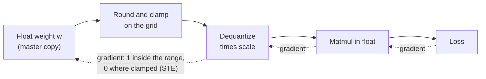

# Урок 17. Fake-квантизация и STE

**Связь с целью курса:** Обучение с учётом квантизации это другой способ получить модель с малой разрядностью, и вы не сможете сказать, когда оно окупает свою цену, пока не сможете сказать, как цикл обучения переживает шаг округления.
**Первоисточник:** [Научная статья: "A White Paper on Neural Network Quantization", Nagel et al., 2021](https://arxiv.org/abs/2106.08295), раздел 4.1
**Предварительные требования:** [Урок 16](0016-kv-cache-quantization.md), [Fake-квантизация](../GLOSSARY.md), [Straight-through estimator](../GLOSSARY.md), [Масштаб](../GLOSSARY.md), [Диапазон отсечения](../GLOSSARY.md)

## Разминка

1. ▢ Квантизация значения с последующей деквантизацией не возвращает исходное число. Какова наибольшая ошибка, которую округление к ближайшему может добавить значению внутри диапазона отсечения при данном масштабе?

<details markdown="1"><summary>Проверка</summary>

Полшага, то есть `scale / 2` (граница [ошибки округления](../GLOSSARY.md) из уроков 4 и 5). При масштабе 0,25 наихудший случай равен 0,125. Значение вне диапазона отсечения вместо этого смещается к ближайшему концу диапазона, и у этой ошибки отсечения такой границы нет.

</details>

2. ▢ После урока 16 существуют и схема только для весов, и схема, которая квантизует ещё и KV-кеш. Какая из двух меняет то, что модель вычисляет при внимании во время инференса, а какая меняет только то, что хранится?

<details markdown="1"><summary>Проверка</summary>

Квантизация KV-кеша меняет то, что читает внимание: ключи и значения возвращаются из кеша с ошибкой округления. Квантизация только весов меняет веса, на которые умножает каждый слой. Обе меняют числа, с которыми считает модель, поэтому обеим нужно измерение качества, а не только проверка размера.

</details>

## Что нужно знать

### Fake-квантизация: квантизовать, деквантизовать, продолжать считать в float

Посттренировочные методы (уроки с 9 по 12) квантизуют готовую модель. **Обучение с учётом квантизации** вместо этого обучает уже с округлением на месте, так что веса могут сдвинуться к значениям, которые его переживают. Оно делает это с помощью **fake-квантизации**: в прямом проходе каждый вес квантизуется и сразу деквантизуется, а умножение матриц затем выполняется на этих округлённых значениях в обычной арифметике с плавающей точкой. Для симметричного квантизатора с масштабом `s` и пределами целочисленной сетки `n` и `p` значение в прямом проходе равно:

```text
x_hat = s * clamp(round(x / s), n, p)
```

Команда PyTorch описывает то же самое: QAT имитирует числовые особенности квантизации во время обучения, оставляя веса и активации в исходном типе данных, так что ничто на самом деле не приводится к типу с малой разрядностью ([блог PyTorch](https://pytorch.org/blog/quantization-aware-training/)). Веса в полной точности остаются главной копией, которую обновляет оптимизатор, а функция потерь видит ошибку округления и отсечения, в чём и весь смысл.

### Проблема градиента

Обучению нужен градиент функции потерь по каждому весу. Nagel и соавторы указывают, что производная округления к ближайшему «либо нулевая, либо не определена везде», что делает обучение на градиентах невозможным, если честно дифференцировать шаг округления. Между двумя точками сетки смещение веса на небольшую величину ничего не меняет, так что истинный наклон равен нулю. На границе округления выход скачет, так что наклона нет вовсе.

### Straight-through estimator

Обходной путь это **straight-through estimator** (STE), который приписывают [Bengio и соавторам, 2013](https://arxiv.org/abs/1308.3432): в обратном проходе копировать градиент с выхода жёсткого шага прямо на его вход, как будто шага нет. Nagel и соавторы применяют его к квантизации, приближая производную округления единицей, так что обратный проход полностью пропускает блок округления.

В PyTorch этот трюк умещается в одну строку, `x + (round(x) - x).detach()`. Её значение равно `round(x)`, потому что члены `x` сокращаются. Её градиент равен 1, потому что autograd не заглядывает внутрь `detach()`. Это приближение, а не истинный градиент: оно утверждает, что смещение веса на 0,1 смещает выход на 0,1, тогда как реальный выход движется ступенями. Оно работает потому, что вес и его округлённое значение остаются близки.

### Вне диапазона градиент равен нулю

Отсечение не пропускается. Вес вне диапазона отсечения удерживается на конце диапазона, что бы с ним ни делали, и градиент это отражает. Nagel и соавторы дают градиент всего квантизатора по его входу: 1, когда значение внутри диапазона, и 0 в остальных случаях. Отсечённый вес не получает обучающего сигнала от функции потерь, пока что-то другое не вернёт его в диапазон.



Сплошные стрелки это прямой проход. Пунктирные это обратный проход: STE позволяет градиенту пересечь блок округления, а отсечение останавливает его для отсечённых значений.

### Масштаб тоже может обучаться

Тот же трюк даёт градиент для масштаба. Nagel и соавторы отмечают, что более поздняя работа (они ссылаются, среди прочих, на Esser et al., 2020) использует STE, чтобы вычислить градиент по параметрам квантизации, так что диапазон отсечения обучается вместе с весами, а не фиксируется заранее. Для масштаба градиент значения внутри диапазона равен `round(x / s) - x / s`, то есть минус его собственная ошибка округления в единицах сетки, а отсечённое значение вносит свой предел сетки, `n` или `p`. Затем масштаб обновляется тем же оптимизатором, что и веса.

### Чего это стоит

Nagel и соавторы говорят, что более высокая точность QAT «приходит с обычными затратами на обучение нейронных сетей»: более долгое обучение, потребность в данных и поиск гиперпараметров. Fake-квантизация добавляет сверху собственные накладные расходы, которые урок 18 оценивает для LLM.

## Практика

1. ▢ Fake-квантизация держит тензоры в float и лишь округляет их значения, вместо того чтобы хранить настоящие веса int4 во время обучения. Почему это правильный дизайн для цикла обучения?

<details markdown="1"><summary>Проверка</summary>

Оптимизатору нужно добавлять к весам крошечные обновления, а вес int4 не может удержать обновление меньше одного шага сетки. Главная копия в float позволяет обновлениям накапливаться, пока они не станут достаточно большими, чтобы изменить округлённое значение, а прямой проход при этом всё равно видит ошибку округления. Цена в том, что сам запуск обучения не становится ни быстрее, ни меньше: с малой разрядностью только итоговая, преобразованная модель.

</details>

2. ▢ Предскажите, затем запустите. Что показывает каждая из двух напечатанных строк: градиент `torch.round(x).sum()` и градиент версии со straight-through?

    ```python
    import torch

    x = torch.tensor([0.2, 1.4, 2.6], requires_grad=True)

    torch.round(x).sum().backward()
    print("round grad:", x.grad)

    x.grad = None
    y = x + (torch.round(x) - x).detach()
    y.sum().backward()
    print("ste value:", y.detach())
    print("ste grad:", x.grad)
    ```

<details markdown="1"><summary>Проверка</summary>

```text
round grad: tensor([0., 0., 0.])
ste value: tensor([0., 1., 3.])
ste grad: tensor([1., 1., 1.])
```

Собственный `round` в PyTorch имеет нулевой градиент везде, поэтому функция потерь, построенная на нём, никогда не обновила бы веса. Версия с STE даёт те же значения в прямом проходе (0, 1, 3), но градиент 1 для каждого элемента.

</details>

3. ▢ Предскажите, затем запустите. 4-битная знаковая сетка идёт от -8 до 7, а масштаб равен 0,25. Какой вес получает нулевой градиент и каковы значения в прямом проходе?

    ```python
    import torch

    def fake_quant(x, scale, qmin=-8, qmax=7):
        q = torch.clamp(x / scale, qmin, qmax)
        q = q + (torch.round(q) - q).detach()
        return q * scale

    w = torch.tensor([0.30, -0.47, 1.90, 0.06], requires_grad=True)
    wq = fake_quant(w, 0.25)
    print("values:", wq.detach())
    wq.sum().backward()
    print("grad:", w.grad)
    ```

<details markdown="1"><summary>Подсказка</summary>

Разделите каждый вес на масштаб и сравните с пределами сетки.

</details>

<details markdown="1"><summary>Проверка</summary>

```text
values: tensor([ 0.2500, -0.5000,  1.7500,  0.0000])
grad: tensor([1., 1., 0., 1.])
```

1,90 / 0,25 = 7,6, что выше наибольшего уровня 7, поэтому отсекается до 7 * 0,25 = 1,75 и получает градиент 0. Вес 0,06 округляется до уровня 0 и его значение равно 0, но градиент всё равно 1: вес, округлённый до нуля, находится внутри диапазона, поэтому STE сохраняет его обучаемым.

</details>

4. ▢ В запуске QAT вес лежит далеко выше диапазона отсечения. Какой градиент даёт ему функция потерь через квантизатор и почему?

    - a) Единицу, потому что STE игнорирует отсечение
    - b) Нуль, потому что STE блокирует все градиенты
    - c) Нуль, потому что отсечение там плоское
    - d) Единицу, потому что отсечённые значения всё ещё веса

<details markdown="1"><summary>Проверка</summary>

**c)** Выход квантизатора один и тот же, что бы вес ни делал за пределами диапазона, поэтому градиент там нулевой. (a) неверно, потому что STE заменяет производную только округления, а не отсечения. (b) неверно, потому что STE существует, чтобы пропускать градиенты, и внутри диапазона они проходят. (d) неверно, потому что обучаемость параметра не даёт функции потерь пути к нему: градиент вычисляется через операции, а не через переменную.

</details>

5. ▢ Предскажите, затем запустите, используя формулы из раздела «Масштаб тоже может обучаться». Веса те же четыре значения, масштаб 0,25, а цель это то, какими мы хотели бы видеть квантизованные веса. Сначала вычислите вручную градиент выхода квантизатора по масштабу для каждого элемента, затем знак градиента функции потерь по масштабу, затем запустите.

    ```python
    import torch

    def fake_quant(x, scale, qmin=-8, qmax=7):
        q = torch.clamp(x / scale, qmin, qmax)
        q = q + (torch.round(q) - q).detach()
        return q * scale

    w = torch.tensor([0.30, -0.47, 1.90, 0.06])
    target = torch.tensor([0.28, -0.52, 1.75, 0.10])
    scale = torch.tensor(0.25, requires_grad=True)
    loss = ((fake_quant(w, scale) - target) ** 2).sum()
    loss.backward()
    print("loss:", round(loss.item(), 4))
    print("d loss / d scale:", round(scale.grad.item(), 4))
    ```

<details markdown="1"><summary>Подсказка</summary>

Для каждого веса `x / s` равно 1,2, -1,88, 7,6 и 0,24. Первый, второй и четвёртый внутри диапазона, поэтому их градиент равен `round(x / s) - x / s`. Третий отсечён до 7.

</details>

<details markdown="1"><summary>Проверка</summary>

```text
loss: 0.0113
d loss / d scale: 0.0552
```

Градиенты квантизованного значения по масштабу для каждого элемента равны -0,2, -0,12, 7 и -0,24. Квантизованные значения равны 0,25, -0,5, 1,75 и 0, так что ошибки относительно цели равны -0,03, +0,02, 0 и -0,10. Градиент функции потерь это сумма `2 * error * gradient`: 0,012 - 0,0048 + 0 + 0,048 = 0,0552. Отсечённый вес здесь ничего не вносит лишь потому, что его ошибка оказывается нулевой. Градиент положителен, поэтому шаг градиентного спуска уменьшил бы масштаб.

</details>

## Практика в реальной работе

- [ ] Напишите функцию `fake_quant` из упражнения 3 для 4-битной беззнаковой сетки (от 0 до 15) с нулевой точкой, запустите её на пяти выбранных вами весах и проверьте вручную, что значения в прямом проходе совпадают с тем, что дают формулы квантизации и деквантизации из урока 4.
- [ ] Откройте пример кода в блоге PyTorch о QAT и найдите, где `prepare` вставляет fake-квантизацию и где `convert` заменяет её настоящими операциями квантизации и деквантизации. Напишите одно предложение о том, почему эти два шага разделены.
- [ ] Завтра, без заметок, запишите однострочный трюк STE, значение fake-квантизации в прямом проходе и правило градиента для значения внутри и вне диапазона отсечения.

## Что почитать дальше

- [QAT и оборудование](../reference/qat-and-hardware.md)
- [Научная статья: "A White Paper on Neural Network Quantization", Nagel et al., 2021](https://arxiv.org/abs/2106.08295), раздел 4 о полном конвейере QAT
- [Научная статья: "Estimating or Propagating Gradients Through Stochastic Neurons for Conditional Computation", Bengio et al., 2013](https://arxiv.org/abs/1308.3432)
- [Ресурсы](../RESOURCES.md)

---

Не доходит? Перечитайте первоисточник в начале: этот урок его сжимает, а при сжатии понимание как раз и теряется. Загляните в [глоссарий](../GLOSSARY.md), если какой-то термин показался скользким.

Если неясен сам урок, а не материал, это дефект: [откройте issue](https://github.com/TokenCemetery/teach/issues).
