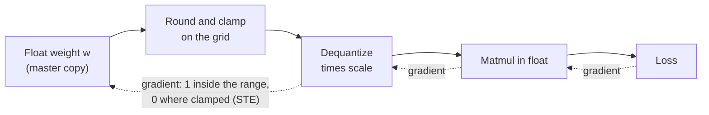

# 第 17 课：伪量化与 STE

**使命关联:** 量化感知训练是得到低位模型的另一条路，而你得先说得清一个训练循环怎样挺过舍入这一步，才能说它在什么时候值回它的成本。
**主要来源:** [论文：“A White Paper on Neural Network Quantization”，Nagel 等，2021](https://arxiv.org/abs/2106.08295)，第 4.1 节
**前置知识:** [第 16 课](0016-kv-cache-quantization.md)、[伪量化](../GLOSSARY.md)、[直通估计器](../GLOSSARY.md)、[缩放因子](../GLOSSARY.md)、[截断范围](../GLOSSARY.md)

## 热身

1. ▢ 把一个值量化再反量化，得不到原来的数。对给定的缩放因子，就近舍入能给截断范围之内的值增加的最大误差是多少？

<details markdown="1"><summary>检查</summary>

半个步长，也就是 `scale / 2`（第 4 和第 5 课的[舍入误差](../GLOSSARY.md)界）。缩放因子为 0.25 时，最坏情况是 0.125。截断范围之外的值，会被移到范围最近的一端，而那个截断误差没有这样的界。

</details>

2. ▢ 第 16 课之后，仅权重量化的方案和同时量化 KV 缓存的方案都存在。这两者中，哪一个改变了模型在推理时做注意力所计算的东西，哪一个只改变了存储的东西？

<details markdown="1"><summary>检查</summary>

KV 缓存量化改变的是注意力读取的东西：键和值从缓存里读回来时带着舍入误差。仅权重量化改变的是每一层所乘的权重。两者都改变了模型计算所用的数字，这就是为什么两者都需要质量的度量，而不能只看大小。

</details>

## 要点

### 伪量化：量化、反量化，继续用浮点计算

训练后方法（第 9 到第 12 课）量化的是一个已经完成的模型。**量化感知训练**则是在舍入已经就位的情况下训练，使权重可以移动到经得起舍入的取值上。它靠**伪量化**做到这一点：在前向传播中，每个权重先被量化，紧接着被反量化，然后矩阵乘法在这些舍入后的值上以普通浮点运行。对于缩放因子为 `s`、整数网格界限为 `n` 和 `p` 的对称量化器，前向的值是：

```text
x_hat = s * clamp(round(x / s), n, p)
```

PyTorch 团队描述的是同一件事：QAT 在训练期间模拟量化的数值，同时让权重和激活值保持原来的数据类型，所以没有任何东西被真正转换成低位类型（[PyTorch 博客](https://pytorch.org/blog/quantization-aware-training/)）。全精度的权重仍然是优化器更新的主副本，而损失看到的是舍入和钳制带来的误差，这正是关键所在。

### 梯度问题

训练需要损失对每个权重的梯度。Nagel 等人指出，就近舍入的导数“处处要么为零，要么没有定义”，所以如果老老实实地对舍入这一步求导，基于梯度的训练就不可能进行。在两个网格点之间，把权重轻轻推动一点，什么也不会变，所以真实的斜率是零。在舍入的边界处，输出发生跳变，所以根本没有斜率。

### 直通估计器

变通的办法是**直通估计器**（STE），出自 [Bengio 等，2013](https://arxiv.org/abs/1308.3432)：在反向传播中，把梯度从硬阶跃的输出直接复制到它的输入，就像这一步不存在一样。Nagel 等人把它应用到量化上，把舍入的导数近似为 1，使反向传播完全跳过舍入这个模块。

在 PyTorch 里，这个技巧一行就写得下，`x + (round(x) - x).detach()`。它的值是 `round(x)`，因为 `x` 项互相抵消了。它的梯度是 1，因为自动求导不会看进 `detach()` 的内部。这是一个近似，不是真实的梯度：它说把权重移动 0.1，输出就移动 0.1，而真实的输出是一级一级跳变的。它之所以管用，是因为权重和它舍入后的值始终很接近。

### 范围之外，梯度为零

钳制没有被跳过。一个落在截断范围之外的权重，不管你对它做什么，都被固定在范围的端点上，梯度也这样说。Nagel 等人给出了整个量化器对其输入的梯度：值在范围之内时为 1，否则为 0。一个被截断的权重得不到来自损失的任何学习信号，直到有别的东西把它移回范围之内。



实线箭头是前向传播。虚线箭头是反向传播：STE 让梯度能够穿过舍入模块，而钳制则让被截断的值的梯度到此为止。

### 缩放因子也可以学习

同样的技巧也给出了缩放因子的梯度。Nagel 等人指出，后来的工作（他们引用了 Esser 等，2020，以及其他）用 STE 来计算对量化参数的梯度，所以截断范围是与权重一起训练的，而不是先固定下来。对于缩放因子，范围之内的值的梯度是 `round(x / s) - x / s`，也就是以网格为单位的、它自己的舍入误差的相反数，而被截断的值贡献的是它的网格界限，`n` 或 `p`。然后缩放因子由与权重相同的优化器来更新。

### 它的代价

Nagel 等人说，QAT 更高的精度“伴随着神经网络训练通常的代价”：更长的训练、对数据的需求，以及超参数搜索。伪量化在此之上还要加上它自己的开销，第 18 课会为 LLM 给它标价。

## 练习

1. ▢ 伪量化让张量保持浮点，只对它们的值做舍入，而不是在训练期间存储真正的 int4 权重。为什么这是训练循环的正确设计？

<details markdown="1"><summary>检查</summary>

优化器需要给权重加上很小的更新，而一个 int4 的权重存不下小于一个网格步长的更新。保留一个浮点主副本，让更新可以累积，直到大到足以改变舍入后的值，同时前向传播仍然看得到舍入误差。代价是训练过程本身并没有变快或变小：只有最终转换出来的模型才是低位的。

</details>

2. ▢ 先预测，再运行。打印出来的两行各显示什么：`torch.round(x).sum()` 的梯度，以及直通版本的梯度？

    ```python
    import torch

    x = torch.tensor([0.2, 1.4, 2.6], requires_grad=True)

    torch.round(x).sum().backward()
    print("round grad:", x.grad)

    x.grad = None
    y = x + (torch.round(x) - x).detach()
    y.sum().backward()
    print("ste value:", y.detach())
    print("ste grad:", x.grad)
    ```

<details markdown="1"><summary>检查</summary>

```text
round grad: tensor([0., 0., 0.])
ste value: tensor([0., 1., 3.])
ste grad: tensor([1., 1., 1.])
```

PyTorch 自己的 `round` 处处梯度为零，所以建立在它上面的损失永远不会更新权重。STE 版本的前向值相同（0、1、3），但每个元素的梯度都是 1。

</details>

3. ▢ 先预测，再运行。一个 4 位有符号网格从 -8 到 7，缩放因子是 0.25。哪个权重得到零梯度？前向的值是多少？

    ```python
    import torch

    def fake_quant(x, scale, qmin=-8, qmax=7):
        q = torch.clamp(x / scale, qmin, qmax)
        q = q + (torch.round(q) - q).detach()
        return q * scale

    w = torch.tensor([0.30, -0.47, 1.90, 0.06], requires_grad=True)
    wq = fake_quant(w, 0.25)
    print("values:", wq.detach())
    wq.sum().backward()
    print("grad:", w.grad)
    ```

<details markdown="1"><summary>提示</summary>

把每个权重除以缩放因子，并与网格界限比较。

</details>

<details markdown="1"><summary>检查</summary>

```text
values: tensor([ 0.2500, -0.5000,  1.7500,  0.0000])
grad: tensor([1., 1., 0., 1.])
```

1.90 / 0.25 = 7.6，高于最大档位 7，所以被钳制到 7 * 0.25 = 1.75，梯度为 0。权重 0.06 舍入到档位 0，值为 0，但它的梯度仍然是 1：一个舍入成零的权重位于范围之内，所以 STE 让它保持可训练。

</details>

4. ▢ 在一次 QAT 运行中，一个权重远在截断范围之上。损失通过量化器给它什么梯度？为什么？

    - a) 一，因为 STE 忽略钳制
    - b) 零，因为 STE 阻断所有梯度
    - c) 零，因为钳制在那里是平的
    - d) 一，因为被截断的值仍然是权重

<details markdown="1"><summary>检查</summary>

**c)** 不管权重在范围之外怎么变，量化器的输出都一样，所以那里的梯度是零。(a) 是错的，因为 STE 替换的只是舍入的导数，而不是钳制的导数。(b) 是错的，因为 STE 的存在就是为了让梯度通过，而在范围之内它们确实通过了。(d) 是错的，因为是可训练参数，并不会给损失一条通向它的路：梯度是沿着运算算出来的，而不是沿着变量。

</details>

5. ▢ 先预测，再运行，使用“缩放因子也可以学习”中的公式。权重还是那四个值，缩放因子是 0.25，目标是我们希望量化后的权重所取的值。先手工算出量化器输出对缩放因子的逐元素梯度，再算出损失对缩放因子的梯度的符号，然后运行。

    ```python
    import torch

    def fake_quant(x, scale, qmin=-8, qmax=7):
        q = torch.clamp(x / scale, qmin, qmax)
        q = q + (torch.round(q) - q).detach()
        return q * scale

    w = torch.tensor([0.30, -0.47, 1.90, 0.06])
    target = torch.tensor([0.28, -0.52, 1.75, 0.10])
    scale = torch.tensor(0.25, requires_grad=True)
    loss = ((fake_quant(w, scale) - target) ** 2).sum()
    loss.backward()
    print("loss:", round(loss.item(), 4))
    print("d loss / d scale:", round(scale.grad.item(), 4))
    ```

<details markdown="1"><summary>提示</summary>

对每个权重，`x / s` 分别是 1.2、-1.88、7.6 和 0.24。第一个、第二个和第四个在范围之内，所以它们的梯度是 `round(x / s) - x / s`。第三个被截断到 7。

</details>

<details markdown="1"><summary>检查</summary>

```text
loss: 0.0113
d loss / d scale: 0.0552
```

量化后的值对缩放因子的逐元素梯度是 -0.2、-0.12、7 和 -0.24。量化后的值是 0.25、-0.5、1.75 和 0，所以与目标的误差是 -0.03、+0.02、0 和 -0.10。损失的梯度是 `2 * error * gradient` 之和：0.012 - 0.0048 + 0 + 0.048 = 0.0552。被截断的权重在这里什么也没贡献，只是因为它的误差恰好是零。梯度为正，所以一步梯度下降会缩小缩放因子。

</details>

## 实战练习

- [ ] 为 4 位无符号网格（0 到 15）带零点的情形，写出第 3 题的 `fake_quant` 函数，在你选的五个权重上运行，并手工核对前向的值与第 4 课的量化和反量化公式给出的一致。
- [ ] 打开 PyTorch QAT 博客的代码示例，找到 `prepare` 在哪里插入伪量化，以及 `convert` 在哪里把它换成真正的量化和反量化运算。用一句话写出这两步为什么是分开的。
- [ ] 明天：不看笔记，写出一行的 STE 技巧、伪量化的前向值，以及值在截断范围之内和之外时的梯度规则。

## 延伸阅读

- [QAT 与硬件](../reference/qat-and-hardware.md)
- [论文：“A White Paper on Neural Network Quantization”，Nagel 等，2021](https://arxiv.org/abs/2106.08295)，第 4 节讲完整的 QAT 流程
- [论文：“Estimating or Propagating Gradients Through Stochastic Neurons for Conditional Computation”，Bengio 等，2013](https://arxiv.org/abs/1308.3432)
- [资源](../RESOURCES.md)

---

没学明白？请重读顶部的主要来源，因为本课是对它的压缩，而理解正是在压缩中流失的。如果有哪个术语觉得含糊，可以查看[术语表](../GLOSSARY.md)。

如果问题出在课程本身，而不是学习材料，那就是一个缺陷：[提交 issue](https://github.com/TokenCemetery/teach/issues)。
