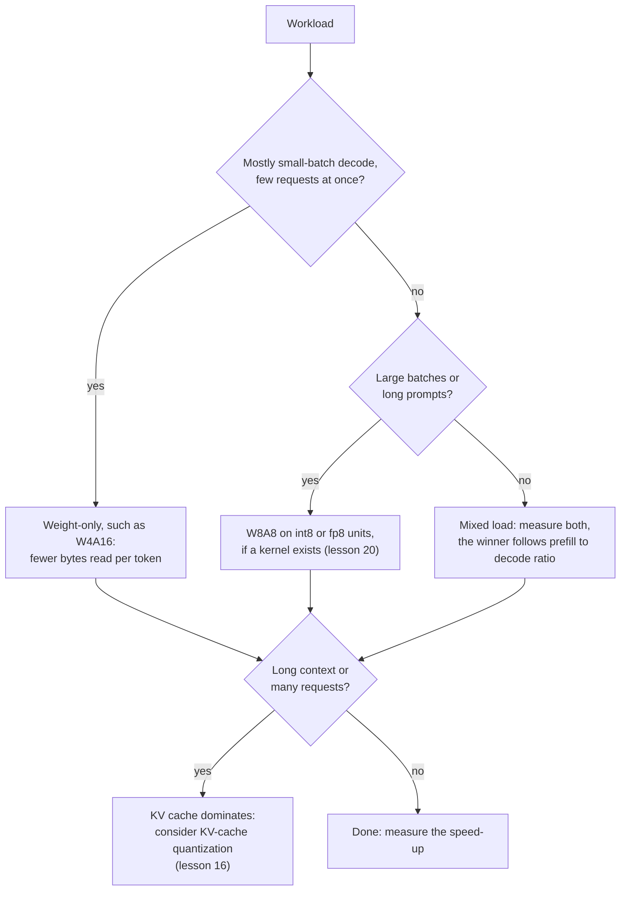

# Lección 19. Qué corre realmente más rápido

**Vínculo con la misión:** La misión te pide predecir si un esquema correrá más rápido en un hardware dado con un tamaño de lote dado, y la predicción empieza con una división: trabajo aritmético entre bytes movidos.
**Fuente principal:** [Paper: "MARLIN: Mixed-Precision Auto-Regressive Parallel Inference on Large Language Models", Frantar et al., 2024](https://arxiv.org/abs/2408.11743)
**Requisitos previos:** [Lección 18](0018-qat-for-llms.md), [Limitado por el ancho de banda de memoria](../GLOSSARY.md), [Limitado por cómputo](../GLOSSARY.md), [Cuantización solo de pesos](../GLOSSARY.md), [Notación WxAy](../GLOSSARY.md), [Descuantización](../GLOSSARY.md)

## Calentamiento

1. ▢ Un modelo de 70B en int4 ocupa unos 35 GB de pesos. En una GPU con 2 TB/s de ancho de banda de memoria con tamaño de lote 1, ¿cuál es el piso del tiempo por token y el techo de tokens por segundo?

<details markdown="1"><summary>Comprobación</summary>

Cada peso se lee una vez por token, así que el piso es 35 GB divididos por 2,000 GB/s, que son 17.5 ms por token, unos 57 tokens por segundo. Es la aritmética de la lección 1. Ignora la KV cache y el trabajo de descuantización, así que un sistema real queda por debajo.

</details>

2. ▢ ¿Qué te dicen el 4 y el 16 de W4A16, y en qué precisión corre la propia multiplicación de matrices?

<details markdown="1"><summary>Comprobación</summary>

Los pesos se almacenan en 4 bits y las activaciones se quedan en 16 bits. El kernel descuantiza los pesos a 16 bits dentro del kernel, así que la multiplicación corre en aritmética de 16 bits: el esquema ahorra bytes movidos, no aritmética.

</details>

## Qué debes saber

### Intensidad aritmética y el roofline

Un chip hace dos cosas que pueden limitar un cálculo: aritmética y mover bytes desde la memoria. La **intensidad aritmética** es el número de operaciones de punto flotante que hace un cálculo por cada byte que mueve. La idea del **roofline** compara ese número con la razón del chip entre aritmética máxima y ancho de banda de memoria, su ridge point. Por debajo del ridge point el cálculo está limitado por el ancho de banda de memoria y su tiempo es los bytes divididos por el ancho de banda. Por encima, está limitado por cómputo y su tiempo es las operaciones divididas por el máximo. En una línea, `time = max(operations / peak, bytes / bandwidth)`.

La ficha técnica de la A100 80GB da 312 TFLOPS de throughput denso de tensor cores en FP16 y, para la versión SXM, 2,039 GB/s de ancho de banda de memoria ([ficha técnica de NVIDIA](https://www.nvidia.com/content/dam/en-zz/Solutions/Data-Center/a100/pdf/nvidia-a100-datasheet-nvidia-us-2188504-web.pdf), que lista a su lado 624 TFLOPS con sparsity). Su ridge point es 312e12 / 2.039e12, unas 153 operaciones por byte.

### Cuantización solo de pesos frente al tamaño de lote

Una matriz de pesos con `P` parámetros aplicada a `B` tokens hace `2 * B * P` operaciones, una multiplicación y una suma por peso y por token, y lee unos `P * bytes_per_weight` bytes, ya que los pesos empequeñecen todo lo demás. Así que la intensidad es `2 * B / bytes_per_weight`:

| Pesos | Bytes por peso | Intensidad | Limitado por cómputo desde aproximadamente |
|---|---|---|---|
| bf16 | 2 | `B` | lote 153 |
| int4, solo pesos | 0.5 | `4 * B` | lote 38 |

El decode con lote 1 queda muy por debajo del ridge point en ambos casos, así que está limitado por el ancho de banda de memoria, y los pesos de 4 bits reducen el tiempo hasta 4 veces. A medida que crece el lote, el modelo de 4 bits cruza el ridge point a una cuarta parte del tamaño de lote, tras lo cual su tiempo crece con la aritmética, que la cuantización solo de pesos no redujo. El prefill es el caso extremo: los tokens de un prompt se procesan juntos, así que se comporta como un lote muy grande. Está limitado por cómputo en ambos formatos, el ahorro de bytes es irrelevante y cualquier trabajo de descuantización es puro extra.

El paper de MARLIN lo pone a prueba con kernels reales. Su resumen informa de una aceleración cercana al máximo de 4x para pesos de 4 bits con tamaños de lote de hasta 16 a 32, una aceleración que decrece gradualmente pero sigue siendo significativa hasta 64 a 128, y aceleraciones de extremo a extremo de hasta 2.8x al integrarlo en vLLM. Esas cifras vienen de una GPU distinta de la de la tabla de arriba e incluyen sobrecargas reales, así que solo debe compararse su orden de magnitud con el 38 del roofline.

### La descuantización es un costo, no un error de redondeo

El roofline ignora que el kernel tiene que convertir los pesos de 4 bits a 16 bits antes de multiplicar. [QServe](https://arxiv.org/abs/2405.04532) encuentra que los métodos INT4 existentes sufren una sobrecarga de tiempo de ejecución del 20 al 90% por descuantizar pesos o sumas parciales en GPU, y que los métodos INT4 más avanzados solo aceleran la inferencia en el edge con lotes pequeños, no el servicio en la nube con lotes grandes. Su remedio es un esquema distinto (pesos de 4 bits, activaciones de 8 bits y KV cache de 4 bits) diseñado para que la descuantización sea barata. MARLIN es la otra respuesta: un kernel construido para seguir limitado por el ancho de banda de memoria a medida que crece el lote.

### Los esquemas de pesos y activaciones mueven el techo

Cuantizar también las activaciones permite que la multiplicación use unidades de baja precisión más rápidas. La ficha técnica de la A100 lista 624 TOPS de throughput denso de tensor cores en INT8, el doble de la cifra de FP16. En el script del ejercicio 2 de la práctica, W8A8 lee el doble de bytes que W4A16, así que pierde con lotes pequeños, y gana cuando el lote es lo bastante grande como para que el límite sea la aritmética.

Kurtic et al. midieron el resultado práctico con vLLM en tres GPU a lo largo de siete escenarios de despliegue. El prefill suele estar limitado por cómputo y el decode por el ancho de banda de memoria, la cuantización de pesos acelera sobre todo el decode, y la cuantización de pesos y activaciones mejora la eficiencia en el prefill. Su recomendación: W4A16 es el más eficiente en costo para configuraciones síncronas, W8A8 domina el continuous batching asíncrono, y para cargas mixtas el óptimo depende de la razón entre prefill y decode ([Kurtic et al., 2024](https://arxiv.org/abs/2411.02355)).



## Práctica

1. ▢ Una multiplicación de matrices solo de pesos en bf16 se aplica a 8 tokens a la vez. ¿Cuál es su intensidad aritmética, y está limitada por el ancho de banda de memoria o por cómputo en un chip cuyo ridge point es 153 operaciones por byte? ¿Y si los pesos son int4?

<details markdown="1"><summary>Comprobación</summary>

Para bf16 la intensidad es `2 * 8 / 2`, que son 8 operaciones por byte. Para int4 es `2 * 8 / 0.5`, que es 32. Ambas están por debajo de 153, así que ambas están limitadas por el ancho de banda de memoria, y la versión int4 tarda aproximadamente una cuarta parte. Cuantizar los pesos multiplica la intensidad por la razón de compresión, y por eso el ridge point llega antes.

</details>

2. ▢ Predice y luego ejecuta. Para un modelo de 8B con los números de la A100 de arriba, ¿cuál de bf16, W4A16 y W8A8 es el más rápido con lote 1, con lote 128 y con lote 512? El script modela solo los pesos y la aritmética, sin costo de descuantización ni KV cache.

    ```python
    P = 8e9            # parameters
    BW = 2039e9        # bytes per second, A100 80GB memory bandwidth
    BF16 = 312e12      # dense bf16 FLOP/s
    INT8 = 624e12      # dense int8 OP/s

    def step_time(batch, weight_bytes, peak):
        flops = 2 * batch * P
        return max(flops / peak, P * weight_bytes / BW)

    print("ridge point, FLOP per byte:", round(BF16 / BW))
    print("batch  bf16_ms  w4a16_ms  w8a8_ms")
    for b in [1, 16, 32, 64, 128, 256, 512]:
        t16 = step_time(b, 2.0, BF16)
        t4 = step_time(b, 0.5, BF16)
        t8 = step_time(b, 1.0, INT8)
        print(f"{b:5d}  {t16*1e3:7.2f}  {t4*1e3:8.2f}  {t8*1e3:7.2f}")
    ```

<details markdown="1"><summary>Comprobación</summary>

```text
ridge point, FLOP per byte: 153
batch  bf16_ms  w4a16_ms  w8a8_ms
    1     7.85      1.96     3.92
   16     7.85      1.96     3.92
   32     7.85      1.96     3.92
   64     7.85      3.28     3.92
  128     7.85      6.56     3.92
  256    13.13     13.13     6.56
  512    26.26     26.26    13.13
```

W4A16 gana con lote 1, una ganancia de 4x sobre bf16. Con lote 128, W8A8 gana (3.92 ms frente a 6.56) porque W4A16 ya está limitado por cómputo, y su ganancia sobre bf16 baja a 1.2x. Con lote 512 W4A16 y bf16 empatan, mientras que W8A8 es 2x más rápido porque usa las unidades int8. El 4x se mantiene hasta lote 32 y se reduce desde 64, la misma forma que el rango que informa MARLIN, aunque un kernel real añade sobrecargas que este modelo omite.

</details>

3. ▢ En la tabla del ejercicio 2, ¿por qué se reduce la aceleración de W4A16 sobre bf16 a medida que crece el lote?

    - a) La descuantización se vuelve más lenta con cada solicitud adicional que se atiende
    - b) El cómputo crece con el lote mientras que los bytes leídos se mantienen fijos
    - c) El ancho de banda de memoria baja cuando más solicitudes lo comparten
    - d) Los valores de cuatro bits no pueden agruparse en lotes en los tensor cores de la GPU

<details markdown="1"><summary>Comprobación</summary>

**b)** Los pesos se leen una vez por paso sea cual sea el lote, pero la aritmética crece con él, así que el paso deja de estar limitado por el ancho de banda de memoria y dejan de importar menos bytes. (a) es incorrecta: los pesos se convierten una vez por paso, no una vez por solicitud, y la sobrecarga de descuantización es un costo aparte (QServe) que no explica la tendencia de este modelo. (c) es incorrecta: el ancho de banda máximo no baja con el tamaño de lote, simplemente deja de ser el cuello de botella. (d) es incorrecta: MARLIN agrupa en lotes pesos de 4 bits hasta 128.

</details>

4. ▢ Una GPU hipotética tiene 800 TFLOPS de aritmética densa en bf16 y 2 TB/s de ancho de banda de memoria. ¿A qué tamaño de lote pasa a estar limitado por cómputo bf16 solo de pesos, y int4 solo de pesos? ¿Qué le hace un chip más rápido con el mismo ancho de banda al rango en el que compensan los pesos de 4 bits?

<details markdown="1"><summary>Comprobación</summary>

El ridge point es 800e12 / 2e12 = 400 operaciones por byte. bf16 tiene intensidad `B`, así que cruza en el lote 400. int4 tiene `4 * B`, así que cruza en el lote 100. Más aritmética con el mismo ancho de banda empuja el ridge point hacia arriba y ensancha el rango de tamaños de lote en que la cuantización solo de pesos da toda su ganancia. Un chip con más ancho de banda en relación con la aritmética hace lo contrario.

</details>

5. ▢ Una aplicación de recuperación envía prompts de 6,000 tokens y obtiene respuestas de 100 tokens, en una sola GPU, con muchos usuarios concurrentes. Un colega propone W4A16 para una aceleración de 4x. ¿Qué falla al esperar 4x, y qué probarías?

<details markdown="1"><summary>Pista</summary>

Cuenta cuánto del trabajo es prefill y cuán grande es el lote efectivo.

</details>

<details markdown="1"><summary>Comprobación</summary>

Aquí domina el prefill: 6,000 tokens de prompt frente a 100 generados. El prefill está limitado por cómputo, así que leer menos bytes de pesos no lo acorta, y cualquier sobrecarga de descuantización se suma encima. Además, muchos usuarios concurrentes empujan el decode hacia lotes mayores, donde la ganancia de solo pesos se reduce. La orientación de Kurtic et al. apunta al otro lado, a W8A8 para continuous batching, y dice que el óptimo depende de la razón entre prefill y decode. Haz un benchmark de W4A16 y W8A8 frente a bf16 sobre la mezcla real de prompts, y comprueba que existe el kernel para el esquema en tu GPU (lección 20).

</details>

## Prácticas en el mundo real

- [ ] Busca el throughput denso máximo en bf16 y el ancho de banda de memoria de una GPU que puedas usar, en la página de especificaciones del proveedor, y calcula su ridge point. Luego calcula el tamaño de lote a partir del cual bf16 e int4 solo de pesos pasan a estar limitados por cómputo.
- [ ] Encuentra las cifras de throughput que publica un proveedor de modelos cuantizados o un motor de servicio para un modelo con varios tamaños de lote. Calcula la aceleración sobre bf16 en cada lote y compara la forma con el roofline de arriba.
- [ ] Mañana: sin apuntes, escribe la fórmula de la intensidad aritmética de una multiplicación de matrices solo de pesos, la fórmula del ridge point, y cuál de W4A16 y W8A8 gana con lotes pequeños y con lotes grandes.

## Para profundizar

- [QAT y hardware](../reference/qat-and-hardware.md)
- [Paper: "MARLIN: Mixed-Precision Auto-Regressive Parallel Inference on Large Language Models", Frantar et al., 2024](https://arxiv.org/abs/2408.11743)
- [Paper: "QServe: W4A8KV4 Quantization and System Co-design for Efficient LLM Serving", Lin et al., 2024](https://arxiv.org/abs/2405.04532)
- [Paper: "Give Me BF16 or Give Me Death? Accuracy-Performance Trade-Offs in LLM Quantization", Kurtic et al., 2024](https://arxiv.org/abs/2411.02355)
- Inferencia: [Cuantización al servir](../../inference/reference/quantization-at-serve-time.md)
- [Recursos](../RESOURCES.md)

---

¿No termina de quedar claro? Vuelve a leer la fuente primaria de arriba, ya que esta lección la comprime y en la compresión es donde se escapa la comprensión. Consulta el [glosario](../GLOSSARY.md) por si algún término te resultó resbaladizo.

Si lo poco claro es la propia lección y no el material, eso es un defecto: [abre un issue](https://github.com/TokenCemetery/teach/issues).
