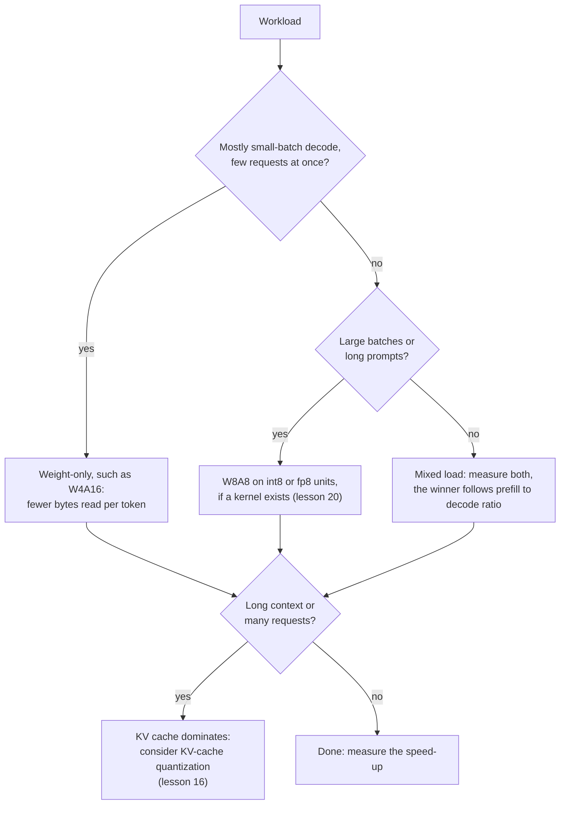

# Leçon 19. Ce qui tourne vraiment plus vite

**Lien avec la mission :** La mission vous demande de prédire si un schéma tournera plus vite sur un matériel donné à une taille de batch donnée, et la prédiction commence par une division : le travail arithmétique sur les octets déplacés.
**Source primaire :** [Article : "MARLIN: Mixed-Precision Auto-Regressive Parallel Inference on Large Language Models", Frantar et al., 2024](https://arxiv.org/abs/2408.11743)
**Prérequis :** [Leçon 18](0018-qat-for-llms.md), [Limité par la mémoire](../GLOSSARY.md), [Limité par le calcul](../GLOSSARY.md), [Quantification weight-only](../GLOSSARY.md), [Notation WxAy](../GLOSSARY.md), [Déquantification](../GLOSSARY.md)

## Échauffement

1. ▢ Un modèle de 70B en int4 prend environ 35 GB de poids. Sur un GPU de 2 TB/s de bande passante mémoire à une taille de batch de 1, quel est le plancher du temps par token, et le plafond de tokens par seconde ?

<details markdown="1"><summary>Vérifier</summary>

Chaque poids est lu une fois par token, donc le plancher est 35 GB divisés par 2,000 GB/s, soit 17.5 ms par token, environ 57 tokens par seconde. C'est l'arithmétique de la leçon 1. Elle ignore le KV cache et le travail de déquantification, donc un vrai système tombe en dessous.

</details>

2. ▢ Que vous disent le 4 et le 16 de W4A16, et dans quelle précision la multiplication de matrices elle-même tourne-t-elle ?

<details markdown="1"><summary>Vérifier</summary>

Les poids sont stockés en 4 bits et les activations restent en 16 bits. Le kernel déquantifie les poids en 16 bits à l'intérieur du kernel, donc la multiplication tourne en arithmétique 16 bits : le schéma économise des octets déplacés, pas de l'arithmétique.

</details>

## À savoir

### Intensité arithmétique et roofline

Une puce fait deux choses qui peuvent limiter un calcul : de l'arithmétique et le déplacement d'octets depuis la mémoire. L'**intensité arithmétique** est le nombre d'opérations en virgule flottante qu'un calcul effectue par octet qu'il déplace. L'idée du **roofline** compare ce nombre au rapport de la puce entre arithmétique de crête et bande passante mémoire, son point de crête. En dessous du point de crête, le calcul est limité par la mémoire et son temps est les octets divisés par la bande passante. Au-dessus, il est limité par le calcul et son temps est les opérations divisées par la crête. En une ligne, `time = max(operations / peak, bytes / bandwidth)`.

La fiche technique de l'A100 80GB donne 312 TFLOPS de débit dense de tensor cores FP16 et, pour la version SXM, 2,039 GB/s de bande passante mémoire ([fiche technique NVIDIA](https://www.nvidia.com/content/dam/en-zz/Solutions/Data-Center/a100/pdf/nvidia-a100-datasheet-nvidia-us-2188504-web.pdf), qui liste à côté 624 TFLOPS avec sparsité). Son point de crête est 312e12 / 2.039e12, soit environ 153 opérations par octet.

### Quantification weight-only face à la taille de batch

Une matrice de poids à `P` paramètres appliquée à `B` tokens fait `2 * B * P` opérations, une multiplication et une addition par poids et par token, et lit environ `P * bytes_per_weight` octets, puisque les poids écrasent tout le reste. L'intensité est donc `2 * B / bytes_per_weight` :

| Poids | Octets par poids | Intensité | Limité par le calcul à partir de |
|---|---|---|---|
| bf16 | 2 | `B` | batch 153 environ |
| int4, weight-only | 0.5 | `4 * B` | batch 38 environ |

Le décodage à batch 1 se situe très en dessous du point de crête pour les deux, donc il est limité par la mémoire, et des poids en 4 bits réduisent le temps jusqu'à 4. À mesure que le batch grandit, le modèle en 4 bits franchit le point de crête à un quart de la taille de batch, après quoi son temps croît avec l'arithmétique, que la quantification weight-only n'a pas réduite. Le prefill est le cas extrême : les tokens d'un prompt sont traités ensemble, donc il se comporte comme un très grand batch. Il est limité par le calcul pour les deux formats, l'économie d'octets est sans objet, et tout travail de déquantification est un pur surplus.

L'article MARLIN teste cela avec de vrais kernels. Son résumé rapporte un gain de vitesse proche du maximum de 4x pour des poids en 4 bits à des tailles de batch allant jusqu'à 16 à 32, une accélération qui décroît progressivement mais reste significative jusqu'à 64 à 128, et des gains de bout en bout allant jusqu'à 2.8x une fois intégré à vLLM. Ces chiffres viennent d'un autre GPU que celui du tableau ci-dessus et incluent de vrais surcoûts, donc seul leur ordre de grandeur doit être comparé aux 38 du roofline.

### La déquantification est un coût, pas une erreur d'arrondi

Le roofline ignore le fait que le kernel doit convertir les poids de 4 bits en 16 bits avant de multiplier. [QServe](https://arxiv.org/abs/2405.04532) constate que les méthodes INT4 existantes subissent un surcoût d'exécution de 20 à 90 % en déquantifiant soit les poids, soit les sommes partielles sur GPU, et que les méthodes INT4 de pointe n'accélèrent que l'inférence en périphérie à petit batch, pas le serving cloud à grand batch. Leur remède est un schéma différent (poids en 4 bits, activations en 8 bits et KV cache en 4 bits) conçu pour que la déquantification soit bon marché. MARLIN est l'autre réponse : un kernel construit pour rester limité par la mémoire quand le batch grandit.

### Les schémas poids-et-activations déplacent le plafond

Quantifier aussi les activations permet à la multiplication d'utiliser des unités de plus basse précision, plus rapides. La fiche technique de l'A100 liste 624 TOPS de débit dense de tensor cores INT8, le double du chiffre FP16. Dans le script de l'exercice 2 de la pratique, W8A8 lit deux fois les octets de W4A16, donc il perd à petit batch, et gagne une fois le batch assez grand pour que l'arithmétique soit la limite.

Kurtic et al. ont mesuré le résultat pratique avec vLLM sur trois GPU dans sept scénarios de déploiement. Le prefill est typiquement limité par le calcul et le décodage par la mémoire, la quantification des poids accélère surtout le décodage, et la quantification poids-et-activations améliore l'efficacité du prefill. Leur recommandation : W4A16 est le plus rentable pour les configurations synchrones, W8A8 domine le continuous batching asynchrone, et pour les charges mixtes l'optimum dépend du rapport entre prefill et décodage ([Kurtic et al., 2024](https://arxiv.org/abs/2411.02355)).



## Pratique

1. ▢ Une multiplication de matrices weight-only en bf16 est appliquée à 8 tokens à la fois. Quelle est son intensité arithmétique, et est-elle limitée par la mémoire ou par le calcul sur une puce dont le point de crête est 153 opérations par octet ? Et si les poids sont en int4 ?

<details markdown="1"><summary>Vérifier</summary>

Pour le bf16, l'intensité est `2 * 8 / 2`, soit 8 opérations par octet. Pour l'int4, elle est `2 * 8 / 0.5`, soit 32. Les deux sont sous 153, donc les deux sont limitées par la mémoire, et la version int4 prend environ un quart du temps. Quantifier les poids multiplie l'intensité par le taux de compression, ce qui explique que le point de crête arrive plus tôt.

</details>

2. ▢ Prédisez, puis exécutez. Pour un modèle 8B avec les chiffres de l'A100 ci-dessus, lequel de bf16, W4A16 et W8A8 est le plus rapide à batch 1, à batch 128 et à batch 512 ? Le script ne modélise que les poids et l'arithmétique, sans coût de déquantification ni KV cache.

    ```python
    P = 8e9            # parameters
    BW = 2039e9        # bytes per second, A100 80GB memory bandwidth
    BF16 = 312e12      # dense bf16 FLOP/s
    INT8 = 624e12      # dense int8 OP/s

    def step_time(batch, weight_bytes, peak):
        flops = 2 * batch * P
        return max(flops / peak, P * weight_bytes / BW)

    print("ridge point, FLOP per byte:", round(BF16 / BW))
    print("batch  bf16_ms  w4a16_ms  w8a8_ms")
    for b in [1, 16, 32, 64, 128, 256, 512]:
        t16 = step_time(b, 2.0, BF16)
        t4 = step_time(b, 0.5, BF16)
        t8 = step_time(b, 1.0, INT8)
        print(f"{b:5d}  {t16*1e3:7.2f}  {t4*1e3:8.2f}  {t8*1e3:7.2f}")
    ```

<details markdown="1"><summary>Vérifier</summary>

```text
ridge point, FLOP per byte: 153
batch  bf16_ms  w4a16_ms  w8a8_ms
    1     7.85      1.96     3.92
   16     7.85      1.96     3.92
   32     7.85      1.96     3.92
   64     7.85      3.28     3.92
  128     7.85      6.56     3.92
  256    13.13     13.13     6.56
  512    26.26     26.26    13.13
```

W4A16 gagne à batch 1, un gain de 4x sur le bf16. À batch 128, W8A8 gagne (3.92 ms contre 6.56) parce que W4A16 est déjà limité par le calcul, et son gain sur le bf16 est tombé à 1.2x. À batch 512, W4A16 et bf16 sont à égalité, tandis que W8A8 est 2x plus rapide parce qu'il utilise les unités int8. Le 4x tient jusqu'à batch 32 et diminue à partir de 64, la même forme que la plage rapportée par MARLIN, bien qu'un vrai kernel ajoute des surcoûts que ce modèle laisse de côté.

</details>

3. ▢ Dans le tableau de l'exercice 2, pourquoi le gain de W4A16 sur le bf16 diminue-t-il quand le batch grandit ?

    - a) La déquantification devient plus lente pour chaque requête servie en plus
    - b) Le calcul croît avec le batch tandis que les octets lus restent fixes
    - c) La bande passante mémoire baisse quand davantage de requêtes la partagent
    - d) Les valeurs en quatre bits ne peuvent pas être traitées par batch sur les tensor cores GPU

<details markdown="1"><summary>Vérifier</summary>

**b)** Les poids sont lus une fois par pas quel que soit le batch, mais l'arithmétique croît avec lui, donc le pas cesse d'être limité par la mémoire et moins d'octets cessent de compter. (a) est faux : les poids sont convertis une fois par pas, pas une fois par requête, et le surcoût de déquantification est un coût distinct (QServe) qui n'explique pas la tendance de ce modèle. (c) est faux : la bande passante de crête ne baisse pas avec la taille de batch, la limite cesse simplement d'être le goulot. (d) est faux : MARLIN traite par batch des poids en 4 bits jusqu'à 128.

</details>

4. ▢ Un GPU hypothétique a 800 TFLOPS d'arithmétique bf16 dense et 2 TB/s de bande passante mémoire. À quelle taille de batch le bf16 weight-only devient-il limité par le calcul, et l'int4 weight-only ? Que fait une puce plus rapide avec la même bande passante à la plage où les poids en 4 bits rapportent ?

<details markdown="1"><summary>Vérifier</summary>

Le point de crête est 800e12 / 2e12 = 400 opérations par octet. Le bf16 a une intensité `B`, donc il franchit à batch 400. L'int4 a `4 * B`, donc il franchit à batch 100. Plus d'arithmétique sur la même bande passante pousse le point de crête vers le haut et élargit la plage de tailles de batch où la quantification weight-only donne son plein gain. Une puce avec plus de bande passante relativement à l'arithmétique fait l'inverse.

</details>

5. ▢ Une application de récupération envoie des prompts de 6,000 tokens et obtient des réponses de 100 tokens, sur un GPU, avec de nombreux utilisateurs concurrents. Un collègue propose du W4A16 pour un gain de 4x. Qu'y a-t-il de faux à attendre 4x, et que testeriez-vous ?

<details markdown="1"><summary>Indice</summary>

Comptez quelle part du travail est du prefill et quelle est la taille du batch effectif.

</details>

<details markdown="1"><summary>Vérifier</summary>

Le prefill domine ici : 6,000 tokens de prompt contre 100 générés. Le prefill est limité par le calcul, donc lire moins d'octets de poids ne le raccourcit pas, et tout surcoût de déquantification s'y ajoute. De nombreux utilisateurs concurrents poussent aussi le décodage vers de plus grands batchs, où le gain du weight-only diminue. Le conseil de Kurtic et al. va dans l'autre sens, vers du W8A8 pour le continuous batching, et dit que l'optimum dépend du rapport prefill sur décodage. Comparez W4A16 et W8A8 au bf16 sur le vrai mélange de prompts, et vérifiez que le kernel existe pour le schéma sur votre GPU (leçon 20).

</details>

## Exercices en situation réelle

- [ ] Cherchez le débit bf16 dense de crête et la bande passante mémoire d'un GPU que vous pouvez utiliser, sur la page de spécifications du fournisseur, et calculez son point de crête. Déterminez ensuite la taille de batch à partir de laquelle le bf16 et l'int4 weight-only deviennent limités par le calcul.
- [ ] Trouvez les chiffres de débit que publie un fournisseur de modèles quantifiés ou un moteur de serving pour un modèle à plusieurs tailles de batch. Calculez le gain par rapport au bf16 à chaque batch et comparez la forme avec le roofline ci-dessus.
- [ ] Demain : sans notes, écrivez la formule de l'intensité arithmétique d'une multiplication de matrices weight-only, la formule du point de crête, et lequel de W4A16 et W8A8 gagne à petit et à grand batch.

## Pour aller plus loin

- [QAT et matériel](../reference/qat-and-hardware.md)
- [Article : "MARLIN: Mixed-Precision Auto-Regressive Parallel Inference on Large Language Models", Frantar et al., 2024](https://arxiv.org/abs/2408.11743)
- [Article : "QServe: W4A8KV4 Quantization and System Co-design for Efficient LLM Serving", Lin et al., 2024](https://arxiv.org/abs/2405.04532)
- [Article : "Give Me BF16 or Give Me Death? Accuracy-Performance Trade-Offs in LLM Quantization", Kurtic et al., 2024](https://arxiv.org/abs/2411.02355)
- Inférence : [Quantification au moment du serving](../../inference/reference/quantization-at-serve-time.md)
- [Ressources](../RESOURCES.md)

---

Ça ne passe pas ? Relisez la source primaire en haut de page, car cette leçon la condense et c'est dans la condensation que la compréhension s'échappe. Consultez le [glossaire](../GLOSSARY.md) pour tout terme qui vous a paru glissant.

Si c'est la leçon elle-même qui n'est pas claire plutôt que la matière, c'est un défaut : [ouvrez une issue](https://github.com/TokenCemetery/teach/issues).
