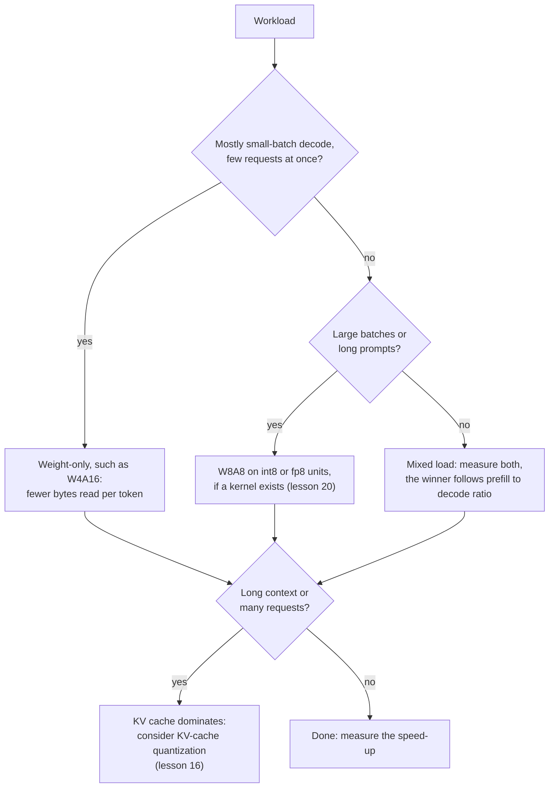

# पाठ 19. असल में क्या तेज़ चलता है

**मिशन से संबंध:** मिशन आपसे माँगता है कि आप अनुमान लगा सकें कि कोई scheme दिए hardware पर दिए batch size में तेज़ चलेगी या नहीं, और वह अनुमान एक भाग से शुरू होता है: arithmetic का काम भाग हिलाए गए bytes।
**मुख्य स्रोत:** [पेपर: "MARLIN: Mixed-Precision Auto-Regressive Parallel Inference on Large Language Models", Frantar et al., 2024](https://arxiv.org/abs/2408.11743)
**पूर्व-आवश्यकताएँ:** [पाठ 18](0018-qat-for-llms.md), [Memory-bound](../GLOSSARY.md), [Compute-bound](../GLOSSARY.md), [Weight-only quantization](../GLOSSARY.md), [WxAy notation](../GLOSSARY.md), [Dequantization](../GLOSSARY.md)

## वार्म-अप

1. ▢ 70B model int4 में लगभग 35 GB के weights लेता है। 2 TB/s memory bandwidth वाले GPU पर batch size 1 पर, प्रति token समय की न्यूनतम सीमा क्या है, और प्रति सेकंड tokens की ऊपरी सीमा?

<details markdown="1"><summary>जाँचें</summary>

हर token पर हर weight एक बार पढ़ा जाता है, इसलिए न्यूनतम सीमा 35 GB भाग 2,000 GB/s है, यानी प्रति token 17.5 ms, लगभग 57 tokens प्रति सेकंड। यह पाठ 1 का हिसाब है। यह KV cache और dequantization के काम को अनदेखा करता है, इसलिए असली system उससे नीचे उतरता है।

</details>

2. ▢ W4A16 में 4 और 16 आपको क्या बताते हैं, और matrix multiplication ख़ुद किस precision में चलता है?

<details markdown="1"><summary>जाँचें</summary>

Weights 4 bits में store हैं और activations 16 bits में रहती हैं। Kernel weights को kernel के भीतर 16 bits में dequantize करता है, इसलिए multiplication 16-bit arithmetic में चलता है: scheme हिलाए गए bytes बचाती है, arithmetic नहीं।

</details>

## यह जानें

### Arithmetic intensity और roofline

Chip दो काम करती है जो किसी computation को सीमित कर सकते हैं: arithmetic और memory से bytes हिलाना। **Arithmetic intensity** वह संख्या है जितने floating-point operations कोई computation हर उस byte पर करता है जो वह हिलाता है। **Roofline** का विचार उस संख्या की तुलना chip के peak arithmetic और memory bandwidth के अनुपात से करता है, यानी उसके ridge point से। Ridge point के नीचे computation memory-bound है और उसका समय bytes भाग bandwidth है। उसके ऊपर वह compute-bound है और उसका समय operations भाग peak है। एक पंक्ति में, `time = max(operations / peak, bytes / bandwidth)`।

A100 80GB datasheet 312 TFLOPS का dense FP16 tensor-core throughput देता है और, SXM version के लिए, 2,039 GB/s की memory bandwidth ([NVIDIA datasheet](https://www.nvidia.com/content/dam/en-zz/Solutions/Data-Center/a100/pdf/nvidia-a100-datasheet-nvidia-us-2188504-web.pdf), जो उसके बग़ल में sparsity के साथ 624 TFLOPS सूचीबद्ध करता है)। उसका ridge point 312e12 / 2.039e12 है, लगभग 153 operations प्रति byte।

### Weight-only quantization बनाम batch size

`P` parameters वाली weight matrix को `B` tokens पर लगाने में `2 * B * P` operations होते हैं, हर weight पर हर token के लिए एक multiply और एक add, और लगभग `P * bytes_per_weight` bytes पढ़े जाते हैं, क्योंकि weights बाक़ी सब को बौना कर देते हैं। इसलिए intensity `2 * B / bytes_per_weight` है:

| Weights | प्रति weight bytes | Intensity | कब से compute-bound |
|---|---|---|---|
| bf16 | 2 | `B` | लगभग batch 153 से |
| int4, weight-only | 0.5 | `4 * B` | लगभग batch 38 से |

Batch-1 decode दोनों के लिए ridge point से बहुत नीचे है, इसलिए वह memory-bound है, और 4-bit weights समय को 4 गुना तक घटा देते हैं। जैसे-जैसे batch बढ़ता है, 4-bit model ridge point को batch size के चौथाई पर पार कर लेता है, जिसके बाद उसका समय उस arithmetic के साथ बढ़ता है जिसे weight-only quantization ने नहीं घटाया। Prefill चरम मामला है: prompt के tokens एक साथ प्रोसेस होते हैं, इसलिए वह बहुत बड़े batch की तरह बर्ताव करता है। वह दोनों formats के लिए compute-bound है, bytes की बचत अप्रासंगिक है, और dequantization का कोई भी काम शुद्ध अतिरिक्त है।

MARLIN पेपर इसे असली kernels के मुक़ाबले परखता है। उसका abstract 16 से 32 तक के batch sizes पर 4-bit weights के लिए अधिकतम 4 गुना के क़रीब speed-up बताता है, 64 से 128 तक धीरे-धीरे घटता पर फिर भी उल्लेखनीय तेज़ी, और vLLM में integrate होने पर 2.8 गुना तक के end-to-end speed-ups। वे संख्याएँ ऊपर की table वाले GPU से अलग GPU की हैं और असली overheads शामिल करती हैं, इसलिए roofline के 38 से सिर्फ़ उनके परिमाण के क्रम की तुलना होनी चाहिए।

### Dequantization एक क़ीमत है, rounding error नहीं

Roofline इसे अनदेखा करता है कि kernel को गुणा से पहले 4-bit weights को 16-bit में बदलना पड़ता है। [QServe](https://arxiv.org/abs/2405.04532) पाता है कि मौजूदा INT4 methods GPUs पर weights या partial sums को dequantize करने से 20 से 90% runtime overhead झेलते हैं, और अत्याधुनिक INT4 methods सिर्फ़ छोटे-batch के edge inference को तेज़ करते हैं, बड़े-batch की cloud serving को नहीं। उनका इलाज एक अलग scheme है (4-bit weights, 8-bit activations और 4-bit KV cache) जो इस तरह बनाई गई कि dequantization सस्ता रहे। MARLIN दूसरा उत्तर है: ऐसा kernel जो batch बढ़ने पर भी memory-bound बना रहे।

### Weight-और-activation schemes ऊपरी सीमा खिसकाती हैं

Activations को भी quantize करने से multiplication तेज़ low-precision units इस्तेमाल कर सकता है। A100 datasheet 624 TOPS का dense INT8 tensor-core throughput सूचीबद्ध करता है, जो FP16 की संख्या का दुगुना है। अभ्यास के सवाल 2 की script में, W8A8 W4A16 से दुगुने bytes पढ़ता है, इसलिए छोटे batch पर हारता है, और तब जीतता है जब batch इतना बड़ा हो कि arithmetic ही सीमा हो।

Kurtic et al. ने व्यावहारिक नतीजा vLLM से तीन GPUs पर सात deployment scenarios में मापा। Prefill आम तौर पर compute-bound होता है और decode memory-bound, weight quantization मुख्यतः decode को तेज़ करता है, और weight-और-activation quantization prefill में कुशलता सुधारता है। उनकी सिफ़ारिश: synchronous setups के लिए W4A16 सबसे किफ़ायती है, asynchronous continuous batching में W8A8 हावी रहता है, और मिश्रित workloads के लिए इष्टतम prefill और decode के अनुपात पर निर्भर करता है ([Kurtic et al., 2024](https://arxiv.org/abs/2411.02355))।



## अभ्यास

1. ▢ bf16 weight-only matrix multiplication एक साथ 8 tokens पर लगता है। उसकी arithmetic intensity क्या है, और क्या वह उस chip पर memory-bound है या compute-bound जिसका ridge point 153 operations प्रति byte है? अगर weights int4 हों तो?

<details markdown="1"><summary>जाँचें</summary>

bf16 के लिए intensity `2 * 8 / 2` है, यानी 8 operations प्रति byte। int4 के लिए वह `2 * 8 / 0.5` है, यानी 32। दोनों 153 से नीचे हैं, इसलिए दोनों memory-bound हैं, और int4 version में समय का लगभग चौथाई लगता है। Weights को quantize करना intensity को compression अनुपात से गुणा करता है, इसीलिए ridge point जल्दी आ जाता है।

</details>

2. ▢ पहले अनुमान लगाएँ, फिर चलाएँ। ऊपर के A100 आँकड़ों पर 8B model के लिए, bf16, W4A16 और W8A8 में से batch 1, batch 128 और batch 512 पर कौन-सा सबसे तेज़ है? Script सिर्फ़ weights और arithmetic का model बनाती है, बिना dequantization की लागत और बिना KV cache के।

    ```python
    P = 8e9            # parameters
    BW = 2039e9        # bytes per second, A100 80GB memory bandwidth
    BF16 = 312e12      # dense bf16 FLOP/s
    INT8 = 624e12      # dense int8 OP/s

    def step_time(batch, weight_bytes, peak):
        flops = 2 * batch * P
        return max(flops / peak, P * weight_bytes / BW)

    print("ridge point, FLOP per byte:", round(BF16 / BW))
    print("batch  bf16_ms  w4a16_ms  w8a8_ms")
    for b in [1, 16, 32, 64, 128, 256, 512]:
        t16 = step_time(b, 2.0, BF16)
        t4 = step_time(b, 0.5, BF16)
        t8 = step_time(b, 1.0, INT8)
        print(f"{b:5d}  {t16*1e3:7.2f}  {t4*1e3:8.2f}  {t8*1e3:7.2f}")
    ```

<details markdown="1"><summary>जाँचें</summary>

```text
ridge point, FLOP per byte: 153
batch  bf16_ms  w4a16_ms  w8a8_ms
    1     7.85      1.96     3.92
   16     7.85      1.96     3.92
   32     7.85      1.96     3.92
   64     7.85      3.28     3.92
  128     7.85      6.56     3.92
  256    13.13     13.13     6.56
  512    26.26     26.26    13.13
```

W4A16 batch 1 पर जीतता है, bf16 पर 4 गुना का फ़ायदा। Batch 128 पर, W8A8 जीतता है (3.92 ms बनाम 6.56) क्योंकि W4A16 पहले से compute-bound है, और bf16 पर उसका फ़ायदा 1.2 गुना रह गया है। Batch 512 पर W4A16 और bf16 बराबर हैं, जबकि W8A8 2 गुना तेज़ है क्योंकि वह int8 units इस्तेमाल करता है। 4 गुना batch 32 तक टिकता है और 64 से सिकुड़ता है, MARLIN की बताई range जैसा ही आकार, हालाँकि असली kernel ऐसे overheads जोड़ता है जिन्हें यह model छोड़ देता है।

</details>

3. ▢ सवाल 2 की table में, batch बढ़ने पर bf16 पर W4A16 का speed-up क्यों सिकुड़ता है?

    - a) हर अतिरिक्त serve हो रहे request के लिए dequantization धीमा होता जाता है
    - b) Batch के साथ compute बढ़ता है जबकि पढ़े गए bytes तय रहते हैं
    - c) जैसे-जैसे ज़्यादा requests साझा करते हैं, memory bandwidth गिरती जाती है
    - d) चार-bit values GPU tensor cores पर batch नहीं हो सकतीं

<details markdown="1"><summary>जाँचें</summary>

**b)** Batch कुछ भी हो weights हर step में एक बार पढ़े जाते हैं, पर arithmetic उसके साथ बढ़ता है, इसलिए step memory-bound नहीं रहता और कम bytes मायने रखना बंद कर देते हैं। (a) ग़लत है: weights हर step में एक बार बदले जाते हैं, हर request पर नहीं, और dequantization overhead एक अलग क़ीमत है (QServe) जो इस model के रुझान को नहीं समझाती। (c) ग़लत है: peak bandwidth batch size के साथ नहीं गिरती, सीमा बस अड़चन नहीं रहती। (d) ग़लत है: MARLIN 4-bit weights को 128 तक batch करता है।

</details>

4. ▢ किसी काल्पनिक GPU में 800 TFLOPS का dense bf16 arithmetic और 2 TB/s की memory bandwidth है। किस batch size पर bf16 weight-only compute-bound बनता है, और int4 weight-only? उसी bandwidth वाली तेज़ chip उस range का क्या करती है जहाँ 4-bit weights फ़ायदा देते हैं?

<details markdown="1"><summary>जाँचें</summary>

Ridge point 800e12 / 2e12 = 400 operations प्रति byte है। bf16 की intensity `B` है, इसलिए वह batch 400 पर पार करता है। int4 की `4 * B` है, इसलिए वह batch 100 पर पार करता है। उसी bandwidth पर ज़्यादा arithmetic ridge point को ऊपर धकेलता है और batch sizes की उस range को चौड़ा करता है जहाँ weight-only quantization अपना पूरा फ़ायदा देता है। Arithmetic के सापेक्ष ज़्यादा bandwidth वाली chip उल्टा करती है।

</details>

5. ▢ एक retrieval application 6,000-token के prompts भेजता है और 100-token के उत्तर पाता है, एक GPU पर, कई एक साथ चल रहे users के साथ। कोई साथी 4 गुना speed-up के लिए W4A16 सुझाता है। 4 गुना की उम्मीद में क्या ग़लत है, और आप क्या परखेंगे?

<details markdown="1"><summary>संकेत</summary>

गिनें कि काम का कितना हिस्सा prefill है और असरदार batch कितना बड़ा है।

</details>

<details markdown="1"><summary>जाँचें</summary>

यहाँ prefill हावी है: 6,000 prompt tokens बनाम 100 generate हुए। Prefill compute-bound है, इसलिए कम weight bytes पढ़ना उसे छोटा नहीं करता, और dequantization का कोई भी overhead ऊपर से जुड़ता है। कई एक साथ चल रहे users decode को बड़े batches की ओर भी धकेलते हैं, जहाँ weight-only का फ़ायदा सिकुड़ता है। Kurtic et al. का मार्गदर्शन उल्टी ओर इशारा करता है, continuous batching के लिए W8A8, और कहता है कि इष्टतम prefill और decode के अनुपात पर निर्भर है। असली prompt मिश्रण पर W4A16 और W8A8 को bf16 के मुक़ाबले benchmark करें, और जाँचें कि आपके GPU पर उस scheme के लिए kernel मौजूद है (पाठ 20)।

</details>

## असली दुनिया का अभ्यास

- [ ] किसी ऐसे GPU का peak dense bf16 throughput और memory bandwidth, vendor के specification पन्ने से, खोजें जो आप इस्तेमाल कर सकते हैं, और उसका ridge point निकालें। फिर वह batch size निकालें जहाँ bf16 और int4 weight-only compute-bound बनते हैं।
- [ ] किसी quantized-model vendor या serving engine द्वारा किसी एक model के लिए कई batch sizes पर प्रकाशित throughput संख्याएँ खोजें। हर batch पर bf16 से speed-up निकालें और आकार की तुलना ऊपर के roofline से करें।
- [ ] कल: बिना नोट्स के weight-only matrix multiplication की arithmetic intensity का formula, ridge point का formula, और यह लिखें कि W4A16 और W8A8 में से छोटे और बड़े batch पर कौन जीतता है।

## आगे बढ़ने के लिए

- [QAT और Hardware शीट](../reference/qat-and-hardware.md)
- [पेपर: "MARLIN: Mixed-Precision Auto-Regressive Parallel Inference on Large Language Models", Frantar et al., 2024](https://arxiv.org/abs/2408.11743)
- [पेपर: "QServe: W4A8KV4 Quantization and System Co-design for Efficient LLM Serving", Lin et al., 2024](https://arxiv.org/abs/2405.04532)
- [पेपर: "Give Me BF16 or Give Me Death? Accuracy-Performance Trade-Offs in LLM Quantization", Kurtic et al., 2024](https://arxiv.org/abs/2411.02355)
- [Inference: Serve Time पर Quantization](../../inference/reference/quantization-at-serve-time.md)
- [संसाधन](../RESOURCES.md)

---

बात नहीं बन रही? ऊपर दिए मुख्य स्रोत को दोबारा पढ़ें, क्योंकि यह पाठ उसे संक्षिप्त करता है और समझ संक्षेप में ही रिसती है। जो शब्द फिसलन भरा लगे, उसके लिए [शब्दावली](../GLOSSARY.md) देखें।

अगर दिक़्क़त सामग्री की नहीं बल्कि पाठ की ही है, तो वह एक खोट है: [issue खोलें](https://github.com/TokenCemetery/teach/issues)।
