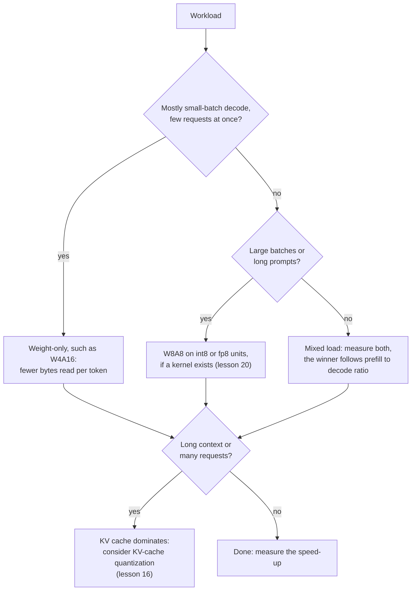

# Lesson 19. What Actually Runs Faster

**Mission link:** The mission asks you to predict whether a scheme will run faster on given hardware at a given batch size, and the prediction starts with one division: arithmetic work over bytes moved.
**Primary source:** [Paper: "MARLIN: Mixed-Precision Auto-Regressive Parallel Inference on Large Language Models", Frantar et al., 2024](https://arxiv.org/abs/2408.11743)
**Prerequisites:** [Lesson 18](0018-qat-for-llms.md), [Memory-bound](../GLOSSARY.md), [Compute-bound](../GLOSSARY.md), [Weight-only quantization](../GLOSSARY.md), [WxAy notation](../GLOSSARY.md), [Dequantization](../GLOSSARY.md)

## Warm-up

1. ▢ A 70B model in int4 takes about 35 GB of weights. On a GPU with 2 TB/s of memory bandwidth at batch size 1, what is the floor on time per token, and the ceiling on tokens per second?

<details markdown="1"><summary>Check</summary>

Every weight is read once per token, so the floor is 35 GB divided by 2,000 GB/s, which is 17.5 ms per token, about 57 tokens per second. That is the lesson 1 arithmetic. It ignores the KV cache and the dequantization work, so a real system lands below it.

</details>

2. ▢ What do the 4 and the 16 in W4A16 tell you, and which precision does the matrix multiplication itself run in?

<details markdown="1"><summary>Check</summary>

Weights are stored in 4 bits and activations stay in 16 bits. The kernel dequantizes the weights to 16 bits inside the kernel, so the multiplication runs in 16-bit arithmetic: the scheme saves bytes moved, not arithmetic.

</details>

## Know this

### Arithmetic intensity and the roofline

A chip does two things that can limit a computation: arithmetic and moving bytes from memory. **Arithmetic intensity** is the number of floating-point operations a computation does per byte it moves. The **roofline** idea compares that number with the chip's ratio of peak arithmetic to memory bandwidth, its ridge point. Below the ridge point the computation is memory-bound and its time is the bytes divided by the bandwidth. Above it, it is compute-bound and its time is the operations divided by the peak. In one line, `time = max(operations / peak, bytes / bandwidth)`.

The A100 80GB datasheet gives 312 TFLOPS of dense FP16 tensor-core throughput and, for the SXM version, 2,039 GB/s of memory bandwidth ([NVIDIA datasheet](https://www.nvidia.com/content/dam/en-zz/Solutions/Data-Center/a100/pdf/nvidia-a100-datasheet-nvidia-us-2188504-web.pdf), which lists 624 TFLOPS with sparsity beside it). Its ridge point is 312e12 / 2.039e12, about 153 operations per byte.

### Weight-only quantization against batch size

A weight matrix with `P` parameters applied to `B` tokens does `2 * B * P` operations, one multiply and one add per weight per token, and reads about `P * bytes_per_weight` bytes, since the weights dwarf everything else. So the intensity is `2 * B / bytes_per_weight`:

| Weights | Bytes per weight | Intensity | Compute-bound from about |
|---|---|---|---|
| bf16 | 2 | `B` | batch 153 |
| int4, weight-only | 0.5 | `4 * B` | batch 38 |

Batch-1 decode sits far below the ridge point for both, so it is memory-bound, and 4-bit weights cut the time by up to 4. As the batch grows, the 4-bit model crosses the ridge point at a quarter of the batch size, after which its time grows with the arithmetic, which weight-only quantization did not shrink. Prefill is the extreme case: a prompt's tokens are processed together, so it behaves like a very large batch. It is compute-bound for both formats, the saving in bytes is irrelevant, and any dequantization work is pure extra.

The MARLIN paper tests this against real kernels. Its abstract reports close to the maximum 4x speed-up for 4-bit weights at batch sizes up to 16 to 32, gradually decreasing but still significant acceleration up to 64 to 128, and end-to-end speed-ups of up to 2.8x when integrated into vLLM. Those figures come from a different GPU than the one in the table above and include real overheads, so only their order of magnitude should be compared with the roofline's 38.

### Dequantization is a cost, not a rounding error

The roofline ignores the kernel having to convert 4-bit weights to 16-bit before multiplying. [QServe](https://arxiv.org/abs/2405.04532) finds that existing INT4 methods suffer a 20 to 90% runtime overhead from dequantizing either weights or partial sums on GPUs, and that state-of-the-art INT4 methods only speed up low-batch edge inference, not large-batch cloud serving. Their remedy is a different scheme (4-bit weights, 8-bit activations and 4-bit KV cache) designed so the dequantization is cheap. MARLIN is the other answer: a kernel built to stay memory-bound as the batch grows.

### Weight-and-activation schemes move the ceiling

Quantizing activations as well lets the multiplication use faster low-precision units. The A100 datasheet lists 624 TOPS of dense INT8 tensor-core throughput, twice the FP16 figure. In the script in practice item 2, W8A8 reads twice the bytes of W4A16, so it loses at small batch, and wins once the batch is large enough that arithmetic is the limit.

Kurtic et al. measured the practical result with vLLM on three GPUs across seven deployment scenarios. Prefill is typically compute-bound and decode memory-bound, weight quantization mainly speeds up decode, and weight-and-activation quantization improves efficiency in prefill. Their recommendation: W4A16 is the most cost-efficient for synchronous setups, W8A8 dominates asynchronous continuous batching, and for mixed workloads the optimum depends on the ratio of prefill to decode ([Kurtic et al., 2024](https://arxiv.org/abs/2411.02355)).



## Practice

1. ▢ A bf16 weight-only matrix multiplication is applied to 8 tokens at once. What is its arithmetic intensity, and is it memory-bound or compute-bound on a chip whose ridge point is 153 operations per byte? What if the weights are int4?

<details markdown="1"><summary>Check</summary>

For bf16 the intensity is `2 * 8 / 2`, which is 8 operations per byte. For int4 it is `2 * 8 / 0.5`, which is 32. Both are below 153, so both are memory-bound, and the int4 version has about a quarter of the time. Quantizing weights multiplies the intensity by the compression ratio, which is why the ridge point arrives sooner.

</details>

2. ▢ Predict, then run. For an 8B model on the A100 numbers above, which of bf16, W4A16 and W8A8 is fastest at batch 1, at batch 128 and at batch 512? The script models only the weights and arithmetic, with no dequantization cost and no KV cache.

    ```python
    P = 8e9            # parameters
    BW = 2039e9        # bytes per second, A100 80GB memory bandwidth
    BF16 = 312e12      # dense bf16 FLOP/s
    INT8 = 624e12      # dense int8 OP/s

    def step_time(batch, weight_bytes, peak):
        flops = 2 * batch * P
        return max(flops / peak, P * weight_bytes / BW)

    print("ridge point, FLOP per byte:", round(BF16 / BW))
    print("batch  bf16_ms  w4a16_ms  w8a8_ms")
    for b in [1, 16, 32, 64, 128, 256, 512]:
        t16 = step_time(b, 2.0, BF16)
        t4 = step_time(b, 0.5, BF16)
        t8 = step_time(b, 1.0, INT8)
        print(f"{b:5d}  {t16*1e3:7.2f}  {t4*1e3:8.2f}  {t8*1e3:7.2f}")
    ```

<details markdown="1"><summary>Check</summary>

```text
ridge point, FLOP per byte: 153
batch  bf16_ms  w4a16_ms  w8a8_ms
    1     7.85      1.96     3.92
   16     7.85      1.96     3.92
   32     7.85      1.96     3.92
   64     7.85      3.28     3.92
  128     7.85      6.56     3.92
  256    13.13     13.13     6.56
  512    26.26     26.26    13.13
```

W4A16 wins at batch 1, a 4x gain over bf16. At batch 128, W8A8 wins (3.92 ms against 6.56) because W4A16 is already compute-bound, and its gain over bf16 is down to 1.2x. At batch 512 W4A16 and bf16 tie, while W8A8 is 2x faster because it uses the int8 units. The 4x holds to batch 32 and shrinks from 64, the same shape as MARLIN's reported range, though a real kernel adds overheads this model leaves out.

</details>

3. ▢ In the table from item 2, why does the W4A16 speed-up over bf16 shrink as the batch grows?

    - a) Dequantization gets slower for every additional request being served
    - b) Compute grows with batch while bytes read stay fixed
    - c) Memory bandwidth falls as more requests all share it
    - d) Four-bit values cannot be batched on GPU tensor cores

<details markdown="1"><summary>Check</summary>

**b)** The weights are read once per step whatever the batch, but the arithmetic grows with it, so the step stops being memory-bound and fewer bytes stop mattering. (a) is wrong: the weights are converted once per step, not once per request, and dequantization overhead is a separate cost (QServe) that does not explain the trend in this model. (c) is wrong: peak bandwidth does not fall with batch size, the limit just stops being the bottleneck. (d) is wrong: MARLIN batches 4-bit weights up to 128.

</details>

4. ▢ A hypothetical GPU has 800 TFLOPS of dense bf16 arithmetic and 2 TB/s of memory bandwidth. At what batch size does bf16 weight-only become compute-bound, and int4 weight-only? What does a faster chip with the same bandwidth do to the range where 4-bit weights pay?

<details markdown="1"><summary>Check</summary>

The ridge point is 800e12 / 2e12 = 400 operations per byte. bf16 has intensity `B`, so it crosses at batch 400. int4 has `4 * B`, so it crosses at batch 100. More arithmetic on the same bandwidth pushes the ridge point up and widens the range of batch sizes where weight-only quantization gives its full gain. A chip with more bandwidth relative to arithmetic does the reverse.

</details>

5. ▢ A retrieval application sends 6,000-token prompts and gets 100-token answers, on one GPU, with many concurrent users. A colleague proposes W4A16 for a 4x speed-up. What is wrong with expecting 4x, and what would you test?

<details markdown="1"><summary>Hint</summary>

Count how much of the work is prefill and how large the effective batch is.

</details>

<details markdown="1"><summary>Check</summary>

Prefill dominates here: 6,000 prompt tokens against 100 generated ones. Prefill is compute-bound, so reading fewer weight bytes does not shorten it, and any dequantization overhead is added on top. Many concurrent users also push decode towards larger batches, where the weight-only gain shrinks. Kurtic et al.'s guidance points the other way, to W8A8 for continuous batching, and says the optimum depends on the prefill to decode ratio. Benchmark W4A16 and W8A8 against bf16 on the real prompt mix, and check the kernel exists for the scheme on your GPU (lesson 20).

</details>

## Real-world reps

- [ ] Look up the peak dense bf16 throughput and the memory bandwidth of a GPU you can use, from the vendor's specification page, and compute its ridge point. Then work out the batch size where bf16 and int4 weight-only become compute-bound.
- [ ] Find the throughput numbers a quantized-model vendor or a serving engine publishes for one model at several batch sizes. Compute the speed-up over bf16 at each batch and compare the shape with the roofline above.
- [ ] Tomorrow: without notes, write the formula for the arithmetic intensity of a weight-only matrix multiplication, the ridge point formula, and which of W4A16 and W8A8 wins at small and at large batch.

## Going further

- [QAT and Hardware](../reference/qat-and-hardware.md)
- [Paper: "MARLIN: Mixed-Precision Auto-Regressive Parallel Inference on Large Language Models", Frantar et al., 2024](https://arxiv.org/abs/2408.11743)
- [Paper: "QServe: W4A8KV4 Quantization and System Co-design for Efficient LLM Serving", Lin et al., 2024](https://arxiv.org/abs/2405.04532)
- [Paper: "Give Me BF16 or Give Me Death? Accuracy-Performance Trade-Offs in LLM Quantization", Kurtic et al., 2024](https://arxiv.org/abs/2411.02355)
- [Inference: Quantization at Serve Time](../../inference/reference/quantization-at-serve-time.md)
- [Resources](../RESOURCES.md)

---

Not landing? Reread the primary source at the top, since this lesson compresses it and compression is where understanding leaks. Check the [glossary](../GLOSSARY.md) for any term that felt slippery.

If the lesson itself is unclear rather than the material, that is a defect: [open an issue](https://github.com/TokenCemetery/teach/issues).
