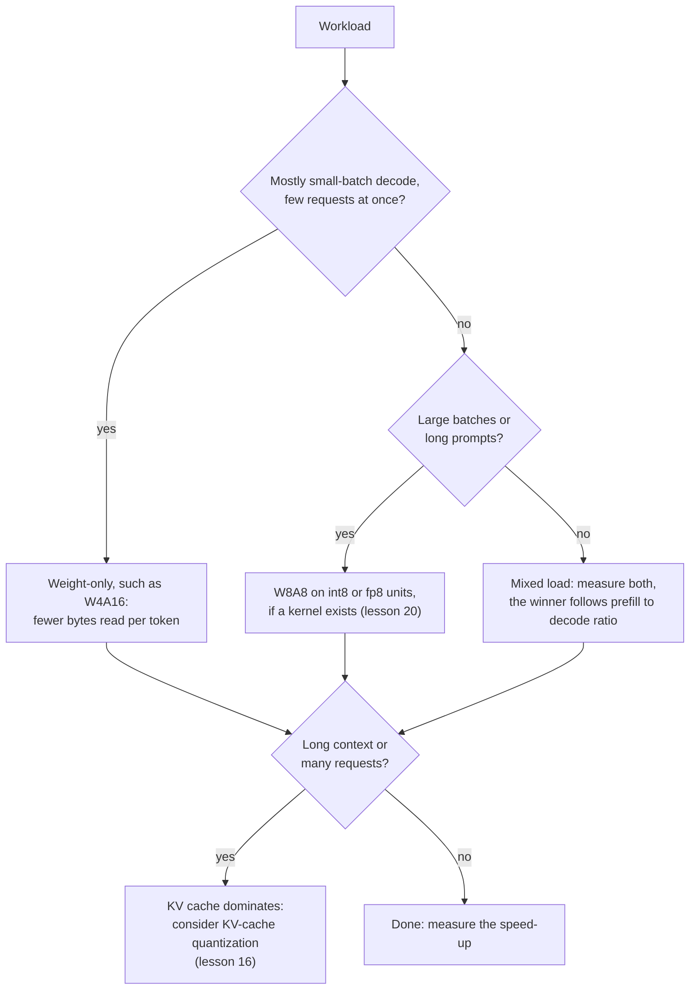

# Lição 19. O que realmente roda mais rápido

**Ligação com a missão:** A missão pede que você preveja se um esquema vai rodar mais rápido em um dado hardware e com um dado batch size, e a previsão começa com uma divisão: trabalho aritmético sobre bytes movidos.
**Fonte principal:** [Artigo científico: "MARLIN: Mixed-Precision Auto-Regressive Parallel Inference on Large Language Models", Frantar et al., 2024](https://arxiv.org/abs/2408.11743)
**Pré-requisitos:** [Lição 18](0018-qat-for-llms.md), [Limitado pela largura de banda de memória](../GLOSSARY.md), [Limitado por compute](../GLOSSARY.md), [Quantização somente de pesos](../GLOSSARY.md), [Notação WxAy](../GLOSSARY.md), [Dequantização](../GLOSSARY.md)

## Aquecimento

1. ▢ Um modelo de 70B em int4 ocupa cerca de 35 GB de pesos. Em uma GPU com 2 TB/s de largura de banda de memória e batch size 1, qual é o piso do tempo por token e o teto de tokens por segundo?

<details markdown="1"><summary>Verificação</summary>

Cada peso é lido uma vez por token, então o piso é 35 GB divididos por 2.000 GB/s, que são 17.5 ms por token, cerca de 57 tokens por segundo. Essa é a aritmética da lição 1. Ela ignora o KV cache e o trabalho de dequantização, então um sistema real fica abaixo dela.

</details>

2. ▢ O que o 4 e o 16 em W4A16 dizem, e em qual precisão a própria multiplicação de matrizes roda?

<details markdown="1"><summary>Verificação</summary>

Os pesos são armazenados em 4 bits e as ativações ficam em 16 bits. O kernel dequantiza os pesos para 16 bits dentro do kernel, então a multiplicação roda em aritmética de 16 bits: o esquema economiza bytes movidos, não aritmética.

</details>

## Saiba isto

### Intensidade aritmética e o roofline

Um chip faz duas coisas que podem limitar uma computação: aritmética e mover bytes da memória. A **intensidade aritmética** é o número de operações de ponto flutuante que uma computação faz por byte que ela move. A ideia do **roofline** compara esse número com a razão do chip entre aritmética de pico e largura de banda de memória, o seu ridge point. Abaixo do ridge point, a computação é limitada pela largura de banda de memória e o seu tempo são os bytes divididos pela largura de banda. Acima dele, é limitada por compute e o seu tempo são as operações divididas pelo pico. Em uma linha, `time = max(operations / peak, bytes / bandwidth)`.

O datasheet da A100 80GB dá 312 TFLOPS de vazão densa de tensor cores em FP16 e, para a versão SXM, 2.039 GB/s de largura de banda de memória ([datasheet da NVIDIA](https://www.nvidia.com/content/dam/en-zz/Solutions/Data-Center/a100/pdf/nvidia-a100-datasheet-nvidia-us-2188504-web.pdf), que lista 624 TFLOPS com esparsidade ao lado). O seu ridge point é 312e12 / 2.039e12, cerca de 153 operações por byte.

### Quantização somente de pesos contra o batch size

Uma matriz de pesos com `P` parâmetros aplicada a `B` tokens faz `2 * B * P` operações, uma multiplicação e uma soma por peso por token, e lê cerca de `P * bytes_per_weight` bytes, já que os pesos superam tudo o mais. Então a intensidade é `2 * B / bytes_per_weight`:

| Pesos | Bytes por peso | Intensidade | Limitado por compute a partir de cerca de |
|---|---|---|---|
| bf16 | 2 | `B` | batch 153 |
| int4, somente pesos | 0.5 | `4 * B` | batch 38 |

O decode com batch 1 fica muito abaixo do ridge point nos dois, então é limitado pela largura de banda de memória, e pesos de 4 bits reduzem o tempo em até 4. Conforme o batch cresce, o modelo de 4 bits cruza o ridge point com um quarto do batch size, depois do que o seu tempo cresce com a aritmética, que a quantização somente de pesos não reduziu. O prefill é o caso extremo: os tokens de um prompt são processados juntos, então ele se comporta como um batch muito grande. Ele é limitado por compute nos dois formatos, a economia de bytes é irrelevante e qualquer trabalho de dequantização é puro extra.

O artigo do MARLIN testa isso contra kernels reais. O seu resumo relata um ganho de velocidade próximo do máximo de 4x para pesos de 4 bits em batch sizes de até 16 a 32, diminuindo gradualmente, mas ainda com aceleração significativa até 64 a 128, e ganhos de velocidade de ponta a ponta de até 2.8x quando integrado ao vLLM. Esses números vêm de uma GPU diferente da da tabela acima e incluem overheads reais, então apenas a sua ordem de grandeza deve ser comparada com o 38 do roofline.

### A dequantização é um custo, não um erro de arredondamento

O roofline ignora o fato de o kernel precisar converter pesos de 4 bits para 16 bits antes de multiplicar. O [QServe](https://arxiv.org/abs/2405.04532) descobre que os métodos INT4 existentes sofrem 20 a 90% de overhead de tempo de execução por dequantizar pesos ou somas parciais em GPUs, e que os métodos INT4 de estado da arte só aceleram a inferência de borda com batch baixo, não o serving em nuvem com batch grande. O remédio deles é um esquema diferente (pesos de 4 bits, ativações de 8 bits e KV cache de 4 bits) projetado para que a dequantização seja barata. O MARLIN é a outra resposta: um kernel construído para continuar limitado pela largura de banda de memória conforme o batch cresce.

### Esquemas de pesos e ativações movem o teto

Quantizar também as ativações permite que a multiplicação use unidades de baixa precisão mais rápidas. O datasheet da A100 lista 624 TOPS de vazão densa de tensor cores em INT8, o dobro do número de FP16. No script do item 2 da prática, o W8A8 lê o dobro dos bytes do W4A16, então perde em batch pequeno e ganha quando o batch é grande o bastante para a aritmética ser o limite.

Kurtic et al. mediram o resultado prático com o vLLM em três GPUs em sete cenários de deployment. O prefill é tipicamente limitado por compute e o decode limitado pela largura de banda de memória, a quantização de pesos acelera principalmente o decode e a quantização de pesos e ativações melhora a eficiência no prefill. A recomendação deles: o W4A16 é o mais econômico para setups síncronos, o W8A8 domina o continuous batching assíncrono e, para cargas mistas, o ótimo depende da razão entre prefill e decode ([Kurtic et al., 2024](https://arxiv.org/abs/2411.02355)).



## Prática

1. ▢ Uma multiplicação de matrizes somente de pesos em bf16 é aplicada a 8 tokens de uma vez. Qual é a sua intensidade aritmética, e ela é limitada pela largura de banda de memória ou por compute em um chip cujo ridge point é 153 operações por byte? E se os pesos forem int4?

<details markdown="1"><summary>Verificação</summary>

Para o bf16 a intensidade é `2 * 8 / 2`, que são 8 operações por byte. Para o int4 é `2 * 8 / 0.5`, que é 32. Ambas estão abaixo de 153, então ambas são limitadas pela largura de banda de memória, e a versão int4 leva cerca de um quarto do tempo. Quantizar pesos multiplica a intensidade pela razão de compressão, e é por isso que o ridge point chega mais cedo.

</details>

2. ▢ Preveja e depois execute. Para um modelo de 8B com os números da A100 acima, qual entre bf16, W4A16 e W8A8 é o mais rápido no batch 1, no batch 128 e no batch 512? O script modela apenas os pesos e a aritmética, sem custo de dequantização e sem KV cache.

    ```python
    P = 8e9            # parameters
    BW = 2039e9        # bytes per second, A100 80GB memory bandwidth
    BF16 = 312e12      # dense bf16 FLOP/s
    INT8 = 624e12      # dense int8 OP/s

    def step_time(batch, weight_bytes, peak):
        flops = 2 * batch * P
        return max(flops / peak, P * weight_bytes / BW)

    print("ridge point, FLOP per byte:", round(BF16 / BW))
    print("batch  bf16_ms  w4a16_ms  w8a8_ms")
    for b in [1, 16, 32, 64, 128, 256, 512]:
        t16 = step_time(b, 2.0, BF16)
        t4 = step_time(b, 0.5, BF16)
        t8 = step_time(b, 1.0, INT8)
        print(f"{b:5d}  {t16*1e3:7.2f}  {t4*1e3:8.2f}  {t8*1e3:7.2f}")
    ```

<details markdown="1"><summary>Verificação</summary>

```text
ridge point, FLOP per byte: 153
batch  bf16_ms  w4a16_ms  w8a8_ms
    1     7.85      1.96     3.92
   16     7.85      1.96     3.92
   32     7.85      1.96     3.92
   64     7.85      3.28     3.92
  128     7.85      6.56     3.92
  256    13.13     13.13     6.56
  512    26.26     26.26    13.13
```

O W4A16 vence no batch 1, um ganho de 4x sobre o bf16. No batch 128, o W8A8 vence (3.92 ms contra 6.56) porque o W4A16 já é limitado por compute, e o seu ganho sobre o bf16 cai para 1.2x. No batch 512, W4A16 e bf16 empatam, enquanto o W8A8 é 2x mais rápido porque usa as unidades int8. Os 4x se mantêm até o batch 32 e diminuem a partir de 64, a mesma forma da faixa relatada pelo MARLIN, embora um kernel real acrescente overheads que este modelo deixa de fora.

</details>

3. ▢ Na tabela do item 2, por que o ganho de velocidade do W4A16 sobre o bf16 diminui conforme o batch cresce?

    - a) A dequantização fica mais lenta a cada requisição adicional atendida
    - b) O compute cresce com o batch enquanto os bytes lidos ficam fixos
    - c) A largura de banda de memória cai conforme mais requisições a compartilham
    - d) Valores de quatro bits não podem ser agrupados em batch nos tensor cores da GPU

<details markdown="1"><summary>Verificação</summary>

**b)** Os pesos são lidos uma vez por passo qualquer que seja o batch, mas a aritmética cresce com ele, então o passo deixa de ser limitado pela largura de banda de memória e menos bytes deixam de importar. (a) está errada: os pesos são convertidos uma vez por passo, não uma vez por requisição, e o overhead de dequantização é um custo à parte (QServe) que não explica a tendência neste modelo. (c) está errada: a largura de banda de pico não cai com o batch size, o limite apenas deixa de ser o gargalo. (d) está errada: o MARLIN agrupa pesos de 4 bits em batch até 128.

</details>

4. ▢ Uma GPU hipotética tem 800 TFLOPS de aritmética densa em bf16 e 2 TB/s de largura de banda de memória. Em que batch size o bf16 somente de pesos se torna limitado por compute, e o int4 somente de pesos? O que um chip mais rápido com a mesma largura de banda faz com a faixa em que pesos de 4 bits compensam?

<details markdown="1"><summary>Verificação</summary>

O ridge point é 800e12 / 2e12 = 400 operações por byte. O bf16 tem intensidade `B`, então cruza no batch 400. O int4 tem `4 * B`, então cruza no batch 100. Mais aritmética na mesma largura de banda empurra o ridge point para cima e alarga a faixa de batch sizes em que a quantização somente de pesos dá o seu ganho completo. Um chip com mais largura de banda em relação à aritmética faz o contrário.

</details>

5. ▢ Uma aplicação de recuperação envia prompts de 6.000 tokens e recebe respostas de 100 tokens, em uma GPU, com muitos usuários simultâneos. Um colega propõe W4A16 para um ganho de 4x. O que há de errado em esperar 4x, e o que você testaria?

<details markdown="1"><summary>Dica</summary>

Conte quanto do trabalho é prefill e quão grande é o batch efetivo.

</details>

<details markdown="1"><summary>Verificação</summary>

O prefill domina aqui: 6.000 tokens de prompt contra 100 gerados. O prefill é limitado por compute, então ler menos bytes de pesos não o encurta, e qualquer overhead de dequantização é somado por cima. Muitos usuários simultâneos também empurram o decode para batches maiores, onde o ganho do somente pesos diminui. A orientação de Kurtic et al. aponta para o outro lado, o W8A8 para continuous batching, e diz que o ótimo depende da razão entre prefill e decode. Faça benchmark do W4A16 e do W8A8 contra o bf16 na mistura real de prompts e confira se o kernel existe para o esquema na sua GPU (lição 20).

</details>

## Prática no mundo real

- [ ] Procure a vazão densa de pico em bf16 e a largura de banda de memória de uma GPU que você possa usar, na página de especificações do fornecedor, e calcule o seu ridge point. Depois calcule o batch size em que bf16 e int4 somente de pesos se tornam limitados por compute.
- [ ] Encontre os números de throughput que um fornecedor de modelos quantizados ou um motor de serving publica para um modelo em vários batch sizes. Calcule o ganho de velocidade sobre o bf16 em cada batch e compare a forma com o roofline acima.
- [ ] Amanhã: sem consultar anotações, escreva a fórmula da intensidade aritmética de uma multiplicação de matrizes somente de pesos, a fórmula do ridge point e qual entre W4A16 e W8A8 vence em batch pequeno e em batch grande.

## Para ir além

- [QAT e Hardware](../reference/qat-and-hardware.md)
- [Artigo científico: "MARLIN: Mixed-Precision Auto-Regressive Parallel Inference on Large Language Models", Frantar et al., 2024](https://arxiv.org/abs/2408.11743)
- [Artigo científico: "QServe: W4A8KV4 Quantization and System Co-design for Efficient LLM Serving", Lin et al., 2024](https://arxiv.org/abs/2405.04532)
- [Artigo científico: "Give Me BF16 or Give Me Death? Accuracy-Performance Trade-Offs in LLM Quantization", Kurtic et al., 2024](https://arxiv.org/abs/2411.02355)
- [Inferência: Quantização no Serving](../../inference/reference/quantization-at-serve-time.md)
- [Recursos](../RESOURCES.md)

---

Não ficou claro? Releia a fonte principal no topo, já que esta lição a comprime e é na compressão que o entendimento escapa. Consulte o [glossário](../GLOSSARY.md) para qualquer termo que pareceu escorregadio.

Se o problema é a lição em si, e não o material, isso é um defeito: [abra uma issue](https://github.com/TokenCemetery/teach/issues).
