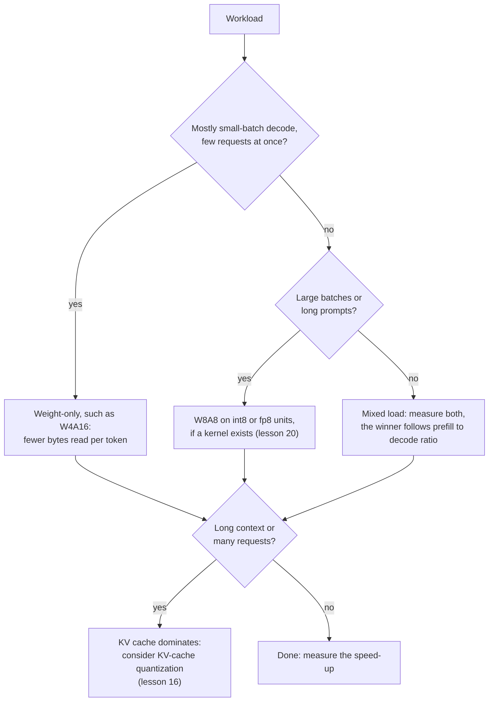

# Урок 19. Что на самом деле работает быстрее

**Связь с целью курса:** Цель курса требует предсказать, будет ли схема работать быстрее на заданном оборудовании при заданном размере батча, и предсказание начинается с одного деления: арифметическая работа на перемещённые байты.
**Первоисточник:** [Научная статья: "MARLIN: Mixed-Precision Auto-Regressive Parallel Inference on Large Language Models", Frantar et al., 2024](https://arxiv.org/abs/2408.11743)
**Предварительные требования:** [Урок 18](0018-qat-for-llms.md), [Ограничение памятью](../GLOSSARY.md), [Ограничение вычислениями](../GLOSSARY.md), [Квантизация только весов](../GLOSSARY.md), [Нотация WxAy](../GLOSSARY.md), [Деквантизация](../GLOSSARY.md)

## Разминка

1. ▢ Модель на 70 млрд в int4 занимает около 35 ГБ весов. На GPU с пропускной способностью памяти 2 ТБ/с при размере батча 1 какова нижняя граница времени на токен и верхняя граница токенов в секунду?

<details markdown="1"><summary>Проверка</summary>

Каждый вес читается один раз на токен, поэтому нижняя граница равна 35 ГБ, делённым на 2000 ГБ/с, то есть 17,5 мс на токен, около 57 токенов в секунду. Это арифметика урока 1. Она игнорирует KV-кеш и работу по деквантизации, поэтому настоящая система оказывается ниже.

</details>

2. ▢ Что говорят 4 и 16 в W4A16 и в какой точности выполняется само умножение матриц?

<details markdown="1"><summary>Проверка</summary>

Веса хранятся в 4 битах, а активации остаются в 16 битах. Ядро деквантизует веса в 16 бит внутри ядра, поэтому умножение выполняется в 16-битной арифметике: схема экономит перемещаемые байты, а не арифметику.

</details>

## Что нужно знать

### Арифметическая интенсивность и roofline

У чипа есть две вещи, которые могут ограничивать вычисление: арифметика и перемещение байтов из памяти. **Арифметическая интенсивность** это число операций с плавающей точкой, которые вычисление выполняет на каждый перемещённый байт. Идея **roofline** сравнивает это число с отношением пиковой арифметики чипа к пропускной способности памяти, его ridge point. Ниже ridge point вычисление ограничено памятью, а его время равно байтам, делённым на пропускную способность. Выше него оно ограничено вычислениями, а его время равно операциям, делённым на пик. Одной строкой: `time = max(operations / peak, bytes / bandwidth)`.

Даташит A100 80GB указывает 312 TFLOPS плотной пропускной способности тензорных ядер FP16 и, для версии SXM, 2039 ГБ/с пропускной способности памяти ([даташит NVIDIA](https://www.nvidia.com/content/dam/en-zz/Solutions/Data-Center/a100/pdf/nvidia-a100-datasheet-nvidia-us-2188504-web.pdf), который рядом указывает 624 TFLOPS с разреженностью). Её ridge point равен 312e12 / 2.039e12, около 153 операций на байт.

### Квантизация только весов в зависимости от размера батча

Матрица весов с `P` параметрами, применённая к `B` токенам, выполняет `2 * B * P` операций, одно умножение и одно сложение на вес на токен, и читает около `P * bytes_per_weight` байт, поскольку веса затмевают всё остальное. Поэтому интенсивность равна `2 * B / bytes_per_weight`:

| Веса | Байт на вес | Интенсивность | Ограничение вычислениями начиная примерно с |
|---|---|---|---|
| bf16 | 2 | `B` | батч 153 |
| int4, только веса | 0,5 | `4 * B` | батч 38 |

Декодирование при батче 1 лежит далеко ниже ridge point в обоих случаях, поэтому оно ограничено памятью, а 4-битные веса сокращают время до 4 раз. По мере роста батча 4-битная модель пересекает ridge point при четверти размера батча, после чего её время растёт вместе с арифметикой, которую квантизация одних весов не сократила. Prefill это крайний случай: токены промпта обрабатываются вместе, так что он ведёт себя как очень большой батч. Он ограничен вычислениями в обоих форматах, экономия байтов несущественна, а любая работа по деквантизации чистая добавка.

Статья MARLIN проверяет это на настоящих ядрах. Её аннотация сообщает о ускорении, близком к максимальным 4 разам, для 4-битных весов при размерах батча до 16-32, постепенно убывающем, но всё ещё значительном ускорении до 64-128 и о сквозном ускорении до 2,8 раза при интеграции в vLLM. Эти цифры получены на другом GPU, чем в таблице выше, и включают настоящие накладные расходы, поэтому с 38 из roofline можно сравнивать только их порядок величины.

### Деквантизация это цена, а не ошибка округления

Roofline игнорирует то, что ядру приходится преобразовывать 4-битные веса в 16-битные перед умножением. [QServe](https://arxiv.org/abs/2405.04532) обнаруживает, что существующие методы INT4 несут накладные расходы 20-90% времени выполнения на деквантизацию весов или частичных сумм на GPU и что современные методы INT4 ускоряют лишь инференс на периферии с малым батчем, а не облачное обслуживание с большим батчем. Их средство это другая схема (4-битные веса, 8-битные активации и 4-битный KV-кеш), спроектированная так, чтобы деквантизация была дешёвой. MARLIN это другой ответ: ядро, построенное так, чтобы оставаться ограниченным памятью с ростом батча.

### Схемы с весами и активациями поднимают потолок

Квантизация и активаций позволяет умножению использовать более быстрые блоки низкой точности. Даташит A100 указывает 624 TOPS плотной пропускной способности тензорных ядер INT8, вдвое больше, чем у FP16. В скрипте из упражнения 2 практики W8A8 читает вдвое больше байт, чем W4A16, поэтому проигрывает при малом батче и выигрывает, когда батч достаточно велик, чтобы арифметика была пределом.

Kurtic и соавторы измерили практический результат с vLLM на трёх GPU в семи сценариях развёртывания. Prefill обычно ограничен вычислениями, а декодирование памятью, квантизация весов в основном ускоряет декодирование, а квантизация весов и активаций повышает эффективность prefill. Их рекомендация: W4A16 наиболее экономичен для синхронных постановок, W8A8 доминирует при асинхронной непрерывной пакетной обработке, а для смешанных нагрузок оптимум зависит от отношения prefill к декодированию ([Kurtic et al., 2024](https://arxiv.org/abs/2411.02355)).



## Практика

1. ▢ Умножение матриц bf16 только для весов применяется сразу к 8 токенам. Какова его арифметическая интенсивность и ограничено ли оно памятью или вычислениями на чипе с ridge point 153 операции на байт? А если веса в int4?

<details markdown="1"><summary>Проверка</summary>

Для bf16 интенсивность равна `2 * 8 / 2`, то есть 8 операций на байт. Для int4 она равна `2 * 8 / 0.5`, то есть 32. Обе ниже 153, поэтому обе ограничены памятью, а у версии int4 около четверти времени. Квантизация весов умножает интенсивность на коэффициент сжатия, поэтому ridge point наступает раньше.

</details>

2. ▢ Предскажите, затем запустите. Для модели на 8 млрд на числах A100 выше какая из bf16, W4A16 и W8A8 быстрее всего при батче 1, при батче 128 и при батче 512? Скрипт моделирует только веса и арифметику, без стоимости деквантизации и без KV-кеша.

    ```python
    P = 8e9            # parameters
    BW = 2039e9        # bytes per second, A100 80GB memory bandwidth
    BF16 = 312e12      # dense bf16 FLOP/s
    INT8 = 624e12      # dense int8 OP/s

    def step_time(batch, weight_bytes, peak):
        flops = 2 * batch * P
        return max(flops / peak, P * weight_bytes / BW)

    print("ridge point, FLOP per byte:", round(BF16 / BW))
    print("batch  bf16_ms  w4a16_ms  w8a8_ms")
    for b in [1, 16, 32, 64, 128, 256, 512]:
        t16 = step_time(b, 2.0, BF16)
        t4 = step_time(b, 0.5, BF16)
        t8 = step_time(b, 1.0, INT8)
        print(f"{b:5d}  {t16*1e3:7.2f}  {t4*1e3:8.2f}  {t8*1e3:7.2f}")
    ```

<details markdown="1"><summary>Проверка</summary>

```text
ridge point, FLOP per byte: 153
batch  bf16_ms  w4a16_ms  w8a8_ms
    1     7.85      1.96     3.92
   16     7.85      1.96     3.92
   32     7.85      1.96     3.92
   64     7.85      3.28     3.92
  128     7.85      6.56     3.92
  256    13.13     13.13     6.56
  512    26.26     26.26    13.13
```

W4A16 выигрывает при батче 1, выигрыш в 4 раза относительно bf16. При батче 128 выигрывает W8A8 (3,92 мс против 6,56), потому что W4A16 уже ограничен вычислениями, а его выигрыш над bf16 упал до 1,2 раза. При батче 512 W4A16 и bf16 равны, а W8A8 вдвое быстрее, потому что использует блоки int8. 4-кратный выигрыш держится до батча 32 и сокращается начиная с 64, это та же форма, что и сообщённый диапазон MARLIN, хотя настоящее ядро добавляет накладные расходы, которых эта модель не учитывает.

</details>

3. ▢ Почему в таблице из упражнения 2 ускорение W4A16 относительно bf16 сокращается с ростом батча?

    - a) Деквантизация замедляется с каждым дополнительным обслуживаемым запросом
    - b) Вычисления растут вместе с батчем, а читаемые байты остаются фиксированными
    - c) Пропускная способность памяти падает, когда её делят больше запросов
    - d) 4-битные значения нельзя пакетировать на тензорных ядрах GPU

<details markdown="1"><summary>Проверка</summary>

**b)** Веса читаются один раз на шаг независимо от батча, но арифметика растёт вместе с ним, поэтому шаг перестаёт быть ограниченным памятью, а меньшее число байт перестаёт иметь значение. (a) неверно: веса преобразуются один раз на шаг, а не один раз на запрос, и накладные расходы деквантизации это отдельная цена (QServe), которая не объясняет тренд в этой модели. (c) неверно: пиковая пропускная способность не падает с размером батча, просто предел перестаёт быть узким местом. (d) неверно: MARLIN пакетирует 4-битные веса до 128.

</details>

4. ▢ У гипотетического GPU 800 TFLOPS плотной арифметики bf16 и 2 ТБ/с пропускной способности памяти. При каком размере батча bf16 только для весов становится ограниченным вычислениями и при каком int4 только для весов? Что делает более быстрый чип с той же пропускной способностью с диапазоном, где окупаются 4-битные веса?

<details markdown="1"><summary>Проверка</summary>

Ridge point равен 800e12 / 2e12 = 400 операций на байт. У bf16 интенсивность `B`, поэтому он пересекает при батче 400. У int4 `4 * B`, поэтому он пересекает при батче 100. Больше арифметики на той же пропускной способности поднимает ridge point и расширяет диапазон размеров батча, где квантизация только весов даёт полный выигрыш. Чип с большей пропускной способностью относительно арифметики делает обратное.

</details>

5. ▢ Приложение с поиском отправляет промпты по 6000 токенов и получает ответы по 100 токенов, на одном GPU, со многими одновременными пользователями. Коллега предлагает W4A16 ради 4-кратного ускорения. Что не так с ожиданием 4 раз и что бы вы проверили?

<details markdown="1"><summary>Подсказка</summary>

Посчитайте, какая доля работы приходится на prefill и каков эффективный размер батча.

</details>

<details markdown="1"><summary>Проверка</summary>

Здесь доминирует prefill: 6000 токенов промпта против 100 сгенерированных. Prefill ограничен вычислениями, поэтому чтение меньшего числа байт весов его не укорачивает, а любые накладные расходы на деквантизацию добавляются сверху. Многие одновременные пользователи также толкают декодирование к большим батчам, где выигрыш схемы только для весов сокращается. Рекомендация Kurtic и соавторов указывает в другую сторону, на W8A8 для непрерывной пакетной обработки, и говорит, что оптимум зависит от отношения prefill к декодированию. Прогоните бенчмарк W4A16 и W8A8 против bf16 на реальной смеси промптов и проверьте, что для схемы на вашем GPU существует ядро (урок 20).

</details>

## Практика в реальной работе

- [ ] Найдите пиковую плотную пропускную способность bf16 и пропускную способность памяти GPU, который вы можете использовать, на странице спецификации производителя и посчитайте его ridge point. Затем найдите размер батча, при котором bf16 и int4 только для весов становятся ограниченными вычислениями.
- [ ] Найдите числа пропускной способности, которые публикует поставщик квантизованных моделей или движок обслуживания для одной модели при нескольких размерах батча. Посчитайте ускорение относительно bf16 при каждом батче и сравните форму с roofline выше.
- [ ] Завтра, без заметок, запишите формулу арифметической интенсивности умножения матриц только для весов, формулу ridge point и какая из W4A16 и W8A8 выигрывает при малом и при большом батче.

## Что почитать дальше

- [QAT и оборудование](../reference/qat-and-hardware.md)
- [Научная статья: "MARLIN: Mixed-Precision Auto-Regressive Parallel Inference on Large Language Models", Frantar et al., 2024](https://arxiv.org/abs/2408.11743)
- [Научная статья: "QServe: W4A8KV4 Quantization and System Co-design for Efficient LLM Serving", Lin et al., 2024](https://arxiv.org/abs/2405.04532)
- [Научная статья: "Give Me BF16 or Give Me Death? Accuracy-Performance Trade-Offs in LLM Quantization", Kurtic et al., 2024](https://arxiv.org/abs/2411.02355)
- [Инференс: Квантизация при обслуживании](../../inference/reference/quantization-at-serve-time.md)
- [Ресурсы](../RESOURCES.md)

---

Не доходит? Перечитайте первоисточник в начале: этот урок его сжимает, а при сжатии понимание как раз и теряется. Загляните в [глоссарий](../GLOSSARY.md), если какой-то термин показался скользким.

Если неясен сам урок, а не материал, это дефект: [откройте issue](https://github.com/TokenCemetery/teach/issues).
