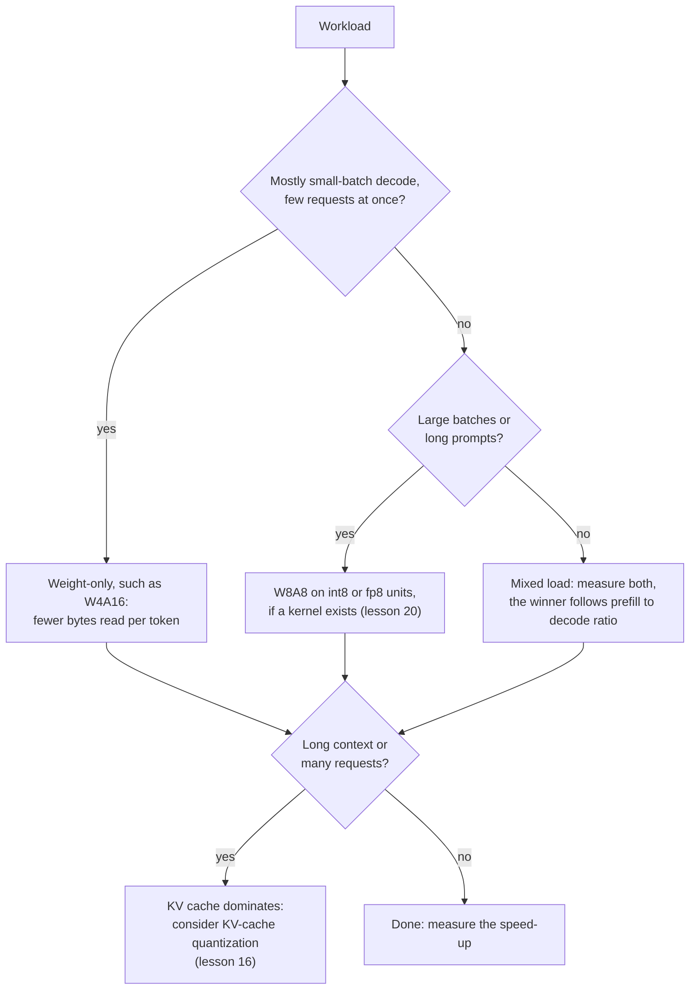

# 第 19 课：什么才真正跑得更快

**使命关联:** 本使命要求你预测一种方案在给定硬件和给定批大小下是否会跑得更快，而这个预测从一次除法开始：算术工作量除以搬运的字节数。
**主要来源:** [论文：“MARLIN: Mixed-Precision Auto-Regressive Parallel Inference on Large Language Models”，Frantar 等，2024](https://arxiv.org/abs/2408.11743)
**前置知识:** [第 18 课](0018-qat-for-llms.md)、[受内存带宽限制](../GLOSSARY.md)、[受算力限制](../GLOSSARY.md)、[仅权重量化](../GLOSSARY.md)、[WxAy 记法](../GLOSSARY.md)、[反量化](../GLOSSARY.md)

## 热身

1. ▢ 一个 70B 的模型用 int4，权重约占 35 GB。在内存带宽为 2 TB/s 的 GPU 上，批大小为 1 时，每个 token 耗时的下限是多少？每秒 token 数的上限是多少？

<details markdown="1"><summary>检查</summary>

每个权重每个 token 读取一次，所以下限是 35 GB 除以 2,000 GB/s，也就是每个 token 17.5 ms，约合每秒 57 个 token。这就是第 1 课的算术。它忽略了 KV 缓存和反量化的工作，所以真实的系统会落在它之下。

</details>

2. ▢ W4A16 里的 4 和 16 告诉你什么？矩阵乘法本身以什么精度运行？

<details markdown="1"><summary>检查</summary>

权重以 4 位存储，激活值保持 16 位。内核在内核内部把权重反量化成 16 位，所以乘法是以 16 位算术运行的：这种方案节省的是搬运的字节，而不是算术。

</details>

## 要点

### 算术强度与屋顶线

芯片有两件事可能限制一次计算：算术，以及从内存搬运字节。**算术强度**是一次计算每搬运一个字节所做的浮点运算次数。**屋顶线**的思路，是拿这个数字与芯片的峰值算术与内存带宽之比，也就是它的脊点，做比较。低于脊点，计算受内存带宽限制，它的耗时就是字节数除以带宽。高于脊点，它受算力限制，耗时就是运算次数除以峰值。一句话就是 `time = max(operations / peak, bytes / bandwidth)`。

A100 80GB 的数据手册给出的稠密 FP16 张量核心吞吐量是 312 TFLOPS，SXM 版本的内存带宽是 2,039 GB/s（[NVIDIA 数据手册](https://www.nvidia.com/content/dam/en-zz/Solutions/Data-Center/a100/pdf/nvidia-a100-datasheet-nvidia-us-2188504-web.pdf)，它旁边还列出了带稀疏时的 624 TFLOPS）。它的脊点是 312e12 / 2.039e12，约为每字节 153 次运算。

### 仅权重量化与批大小

一个有 `P` 个参数的权重矩阵，作用在 `B` 个 token 上，要做 `2 * B * P` 次运算，每个权重每个 token 一次乘法和一次加法，并且读取约 `P * bytes_per_weight` 字节，因为权重的量远远超过其他一切。所以强度是 `2 * B / bytes_per_weight`：

| 权重 | 每个权重的字节数 | 强度 | 从大约多大的批开始受算力限制 |
|---|---|---|---|
| bf16 | 2 | `B` | 批大小 153 |
| int4，仅权重 | 0.5 | `4 * B` | 批大小 38 |

批大小为 1 的解码，对两者来说都远低于脊点，所以它受内存带宽限制，4 位权重最多把耗时降到原来的四分之一。随着批变大，4 位模型在四分之一的批大小处越过脊点，此后它的耗时随算术增长，而仅权重量化并没有缩小算术。预填充是极端的情形：一个提示词的 token 是一起处理的，所以它的行为像一个非常大的批。对两种格式来说它都受算力限制，字节上的节省无关紧要，任何反量化的工作都是纯粹的额外开销。

MARLIN 论文用真实的内核检验了这一点。它的摘要报告了：批大小最多到 16 至 32 时，4 位权重接近 4 倍的最大加速，到 64 至 128 时加速逐渐减小但仍然显著，集成进 vLLM 后端到端的加速最高可达 2.8 倍。这些数字来自与上表不同的 GPU，并且包含真实的开销，所以只能拿它们的数量级去和屋顶线给出的 38 比较。

### 反量化是一项代价，不是舍入误差

屋顶线忽略了内核在相乘之前，必须把 4 位权重转换成 16 位这件事。[QServe](https://arxiv.org/abs/2405.04532) 发现，现有的 INT4 方法在 GPU 上，因为对权重或部分和做反量化，要承受 20% 到 90% 的运行时开销，而且最先进的 INT4 方法只能加速小批量的边缘推理，不能加速大批量的云端服务。它们的补救办法是另一种方案（4 位权重、8 位激活值和 4 位 KV 缓存），其设计使反量化很便宜。MARLIN 是另一种回答：一个为了在批变大时仍保持受内存带宽限制而构建的内核。

### 权重加激活值的方案把上限抬高了

把激活值也量化，能让乘法使用更快的低精度单元。A100 的数据手册列出稠密 INT8 张量核心吞吐量为 624 TOPS，是 FP16 数字的两倍。在练习第 2 题的脚本里，W8A8 读取的字节是 W4A16 的两倍，所以在小批量时它输，而当批大到算术成为限制时，它就赢了。

Kurtic 等人用 vLLM 在三种 GPU 上、七种部署场景中度量了实际结果。预填充通常受算力限制，解码受内存带宽限制，权重量化主要加快解码，而权重加激活值量化提高预填充的效率。他们的建议是：W4A16 对同步的设置最具成本效益，W8A8 在异步的连续批处理中占优，而对混合的工作负载，最优方案取决于预填充与解码之比（[Kurtic 等，2024](https://arxiv.org/abs/2411.02355)）。



## 练习

1. ▢ 一个 bf16 的仅权重矩阵乘法，一次作用在 8 个 token 上。它的算术强度是多少？在脊点为每字节 153 次运算的芯片上，它受内存带宽限制还是受算力限制？如果权重是 int4 呢？

<details markdown="1"><summary>检查</summary>

对 bf16，强度是 `2 * 8 / 2`，即每字节 8 次运算。对 int4，是 `2 * 8 / 0.5`，即 32。两者都低于 153，所以都受内存带宽限制，int4 版本的耗时约为四分之一。量化权重把强度乘以压缩比，这就是脊点来得更早的原因。

</details>

2. ▢ 先预测，再运行。对一个 8B 的模型，按上面的 A100 数字，bf16、W4A16 和 W8A8 里，批大小为 1、128 和 512 时，哪一个最快？这个脚本只对权重和算术建模，不含反量化代价，也不含 KV 缓存。

    ```python
    P = 8e9            # parameters
    BW = 2039e9        # bytes per second, A100 80GB memory bandwidth
    BF16 = 312e12      # dense bf16 FLOP/s
    INT8 = 624e12      # dense int8 OP/s

    def step_time(batch, weight_bytes, peak):
        flops = 2 * batch * P
        return max(flops / peak, P * weight_bytes / BW)

    print("ridge point, FLOP per byte:", round(BF16 / BW))
    print("batch  bf16_ms  w4a16_ms  w8a8_ms")
    for b in [1, 16, 32, 64, 128, 256, 512]:
        t16 = step_time(b, 2.0, BF16)
        t4 = step_time(b, 0.5, BF16)
        t8 = step_time(b, 1.0, INT8)
        print(f"{b:5d}  {t16*1e3:7.2f}  {t4*1e3:8.2f}  {t8*1e3:7.2f}")
    ```

<details markdown="1"><summary>检查</summary>

```text
ridge point, FLOP per byte: 153
batch  bf16_ms  w4a16_ms  w8a8_ms
    1     7.85      1.96     3.92
   16     7.85      1.96     3.92
   32     7.85      1.96     3.92
   64     7.85      3.28     3.92
  128     7.85      6.56     3.92
  256    13.13     13.13     6.56
  512    26.26     26.26    13.13
```

批大小为 1 时 W4A16 胜出，比 bf16 快 4 倍。批大小为 128 时，W8A8 胜出（3.92 ms 对 6.56），因为 W4A16 已经受算力限制，它相对于 bf16 的收益降到了 1.2 倍。批大小为 512 时 W4A16 与 bf16 持平，而 W8A8 快 2 倍，因为它用了 int8 单元。4 倍的加速保持到批大小 32，从 64 起缩小，与 MARLIN 所报告的范围形态相同，不过真实的内核会加上这个模型忽略的开销。

</details>

3. ▢ 在第 2 题的表里，为什么 W4A16 相对于 bf16 的加速，会随批变大而缩小？

    - a) 每多服务一个请求，反量化就变慢一点
    - b) 计算量随批增长，而读取的字节数不变
    - c) 内存带宽因为越来越多的请求共用而下降
    - d) 四位的值无法在 GPU 张量核心上做批处理

<details markdown="1"><summary>检查</summary>

**b)** 不管批多大，权重每一步都只读一次，但算术随批增长，所以这一步不再受内存带宽限制，字节更少也就不再要紧了。(a) 是错的：权重是每一步转换一次，而不是每个请求一次，反量化开销是另一项代价（QServe），解释不了这个模型里的趋势。(c) 是错的：峰值带宽不会随批大小下降，只是限制它的不再是瓶颈。(d) 是错的：MARLIN 对 4 位权重做批处理，最多到 128。

</details>

4. ▢ 一块假想的 GPU 有 800 TFLOPS 的稠密 bf16 算力和 2 TB/s 的内存带宽。bf16 的仅权重在多大的批大小下变成受算力限制？int4 的仅权重呢？在带宽不变的情况下，一块更快的芯片，对 4 位权重划算的范围会有什么影响？

<details markdown="1"><summary>检查</summary>

脊点是 800e12 / 2e12 = 每字节 400 次运算。bf16 的强度是 `B`，所以它在批大小 400 处越过。int4 是 `4 * B`，所以它在批大小 100 处越过。在同样的带宽上有更多算力，会把脊点推高，并拓宽仅权重量化能得到全部收益的批大小范围。相对于算力带宽更大的芯片，则做的是相反的事。

</details>

5. ▢ 一个检索应用发送 6,000 个 token 的提示词，得到 100 个 token 的回答，在一块 GPU 上，有许多并发用户。一位同事提议用 W4A16 获得 4 倍的加速。期待 4 倍错在哪里？你会测试什么？

<details markdown="1"><summary>提示</summary>

数一数有多少工作是预填充，以及有效的批有多大。

</details>

<details markdown="1"><summary>检查</summary>

这里预填充占主导：6,000 个提示词 token 对 100 个生成的 token。预填充受算力限制，所以读取更少的权重字节并不会缩短它，任何反量化的开销还要额外叠加。许多并发用户也把解码推向更大的批，仅权重量化的收益在那里缩小。Kurtic 等人的指导意见指向另一个方向，连续批处理用 W8A8，并说最优方案取决于预填充与解码之比。请在真实的提示词组合上，拿 W4A16 和 W8A8 与 bf16 做基准测试，并核查你的 GPU 上存在这种方案的内核（第 20 课）。

</details>

## 实战练习

- [ ] 从厂商的规格页面上，查一块你能用的 GPU 的峰值稠密 bf16 吞吐量和内存带宽，算出它的脊点。然后算出 bf16 和 int4 仅权重量化各在多大的批大小下变成受算力限制。
- [ ] 找一家量化模型厂商或一个服务引擎，为某个模型在几个批大小下公布的吞吐量数字。算出每个批大小下相对于 bf16 的加速，并把形态与上面的屋顶线做比较。
- [ ] 明天：不看笔记，写出仅权重矩阵乘法的算术强度公式、脊点公式，以及 W4A16 和 W8A8 里哪一个在小批量时赢，哪一个在大批量时赢。

## 延伸阅读

- [QAT 与硬件](../reference/qat-and-hardware.md)
- [论文：“MARLIN: Mixed-Precision Auto-Regressive Parallel Inference on Large Language Models”，Frantar 等，2024](https://arxiv.org/abs/2408.11743)
- [论文：“QServe: W4A8KV4 Quantization and System Co-design for Efficient LLM Serving”，Lin 等，2024](https://arxiv.org/abs/2405.04532)
- [论文：“Give Me BF16 or Give Me Death? Accuracy-Performance Trade-Offs in LLM Quantization”，Kurtic 等，2024](https://arxiv.org/abs/2411.02355)
- [推理：服务时量化](../../inference/reference/quantization-at-serve-time.md)
- [资源](../RESOURCES.md)

---

没学明白？请重读顶部的主要来源，因为本课是对它的压缩，而理解正是在压缩中流失的。如果有哪个术语觉得含糊，可以查看[术语表](../GLOSSARY.md)。

如果问题出在课程本身，而不是学习材料，那就是一个缺陷：[提交 issue](https://github.com/TokenCemetery/teach/issues)。
