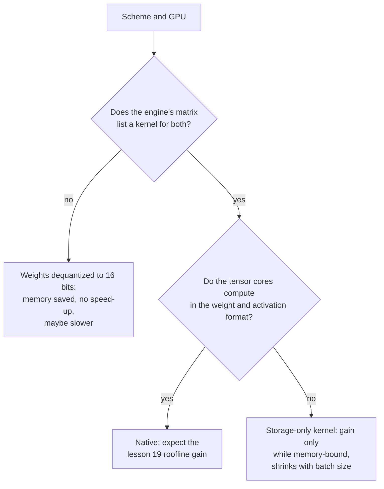

# Lección 20. Hardware y soporte de kernels

**Vínculo con la misión:** Un esquema solo corre más rápido si la GPU puede multiplicar en su formato y el motor de servicio tiene un kernel que lo use, así que el último paso para predecir la velocidad es leer una matriz de soporte en lugar de fiarse de un ancho de bits.
**Fuente principal:** [Article: "Introducing NVFP4 for Efficient and Accurate Low-Precision Inference", NVIDIA Technical Blog, 2025](https://developer.nvidia.com/blog/introducing-nvfp4-for-efficient-and-accurate-low-precision-inference/)
**Requisitos previos:** [Lección 19](0019-what-actually-runs-faster.md), [Formato con scale por bloque](../GLOSSARY.md), [Descuantización](../GLOSSARY.md), [Cuantización solo de pesos](../GLOSSARY.md)

## Calentamiento

1. ▢ MXFP4 almacena elementos de 4 bits con un scale de 8 bits por bloque de 32 valores. ¿Cuáles son sus bits efectivos por peso?

Comprobación

4 + 8 / 32 = 4.25 bits efectivos por peso. El scale se almacena junto con los elementos, así que el checkpoint es algo mayor de lo que sugieren "4 bits" (lección 3).

2. ▢ ¿Cuál de prefill y decode con lote pequeño está limitado por cómputo, y qué clase de cuantización ayuda a cada uno?

Comprobación

El prefill está limitado por cómputo, así que solo lo acelera un esquema que abarate también la aritmética, como W8A8 en unidades int8 o fp8. El decode con lote pequeño está limitado por el ancho de banda de memoria, así que la cuantización solo de pesos lo acelera al recortar los bytes leídos (lección 19).

## Qué debes saber

### Datos de proveedores con fecha

Los datos sobre chips y motores concretos de esta lección son documentación de proveedores leída en fechas concretas, y caducan más rápido que la teoría de las lecciones 17 a 19. Cada fila de abajo nombra su fuente. Trata las tablas como lo que decía la fuente cuando se leyó, y vuelve a comprobar la fuente antes de comprar hardware o elegir un esquema. La página de vLLM se obtuvo en octubre de 2026. El blog de NVFP4 es de junio de 2025.

### Cómputo nativo frente a solo almacenamiento

Los tensor cores de una GPU multiplican en una lista fija de formatos. Un formato de esa lista es **nativo**: la multiplicación corre directamente en él, y la aceleración de la lección 19 está disponible. Un formato que no está en la lista es **solo de almacenamiento**: los pesos ocupan menos bytes en memoria, pero un kernel debe convertirlos a un formato nativo antes de multiplicar. La cuantización solo de pesos es de solo almacenamiento por diseño, ya que W4A16 multiplica en 16 bits. La documentación de Transformers para bitsandbytes muestra la idea en sus ajustes: los pesos de 4 bits tienen un "tipo de datos de cómputo" aparte, que por defecto es float32 y que la documentación sugiere cambiar a bf16 para acelerar el cálculo ([documentación de Transformers](https://huggingface.co/docs/transformers/main/en/quantization/bitsandbytes)).

### Qué documenta NVIDIA, generación por generación

| Generación | Formatos de tensor cores de baja precisión documentados | Fuente |
|---|---|---|
| Ampere (A100) | La tabla de especificaciones lista filas de TF32, BF16, FP16 e INT8, con 624 TOPS de INT8 denso frente a 312 TFLOPS de FP16, y ninguna fila de FP8 | [ficha técnica de la A100](https://www.nvidia.com/content/dam/en-zz/Solutions/Data-Center/a100/pdf/nvidia-a100-datasheet-nvidia-us-2188504-web.pdf) |
| Ada | Tensor cores de cuarta generación y el Transformer Engine FP8 de Hopper; el throughput de FP8 se lista para la RTX 4090 y se muestra como N/A para las tarjetas Turing y Ampere con las que se compara | [whitepaper de la arquitectura Ada](https://images.nvidia.com/aem-dam/Solutions/Data-Center/l4/nvidia-ada-gpu-architecture-whitepaper-v2.1.pdf) |
| Hopper (H100) | Filas de tensor cores FP8 e INT8; el formato FP8 se añadió con los tensor cores de cuarta generación | [página de la H100](https://www.nvidia.com/en-us/data-center/h100/), [blog de la arquitectura Hopper](https://developer.nvidia.com/blog/nvidia-hopper-architecture-in-depth/) |
| Blackwell | FP64, FP32/TF32, FP16/BF16, INT8/FP8, FP6 y FP4, con MXFP4 y NVFP4 escalados en hardware | [blog de NVFP4](https://developer.nvidia.com/blog/introducing-nvfp4-for-efficient-and-accurate-low-precision-inference/) |

La comparación del mismo blog entre los tres formatos de 4 bits en Blackwell dice que FP4 simple (E2M1) lleva un factor de escala por software y no tiene escalado acelerado por hardware, mientras que MXFP4 (un scale compartido que es potencia de dos por cada 32 valores) y NVFP4 (un scale FP8 compartido por cada 16 valores) sí lo tienen. Dice que NVFP4 almacena 4.5 bits por valor y reduce la memoria unas 3.5 veces frente a FP16. Dice también que FP8 está soportado por Hopper y Blackwell, y no menciona Ada, que sí cubre el whitepaper de Ada. El blog es un proveedor describiendo su propio formato, así que sus afirmaciones sobre accuracy son las del proveedor.

### Leer la matriz de soporte de un motor de servicio

El hardware es la mitad. Un motor necesita además un kernel para el esquema en ese chip. vLLM publica una tabla de implementaciones de cuantización frente a hardware, con las generaciones de GPU identificadas por compute capability: Ampere es SM 8.0 y 8.6, Ada SM 8.9, Hopper SM 9.0 ([documentación de cuantización de vLLM](https://docs.vllm.ai/en/latest/features/quantization/)). Una selección de filas tal como se obtuvieron:

| Implementación | Turing | Ampere | Ada | Hopper |
|---|---|---|---|---|
| AWQ | sí | sí | sí | sí |
| GPTQ | sí | sí | sí | sí |
| Marlin (GPTQ, AWQ, FP8, FP4) | sí, con una excepción | sí | sí | sí |
| llm-compressor INT8 (W8A8) | sí | sí | sí | sí |
| llm-compressor FP8 (W8A8) | no | no | sí | sí |
| llm-compressor INT8 (W4A8) | no | no | no | no (solo se lista una CPU Arm) |

Lee la tabla frente a los datos del proveedor. FP8 W8A8 aparece de Ada en adelante y no en Ampere, lo que coincide con la tabla de tensor cores de arriba. La fila de W4A8 no tiene ninguna columna de GPU marcada: un esquema puede tener un buen paper y un cuantizador y aun así no tener kernel de GPU en este motor. La fila de Marlin nombra FP8 entre sus formatos y está marcada para Ampere. Si FP8 funciona ahí, no puede ser aritmética FP8 en un chip sin tensor cores FP8. La tabla no dice qué hace, y la lectura natural, almacenamiento FP8 con aritmética de 16 bits, es una inferencia que hay que comprobar en el motor antes de depender de ella. La página advierte además de que el cuadro cambia a medida que evoluciona vLLM.

### Qué cuesta un kernel que falta

Si un motor no tiene kernel para tu esquema en tu chip, aun así puede cargar el checkpoint, y la memoria se reduce, ya que los pesos se almacenan pequeños. Lo que no puede hacer es usar la velocidad del formato: los pesos se convierten a 16 bits antes de una multiplicación normal, que es el caso de solo almacenamiento. Las fuentes de la lección 19 muestran por qué la conversión no es gratis: QServe midió una sobrecarga de tiempo de ejecución del 20 al 90% por descuantizar en los métodos INT4 existentes en GPU ([Lin et al., 2024](https://arxiv.org/abs/2405.04532)). Un punto más se sigue de un razonamiento y no de una medición: un fallback ingenuo que convierte una matriz entera a 16 bits antes de multiplicar lee y escribe más bytes que bf16 simple, así que puede ser más lento. Los autores de LLM-QAT chocaron con un muro relacionado: señalan que la cuantización de 4 bits no tenía soporte de hardware de fábrica y no incluyeron ninguna implementación de hardware ([Liu et al., 2023](https://arxiv.org/abs/2305.17888)).

## Práctica

1. ▢ Usando la tabla de vLLM de arriba, ¿puedes ejecutar llm-compressor FP8 W8A8 en una A100? ¿Y en una RTX 4090? ¿Qué dicen los documentos del proveedor que explique ambas respuestas?

Comprobación

No en la A100 (Ampere) y sí en la RTX 4090 (Ada). La ficha técnica de la A100 no lista ninguna fila de tensor cores FP8, y el whitepaper de Ada lista el throughput de FP8 para la RTX 4090 y N/A para la tarjeta Ampere con la que compara. La aritmética FP8 necesita tensor cores FP8, que Ada y Hopper tienen y Ampere no.

2. ▢ Almacenas pesos en FP8 en una A100 y el motor tiene un kernel solo de pesos para ello. ¿Qué obtienes?

    - a) Menos memoria, más rápido solo mientras el decode siga limitado por el ancho de banda de memoria
    - b) Menos memoria, más rápido con cada tamaño de lote que se sirva
    - c) La misma memoria, más rápido gracias a los tensor cores FP8
    - d) La misma memoria, más lento porque FP8 simplemente no está soportado

Comprobación

**a)** Los pesos ocupan la mitad de bytes que en 16 bits y el kernel los convierte a 16 bits para multiplicar, así que la ganancia es la ganancia de solo pesos de la lección 19: real mientras está limitado por el ancho de banda de memoria, y se reduce al crecer el lote. (b) es incorrecta porque la aritmética sigue siendo de 16 bits, así que los lotes grandes y el prefill no ven ganancia. (c) es incorrecta porque la A100 no tiene tensor cores FP8 y el almacenamiento sí se reduce. (d) es incorrecta porque un kernel solo de pesos hace utilizable el formato, y la memoria es menor.

3. ▢ En la tabla de NVIDIA de formatos de 4 bits en Blackwell, ¿cuáles de FP4, MXFP4 y NVFP4 tienen escalado acelerado por hardware, y qué hace el otro para el escalado?

Comprobación

MXFP4 y NVFP4 lo tienen. FP4 simple (E2M1) usa un factor de escala por software, así que su escalado no está acelerado por el hardware. El proveedor no dice qué cuesta eso en velocidad, así que es algo que hay que medir.

4. ▢ Cuantizaste un modelo a GPTQ de 4 bits. La memoria bajó cerca de un 70%, pero los tokens por segundo con lote 1 no son mejores que bf16 en la misma GPU. ¿Qué compruebas, en orden?

Pista

Separa "es más pequeño" de "la multiplicación usa el formato pequeño".

Comprobación

Primero, el log de arranque del motor o su documentación: ¿qué kernel o backend eligió para este esquema en esta GPU, y lista uno la matriz de soporte? Si recurrió a convertir los pesos a 16 bits, la memoria se redujo pero la aceleración no puede aparecer, y la solución es otro motor o backend. Segundo, si la ejecución está limitada por el ancho de banda de memoria: con lote grande o con prefill la ganancia se reduce de todos modos (lección 19). Tercero, si dominan otros costos, como las lecturas de la KV cache. Un archivo más pequeño demuestra que los pesos se almacenan pequeños, no que se multipliquen rápido.

5. ▢ Un proveedor afirma "inferencia de 4 bits, 4x más rápida" para un modelo. Enumera lo que necesitas confirmar antes de creerlo para tu despliegue.

Comprobación

Qué esquema: W4A16 solo de pesos o también activaciones de 4 bits, ya que solo el segundo cambia la aritmética. Si tu generación de GPU calcula de forma nativa en ese formato (los formatos FP4 están documentados para Blackwell en el blog de NVFP4, y una tarjeta Hopper o Ampere sería de solo almacenamiento). Si tu motor de servicio lista un kernel para ese esquema en esa GPU. Con qué tamaño de lote y longitud de prompt se midió la cifra (lección 19). Y si el accuracy se midió frente a un baseline de precisión completa, ya que la velocidad no dice nada sobre la calidad.

## Prácticas en el mundo real

- [ ] Encuentra la compute capability de tu GPU (para una GPU NVIDIA con PyTorch instalado, `torch.cuda.get_device_capability()`), relaciónala con una generación mediante los números SM de la tabla de vLLM y anota qué formatos de baja precisión documenta el proveedor para ella.
- [ ] Abre la página actual de cuantización de vLLM y compara su tabla con la de esta lección. Anota cada celda que haya cambiado, y qué dice eso sobre fiarse de una matriz de soporte que viene en una lección.
- [ ] Mañana: sin apuntes, define nativo y solo de almacenamiento en una frase cada uno, y anota las tres preguntas que hacerle a cualquier afirmación de que un esquema de cuantización es más rápido.

## Para profundizar

- [QAT y hardware](../reference/qat-and-hardware.md)
- [Docs: "Quantization", vLLM](https://docs.vllm.ai/en/latest/features/quantization/)
- Inferencia: [Cuantización al servir](../../inference/reference/quantization-at-serve-time.md)
- [Recursos](../RESOURCES.md)

---

¿No termina de quedar claro? Vuelve a leer la fuente primaria de arriba, ya que esta lección la comprime y en la compresión es donde se escapa la comprensión. Consulta el [glosario](../GLOSSARY.md) por si algún término te resultó resbaladizo.

Si lo poco claro es la propia lección y no el material, eso es un defecto: [abre un issue](https://github.com/TokenCemetery/teach/issues).
