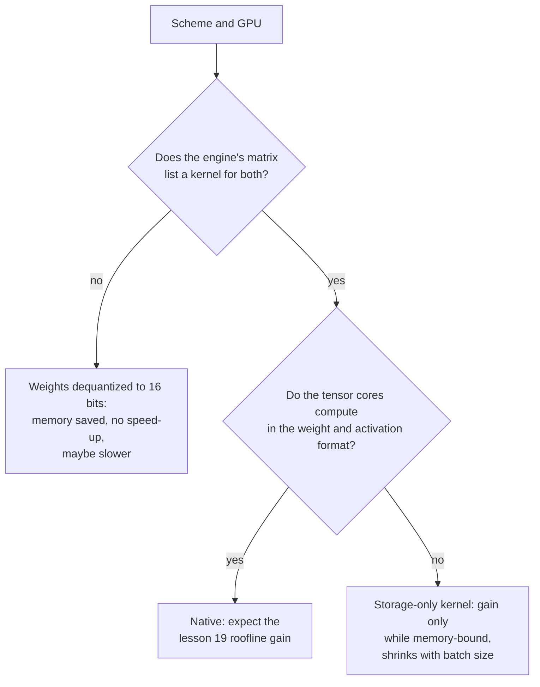

# Leçon 20. Matériel et prise en charge par les kernels

**Lien avec la mission :** Un schéma ne tourne plus vite que si le GPU sait multiplier dans son format et que le moteur de serving a un kernel qui l'utilise, donc la dernière étape pour prédire la vitesse est de lire une matrice de prise en charge au lieu de faire confiance à une largeur en bits.
**Source primaire :** [Billet : "Introducing NVFP4 for Efficient and Accurate Low-Precision Inference", NVIDIA Technical Blog](https://developer.nvidia.com/blog/introducing-nvfp4-for-efficient-and-accurate-low-precision-inference/)
**Prérequis :** [Leçon 19](0019-what-actually-runs-faster.md), [Format à échelle par bloc](../GLOSSARY.md), [Déquantification](../GLOSSARY.md), [Quantification weight-only](../GLOSSARY.md)

## Échauffement

1. ▢ Le MXFP4 stocke des éléments de 4 bits avec un scale de 8 bits par bloc de 32 valeurs. Quels sont ses bits effectifs par poids ?

Vérifier

4 + 8 / 32 = 4.25 bits effectifs par poids. Le scale est stocké avec les éléments, donc le checkpoint est un peu plus grand que ne le laisse penser « 4 bits » (leçon 3).

2. ▢ Lequel du prefill et du décodage à petit batch est limité par le calcul, et quelle sorte de quantification aide chacun ?

Vérifier

Le prefill est limité par le calcul, donc seul un schéma qui rend aussi l'arithmétique moins chère, comme le W8A8 sur des unités int8 ou fp8, l'accélère. Le décodage à petit batch est limité par la mémoire, donc la quantification weight-only l'accélère en réduisant les octets lus (leçon 19).

## À savoir

### Faits de fournisseurs datés

Les faits sur des puces et des moteurs précis dans cette leçon sont de la documentation de fournisseurs lue à des dates précises, et ils vieillissent plus vite que la théorie des leçons 17 à 19. Chaque ligne ci-dessous nomme sa source. Traitez les tableaux comme ce que disait la source quand elle a été lue, et revérifiez la source avant d'acheter du matériel ou de choisir un schéma. La page vLLM a été récupérée en octobre 2026. Le billet NVFP4 date de juin 2025.

### Calcul natif contre stockage seul

Les tensor cores d'un GPU multiplient dans une liste fixe de formats. Un format de cette liste est **natif** : la multiplication s'exécute directement dessus, et le gain de vitesse de la leçon 19 est possible. Un format qui n'est pas dans la liste est **de stockage seul** : les poids occupent moins d'octets en mémoire, mais un kernel doit les convertir en un format natif avant de multiplier. La quantification weight-only est de stockage seul par conception, puisque W4A16 multiplie en 16 bits. La documentation de Transformers sur bitsandbytes montre l'idée dans ses réglages : les poids en 4 bits ont un « type de données de calcul » distinct, par défaut float32, que la doc suggère de changer en bf16 pour accélérer le calcul ([docs de Transformers](https://huggingface.co/docs/transformers/main/en/quantization/bitsandbytes)).

### Ce que documente NVIDIA, génération par génération

| Génération | Formats de tensor cores basse précision documentés | Source |
|---|---|---|
| Ampere (A100) | Le tableau de spécifications liste des lignes TF32, BF16, FP16 et INT8, avec 624 TOPS d'INT8 dense contre 312 TFLOPS de FP16, et aucune ligne FP8 | [fiche technique A100](https://www.nvidia.com/content/dam/en-zz/Solutions/Data-Center/a100/pdf/nvidia-a100-datasheet-nvidia-us-2188504-web.pdf) |
| Ada | Tensor cores de quatrième génération et le Transformer Engine FP8 de Hopper ; le débit FP8 est listé pour la RTX 4090 et indiqué N/A pour les cartes Turing et Ampere auxquelles elle est comparée | [livre blanc de l'architecture Ada](https://images.nvidia.com/aem-dam/Solutions/Data-Center/l4/nvidia-ada-gpu-architecture-whitepaper-v2.1.pdf) |
| Hopper (H100) | Lignes de tensor cores FP8 et INT8 ; le format FP8 a été ajouté avec les tensor cores de quatrième génération | [page H100](https://www.nvidia.com/en-us/data-center/h100/), [billet sur l'architecture Hopper](https://developer.nvidia.com/blog/nvidia-hopper-architecture-in-depth/) |
| Blackwell | FP64, FP32/TF32, FP16/BF16, INT8/FP8, FP6 et FP4, avec MXFP4 et NVFP4 mis à l'échelle en matériel | [billet NVFP4](https://developer.nvidia.com/blog/introducing-nvfp4-for-efficient-and-accurate-low-precision-inference/) |

La comparaison, dans le même billet, des trois formats en 4 bits sur Blackwell dit que le FP4 simple (E2M1) porte un facteur d'échelle logiciel et n'a pas de mise à l'échelle matérielle accélérée, tandis que MXFP4 (un scale partagé en puissance de deux par 32 valeurs) et NVFP4 (un scale FP8 partagé par 16 valeurs) en ont. Il dit que le NVFP4 stocke 4.5 bits par valeur et réduit la mémoire d'environ 3.5 fois par rapport au FP16. Il dit aussi que le FP8 est pris en charge par Hopper et Blackwell, et ne mentionne pas Ada, que couvre le livre blanc d'Ada. Le billet est un fournisseur qui décrit son propre format, donc ses affirmations sur la précision sont celles du fournisseur.

### Lire la matrice de prise en charge d'un moteur de serving

Le matériel n'est que la moitié du sujet. Un moteur a aussi besoin d'un kernel pour le schéma sur cette puce. vLLM publie un tableau d'implémentations de quantification contre le matériel, avec les générations de GPU identifiées par leur compute capability : Ampere est SM 8.0 et 8.6, Ada SM 8.9, Hopper SM 9.0 ([docs de quantification de vLLM](https://docs.vllm.ai/en/latest/features/quantization/)). Une sélection de lignes telles que récupérées :

| Implémentation | Turing | Ampere | Ada | Hopper |
|---|---|---|---|---|
| AWQ | oui | oui | oui | oui |
| GPTQ | oui | oui | oui | oui |
| Marlin (GPTQ, AWQ, FP8, FP4) | oui, avec une exception | oui | oui | oui |
| llm-compressor INT8 (W8A8) | oui | oui | oui | oui |
| llm-compressor FP8 (W8A8) | non | non | oui | oui |
| llm-compressor INT8 (W4A8) | non | non | non | non (seul un CPU Arm est listé) |

Lisez le tableau à la lumière des faits de fournisseurs. Le FP8 W8A8 apparaît à partir d'Ada et pas sur Ampere, ce qui concorde avec le tableau des tensor cores ci-dessus. La ligne W4A8 n'a aucune colonne GPU cochée : un schéma peut avoir un bon article et un quantificateur et n'avoir quand même aucun kernel GPU dans ce moteur. La ligne Marlin nomme le FP8 parmi ses formats et est cochée pour Ampere. Si le FP8 y fonctionne, ce ne peut pas être de l'arithmétique FP8 sur une puce sans tensor cores FP8. Le tableau ne dit pas ce qu'elle fait, et la lecture naturelle, un stockage FP8 avec une arithmétique 16 bits, est une inférence à vérifier dans le moteur avant de s'y fier. La page avertit aussi que le tableau change au fil de l'évolution de vLLM.

### Ce que coûte un kernel manquant

Si un moteur n'a pas de kernel pour votre schéma sur votre puce, il peut tout de même charger le checkpoint, et la mémoire diminue, puisque les poids sont stockés petits. Ce qu'il ne peut pas faire, c'est utiliser la vitesse du format : les poids sont convertis en 16 bits avant une multiplication normale, ce qui est le cas du stockage seul. Les sources de la leçon 19 montrent pourquoi la conversion n'est pas gratuite : QServe a mesuré un surcoût d'exécution de 20 à 90 % dû à la déquantification dans les méthodes INT4 existantes sur GPU ([Lin et al., 2024](https://arxiv.org/abs/2405.04532)). Un point de plus relève du raisonnement plutôt que de la mesure : un repli naïf qui convertit toute une matrice en 16 bits avant de multiplier lit et écrit plus d'octets que du bf16 simple, donc il peut être plus lent. Les auteurs de LLM-QAT se sont heurtés à un mur voisin : ils notent que la quantification en 4 bits n'avait pas de prise en charge matérielle d'emblée et n'ont inclus aucune implémentation matérielle ([Liu et al., 2023](https://arxiv.org/abs/2305.17888)).

## Pratique

1. ▢ D'après le tableau vLLM ci-dessus, pouvez-vous exécuter llm-compressor FP8 W8A8 sur un A100 ? Sur une RTX 4090 ? Que disent les documents des fournisseurs qui explique les deux réponses ?

Vérifier

Non sur l'A100 (Ampere) et oui sur la RTX 4090 (Ada). La fiche technique de l'A100 ne liste aucune ligne de tensor cores FP8, et le livre blanc d'Ada liste un débit FP8 pour la RTX 4090 et N/A pour la carte Ampere à laquelle il la compare. L'arithmétique FP8 demande des tensor cores FP8, qu'ont Ada et Hopper et pas Ampere.

2. ▢ Vous stockez des poids en FP8 sur un A100 et le moteur a un kernel weight-only pour cela. Qu'obtenez-vous ?

    - a) Moins de mémoire, plus rapide seulement tant que le décodage reste limité par la mémoire
    - b) Moins de mémoire, plus rapide à chaque taille de batch servie
    - c) La même mémoire, plus rapide grâce aux tensor cores FP8
    - d) La même mémoire, plus lent parce que le FP8 n'est simplement pas pris en charge

Vérifier

**a)** Les poids prennent la moitié des octets du 16 bits et le kernel les convertit en 16 bits pour multiplier, donc le gain est celui du weight-only de la leçon 19 : réel tant qu'on est limité par la mémoire, diminuant quand le batch grandit. (b) est faux parce que l'arithmétique reste en 16 bits, donc les grands batchs et le prefill ne voient aucun gain. (c) est faux parce que l'A100 n'a pas de tensor cores FP8 et que le stockage diminue bien. (d) est faux parce qu'un kernel weight-only rend le format utilisable, et la mémoire est plus petite.

3. ▢ Dans le tableau NVIDIA des formats 4 bits de Blackwell, lesquels de FP4, MXFP4 et NVFP4 ont une mise à l'échelle matérielle accélérée, et que fait l'autre pour la mise à l'échelle ?

Vérifier

MXFP4 et NVFP4 en ont. Le FP4 simple (E2M1) utilise un facteur d'échelle logiciel, donc sa mise à l'échelle n'est pas accélérée par le matériel. Le fournisseur ne dit pas ce que cela coûte en vitesse, donc c'est une chose à mesurer.

4. ▢ Vous avez quantifié un modèle en GPTQ 4 bits. La mémoire a baissé d'environ 70 %, mais les tokens par seconde à batch 1 ne sont pas meilleurs que le bf16 sur le même GPU. Que vérifiez-vous, dans l'ordre ?

Indice

Séparez « est-ce plus petit » de « la multiplication utilise-t-elle le petit format ».

Vérifier

D'abord, le journal de démarrage du moteur ou sa documentation : quel kernel ou backend a-t-il choisi pour ce schéma sur ce GPU, et la matrice de prise en charge en liste-t-elle un ? S'il est retombé sur une conversion des poids en 16 bits, la mémoire a diminué mais le gain de vitesse ne peut pas apparaître, et le remède est un autre moteur ou backend. Ensuite, si l'exécution est limitée par la mémoire : à grand batch ou en prefill, le gain diminue de toute façon (leçon 19). Enfin, si d'autres coûts dominent, comme les lectures du KV cache. Un fichier plus petit prouve que les poids sont stockés petits, pas qu'ils sont multipliés vite.

5. ▢ Un fournisseur affirme « inférence en 4 bits, 4x plus rapide » pour un modèle. Listez ce qu'il faut confirmer avant d'y croire pour votre déploiement.

Vérifier

Quel schéma : W4A16 weight-only ou des activations aussi en 4 bits, puisque seul le second change l'arithmétique. Si votre génération de GPU calcule nativement dans ce format (les formats FP4 sont documentés pour Blackwell dans le billet NVFP4, et une carte Hopper ou Ampere serait en stockage seul). Si votre moteur de serving liste un kernel pour ce schéma sur ce GPU. À quelle taille de batch et longueur de prompt le chiffre a été mesuré (leçon 19). Et si la précision a été mesurée face à une référence en pleine précision, puisque la vitesse ne dit rien de la qualité.

## Exercices en situation réelle

- [ ] Trouvez la compute capability de votre GPU (pour un GPU NVIDIA avec PyTorch installé, `torch.cuda.get_device_capability()`), rapprochez-la d'une génération avec les numéros SM du tableau vLLM, et notez quels formats basse précision le fournisseur documente pour elle.
- [ ] Ouvrez la page actuelle de vLLM sur la quantification et comparez son tableau à celui de cette leçon. Notez chaque cellule qui a changé, et ce que cela dit de la confiance à accorder à une matrice de prise en charge citée dans une leçon.
- [ ] Demain : sans notes, définissez natif et stockage seul en une phrase chacun, et écrivez les trois questions à poser à toute affirmation selon laquelle un schéma de quantification est plus rapide.

## Pour aller plus loin

- [QAT et matériel](../reference/qat-and-hardware.md)
- [Doc : "Quantization", vLLM](https://docs.vllm.ai/en/latest/features/quantization/)
- Inférence : [Quantification au moment du serving](../../inference/reference/quantization-at-serve-time.md)
- [Ressources](../RESOURCES.md)

---

Ça ne passe pas ? Relisez la source primaire en haut de page, car cette leçon la condense et c'est dans la condensation que la compréhension s'échappe. Consultez le [glossaire](../GLOSSARY.md) pour tout terme qui vous a paru glissant.

Si c'est la leçon elle-même qui n'est pas claire plutôt que la matière, c'est un défaut : [ouvrez une issue](https://github.com/TokenCemetery/teach/issues).
