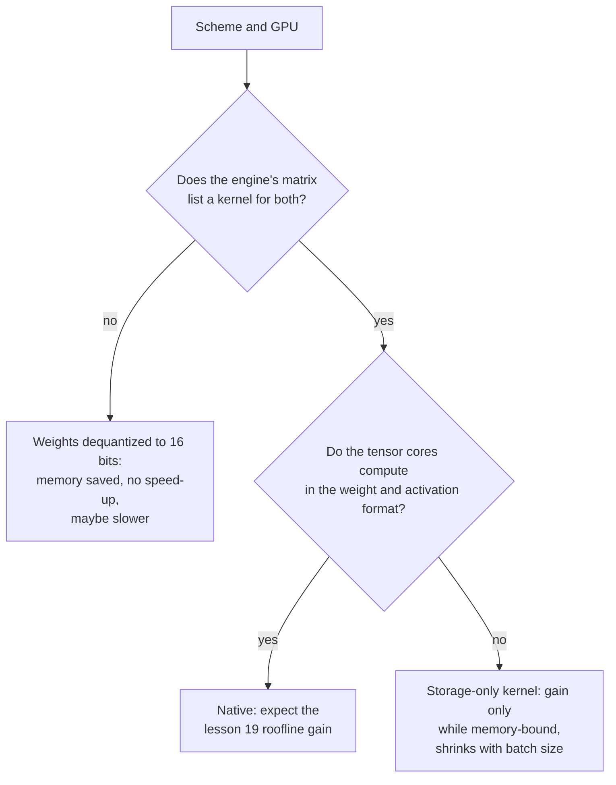

# पाठ 20. Hardware और Kernel Support

**मिशन से संबंध:** कोई scheme तभी तेज़ चलती है जब GPU उसके format में गुणा कर सके और serving engine के पास उसे इस्तेमाल करने वाला kernel हो, इसलिए गति का अनुमान लगाने का आख़िरी क़दम bit width पर भरोसा करने की जगह support matrix पढ़ना है।
**मुख्य स्रोत:** [लेख: "Introducing NVFP4 for Efficient and Accurate Low-Precision Inference", NVIDIA Technical Blog, 2025](https://developer.nvidia.com/blog/introducing-nvfp4-for-efficient-and-accurate-low-precision-inference/)
**पूर्व-आवश्यकताएँ:** [पाठ 19](0019-what-actually-runs-faster.md), [Block-scaled format](../GLOSSARY.md), [Dequantization](../GLOSSARY.md), [Weight-only quantization](../GLOSSARY.md)

## वार्म-अप

1. ▢ MXFP4 हर 32 values के block पर एक 8-bit scale के साथ 4-bit elements store करता है। उसके effective bits per weight क्या हैं?

जाँचें

4 + 8 / 32 = 4.25 effective bits per weight। Scale elements के साथ store होता है, इसलिए checkpoint "4 bits" के संकेत से थोड़ा बड़ा है (पाठ 3)।

2. ▢ Prefill और छोटे-batch के decode में से कौन compute-bound है, और किस तरह का quantization हर एक की मदद करता है?

जाँचें

Prefill compute-bound है, इसलिए सिर्फ़ वह scheme जो arithmetic को भी सस्ता बनाती है, जैसे int8 या fp8 units पर W8A8, उसे तेज़ करती है। छोटे batch का decode memory-bound है, इसलिए weight-only quantization पढ़े गए bytes घटाकर उसे तेज़ करता है (पाठ 19)।

## यह जानें

### तारीख़ वाले vendor तथ्य

इस पाठ में ख़ास chips और engines के बारे में तथ्य vendor के दस्तावेज़ हैं जो ख़ास तारीख़ों पर पढ़े गए, और वे पाठ 17 से 19 के सिद्धांत से तेज़ी से पुराने पड़ते हैं। नीचे की हर पंक्ति अपना स्रोत बताती है। Tables को वैसा मानें जैसा स्रोत ने पढ़े जाने के समय कहा था, और hardware ख़रीदने या scheme चुनने से पहले स्रोत दोबारा जाँचें। vLLM का पन्ना अक्टूबर 2026 में लाया गया था। NVFP4 ब्लॉग जून 2025 का है।

### Native compute बनाम storage-only

GPU के tensor cores formats की एक तय सूची में गुणा करते हैं। उस सूची का format **native** है: multiplication उसी पर सीधे चलता है, और पाठ 19 का speed-up उपलब्ध है। जो format सूची में नहीं है वह **storage-only** है: weights memory में कम bytes घेरते हैं, पर गुणा से पहले kernel को उन्हें native format में बदलना पड़ता है। Weight-only quantization डिज़ाइन से storage-only है, क्योंकि W4A16 16 bits में गुणा करता है। bitsandbytes के लिए Transformers का दस्तावेज़ अपनी settings में यह विचार दिखाता है: 4-bit weights का एक अलग "compute data type" है, जो default रूप से float32 है, जिसे दस्तावेज़ computation तेज़ करने के लिए bf16 में बदलने का सुझाव देता है ([Transformers दस्तावेज़](https://huggingface.co/docs/transformers/main/en/quantization/bitsandbytes))।

### NVIDIA क्या documented करता है, generation दर generation

| Generation | Documented low-precision tensor-core formats | स्रोत |
|---|---|---|
| Ampere (A100) | Spec table में TF32, BF16, FP16 और INT8 की पंक्तियाँ हैं, FP16 के 312 TFLOPS के मुक़ाबले dense INT8 के 624 TOPS के साथ, और FP8 की कोई पंक्ति नहीं | [A100 datasheet](https://www.nvidia.com/content/dam/en-zz/Solutions/Data-Center/a100/pdf/nvidia-a100-datasheet-nvidia-us-2188504-web.pdf) |
| Ada | चौथी-generation tensor cores और Hopper का FP8 Transformer Engine; FP8 throughput RTX 4090 के लिए सूचीबद्ध है और जिन Turing और Ampere cards से उसकी तुलना है उनके लिए N/A दिखाया गया है | [Ada architecture whitepaper](https://images.nvidia.com/aem-dam/Solutions/Data-Center/l4/nvidia-ada-gpu-architecture-whitepaper-v2.1.pdf) |
| Hopper (H100) | FP8 और INT8 tensor-core पंक्तियाँ; FP8 format चौथी-generation tensor cores के साथ जोड़ा गया | [H100 पन्ना](https://www.nvidia.com/en-us/data-center/h100/), [Hopper architecture ब्लॉग](https://developer.nvidia.com/blog/nvidia-hopper-architecture-in-depth/) |
| Blackwell | FP64, FP32/TF32, FP16/BF16, INT8/FP8, FP6 और FP4, MXFP4 और NVFP4 के hardware में scaling के साथ | [NVFP4 ब्लॉग](https://developer.nvidia.com/blog/introducing-nvfp4-for-efficient-and-accurate-low-precision-inference/) |

उसी ब्लॉग की Blackwell पर तीन 4-bit formats की तुलना कहती है कि सादा FP4 (E2M1) software scaling factor ढोता है और उसमें hardware की त्वरित scaling नहीं है, जबकि MXFP4 (हर 32 values पर साझा दो की घात वाला scale) और NVFP4 (हर 16 values पर साझा FP8 scale) में है। वह कहती है कि NVFP4 प्रति value 4.5 bits store करता है और FP16 के मुक़ाबले memory को लगभग 3.5 गुना घटाता है। वह यह भी कहती है कि FP8 Hopper और Blackwell पर supported है, और Ada का ज़िक्र नहीं करती, जिसे Ada whitepaper कवर करता है। ब्लॉग एक vendor है जो अपने ही format का वर्णन कर रहा है, इसलिए accuracy के उसके दावे vendor के दावे हैं।

### Serving engine की support matrix पढ़ना

Hardware आधा हिस्सा है। Engine को उस chip पर scheme के लिए kernel भी चाहिए। vLLM quantization implementations की hardware के सामने table प्रकाशित करता है, GPU generations को compute capability से पहचानते हुए: Ampere SM 8.0 और 8.6 है, Ada SM 8.9, Hopper SM 9.0 ([vLLM quantization दस्तावेज़](https://docs.vllm.ai/en/latest/features/quantization/))। जैसी लाई गई थी वैसी चुनी हुई पंक्तियाँ:

| Implementation | Turing | Ampere | Ada | Hopper |
|---|---|---|---|---|
| AWQ | हाँ | हाँ | हाँ | हाँ |
| GPTQ | हाँ | हाँ | हाँ | हाँ |
| Marlin (GPTQ, AWQ, FP8, FP4) | हाँ, एक अपवाद के साथ | हाँ | हाँ | हाँ |
| llm-compressor INT8 (W8A8) | हाँ | हाँ | हाँ | हाँ |
| llm-compressor FP8 (W8A8) | नहीं | नहीं | हाँ | हाँ |
| llm-compressor INT8 (W4A8) | नहीं | नहीं | नहीं | नहीं (सिर्फ़ Arm CPU सूचीबद्ध है) |

Table को vendor तथ्यों के सामने पढ़ें। FP8 W8A8 Ada से ऊपर दिखता है और Ampere पर नहीं, जो ऊपर की tensor-core table से मेल खाता है। W4A8 की पंक्ति में कोई GPU column टिक नहीं है: किसी scheme का अच्छा पेपर और quantizer हो सकता है और फिर भी इस engine में कोई GPU kernel न हो। Marlin की पंक्ति अपने formats में FP8 का नाम लेती है और Ampere के लिए टिक है। अगर वहाँ FP8 चलता है, तो वह उस chip पर FP8 arithmetic नहीं हो सकता जिसमें FP8 tensor cores नहीं हैं। Table यह नहीं बताती कि वह क्या करता है, और स्वाभाविक पाठ, यानी 16-bit arithmetic के साथ FP8 storage, एक अनुमान है जिसे भरोसा करने से पहले engine में जाँचना चाहिए। पन्ना यह चेतावनी भी देता है कि vLLM के विकसित होने के साथ chart बदलता है।

### Kernel न होने की क्या क़ीमत है

अगर engine के पास आपके chip पर आपकी scheme का kernel नहीं है, तब भी वह checkpoint load कर सकता है, और memory घटती है, क्योंकि weights छोटे store हैं। जो वह नहीं कर सकता वह format की गति इस्तेमाल करना है: weights सामान्य multiplication से पहले 16 bits में बदले जाते हैं, जो storage-only मामला है। पाठ 19 के स्रोत दिखाते हैं कि बदलना मुफ़्त क्यों नहीं है: QServe ने GPUs पर मौजूदा INT4 methods में dequantize करने से 20 से 90% runtime overhead मापा ([Lin et al., 2024](https://arxiv.org/abs/2405.04532))। एक और बात माप से नहीं बल्कि तर्क से निकलती है: जो भोला fallback पूरी matrix को गुणा से पहले 16 bits में बदलता है वह सादे bf16 से ज़्यादा bytes पढ़ता और लिखता है, इसलिए वह धीमा हो सकता है। LLM-QAT के लेखक एक संबंधित दीवार से टकराए: वे बताते हैं कि 4-bit quantization को बिना कुछ किए hardware support नहीं था और उन्होंने कोई hardware implementation शामिल नहीं किया ([Liu et al., 2023](https://arxiv.org/abs/2305.17888))।

## अभ्यास

1. ▢ ऊपर की vLLM table का इस्तेमाल करके, क्या आप A100 पर llm-compressor FP8 W8A8 चला सकते हैं? RTX 4090 पर? Vendor के कौन-से दस्तावेज़ दोनों उत्तरों को समझाते हैं?

जाँचें

A100 (Ampere) पर नहीं और RTX 4090 (Ada) पर हाँ। A100 datasheet में FP8 tensor-core की कोई पंक्ति नहीं है, और Ada whitepaper RTX 4090 के लिए FP8 throughput और जिस Ampere card से तुलना करता है उसके लिए N/A सूचीबद्ध करता है। FP8 arithmetic को FP8 tensor cores चाहिए, जो Ada और Hopper के पास हैं और Ampere के पास नहीं।

2. ▢ आप A100 पर weights को FP8 में store करते हैं और engine के पास उसके लिए weight-only kernel है। आपको क्या मिलता है?

    - a) कम memory, तेज़ सिर्फ़ तब तक जब तक decode memory-bound रहे
    - b) कम memory, serve किए जाने वाले हर batch size पर तेज़
    - c) उतनी ही memory, FP8 tensor cores के ज़रिए तेज़
    - d) उतनी ही memory, धीमी क्योंकि FP8 बस unsupported है

जाँचें

**a)** Weights 16-bit के आधे bytes लेते हैं और kernel गुणा करने के लिए उन्हें 16 bits में बदलता है, इसलिए फ़ायदा पाठ 19 का weight-only फ़ायदा है: memory-bound रहने तक असली, batch बढ़ने पर सिकुड़ता। (b) ग़लत है क्योंकि arithmetic अब भी 16-bit है, इसलिए बड़े batches और prefill को कोई फ़ायदा नहीं दिखता। (c) ग़लत है क्योंकि A100 में FP8 tensor cores नहीं हैं और storage सचमुच घटती है। (d) ग़लत है क्योंकि weight-only kernel format को इस्तेमाल के लायक़ बनाता है, और memory कम है।

3. ▢ NVIDIA की Blackwell के 4-bit formats की table में, FP4, MXFP4 और NVFP4 में से किनमें hardware की त्वरित scaling है, और बाक़ी वाला scaling के लिए क्या करता है?

जाँचें

MXFP4 और NVFP4 में है। सादा FP4 (E2M1) software scaling factor इस्तेमाल करता है, इसलिए उसकी scaling hardware से त्वरित नहीं है। Vendor नहीं बताता कि उसकी गति में क्या क़ीमत पड़ती है, इसलिए यह मापने की चीज़ है।

4. ▢ आपने model को 4-bit GPTQ में quantize किया। Memory लगभग 70% घटी, पर batch 1 पर tokens per second उसी GPU पर bf16 से बेहतर नहीं हैं। आप क्रम से क्या जाँचते हैं?

संकेत

"क्या यह छोटा है" को "क्या multiplication छोटे format का इस्तेमाल कर रहा है" से अलग करें।

जाँचें

पहले, engine का startup log या दस्तावेज़: इस GPU पर इस scheme के लिए उसने कौन-सा kernel या backend चुना, और क्या support matrix कोई सूचीबद्ध करता है? अगर वह weights को 16 bits में बदलने पर लौट आया, तो memory घटी पर speed-up नहीं आ सकता, और हल दूसरा engine या backend है। दूसरे, क्या run memory-bound है: बड़े batch या prefill पर फ़ायदा वैसे भी सिकुड़ता है (पाठ 19)। तीसरे, क्या दूसरी लागतें हावी हैं, जैसे KV cache की reads। छोटी file सिर्फ़ यह साबित करती है कि weights छोटे store हैं, यह नहीं कि वे तेज़ी से गुणा हो रहे हैं।

5. ▢ कोई vendor किसी model के लिए "4-bit inference, 4 गुना तेज़" का दावा करता है। अपनी deployment के लिए उस पर विश्वास करने से पहले आपको क्या पुष्ट करना होगा, उसकी सूची बनाएँ।

जाँचें

कौन-सी scheme: W4A16 weight-only या 4-bit activations भी, क्योंकि सिर्फ़ दूसरी arithmetic बदलती है। क्या आपके GPU की generation उस format में natively compute करती है (FP4 formats Blackwell के लिए NVFP4 ब्लॉग में documented हैं, और Hopper या Ampere card storage-only होगा)। क्या आपका serving engine उस GPU पर उस scheme के लिए kernel सूचीबद्ध करता है। संख्या किस batch size और prompt length पर मापी गई थी (पाठ 19)। और क्या accuracy full-precision baseline के मुक़ाबले मापी गई थी, क्योंकि गति quality के बारे में कुछ नहीं कहती।

## असली दुनिया का अभ्यास

- [ ] अपने GPU की compute capability खोजें (PyTorch वाले NVIDIA GPU के लिए, `torch.cuda.get_device_capability()`), उसे vLLM table के SM numbers से किसी generation से मिलाएँ, और लिखें कि vendor उसके लिए कौन-से low-precision formats documented करता है।
- [ ] vLLM quantization का मौजूदा पन्ना खोलें और उसकी table की तुलना इस पाठ वाली से करें। हर बदली हुई cell दर्ज करें, और यह कि किसी पाठ की support matrix पर भरोसा करने के बारे में वह क्या बताता है।
- [ ] कल: बिना नोट्स के native और storage-only को एक-एक वाक्य में परिभाषित करें, और वे तीन सवाल लिखें जो इस दावे से पूछने हैं कि कोई quantization scheme तेज़ है।

## आगे बढ़ने के लिए

- [QAT और Hardware शीट](../reference/qat-and-hardware.md)
- [दस्तावेज़: "Quantization", vLLM](https://docs.vllm.ai/en/latest/features/quantization/)
- [Inference: Serve Time पर Quantization](../../inference/reference/quantization-at-serve-time.md)
- [संसाधन](../RESOURCES.md)

---

बात नहीं बन रही? ऊपर दिए मुख्य स्रोत को दोबारा पढ़ें, क्योंकि यह पाठ उसे संक्षिप्त करता है और समझ संक्षेप में ही रिसती है। जो शब्द फिसलन भरा लगे, उसके लिए [शब्दावली](../GLOSSARY.md) देखें।

अगर दिक़्क़त सामग्री की नहीं बल्कि पाठ की ही है, तो वह एक खोट है: [issue खोलें](https://github.com/TokenCemetery/teach/issues)।
