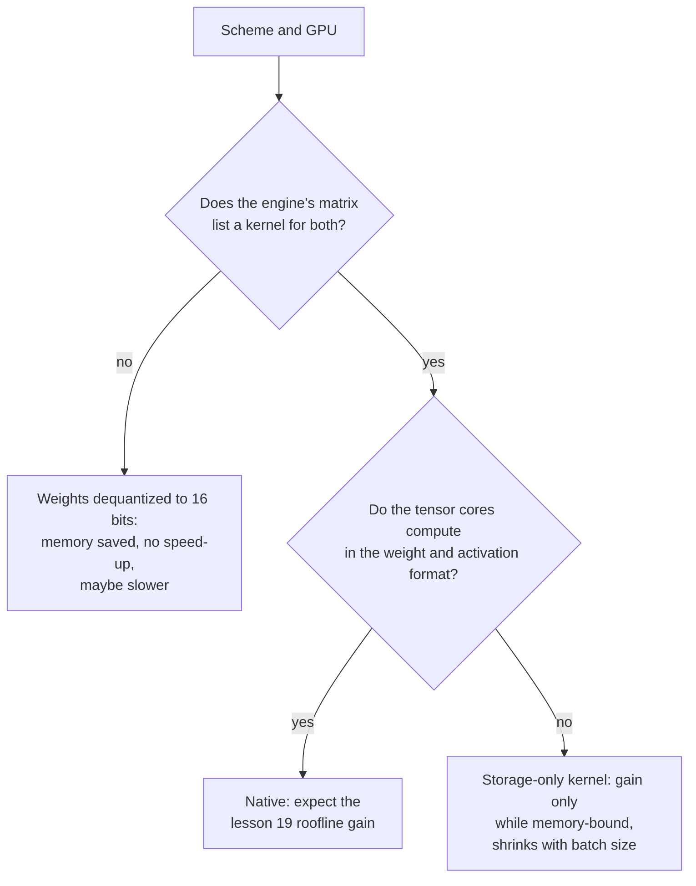

# Lesson 20. Hardware and Kernel Support

**Mission link:** A scheme only runs faster if the GPU can multiply in its format and the serving engine has a kernel that uses it, so the last step of predicting speed is reading a support matrix instead of trusting a bit width.
**Primary source:** [Article: "Introducing NVFP4 for Efficient and Accurate Low-Precision Inference", NVIDIA Technical Blog, 2025](https://developer.nvidia.com/blog/introducing-nvfp4-for-efficient-and-accurate-low-precision-inference/)
**Prerequisites:** [Lesson 19](0019-what-actually-runs-faster.md), [Block-scaled format](../GLOSSARY.md), [Dequantization](../GLOSSARY.md), [Weight-only quantization](../GLOSSARY.md)

## Warm-up

1. ▢ MXFP4 stores 4-bit elements with one 8-bit scale per block of 32 values. What is its effective bits per weight?

Check

4 + 8 / 32 = 4.25 effective bits per weight. The scale is stored with the elements, so the checkpoint is a little larger than "4 bits" suggests (lesson 3).

2. ▢ Which of prefill and small-batch decode is compute-bound, and which kind of quantization helps each?

Check

Prefill is compute-bound, so only a scheme that also makes the arithmetic cheaper, such as W8A8 on int8 or fp8 units, speeds it up. Small-batch decode is memory-bound, so weight-only quantization speeds it up by cutting the bytes read (lesson 19).

## Know this

### Dated vendor facts

The facts about specific chips and engines in this lesson are vendor documentation read on specific dates, and they go stale faster than the theory in lessons 17 to 19. Every row below names its source. Treat the tables as what the source said when it was read, and re-check the source before buying hardware or choosing a scheme. The vLLM page was fetched in October 2026. The NVFP4 blog is dated June 2025.

### Native compute against storage-only

A GPU's tensor cores multiply in a fixed list of formats. A format on that list is **native**: the multiplication runs on it directly, and the speed-up of lesson 19 is on offer. A format that is not on the list is **storage-only**: the weights occupy fewer bytes in memory, but a kernel must convert them to a native format before multiplying. Weight-only quantization is storage-only by design, since W4A16 multiplies in 16 bits. The Transformers documentation for bitsandbytes shows the idea in its settings: 4-bit weights have a separate "compute data type", defaulting to float32, which the docs suggest changing to bf16 to speed up computation ([Transformers docs](https://huggingface.co/docs/transformers/main/en/quantization/bitsandbytes)).

### What NVIDIA documents, generation by generation

| Generation | Low-precision tensor-core formats documented | Source |
|---|---|---|
| Ampere (A100) | The spec table lists TF32, BF16, FP16 and INT8 rows, with 624 TOPS of dense INT8 against 312 TFLOPS of FP16, and no FP8 row | [A100 datasheet](https://www.nvidia.com/content/dam/en-zz/Solutions/Data-Center/a100/pdf/nvidia-a100-datasheet-nvidia-us-2188504-web.pdf) |
| Ada | Fourth-generation tensor cores and the Hopper FP8 Transformer Engine; FP8 throughput is listed for the RTX 4090 and shown as N/A for the Turing and Ampere cards it is compared with | [Ada architecture whitepaper](https://images.nvidia.com/aem-dam/Solutions/Data-Center/l4/nvidia-ada-gpu-architecture-whitepaper-v2.1.pdf) |
| Hopper (H100) | FP8 and INT8 tensor-core rows; the FP8 format was added with the fourth-generation tensor cores | [H100 page](https://www.nvidia.com/en-us/data-center/h100/), [Hopper architecture blog](https://developer.nvidia.com/blog/nvidia-hopper-architecture-in-depth/) |
| Blackwell | FP64, FP32/TF32, FP16/BF16, INT8/FP8, FP6 and FP4, with MXFP4 and NVFP4 scaled in hardware | [NVFP4 blog](https://developer.nvidia.com/blog/introducing-nvfp4-for-efficient-and-accurate-low-precision-inference/) |

The same blog's comparison of the three 4-bit formats on Blackwell says plain FP4 (E2M1) carries a software scaling factor and has no accelerated hardware scaling, while MXFP4 (a shared power-of-two scale per 32 values) and NVFP4 (a shared FP8 scale per 16 values) do. It says NVFP4 stores 4.5 bits per value and cuts memory by about 3.5 times against FP16. It also says FP8 is supported by Hopper and Blackwell, and does not mention Ada, which the Ada whitepaper covers. The blog is a vendor describing its own format, so its claims about accuracy are the vendor's.

### Reading a serving engine's support matrix

Hardware is half of it. An engine also needs a kernel for the scheme on that chip. vLLM publishes a table of quantization implementations against hardware, with GPU generations identified by compute capability: Ampere is SM 8.0 and 8.6, Ada SM 8.9, Hopper SM 9.0 ([vLLM quantization docs](https://docs.vllm.ai/en/latest/features/quantization/)). A selection of rows as fetched:

| Implementation | Turing | Ampere | Ada | Hopper |
|---|---|---|---|---|
| AWQ | yes | yes | yes | yes |
| GPTQ | yes | yes | yes | yes |
| Marlin (GPTQ, AWQ, FP8, FP4) | yes, with one exception | yes | yes | yes |
| llm-compressor INT8 (W8A8) | yes | yes | yes | yes |
| llm-compressor FP8 (W8A8) | no | no | yes | yes |
| llm-compressor INT8 (W4A8) | no | no | no | no (only an Arm CPU is listed) |

Read the table against the vendor facts. FP8 W8A8 appears from Ada up and not on Ampere, matching the tensor-core table above. The W4A8 row has no GPU column ticked at all: a scheme can have a good paper and a quantizer and still have no GPU kernel in this engine. The Marlin row names FP8 among its formats and is ticked for Ampere. If FP8 works there, it cannot be FP8 arithmetic on a chip with no FP8 tensor cores. The table does not say what it does, and the natural reading, FP8 storage with 16-bit arithmetic, is an inference to check in the engine before relying on it. The page also warns that the chart changes as vLLM evolves.

### What a missing kernel costs

If an engine has no kernel for your scheme on your chip, it can still load the checkpoint, and memory shrinks, since the weights are stored small. What it cannot do is use the format's speed: the weights are converted to 16 bits before a normal multiplication, which is the storage-only case. Lesson 19's sources show why conversion is not free: QServe measured a 20 to 90% runtime overhead from dequantizing in existing INT4 methods on GPUs ([Lin et al., 2024](https://arxiv.org/abs/2405.04532)). One more point follows from reasoning rather than measurement: a naive fallback that converts a whole matrix to 16 bits before multiplying reads and writes more bytes than plain bf16, so it can be slower. The LLM-QAT authors hit a related wall: they note 4-bit quantization had no hardware support out of the box and included no hardware implementation ([Liu et al., 2023](https://arxiv.org/abs/2305.17888)).

## Practice

1. ▢ Using the vLLM table above, can you run llm-compressor FP8 W8A8 on an A100? On an RTX 4090? What do the vendor documents say that explains both answers?

Check

No on the A100 (Ampere) and yes on the RTX 4090 (Ada). The A100 datasheet lists no FP8 tensor-core row, and the Ada whitepaper lists FP8 throughput for the RTX 4090 and N/A for the Ampere card it compares against. FP8 arithmetic needs FP8 tensor cores, which Ada and Hopper have and Ampere does not.

2. ▢ You store weights in FP8 on an A100 and the engine has a weight-only kernel for it. What do you get?

    - a) Smaller memory, faster only while decode stays memory-bound
    - b) Smaller memory, faster at every batch size served
    - c) Same memory, faster through the FP8 tensor cores
    - d) Same memory, slower because FP8 is simply unsupported

Check

**a)** The weights take half the bytes of 16-bit and the kernel converts them to 16 bits to multiply, so the gain is the lesson 19 weight-only gain: real while memory-bound, shrinking as the batch grows. (b) is wrong because arithmetic is still 16-bit, so large batches and prefill see no gain. (c) is wrong because the A100 has no FP8 tensor cores and the storage does shrink. (d) is wrong because a weight-only kernel makes the format usable, and the memory is smaller.

3. ▢ In NVIDIA's table of Blackwell 4-bit formats, which of FP4, MXFP4 and NVFP4 have accelerated hardware scaling, and what does the other one do for scaling?

Check

MXFP4 and NVFP4 do. Plain FP4 (E2M1) uses a software scaling factor, so its scaling is not accelerated by the hardware. The vendor does not say what that costs in speed, so that is a thing to measure.

4. ▢ You quantized a model to 4-bit GPTQ. Memory fell by about 70%, but tokens per second at batch 1 are no better than bf16 on the same GPU. What do you check, in order?

Hint

Separate "is it smaller" from "is the multiplication using the small format".

Check

First, the engine's startup log or documentation: which kernel or backend did it pick for this scheme on this GPU, and does the support matrix list one? If it fell back to converting weights to 16 bits, memory shrank but the speed-up cannot appear, and the fix is a different engine or backend. Second, whether the run is memory-bound: at large batch or prefill the gain shrinks anyway (lesson 19). Third, whether other costs dominate, such as the KV cache reads. A smaller file proves the weights are stored small, not that they are multiplied fast.

5. ▢ A vendor claims "4-bit inference, 4x faster" for a model. List what you need to confirm before believing it for your deployment.

Check

Which scheme: W4A16 weight-only or 4-bit activations too, since only the second changes the arithmetic. Whether your GPU generation computes natively in that format (FP4 formats are documented for Blackwell in the NVFP4 blog, and a Hopper or Ampere card would be storage-only). Whether your serving engine lists a kernel for that scheme on that GPU. Which batch size and prompt length the number was measured at (lesson 19). And whether the accuracy was measured against a full-precision baseline, since speed says nothing about quality.

## Real-world reps

- [ ] Find your GPU's compute capability (for an NVIDIA GPU with PyTorch installed, `torch.cuda.get_device_capability()`), match it to a generation with the SM numbers in the vLLM table, and write down which low-precision formats the vendor documents for it.
- [ ] Open the current vLLM quantization page and compare its table with the one in this lesson. Note every cell that has changed, and what that says about trusting a support matrix from a lesson.
- [ ] Tomorrow: without notes, define native and storage-only in one sentence each, and write down the three questions to ask of any claim that a quantization scheme is faster.

## Going further

- [QAT and Hardware](../reference/qat-and-hardware.md)
- [Docs: "Quantization", vLLM](https://docs.vllm.ai/en/latest/features/quantization/)
- [Inference: Quantization at Serve Time](../../inference/reference/quantization-at-serve-time.md)
- [Resources](../RESOURCES.md)

---

Not landing? Reread the primary source at the top, since this lesson compresses it and compression is where understanding leaks. Check the [glossary](../GLOSSARY.md) for any term that felt slippery.

If the lesson itself is unclear rather than the material, that is a defect: [open an issue](https://github.com/TokenCemetery/teach/issues).
