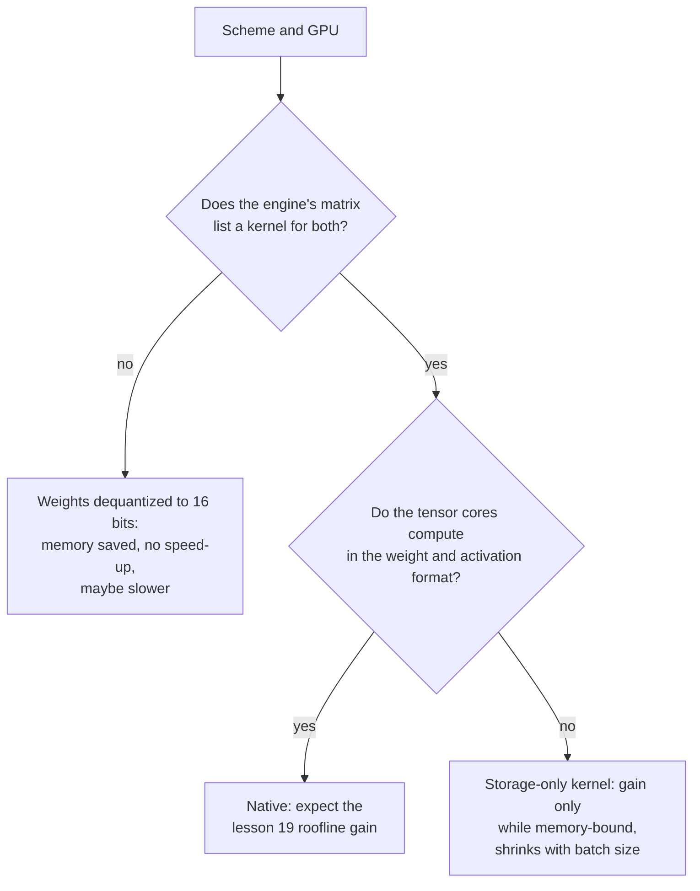

# Lição 20. Hardware e suporte de kernel

**Ligação com a missão:** Um esquema só roda mais rápido se a GPU consegue multiplicar no seu formato e o motor de serving tem um kernel que o usa, então o último passo de prever velocidade é ler uma matriz de suporte em vez de confiar em uma largura em bits.
**Fonte principal:** [Artigo: "Introducing NVFP4 for Efficient and Accurate Low-Precision Inference", NVIDIA Technical Blog, 2025](https://developer.nvidia.com/blog/introducing-nvfp4-for-efficient-and-accurate-low-precision-inference/)
**Pré-requisitos:** [Lição 19](0019-what-actually-runs-faster.md), [Formato com escala por bloco](../GLOSSARY.md), [Dequantização](../GLOSSARY.md), [Quantização somente de pesos](../GLOSSARY.md)

## Aquecimento

1. ▢ O MXFP4 armazena elementos de 4 bits com uma scale de 8 bits por bloco de 32 valores. Quais são os seus bits efetivos por peso?

Verificação

4 + 8 / 32 = 4.25 bits efetivos por peso. A scale é armazenada junto com os elementos, então o checkpoint é um pouco maior do que "4 bits" sugere (lição 3).

2. ▢ Qual entre prefill e decode com batch pequeno é limitado por compute, e que tipo de quantização ajuda cada um?

Verificação

O prefill é limitado por compute, então só um esquema que também deixe a aritmética mais barata, como o W8A8 em unidades int8 ou fp8, o acelera. O decode com batch pequeno é limitado pela largura de banda de memória, então a quantização somente de pesos o acelera ao reduzir os bytes lidos (lição 19).

## Saiba isto

### Fatos de fornecedores, datados

Os fatos sobre chips e motores específicos nesta lição são documentação de fornecedor lida em datas específicas, e envelhecem mais rápido que a teoria das lições 17 a 19. Cada linha abaixo nomeia a sua fonte. Trate as tabelas como o que a fonte dizia quando foi lida e reconfira a fonte antes de comprar hardware ou escolher um esquema. A página do vLLM foi obtida em outubro de 2026. O blog do NVFP4 é datado de junho de 2025.

### Compute nativo contra somente de armazenamento

Os tensor cores de uma GPU multiplicam em uma lista fixa de formatos. Um formato nessa lista é **nativo**: a multiplicação roda nele diretamente, e o ganho de velocidade da lição 19 está disponível. Um formato que não está na lista é **somente de armazenamento**: os pesos ocupam menos bytes na memória, mas um kernel precisa convertê-los para um formato nativo antes de multiplicar. A quantização somente de pesos é somente de armazenamento por projeto, já que o W4A16 multiplica em 16 bits. A documentação do Transformers para o bitsandbytes mostra a ideia nas suas configurações: os pesos de 4 bits têm um "tipo de dado de compute" separado, com padrão float32, que a documentação sugere mudar para bf16 para acelerar o cálculo ([docs do Transformers](https://huggingface.co/docs/transformers/main/en/quantization/bitsandbytes)).

### O que a NVIDIA documenta, geração por geração

| Geração | Formatos de tensor core de baixa precisão documentados | Fonte |
|---|---|---|
| Ampere (A100) | A tabela de especificações lista linhas de TF32, BF16, FP16 e INT8, com 624 TOPS de INT8 denso contra 312 TFLOPS de FP16, e nenhuma linha de FP8 | [datasheet da A100](https://www.nvidia.com/content/dam/en-zz/Solutions/Data-Center/a100/pdf/nvidia-a100-datasheet-nvidia-us-2188504-web.pdf) |
| Ada | Tensor cores de quarta geração e o Transformer Engine de FP8 da Hopper; a vazão em FP8 é listada para a RTX 4090 e mostrada como N/A para as placas Turing e Ampere com que é comparada | [whitepaper da arquitetura Ada](https://images.nvidia.com/aem-dam/Solutions/Data-Center/l4/nvidia-ada-gpu-architecture-whitepaper-v2.1.pdf) |
| Hopper (H100) | Linhas de tensor cores FP8 e INT8; o formato FP8 foi acrescentado com os tensor cores de quarta geração | [página da H100](https://www.nvidia.com/en-us/data-center/h100/), [blog da arquitetura Hopper](https://developer.nvidia.com/blog/nvidia-hopper-architecture-in-depth/) |
| Blackwell | FP64, FP32/TF32, FP16/BF16, INT8/FP8, FP6 e FP4, com MXFP4 e NVFP4 escalados em hardware | [blog do NVFP4](https://developer.nvidia.com/blog/introducing-nvfp4-for-efficient-and-accurate-low-precision-inference/) |

A comparação do mesmo blog entre os três formatos de 4 bits na Blackwell diz que o FP4 simples (E2M1) carrega um fator de escala em software e não tem escala acelerada em hardware, enquanto o MXFP4 (uma scale compartilhada que é potência de dois por 32 valores) e o NVFP4 (uma scale FP8 compartilhada por 16 valores) têm. Ele diz que o NVFP4 armazena 4.5 bits por valor e reduz a memória em cerca de 3.5 vezes em relação ao FP16. Também diz que o FP8 é suportado pela Hopper e pela Blackwell, e não menciona a Ada, que o whitepaper da Ada cobre. O blog é um fornecedor descrevendo o seu próprio formato, então as suas afirmações sobre acurácia são as do fornecedor.

### Lendo a matriz de suporte de um motor de serving

O hardware é metade da questão. Um motor também precisa de um kernel para o esquema naquele chip. O vLLM publica uma tabela de implementações de quantização contra hardware, com as gerações de GPU identificadas pela compute capability: Ampere é SM 8.0 e 8.6, Ada SM 8.9, Hopper SM 9.0 ([docs de quantização do vLLM](https://docs.vllm.ai/en/latest/features/quantization/)). Uma seleção de linhas como obtidas:

| Implementação | Turing | Ampere | Ada | Hopper |
|---|---|---|---|---|
| AWQ | sim | sim | sim | sim |
| GPTQ | sim | sim | sim | sim |
| Marlin (GPTQ, AWQ, FP8, FP4) | sim, com uma exceção | sim | sim | sim |
| llm-compressor INT8 (W8A8) | sim | sim | sim | sim |
| llm-compressor FP8 (W8A8) | não | não | sim | sim |
| llm-compressor INT8 (W4A8) | não | não | não | não (só uma CPU Arm é listada) |

Leia a tabela contra os fatos do fornecedor. O FP8 W8A8 aparece da Ada em diante e não na Ampere, coincidindo com a tabela de tensor cores acima. A linha do W4A8 não tem nenhuma coluna de GPU marcada: um esquema pode ter um bom artigo e um quantizador e ainda assim não ter kernel de GPU neste motor. A linha do Marlin nomeia o FP8 entre os seus formatos e está marcada para a Ampere. Se o FP8 funciona ali, não pode ser aritmética FP8 em um chip sem tensor cores FP8. A tabela não diz o que ele faz, e a leitura natural, armazenamento em FP8 com aritmética de 16 bits, é uma inferência a conferir no motor antes de depender dela. A página também avisa que o quadro muda conforme o vLLM evolui.

### O que um kernel ausente custa

Se um motor não tem kernel para o seu esquema no seu chip, ele ainda pode carregar o checkpoint, e a memória diminui, já que os pesos são armazenados pequenos. O que ele não consegue é usar a velocidade do formato: os pesos são convertidos para 16 bits antes de uma multiplicação normal, que é o caso somente de armazenamento. As fontes da lição 19 mostram por que a conversão não é de graça: o QServe mediu 20 a 90% de overhead de tempo de execução por dequantizar nos métodos INT4 existentes em GPUs ([Lin et al., 2024](https://arxiv.org/abs/2405.04532)). Mais um ponto decorre de raciocínio e não de medição: um fallback ingênuo que converte uma matriz inteira para 16 bits antes de multiplicar lê e escreve mais bytes que o bf16 simples, então pode ser mais lento. Os autores do LLM-QAT esbarraram em uma parede relacionada: eles observam que a quantização de 4 bits não tinha suporte de hardware de fábrica e não incluíram nenhuma implementação em hardware ([Liu et al., 2023](https://arxiv.org/abs/2305.17888)).

## Prática

1. ▢ Usando a tabela do vLLM acima, você consegue rodar o llm-compressor FP8 W8A8 em uma A100? Em uma RTX 4090? O que os documentos do fornecedor dizem que explica as duas respostas?

Verificação

Não na A100 (Ampere) e sim na RTX 4090 (Ada). O datasheet da A100 não lista nenhuma linha de tensor core FP8, e o whitepaper da Ada lista vazão em FP8 para a RTX 4090 e N/A para a placa Ampere com que a compara. A aritmética FP8 precisa de tensor cores FP8, que a Ada e a Hopper têm e a Ampere não.

2. ▢ Você armazena pesos em FP8 em uma A100 e o motor tem um kernel somente de pesos para isso. O que você obtém?

    - a) Memória menor, mais rápido apenas enquanto o decode continuar limitado pela largura de banda de memória
    - b) Memória menor, mais rápido em todo batch size atendido
    - c) Mesma memória, mais rápido pelos tensor cores FP8
    - d) Mesma memória, mais lento porque o FP8 simplesmente não é suportado

Verificação

**a)** Os pesos ocupam metade dos bytes de 16 bits e o kernel os converte para 16 bits para multiplicar, então o ganho é o ganho somente de pesos da lição 19: real enquanto limitado pela largura de banda de memória, diminuindo conforme o batch cresce. (b) está errada porque a aritmética ainda é de 16 bits, então batches grandes e o prefill não veem ganho. (c) está errada porque a A100 não tem tensor cores FP8 e o armazenamento de fato diminui. (d) está errada porque um kernel somente de pesos torna o formato utilizável, e a memória é menor.

3. ▢ Na tabela da NVIDIA de formatos de 4 bits da Blackwell, quais entre FP4, MXFP4 e NVFP4 têm escala acelerada em hardware, e o que o outro faz para a escala?

Verificação

O MXFP4 e o NVFP4 têm. O FP4 simples (E2M1) usa um fator de escala em software, então a sua escala não é acelerada pelo hardware. O fornecedor não diz o que isso custa em velocidade, então isso é algo a medir.

4. ▢ Você quantizou um modelo para GPTQ de 4 bits. A memória caiu cerca de 70%, mas os tokens por segundo no batch 1 não são melhores que os do bf16 na mesma GPU. O que você confere, em ordem?

Dica

Separe "é menor" de "a multiplicação está usando o formato pequeno".

Verificação

Primeiro, o log de inicialização ou a documentação do motor: qual kernel ou backend ele escolheu para esse esquema nessa GPU, e a matriz de suporte lista um? Se ele recorreu a converter os pesos para 16 bits, a memória encolheu mas o ganho de velocidade não pode aparecer, e a correção é um motor ou backend diferente. Segundo, se a execução é limitada pela largura de banda de memória: em batch grande ou no prefill o ganho diminui de qualquer forma (lição 19). Terceiro, se outros custos dominam, como as leituras do KV cache. Um arquivo menor prova que os pesos estão armazenados pequenos, não que são multiplicados rápido.

5. ▢ Um fornecedor alega "inferência de 4 bits, 4x mais rápida" para um modelo. Liste o que você precisa confirmar antes de acreditar nisso para o seu deployment.

Verificação

Qual esquema: W4A16 somente de pesos ou também ativações de 4 bits, já que só o segundo muda a aritmética. Se a sua geração de GPU calcula nativamente nesse formato (os formatos FP4 são documentados para a Blackwell no blog do NVFP4, e uma placa Hopper ou Ampere seria somente de armazenamento). Se o seu motor de serving lista um kernel para esse esquema nessa GPU. Em qual batch size e comprimento de prompt o número foi medido (lição 19). E se a acurácia foi medida contra um baseline de precisão total, já que velocidade não diz nada sobre qualidade.

## Prática no mundo real

- [ ] Encontre a compute capability da sua GPU (para uma GPU NVIDIA com PyTorch instalado, `torch.cuda.get_device_capability()`), associe-a a uma geração com os números SM da tabela do vLLM e anote quais formatos de baixa precisão o fornecedor documenta para ela.
- [ ] Abra a página atual de quantização do vLLM e compare a sua tabela com a desta lição. Anote toda célula que mudou e o que isso diz sobre confiar em uma matriz de suporte vinda de uma lição.
- [ ] Amanhã: sem consultar anotações, defina nativo e somente de armazenamento em uma frase cada e escreva as três perguntas a fazer sobre qualquer alegação de que um esquema de quantização é mais rápido.

## Para ir além

- [QAT e Hardware](../reference/qat-and-hardware.md)
- [Docs: "Quantization", vLLM](https://docs.vllm.ai/en/latest/features/quantization/)
- [Inferência: Quantização no Serving](../../inference/reference/quantization-at-serve-time.md)
- [Recursos](../RESOURCES.md)

---

Não ficou claro? Releia a fonte principal no topo, já que esta lição a comprime e é na compressão que o entendimento escapa. Consulte o [glossário](../GLOSSARY.md) para qualquer termo que pareceu escorregadio.

Se o problema é a lição em si, e não o material, isso é um defeito: [abra uma issue](https://github.com/TokenCemetery/teach/issues).
