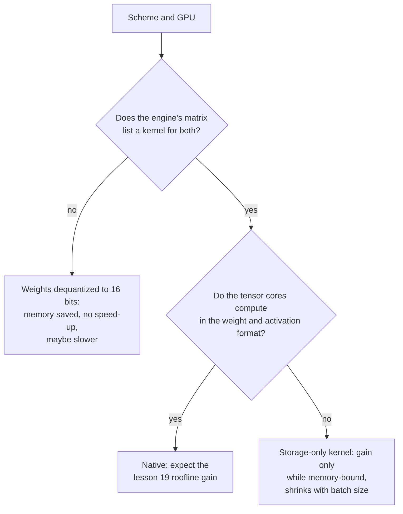

# Урок 20. Поддержка оборудованием и ядрами

**Связь с целью курса:** Схема работает быстрее, только если GPU может умножать в её формате, а у движка обслуживания есть ядро, которое его использует, поэтому последний шаг предсказания скорости это чтение матрицы поддержки, а не доверие к разрядности.
**Первоисточник:** [Статья: "Introducing NVFP4 for Efficient and Accurate Low-Precision Inference", NVIDIA Technical Blog, 2025](https://developer.nvidia.com/blog/introducing-nvfp4-for-efficient-and-accurate-low-precision-inference/)
**Предварительные требования:** [Урок 19](0019-what-actually-runs-faster.md), [Блочно-масштабируемый формат](../GLOSSARY.md), [Деквантизация](../GLOSSARY.md), [Квантизация только весов](../GLOSSARY.md)

## Разминка

1. ▢ MXFP4 хранит 4-битные элементы с одним 8-битным масштабом на блок из 32 значений. Каково его эффективное число бит на вес?

Проверка

4 + 8 / 32 = 4,25 эффективных бита на вес. Масштаб хранится вместе с элементами, поэтому чекпоинт немного больше, чем предполагают «4 бита» (урок 3).

2. ▢ Что из prefill и декодирования с малым батчем ограничено вычислениями и какой вид квантизации помогает каждому?

Проверка

Prefill ограничен вычислениями, поэтому ускорить его может только схема, которая удешевляет и арифметику, например W8A8 на блоках int8 или fp8. Декодирование с малым батчем ограничено памятью, поэтому квантизация только весов ускоряет его, сокращая читаемые байты (урок 19).

## Что нужно знать

### Датированные факты производителей

Факты о конкретных чипах и движках в этом уроке это документация производителей, прочитанная в конкретные даты, и они устаревают быстрее, чем теория в уроках с 17 по 19. Каждая строка ниже называет свой источник. Считайте таблицы тем, что источник говорил на момент чтения, и перепроверяйте источник, прежде чем покупать оборудование или выбирать схему. Страница vLLM была получена в октябре 2026 года. Блог о NVFP4 датирован июнем 2025 года.

### Нативные вычисления против только хранения

Тензорные ядра GPU умножают в фиксированном списке форматов. Формат из этого списка **нативный**: умножение выполняется прямо в нём, и ускорение из урока 19 доступно. Формат вне списка **только для хранения**: веса занимают в памяти меньше байт, но ядро должно преобразовать их в нативный формат перед умножением. Квантизация только весов по замыслу относится к хранению, поскольку W4A16 умножает в 16 битах. Документация Transformers по bitsandbytes показывает эту идею в своих настройках: у 4-битных весов есть отдельный «тип данных для вычислений», по умолчанию float32, который документация советует сменить на bf16, чтобы ускорить вычисления ([документация Transformers](https://huggingface.co/docs/transformers/main/en/quantization/bitsandbytes)).

### Что документирует NVIDIA, поколение за поколением

| Поколение | Документированные форматы тензорных ядер с низкой точностью | Источник |
|---|---|---|
| Ampere (A100) | Таблица характеристик содержит строки TF32, BF16, FP16 и INT8, с 624 TOPS плотного INT8 против 312 TFLOPS FP16, и без строки FP8 | [даташит A100](https://www.nvidia.com/content/dam/en-zz/Solutions/Data-Center/a100/pdf/nvidia-a100-datasheet-nvidia-us-2188504-web.pdf) |
| Ada | Тензорные ядра четвёртого поколения и Transformer Engine FP8 из Hopper; пропускная способность FP8 указана для RTX 4090 и показана как N/A для карт Turing и Ampere, с которыми она сравнивается | [whitepaper об архитектуре Ada](https://images.nvidia.com/aem-dam/Solutions/Data-Center/l4/nvidia-ada-gpu-architecture-whitepaper-v2.1.pdf) |
| Hopper (H100) | Строки тензорных ядер FP8 и INT8; формат FP8 был добавлен вместе с тензорными ядрами четвёртого поколения | [страница H100](https://www.nvidia.com/en-us/data-center/h100/), [блог об архитектуре Hopper](https://developer.nvidia.com/blog/nvidia-hopper-architecture-in-depth/) |
| Blackwell | FP64, FP32/TF32, FP16/BF16, INT8/FP8, FP6 и FP4, с масштабированием MXFP4 и NVFP4 в оборудовании | [блог о NVFP4](https://developer.nvidia.com/blog/introducing-nvfp4-for-efficient-and-accurate-low-precision-inference/) |

Сравнение трёх 4-битных форматов на Blackwell в том же блоге говорит, что обычный FP4 (E2M1) несёт программный масштабирующий множитель и не имеет ускоренного аппаратного масштабирования, а MXFP4 (общий масштаб в виде степени двойки на 32 значения) и NVFP4 (общий масштаб FP8 на 16 значений) имеют. Там сказано, что NVFP4 хранит 4,5 бита на значение и сокращает память примерно в 3,5 раза по сравнению с FP16. Там также сказано, что FP8 поддерживают Hopper и Blackwell, и не упоминается Ada, которую охватывает whitepaper по Ada. Блог это производитель, описывающий собственный формат, поэтому его утверждения о точности принадлежат производителю.

### Чтение матрицы поддержки движка обслуживания

Оборудование это половина дела. Движку ещё нужно ядро для схемы на этом чипе. vLLM публикует таблицу реализаций квантизации против оборудования, где поколения GPU обозначены вычислительной возможностью: Ampere это SM 8.0 и 8.6, Ada SM 8.9, Hopper SM 9.0 ([документация vLLM по квантизации](https://docs.vllm.ai/en/latest/features/quantization/)). Выборка строк в том виде, как они были получены:

| Реализация | Turing | Ampere | Ada | Hopper |
|---|---|---|---|---|
| AWQ | да | да | да | да |
| GPTQ | да | да | да | да |
| Marlin (GPTQ, AWQ, FP8, FP4) | да, с одним исключением | да | да | да |
| llm-compressor INT8 (W8A8) | да | да | да | да |
| llm-compressor FP8 (W8A8) | нет | нет | да | да |
| llm-compressor INT8 (W4A8) | нет | нет | нет | нет (указан только CPU Arm) |

Читайте таблицу вместе с фактами производителей. FP8 W8A8 появляется начиная с Ada и не на Ampere, что совпадает с таблицей тензорных ядер выше. В строке W4A8 не отмечен ни один столбец GPU: у схемы может быть хорошая статья и квантизатор и всё же не быть ядра GPU в этом движке. Строка Marlin называет FP8 среди своих форматов и отмечена для Ampere. Если FP8 там работает, это не может быть арифметика FP8 на чипе без тензорных ядер FP8. Таблица не говорит, что она делает, а естественное прочтение, хранение FP8 с 16-битной арифметикой, это вывод, который нужно проверить в движке, прежде чем на него полагаться. Страница также предупреждает, что диаграмма меняется по мере развития vLLM.

### Во что обходится отсутствие ядра

Если у движка нет ядра для вашей схемы на вашем чипе, он всё равно может загрузить чекпоинт, и память сократится, поскольку веса хранятся в малом виде. Чего он не может, так это воспользоваться скоростью формата: веса преобразуются в 16 бит перед обычным умножением, а это случай только хранения. Источники урока 19 показывают, почему преобразование не бесплатно: QServe измерил накладные расходы 20-90% времени выполнения на деквантизацию в существующих методах INT4 на GPU ([Lin et al., 2024](https://arxiv.org/abs/2405.04532)). Ещё один пункт следует из рассуждения, а не измерения: наивная подмена, которая преобразует всю матрицу в 16 бит перед умножением, читает и записывает больше байт, чем обычный bf16, поэтому может быть медленнее. Авторы LLM-QAT упёрлись в родственную стену: они отмечают, что у 4-битной квантизации не было аппаратной поддержки из коробки, и не включили аппаратной реализации ([Liu et al., 2023](https://arxiv.org/abs/2305.17888)).

## Практика

1. ▢ По таблице vLLM выше, можно ли запустить llm-compressor FP8 W8A8 на A100? На RTX 4090? Что говорят документы производителя, объясняющие оба ответа?

Проверка

Нет на A100 (Ampere) и да на RTX 4090 (Ada). Даташит A100 не содержит строки тензорных ядер FP8, а whitepaper по Ada указывает пропускную способность FP8 для RTX 4090 и N/A для карты Ampere, с которой сравнивает. Арифметике FP8 нужны тензорные ядра FP8, которые есть у Ada и Hopper и нет у Ampere.

2. ▢ Вы храните веса в FP8 на A100, и у движка есть для этого ядро только для весов. Что вы получаете?

    - a) Меньше памяти, быстрее только пока декодирование остаётся ограниченным памятью
    - b) Меньше памяти, быстрее при каждом обслуживаемом размере батча
    - c) Столько же памяти, быстрее за счёт тензорных ядер FP8
    - d) Столько же памяти, медленнее, потому что FP8 просто не поддерживается

Проверка

**a)** Веса занимают вдвое меньше байт, чем в 16 битах, а ядро преобразует их в 16 бит для умножения, поэтому выигрыш это выигрыш квантизации только весов из урока 19: настоящий, пока ограничение в памяти, и сокращающийся с ростом батча. (b) неверно, потому что арифметика всё ещё 16-битная, поэтому большие батчи и prefill выигрыша не видят. (c) неверно, потому что у A100 нет тензорных ядер FP8, а хранение действительно сокращается. (d) неверно, потому что ядро только для весов делает формат пригодным, и память меньше.

3. ▢ В таблице 4-битных форматов Blackwell от NVIDIA у каких из FP4, MXFP4 и NVFP4 есть ускоренное аппаратное масштабирование и что делает остальной формат для масштабирования?

Проверка

У MXFP4 и NVFP4 есть. Обычный FP4 (E2M1) использует программный масштабирующий множитель, поэтому его масштабирование оборудованием не ускоряется. Производитель не говорит, чего это стоит по скорости, так что это то, что нужно измерить.

4. ▢ Вы квантизовали модель в 4-битный GPTQ. Память упала примерно на 70%, но токенов в секунду при батче 1 не больше, чем у bf16 на том же GPU. Что вы проверяете, по порядку?

Подсказка

Отделите «меньше ли оно» от «использует ли умножение малый формат».

Проверка

Сначала лог запуска движка или документацию: какое ядро или бэкенд он выбрал для этой схемы на этом GPU и перечисляет ли такое матрица поддержки? Если он откатился к преобразованию весов в 16 бит, память сократилась, но ускорение появиться не может, и исправление это другой движок или бэкенд. Во-вторых, ограничен ли запуск памятью: при большом батче или prefill выигрыш всё равно сокращается (урок 19). В-третьих, не доминируют ли другие затраты, например чтение KV-кеша. Меньший файл доказывает, что веса хранятся в малом виде, а не то, что они умножаются быстро.

5. ▢ Поставщик заявляет «4-битный инференс, в 4 раза быстрее» для модели. Перечислите, что нужно подтвердить, прежде чем поверить в это для вашего развёртывания.

Проверка

Какая схема: W4A16 только для весов или 4-битные ещё и активации, поскольку арифметику меняет только вторая. Вычисляет ли ваше поколение GPU нативно в этом формате (форматы FP4 документированы для Blackwell в блоге о NVFP4, а карта Hopper или Ampere была бы только для хранения). Перечисляет ли ваш движок обслуживания ядро для этой схемы на этом GPU. При каком размере батча и длине промпта было измерено число (урок 19). И измерялась ли точность относительно базы в полной точности, поскольку скорость ничего не говорит о качестве.

## Практика в реальной работе

- [ ] Найдите вычислительную возможность вашего GPU (для GPU NVIDIA с установленным PyTorch это `torch.cuda.get_device_capability()`), сопоставьте её с поколением по номерам SM из таблицы vLLM и запишите, какие форматы с низкой точностью документирует для него производитель.
- [ ] Откройте актуальную страницу vLLM по квантизации и сравните её таблицу с таблицей в этом уроке. Отметьте каждую ячейку, которая изменилась, и что это говорит о доверии к матрице поддержки из урока.
- [ ] Завтра, без заметок, определите нативный формат и формат только для хранения по одному предложению каждый и запишите три вопроса, которые нужно задавать любому заявлению о том, что схема квантизации быстрее.

## Что почитать дальше

- [QAT и оборудование](../reference/qat-and-hardware.md)
- [Документация: "Quantization", vLLM](https://docs.vllm.ai/en/latest/features/quantization/)
- [Инференс: Квантизация при обслуживании](../../inference/reference/quantization-at-serve-time.md)
- [Ресурсы](../RESOURCES.md)

---

Не доходит? Перечитайте первоисточник в начале: этот урок его сжимает, а при сжатии понимание как раз и теряется. Загляните в [глоссарий](../GLOSSARY.md), если какой-то термин показался скользким.

Если неясен сам урок, а не материал, это дефект: [откройте issue](https://github.com/TokenCemetery/teach/issues).
