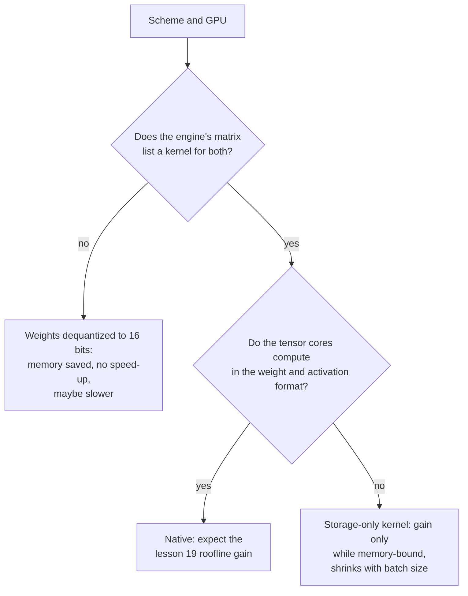

# 第 20 课：硬件与内核支持

**使命关联:** 一种方案只有在 GPU 能以它的格式做乘法、并且服务引擎有使用它的内核时，才会跑得更快，所以预测速度的最后一步，是读一张支持矩阵，而不是相信某个位宽。
**主要来源:** [文章：“Introducing NVFP4 for Efficient and Accurate Low-Precision Inference”，NVIDIA Technical Blog，2025](https://developer.nvidia.com/blog/introducing-nvfp4-for-efficient-and-accurate-low-precision-inference/)
**前置知识:** [第 19 课](0019-what-actually-runs-faster.md)、[块缩放格式](../GLOSSARY.md)、[反量化](../GLOSSARY.md)、[仅权重量化](../GLOSSARY.md)

## 热身

1. ▢ MXFP4 存储 4 位元素，每 32 个值共用一个 8 位缩放因子。它的每个权重的有效位数是多少？

检查

每个权重 4 + 8 / 32 = 4.25 位有效位数。缩放因子与元素存放在一起，所以检查点比“4 位”所暗示的要大一点（第 3 课）。

2. ▢ 预填充和小批量解码里，哪一个受算力限制？哪一种量化对各自有帮助？

检查

预填充受算力限制，所以只有同时让算术变便宜的方案，例如在 int8 或 fp8 单元上的 W8A8，才能加速它。小批量解码受内存带宽限制，所以仅权重量化通过削减读取的字节来加速它（第 19 课）。

## 要点

### 带日期的厂商事实

本课中关于具体芯片和引擎的事实，是在特定日期读到的厂商文档，它们比第 17 到第 19 课的理论过时得更快。下面每一行都注明了来源。请把这些表格当作来源在被读取时所说的内容，在买硬件或选方案之前，重新核对来源。vLLM 的页面是在 2026 年 10 月抓取的。NVFP4 博客的日期是 2025 年 6 月。

### 原生计算与仅存储

GPU 的张量核心以一份固定的格式清单做乘法。清单上的格式是**原生**的：乘法直接在它上面运行，第 19 课的加速是可以拿到的。不在清单上的格式是**仅存储**的：权重在内存里占的字节更少，但内核必须在相乘之前把它们转换成原生格式。仅权重量化在设计上就是仅存储的，因为 W4A16 是以 16 位相乘的。Transformers 关于 bitsandbytes 的文档在它的设置里展示了这个思路：4 位权重有一个单独的“计算数据类型”，默认是 float32，文档建议把它改成 bf16 来加快计算（[Transformers 文档](https://huggingface.co/docs/transformers/main/en/quantization/bitsandbytes)）。

### NVIDIA 逐代记载的内容

| 代际 | 记载的低精度张量核心格式 | 来源 |
|---|---|---|
| Ampere（A100） | 规格表列出 TF32、BF16、FP16 和 INT8 行，稠密 INT8 为 624 TOPS，对 FP16 的 312 TFLOPS，没有 FP8 行 | [A100 数据手册](https://www.nvidia.com/content/dam/en-zz/Solutions/Data-Center/a100/pdf/nvidia-a100-datasheet-nvidia-us-2188504-web.pdf) |
| Ada | 第四代张量核心和 Hopper 的 FP8 Transformer Engine；RTX 4090 列出了 FP8 吞吐量，与它对比的 Turing 和 Ampere 显卡则显示为 N/A | [Ada 架构白皮书](https://images.nvidia.com/aem-dam/Solutions/Data-Center/l4/nvidia-ada-gpu-architecture-whitepaper-v2.1.pdf) |
| Hopper（H100） | FP8 和 INT8 张量核心行；FP8 格式是随第四代张量核心加入的 | [H100 页面](https://www.nvidia.com/en-us/data-center/h100/)、[Hopper 架构博客](https://developer.nvidia.com/blog/nvidia-hopper-architecture-in-depth/) |
| Blackwell | FP64、FP32/TF32、FP16/BF16、INT8/FP8、FP6 和 FP4，MXFP4 和 NVFP4 的缩放由硬件完成 | [NVFP4 博客](https://developer.nvidia.com/blog/introducing-nvfp4-for-efficient-and-accurate-low-precision-inference/) |

同一篇博客对 Blackwell 上三种 4 位格式的比较说，普通的 FP4（E2M1）带有软件缩放因子，没有加速的硬件缩放，而 MXFP4（每 32 个值共用一个 2 的幂缩放因子）和 NVFP4（每 16 个值共用一个 FP8 缩放因子）有。它说 NVFP4 每个值存 4.5 位，与 FP16 相比内存减少约 3.5 倍。它还说 FP8 由 Hopper 和 Blackwell 支持，没有提到 Ada，而 Ada 白皮书是涵盖它的。这篇博客是厂商在描述它自己的格式，所以它关于精度的说法是厂商的说法。

### 读懂服务引擎的支持矩阵

硬件只是一半。引擎还需要在那块芯片上有这种方案的内核。vLLM 公布了一张量化实现对硬件的表，GPU 的代际用计算能力来标识：Ampere 是 SM 8.0 和 8.6，Ada 是 SM 8.9，Hopper 是 SM 9.0（[vLLM 量化文档](https://docs.vllm.ai/en/latest/features/quantization/)）。抓取到的几行如下：

| 实现 | Turing | Ampere | Ada | Hopper |
|---|---|---|---|---|
| AWQ | 是 | 是 | 是 | 是 |
| GPTQ | 是 | 是 | 是 | 是 |
| Marlin（GPTQ、AWQ、FP8、FP4） | 是，有一个例外 | 是 | 是 | 是 |
| llm-compressor INT8（W8A8） | 是 | 是 | 是 | 是 |
| llm-compressor FP8（W8A8） | 否 | 否 | 是 | 是 |
| llm-compressor INT8（W4A8） | 否 | 否 | 否 | 否（只列出了一个 Arm CPU） |

把这张表与厂商的事实对照着读。FP8 W8A8 从 Ada 起才有，Ampere 上没有，与上面的张量核心表相符。W4A8 那一行，没有一个 GPU 的列被勾上：一种方案可以有一篇好论文和一个量化器，却仍然在这个引擎里没有 GPU 内核。Marlin 那一行把 FP8 列在它的格式里，并且 Ampere 被勾上了。如果 FP8 在那里能用，那就不可能是在没有 FP8 张量核心的芯片上做 FP8 算术。表里没有说它做的是什么，而最自然的解读，也就是 FP8 存储配 16 位算术，是一个推断，在依赖它之前要到引擎里去核实。这个页面还警告说，随着 vLLM 的演进，这张图表会变化。

### 缺少内核要付出什么代价

如果引擎在你的芯片上没有你的方案的内核，它仍然可以加载检查点，内存也会缩小，因为权重是以小体积存储的。它做不到的，是利用这种格式的速度：权重在做普通乘法之前被转换成 16 位，这就是仅存储的情形。第 19 课的来源说明了转换为什么不是免费的：QServe 度量到，GPU 上现有的 INT4 方法因反量化而产生 20% 到 90% 的运行时开销（[Lin 等，2024](https://arxiv.org/abs/2405.04532)）。还有一点是靠推理而不是度量得出的：一个天真的回退办法，在相乘之前把整个矩阵转换成 16 位，读写的字节比普通的 bf16 更多，所以可能更慢。LLM-QAT 的作者碰到了一堵相关的墙：他们指出 4 位量化开箱即用时没有硬件支持，也没有包含硬件实现（[Liu 等，2023](https://arxiv.org/abs/2305.17888)）。

## 练习

1. ▢ 用上面的 vLLM 表，你能在 A100 上运行 llm-compressor FP8 W8A8 吗？在 RTX 4090 上呢？厂商文档里有什么说法能解释这两个答案？

检查

A100（Ampere）上不能，RTX 4090（Ada）上能。A100 的数据手册没有列出 FP8 张量核心行，而 Ada 白皮书为 RTX 4090 列出了 FP8 吞吐量，对与它比较的 Ampere 显卡则是 N/A。FP8 算术需要 FP8 张量核心，Ada 和 Hopper 有，Ampere 没有。

2. ▢ 你在 A100 上以 FP8 存储权重，引擎有一个对应的仅权重内核。你得到什么？

    - a) 内存更小，只有在解码仍受内存带宽限制时才更快
    - b) 内存更小，在所服务的每个批大小下都更快
    - c) 内存不变，通过 FP8 张量核心而更快
    - d) 内存不变，更慢，因为 FP8 根本不受支持

检查

**a)** 权重占的字节是 16 位的一半，内核把它们转换成 16 位来相乘，所以收益就是第 19 课的仅权重收益：受内存带宽限制时是真实的，随批变大而缩小。(b) 是错的，因为算术仍然是 16 位，所以大批量和预填充得不到收益。(c) 是错的，因为 A100 没有 FP8 张量核心，而且存储确实缩小了。(d) 是错的，因为仅权重内核让这种格式变得可用，而且内存更小。

3. ▢ 在 NVIDIA 关于 Blackwell 4 位格式的表里，FP4、MXFP4 和 NVFP4 中哪些有加速的硬件缩放？另一个在缩放上怎么做？

检查

MXFP4 和 NVFP4 有。普通的 FP4（E2M1）用的是软件缩放因子，所以它的缩放没有被硬件加速。厂商没有说这在速度上要花多少代价，所以那是需要去度量的东西。

4. ▢ 你把一个模型量化到 4 位 GPTQ。内存下降了约 70%，但在同一块 GPU 上批大小为 1 时的每秒 token 数并不比 bf16 好。你按什么顺序去检查？

提示

把“它是否更小”和“乘法是否在用这种小格式”区分开。

检查

第一，引擎的启动日志或文档：它在这块 GPU 上为这种方案选了哪个内核或后端，支持矩阵里是否列出了一个？如果它回退成把权重转换成 16 位，内存缩小了，但加速不可能出现，修复办法是换一个引擎或后端。第二，这次运行是否受内存带宽限制：在大批量或预填充时，收益本来就会缩小（第 19 课）。第三，是否有其他代价占主导，例如 KV 缓存的读取。更小的文件只证明权重是以小体积存储的，并不证明它们被快速地相乘。

5. ▢ 一家厂商为某个模型声称“4 位推理，快 4 倍”。列出在你的部署上相信它之前，需要确认的事项。

检查

是哪种方案：W4A16 仅权重，还是激活值也是 4 位，因为只有第二种才改变算术。你的 GPU 代际是否能以那种格式原生计算（FP4 格式在 NVFP4 博客里被记载为 Blackwell 的，而 Hopper 或 Ampere 显卡则是仅存储的）。你的服务引擎是否在那块 GPU 上列出了这种方案的内核。这个数字是在什么批大小和提示词长度下度量的（第 19 课）。以及精度是否对照全精度基线做过度量，因为速度对质量什么也没说。

## 实战练习

- [ ] 找出你的 GPU 的计算能力（对于装了 PyTorch 的 NVIDIA GPU，用 `torch.cuda.get_device_capability()`），用 vLLM 表中的 SM 编号把它对应到某一代，并写下厂商为它记载了哪些低精度格式。
- [ ] 打开当前的 vLLM 量化页面，把它的表与本课里的那张比较。记下每一个变化过的单元格，以及这对信任课程里的一张支持矩阵说明了什么。
- [ ] 明天：不看笔记，各用一句话定义原生和仅存储，并写下对任何“某种量化方案更快”的说法都该提出的三个问题。

## 延伸阅读

- [QAT 与硬件](../reference/qat-and-hardware.md)
- [文档：“Quantization”，vLLM](https://docs.vllm.ai/en/latest/features/quantization/)
- [推理：服务时量化](../../inference/reference/quantization-at-serve-time.md)
- [资源](../RESOURCES.md)

---

没学明白？请重读顶部的主要来源，因为本课是对它的压缩，而理解正是在压缩中流失的。如果有哪个术语觉得含糊，可以查看[术语表](../GLOSSARY.md)。

如果问题出在课程本身，而不是学习材料，那就是一个缺陷：[提交 issue](https://github.com/TokenCemetery/teach/issues)。
