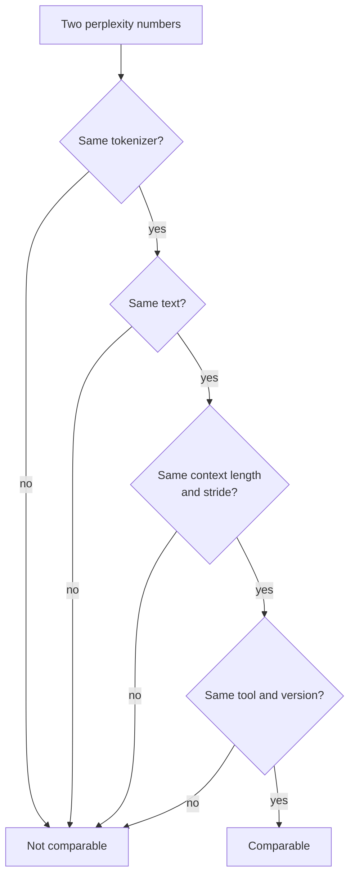

# Lección 21. Perplexity y sus límites

**Vínculo con la misión:** La perplexity es el número que cita primero toda tabla de cuantización, así que necesitas saber exactamente qué puede y qué no puede decirte antes de fiarte de una afirmación de "sin pérdida de calidad".
**Fuente principal:** [Paper: "Accuracy is Not All You Need", Dutta et al., 2024](https://arxiv.org/abs/2407.09141)
**Requisitos previos:** [Lección 20](0020-hardware-and-kernel-support.md), [Perplexity](../GLOSSARY.md), [Calibration set](../GLOSSARY.md)

## Calentamiento

1. ▢ Un esquema de 4 bits almacena un scale de 16 bits por cada grupo de 32 pesos. ¿Cuántos son sus bits efectivos por peso?

<details markdown="1"><summary>Comprobación</summary>

Son 4.5. El scale añade 16 / 32 = 0.5 bits por peso sobre los 4 bits de cada valor (lecciones 1 y 6).

</details>

2. ▢ ¿Qué lee un método post-entrenamiento del calibration set, y qué no hace con él?

<details markdown="1"><summary>Comprobación</summary>

Lee estadísticas de activaciones de una pequeña muestra de entradas, para elegir rangos o para ponderar errores de redondeo. Nunca entrena con él ni hace backpropagation a través de él (lección 12).

</details>

3. ▢ El int4 solo de pesos acelera el decode con lote 1. ¿Qué propiedad de esa carga de trabajo lo explica?

<details markdown="1"><summary>Comprobación</summary>

El decode con lote 1 está limitado por el ancho de banda de memoria: cada peso se lee una vez por token, así que menos bytes de pesos significa menos tiempo leyendo (lecciones 1 y 19).

</details>

## Qué debes saber

### Qué es la perplexity

La **perplexity** es la exponencial de la log-verosimilitud negativa promedio de un texto. La [documentación de Hugging Face Transformers](https://huggingface.co/docs/transformers/main/en/perplexity) la define para una secuencia tokenizada `X = (x_0, ..., x_t)`, y señala que equivale a la exponencial de la entropía cruzada entre los datos y las predicciones del modelo:

```text
perplexity(X) = exp( -(1/t) * sum_i log p(x_i | x_<i) )
```

Léela como entre cuántos tokens igualmente probables está eligiendo el modelo en cada paso. Un modelo que diera a cada token una probabilidad de 0.25 obtendría exactamente 4. Menor es mejor.

### Qué cambia el número

El número depende de más cosas que el modelo. La misma documentación lista los principales mandos:

- **Tokenizer.** La documentación dice que la tokenización "tiene un impacto directo" en la perplexity y que hay que tenerla en cuenta al comparar modelos. El README de la herramienta de llama.cpp añade que la perplexity no es directamente comparable entre modelos con tokenizers distintos ([README de perplexity de llama.cpp](https://github.com/ggml-org/llama.cpp/blob/master/tools/perplexity/README.md)).
- **Ventana y stride.** Un modelo tiene una longitud de contexto fija, así que un texto largo se puntúa en ventanas. Puntuar fragmentos disjuntos da a cada token menos contexto y "suele dar un valor mayor (peor)". Una ventana deslizante con un stride menor da más contexto y un valor más bajo. Para GPT-2 large en WikiText-2 la documentación informa de 19.44 con stride 1024 (sin solapamiento) y 16.44 con stride 512, con el mismo modelo y texto.
- **Texto.** El README de llama.cpp dice que los colaboradores usan por convención el conjunto de prueba de WikiText-2, y que sus números no son comparables con los de otros proyectos, porque los valores exactos dependen mucho de los detalles de implementación.



Así que una comparación de cuantización mide el baseline y el modelo cuantizado en una misma configuración de ejecución, y no cita ninguno de los dos números por separado.

### Para qué sirve la perplexity

llama.cpp la usa "para juzgar la pérdida de calidad de, por ejemplo, los modelos cuantizados frente a FP16", en modelos base, y señala que los fine-tunes suelen obtener una perplexity mayor incluso cuando sube la calidad valorada por personas. La tabla de resultados del README para Llama 3 8B muestra la forma del intercambio: perplexity 6.233 en f16, 6.234 en q8_0, 6.253 en q6_K y 6.407 en q4_K_M sin matriz de importancia, y luego 60.69 en iq1_S, el tipo más pequeño que se muestra, construido con una matriz de importancia. Para ordenar esquemas por tamaño en un modelo y un texto, es útil y barata.

### Qué oculta la perplexity

La perplexity es un promedio, y los promedios se cancelan. Dutta et al. señalan que las menores probabilidades de algunos tokens "pueden quedar canceladas por probabilidades mayores de otros tokens", así que la perplexity por sí sola es inadecuada para juzgar la compresión. Muestran el mismo efecto en las respuestas. En seis esquemas de cuantización y siete tareas, el accuracy se movió de 0 a 2 por ciento, y aun así las respuestas cambiaron mucho más. Llaman **flip** a una respuesta que pasa de correcta a incorrecta, o de incorrecta a correcta, e informan de flips de hasta el 13.6 por ciento en la mayoría de los esquemas. La excepción fue GPTQ con pesos de 8 bits y activaciones de 16 bits, que mantuvo el accuracy con flips despreciables.

¿Por qué se cancelan los flips en el accuracy? El ruido de cuantización mueve un poco las puntuaciones de respuesta de cada pregunta. Donde el modelo estaba seguro, nada cambia. Donde sus dos mejores opciones estaban cerca, el ruido decide. Dutta et al. observan que aproximadamente tantas respuestas pasan de incorrectas a correctas como de correctas a incorrectas, y miden la diferencia entre la mejor y la segunda mejor opción, el margen superior, y la encuentran baja en las preguntas que el modelo falla, así que esas son las respuestas que se mueven.

De aquí salen dos métricas de distancia, ambas medidas frente al baseline y no frente a la verdad:

- **Flips**: el porcentaje de respuestas que cambiaron entre correcta e incorrecta. Fácil de explicar a alguien no especialista.
- **Divergencia KL** entre las distribuciones de salida del baseline y del modelo cuantizado, promediada sobre el dataset. En MMLU el paper informa de una correlación de Spearman de 0.981 entre la divergencia KL y los flips.

En la generación libre el panorama es peor. En MT-Bench, puntuado con GPT-4 como juez, la mayoría de los métodos degradaron los modelos mayores, un 5 por ciento en Llama 2 70B y un 1.5 por ciento en Yi 34B, y hasta un 10 y un 5 por ciento en el segundo turno, más difícil. Eran los modelos de chat Llama 2 y Yi y los métodos de cuantización de 2024, así que lee los porcentajes como una prueba de existencia, no como un pronóstico para tu modelo.

La herramienta de perplexity de llama.cpp puede calcular el mismo tipo de distancia. Ejecútala una vez sobre el modelo FP16 con `--kl-divergence-base` para guardar sus logits, y luego sobre el modelo cuantizado con `--kl-divergence`, e informa de la divergencia KL, el cambio en la probabilidad del token correcto y "same top p", el porcentaje de posiciones en que ambos modelos ponen el mismo token en primer lugar. En la tabla del README para Llama 3 8B en q4_K_M, la perplexity está un 2.8 por ciento por encima de FP16 (razón 1.028160) y same top p es 91.901 por ciento, así que el token principal cambia en aproximadamente una posición de cada doce. En q8_0 la razón es 1.000425 y same top p es 97.674 por ciento.

## Práctica

1. ▢ Un modelo asigna probabilidad 0.25 a cada token de un texto. ¿Cuál es su perplexity?

<details markdown="1"><summary>Comprobación</summary>

Es 4. La log-verosimilitud negativa promedio es `-log(0.25)`, y al exponenciarla da `1 / 0.25 = 4`. La perplexity es el número efectivo de opciones igualmente probables por token.

</details>

2. ▢ ¿Qué par de números de perplexity puedes comparar directamente?

    - a) Una puntuación de llama.cpp frente a una de Transformers sobre texto de Wikitext-2
    - b) Ejecuciones de baseline y cuantizada que comparten tokenizer, texto, ventana y stride
    - c) Dos modelos con tokenizers distintos puntuados sobre un mismo texto held-out
    - d) El mismo checkpoint evaluado con stride 1024 frente a stride 512

<details markdown="1"><summary>Comprobación</summary>

**b)** Es el único par en el que solo cambió el modelo. (a) mezcla dos implementaciones, y llama.cpp dice que sus números no son comparables con los de otros proyectos. (c) es incorrecta porque tokenizers distintos cambian el propio número. (d) es incorrecta porque el stride por sí solo movió GPT-2 large de 19.44 a 16.44 en la documentación de Transformers.

</details>

3. ▢ Predice y luego ejecuta. Cuatro tokens tienen probabilidad 0.5 en el baseline. Tras la cuantización sus probabilidades pasan a ser 0.625, 0.4, 0.625 y 0.4. ¿Será la perplexity del modelo cuantizado mayor, menor o igual? Luego ejecútalo.

    ```python
    import numpy as np

    base = np.array([0.5, 0.5, 0.5, 0.5])
    quant = np.array([0.625, 0.4, 0.625, 0.4])


    def perplexity(p):
        return np.exp(-np.mean(np.log(p)))


    print("baseline perplexity:", round(perplexity(base), 4))
    print("quantized perplexity:", round(perplexity(quant), 4))
    print("tokens whose probability changed:", int(np.sum(base != quant)), "of", len(base))
    ```

<details markdown="1"><summary>Pista</summary>

La perplexity es la inversa de la media geométrica de las probabilidades de los tokens. Multiplica las cuatro probabilidades nuevas y toma la raíz cuarta.

</details>

<details markdown="1"><summary>Comprobación</summary>

Imprime 2.0 en ambos casos, y cambiaron "4 of 4" tokens. La media geométrica de 0.625, 0.4, 0.625 y 0.4 es `sqrt(0.625 * 0.4) = 0.5`, así que la probabilidad de cada token se movió y la perplexity no. Dutta et al. describen esta cancelación: las ganancias en algunos tokens ocultan pérdidas en otros.

</details>

4. ▢ Predice y luego ejecuta. Una prueba simulada de cuatro opciones tiene 5000 preguntas. En el 60 por ciento de ellas el baseline está seguro de la respuesta correcta. En el resto está adivinando. El "modelo cuantizado" son las puntuaciones del baseline más un poco de ruido. Predice la diferencia de accuracy en puntos y la parte de preguntas que hacen flip, y luego ejecútalo. Es una simulación, no una medición de ningún modelo real.

    ```python
    import numpy as np

    rng = np.random.default_rng(0)
    n_questions, n_options = 5000, 4

    logits = rng.normal(size=(n_questions, n_options))
    easy = rng.random(n_questions) < 0.6
    logits[easy, 0] += 6.0  # easy questions: the model is sure
    noisy = logits + rng.normal(scale=0.5, size=logits.shape)

    base_correct = logits.argmax(axis=1) == 0
    quant_correct = noisy.argmax(axis=1) == 0

    print(f"baseline accuracy:  {base_correct.mean():.3f}")
    print(f"quantized accuracy: {quant_correct.mean():.3f}")
    print(f"flips (correct <-> incorrect): {(base_correct != quant_correct).mean():.3f}")
    print(f"correct -> incorrect: {(base_correct & ~quant_correct).mean():.3f}")
    print(f"incorrect -> correct: {(~base_correct & quant_correct).mean():.3f}")
    ```

<details markdown="1"><summary>Pista</summary>

¿Qué preguntas puede cambiar realmente el ruido: las de las que el modelo está seguro, o aquellas en las que adivina?

</details>

<details markdown="1"><summary>Comprobación</summary>

Accuracy del baseline 0.709 y accuracy cuantizado 0.705, una diferencia de 0.4 puntos, y aun así hacen flip 0.059 de las preguntas: 0.031 de correcta a incorrecta y 0.028 al revés. Cambiaron unas 295 de 5000 respuestas mientras el accuracy apenas se movió, porque las dos direcciones de flip casi se cancelan. Solo pueden hacer flip las preguntas adivinadas, y el ruido tiene la misma probabilidad de empujar una conjetura hacia la opción correcta que de alejarla. El paper informa del mismo patrón en modelos reales: accuracy a menos de 2 por ciento, flips por encima del 5 por ciento.

</details>

5. ▢ Una revisión dice: "En q4_K_M la perplexity subió solo un 2.8 por ciento sobre FP16, así que el modelo se comporta igual". Usando los números de llama.cpp de arriba, ¿qué respondes?

<details markdown="1"><summary>Comprobación</summary>

Same top p es 91.901 por ciento, así que los dos modelos discrepan sobre el siguiente token más probable en cerca del 8 por ciento de las posiciones. La perplexity es un promedio sobre todos los tokens y oculta con qué frecuencia cambia la elección. Eso es por token, no por respuesta, así que no da una tasa de flips en ninguna tarea, pero muestra que "2.8 por ciento peor" no significa "se comporta igual". Mide la tarea, como hace la lección siguiente.

</details>

6. ▢ Un compañero informa de una perplexity de baseline de 6.2 con stride 1024 y una perplexity cuantizada de 7.1 con stride 512, y llama a la diferencia 0.9. ¿Qué falla, y hacia dónde va el error?

<details markdown="1"><summary>Comprobación</summary>

Las dos ejecuciones usan strides distintos, así que los números no son comparables. Un stride menor da más contexto y suele dar una perplexity menor (de 19.44 a 16.44 para GPT-2 large), así que el baseline con stride 512 probablemente puntuaría por debajo de 6.2. La diferencia verdadera es probablemente mayor que 0.9. Vuelve a ejecutar ambos con un mismo stride.

</details>

## Prácticas en el mundo real

- [ ] Ejecuta el código de perplexity de la documentación de Transformers sobre el modelo GPT-2 más pequeño con `stride` igual a la longitud de la ventana y otra vez con `stride = 512`, y confirma que el número baja. Tus valores diferirán de las cifras de GPT-2 large de la documentación.
- [ ] Si tienes llama.cpp, registra los logits FP16 con `--kl-divergence-base` sobre un modelo GGUF pequeño, luego ejecuta una copia Q4_K_M con `--kl-divergence` y lee "same top p" y la razón de perplexity.
- [ ] Mañana: sin apuntes, enumera las cuatro cosas que deben coincidir antes de poder comparar dos números de perplexity, y las dos métricas de distancia que van junto a la perplexity.

## Para profundizar

- [Medir y almacenar](../reference/measuring-and-storing.md)
- [Paper: "Accuracy is Not All You Need", Dutta et al., 2024](https://arxiv.org/abs/2407.09141)
- [Docs: "Perplexity of fixed-length models", Hugging Face Transformers](https://huggingface.co/docs/transformers/main/en/perplexity)
- [Docs: llama.cpp perplexity tool README](https://github.com/ggml-org/llama.cpp/blob/master/tools/perplexity/README.md)
- [Recursos](../RESOURCES.md)

---

¿No termina de quedar claro? Vuelve a leer la fuente primaria de arriba, ya que esta lección la comprime y en la compresión es donde se escapa la comprensión. Consulta el [glosario](../GLOSSARY.md) por si algún término te resultó resbaladizo.

Si lo poco claro es la propia lección y no el material, eso es un defecto: [abre un issue](https://github.com/TokenCemetery/teach/issues).
