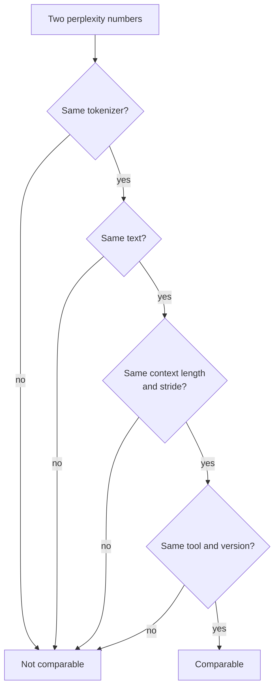

# Leçon 21. La perplexity et ses limites

**Lien avec la mission :** La perplexity est le chiffre que chaque tableau de quantification cite en premier, donc vous devez savoir exactement ce qu'elle peut et ne peut pas vous dire avant de croire une affirmation « sans perte de qualité ».
**Source primaire :** [Article : "Accuracy is Not All You Need", Dutta et al., 2024](https://arxiv.org/abs/2407.09141)
**Prérequis :** [Leçon 20](0020-hardware-and-kernel-support.md), [Perplexity](../GLOSSARY.md), [Calibration set](../GLOSSARY.md)

## Échauffement

1. ▢ Un schéma en 4 bits stocke un scale de 16 bits pour chaque groupe de 32 poids. Quels sont ses bits effectifs par poids ?

<details markdown="1"><summary>Vérifier</summary>

4.5. Le scale ajoute 16 / 32 = 0.5 bit par poids en plus des 4 bits de chaque valeur (leçons 1 et 6).

</details>

2. ▢ Que lit une méthode post-entraînement dans le calibration set, et que ne fait-elle pas avec lui ?

<details markdown="1"><summary>Vérifier</summary>

Elle lit des statistiques d'activation sur un petit échantillon d'entrées, pour choisir des plages ou pondérer des erreurs d'arrondi. Elle ne s'entraîne jamais dessus et ne rétropropage jamais à travers lui (leçon 12).

</details>

3. ▢ L'int4 weight-only rend le décodage à batch 1 plus rapide. Quelle propriété de cette charge de travail l'explique ?

<details markdown="1"><summary>Vérifier</summary>

Le décodage à batch 1 est limité par la mémoire : chaque poids est lu une fois par token, donc moins d'octets de poids signifie moins de temps de lecture (leçons 1 et 19).

</details>

## À savoir

### Ce qu'est la perplexity

La **perplexity** est l'exponentielle de la log-vraisemblance négative moyenne d'un texte. La [doc de Hugging Face Transformers](https://huggingface.co/docs/transformers/main/en/perplexity) la définit pour une séquence tokenisée `X = (x_0, ..., x_t)`, et note qu'elle égale l'exponentielle de l'entropie croisée entre les données et les prédictions du modèle :

```text
perplexity(X) = exp( -(1/t) * sum_i log p(x_i | x_<i) )
```

Lisez-la comme le nombre de tokens également probables parmi lesquels le modèle choisit à chaque pas. Un modèle qui donnerait à chaque token une probabilité de 0.25 obtiendrait exactement 4. Plus bas est mieux.

### Ce qui change le chiffre

Le chiffre dépend de plus que du modèle. La même doc liste les principaux boutons :

- **Tokenizer.** La doc dit que la tokenisation « a un impact direct » sur la perplexity et doit être prise en compte quand on compare des modèles. Le README de l'outil de llama.cpp ajoute que la perplexity n'est pas directement comparable entre des modèles de tokenizers différents ([README de perplexity de llama.cpp](https://github.com/ggml-org/llama.cpp/blob/master/tools/perplexity/README.md)).
- **Fenêtre et stride.** Un modèle a une longueur de contexte fixe, donc un long texte est noté par fenêtres. Noter des morceaux disjoints donne à chaque token moins de contexte et « donnera typiquement une valeur plus haute (pire) ». Une fenêtre glissante avec un stride plus petit donne plus de contexte et une valeur plus basse. Pour GPT-2 large sur WikiText-2, la doc rapporte 19.44 au stride 1024 (sans recouvrement) et 16.44 au stride 512, avec le même modèle et le même texte.
- **Texte.** Le README de llama.cpp dit que les contributeurs utilisent le jeu de test WikiText-2 par convention, et que ses chiffres ne sont pas comparables à ceux d'autres projets, parce que les valeurs exactes dépendent fortement des détails d'implémentation.



Une comparaison de quantification mesure donc la référence et le modèle quantifié dans une même configuration d'exécution, et ne cite aucun des deux chiffres seul.

### À quoi sert la perplexity

llama.cpp l'utilise « pour juger la perte de qualité de, par exemple, des modèles quantifiés par rapport au FP16 », sur des modèles de base, et note que les fine-tunes obtiennent typiquement une perplexity plus haute même quand la qualité jugée par des humains monte. Le tableau de résultats du README pour Llama 3 8B montre la forme de l'échange : une perplexity de 6.233 en f16, 6.234 en q8_0, 6.253 en q6_K et 6.407 en q4_K_M sans matrice d'importance, puis 60.69 en iq1_S, le plus petit type montré, construit avec une matrice d'importance. Pour classer des schémas par taille sur un modèle et un texte, c'est utile et bon marché.

### Ce que la perplexity cache

La perplexity est une moyenne, et les moyennes s'annulent. Dutta et al. soulignent que des probabilités plus basses sur certains tokens « peuvent être annulées par des probabilités plus hautes d'autres tokens », donc la perplexity seule est inadéquate pour juger une compression. Ils montrent le même effet sur les réponses. Sur six schémas de quantification et sept tâches, l'accuracy a bougé de 0 à 2 pour cent, mais les réponses ont changé bien davantage. Ils appellent **flip** une réponse qui passe de correcte à incorrecte, ou d'incorrecte à correcte, et rapportent des flips allant jusqu'à 13.6 pour cent pour la plupart des schémas. L'exception était GPTQ avec des poids en 8 bits et des activations en 16 bits, qui a gardé l'accuracy avec des flips négligeables.

Pourquoi les flips s'annulent-ils dans l'accuracy ? Le bruit de quantification déplace un peu les scores de réponse de chaque question. Là où le modèle était sûr, rien ne change. Là où ses deux meilleures options étaient proches, le bruit tranche. Dutta et al. observent qu'à peu près autant de réponses passent d'incorrectes à correctes que de correctes à incorrectes, et ils mesurent l'écart entre la meilleure et la deuxième meilleure option, la marge du haut, et la trouvent faible sur les questions que le modèle rate, donc ce sont ces réponses qui bougent.

Deux métriques de distance en découlent, toutes deux mesurées par rapport à la référence et non par rapport à la vérité :

- Les **flips** : le pourcentage de réponses qui ont changé entre correcte et incorrecte. Facile à expliquer à un non-spécialiste.
- La **divergence KL** entre les distributions de sortie de la référence et du modèle quantifié, moyennée sur le jeu de données. Sur MMLU, l'article rapporte une corrélation de Spearman de 0.981 entre divergence KL et flips.

Sur la génération libre, le tableau est pire. Sur MT-Bench, noté avec GPT-4 comme juge, la plupart des méthodes ont dégradé les plus grands modèles, de 5 pour cent pour Llama 2 70B et de 1.5 pour cent pour Yi 34B, et jusqu'à 10 pour cent et 5 pour cent sur le second tour, plus difficile. C'étaient les modèles de chat Llama 2 et Yi et les méthodes de quantification de 2024, donc lisez les pourcentages comme une preuve d'existence, pas comme une prévision pour votre modèle.

L'outil perplexity de llama.cpp peut calculer le même genre de distance. Exécutez-le une fois sur le modèle FP16 avec `--kl-divergence-base` pour enregistrer ses logits, puis sur le modèle quantifié avec `--kl-divergence`, et il rapporte la divergence KL, la variation de la probabilité du token correct, et « same top p », le pourcentage de positions où les deux modèles classent le même token en premier. Dans le tableau du README pour Llama 3 8B en q4_K_M, la perplexity est 2.8 pour cent au-dessus du FP16 (ratio 1.028160) et same top p vaut 91.901 pour cent, donc le token de tête change à environ une position sur douze. En q8_0, le ratio est 1.000425 et same top p vaut 97.674 pour cent.

## Pratique

1. ▢ Un modèle attribue une probabilité de 0.25 à chaque token d'un texte. Quelle est sa perplexity ?

<details markdown="1"><summary>Vérifier</summary>

C'est 4. La log-vraisemblance négative moyenne est `-log(0.25)`, et son exponentielle donne `1 / 0.25 = 4`. La perplexity est le nombre effectif de choix également probables par token.

</details>

2. ▢ Quelle paire de chiffres de perplexity pouvez-vous comparer directement ?

    - a) Un score de llama.cpp contre un score de Transformers sur du texte Wikitext-2
    - b) Des exécutions de référence et quantifiée partageant tokenizer, texte, fenêtre et stride
    - c) Deux modèles de tokenizers différents notés sur un texte held-out identique
    - d) Le même checkpoint évalué avec un stride de 1024 contre un stride de 512

<details markdown="1"><summary>Vérifier</summary>

**b)** C'est la seule paire où seul le modèle a changé. (a) mélange deux implémentations, et llama.cpp dit que ses chiffres ne sont pas comparables à ceux d'autres projets. (c) est faux parce que des tokenizers différents changent le chiffre lui-même. (d) est faux parce que le stride seul a fait passer GPT-2 large de 19.44 à 16.44 dans la doc de Transformers.

</details>

3. ▢ Prédisez, puis exécutez. Quatre tokens ont une probabilité de 0.5 sous la référence. Après quantification, leurs probabilités deviennent 0.625, 0.4, 0.625 et 0.4. La perplexity du modèle quantifié sera-t-elle plus haute, plus basse ou la même ? Exécutez ensuite.

    ```python
    import numpy as np

    base = np.array([0.5, 0.5, 0.5, 0.5])
    quant = np.array([0.625, 0.4, 0.625, 0.4])


    def perplexity(p):
        return np.exp(-np.mean(np.log(p)))


    print("baseline perplexity:", round(perplexity(base), 4))
    print("quantized perplexity:", round(perplexity(quant), 4))
    print("tokens whose probability changed:", int(np.sum(base != quant)), "of", len(base))
    ```

<details markdown="1"><summary>Indice</summary>

La perplexity est l'inverse de la moyenne géométrique des probabilités des tokens. Multipliez les quatre nouvelles probabilités et prenez la racine quatrième.

</details>

<details markdown="1"><summary>Vérifier</summary>

Il affiche 2.0 pour les deux, et « 4 of 4 » tokens ont changé. La moyenne géométrique de 0.625, 0.4, 0.625 et 0.4 est `sqrt(0.625 * 0.4) = 0.5`, donc la probabilité de chaque token a bougé et la perplexity non. Dutta et al. décrivent cette annulation : les gains sur certains tokens cachent les pertes sur d'autres.

</details>

4. ▢ Prédisez, puis exécutez. Un test simulé à quatre options a 5000 questions. Pour 60 pour cent d'entre elles, la référence est sûre de la bonne réponse. Pour le reste, elle devine. Le « modèle quantifié » est les scores de la référence plus un petit bruit. Prédisez l'écart d'accuracy en points et la part de questions qui flippent, puis exécutez. C'est une simulation, pas une mesure d'un vrai modèle.

    ```python
    import numpy as np

    rng = np.random.default_rng(0)
    n_questions, n_options = 5000, 4

    logits = rng.normal(size=(n_questions, n_options))
    easy = rng.random(n_questions) < 0.6
    logits[easy, 0] += 6.0  # easy questions: the model is sure
    noisy = logits + rng.normal(scale=0.5, size=logits.shape)

    base_correct = logits.argmax(axis=1) == 0
    quant_correct = noisy.argmax(axis=1) == 0

    print(f"baseline accuracy:  {base_correct.mean():.3f}")
    print(f"quantized accuracy: {quant_correct.mean():.3f}")
    print(f"flips (correct <-> incorrect): {(base_correct != quant_correct).mean():.3f}")
    print(f"correct -> incorrect: {(base_correct & ~quant_correct).mean():.3f}")
    print(f"incorrect -> correct: {(~base_correct & quant_correct).mean():.3f}")
    ```

<details markdown="1"><summary>Indice</summary>

Quelles questions le bruit peut-il réellement changer : celles dont le modèle est sûr, ou celles qu'il devine ?

</details>

<details markdown="1"><summary>Vérifier</summary>

Accuracy de référence 0.709 et accuracy quantifiée 0.705, un écart de 0.4 point, et pourtant 0.059 des questions flippent : 0.031 de correcte à incorrecte et 0.028 dans l'autre sens. Environ 295 réponses sur 5000 ont changé alors que l'accuracy a à peine bougé, parce que les deux sens de flip s'annulent presque. Seules les questions devinées peuvent flipper, et le bruit est aussi susceptible de pousser une devinette vers la bonne option que de l'en éloigner. L'article rapporte le même motif sur de vrais modèles : accuracy à moins de 2 pour cent, flips au-dessus de 5 pour cent.

</details>

5. ▢ Une relecture dit : « En q4_K_M, la perplexity n'a monté que de 2.8 pour cent par rapport au FP16, donc le modèle se comporte pareil. » D'après les chiffres de llama.cpp ci-dessus, que répondez-vous ?

<details markdown="1"><summary>Vérifier</summary>

Same top p vaut 91.901 pour cent, donc les deux modèles divergent sur le token suivant le plus probable à environ 8 pour cent des positions. La perplexity est une moyenne sur tous les tokens et cache la fréquence à laquelle le choix change. C'est par token, pas par réponse, donc cela ne donne un taux de flips sur aucune tâche, mais cela montre que « 2.8 pour cent de pire » ne veut pas dire « se comporte pareil ». Mesurez la tâche, comme le fait la leçon suivante.

</details>

6. ▢ Un coéquipier rapporte une perplexity de référence de 6.2 au stride 1024 et une perplexity quantifiée de 7.1 au stride 512, et appelle l'écart 0.9. Qu'est-ce qui cloche, et dans quel sens va l'erreur ?

<details markdown="1"><summary>Vérifier</summary>

Les deux exécutions utilisent des strides différents, donc les chiffres ne sont pas comparables. Un stride plus petit donne plus de contexte et typiquement une perplexity plus basse (19.44 à 16.44 pour GPT-2 large), donc la référence au stride 512 obtiendrait probablement moins de 6.2. Le vrai écart est probablement plus grand que 0.9. Relancez les deux avec un seul stride.

</details>

## Exercices en situation réelle

- [ ] Exécutez le code de perplexity de la doc de Transformers sur le plus petit modèle GPT-2 avec `stride` égal à la longueur de fenêtre, puis avec `stride = 512`, et confirmez que le chiffre baisse. Vos valeurs différeront des chiffres de GPT-2 large de la doc.
- [ ] Si vous avez llama.cpp, enregistrez des logits FP16 avec `--kl-divergence-base` sur un petit modèle GGUF, puis exécutez une copie Q4_K_M avec `--kl-divergence` et lisez « same top p » et le ratio de perplexity.
- [ ] Demain : sans notes, listez les quatre choses qui doivent concorder avant de pouvoir comparer deux chiffres de perplexity, et les deux métriques de distance qui se placent à côté de la perplexity.

## Pour aller plus loin

- [Mesurer et stocker](../reference/measuring-and-storing.md)
- [Article : "Accuracy is Not All You Need", Dutta et al., 2024](https://arxiv.org/abs/2407.09141)
- [Doc : "Perplexity of fixed-length models", Hugging Face Transformers](https://huggingface.co/docs/transformers/main/en/perplexity)
- [Doc : README de l'outil perplexity de llama.cpp, ggml-org](https://github.com/ggml-org/llama.cpp/blob/master/tools/perplexity/README.md)
- [Ressources](../RESOURCES.md)

---

Ça ne passe pas ? Relisez la source primaire en haut de page, car cette leçon la condense et c'est dans la condensation que la compréhension s'échappe. Consultez le [glossaire](../GLOSSARY.md) pour tout terme qui vous a paru glissant.

Si c'est la leçon elle-même qui n'est pas claire plutôt que la matière, c'est un défaut : [ouvrez une issue](https://github.com/TokenCemetery/teach/issues).
