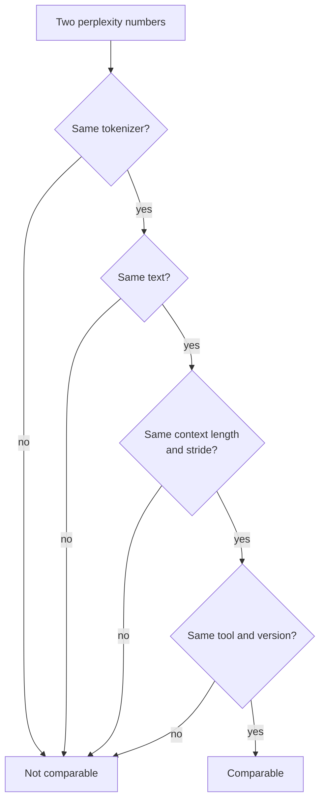

# पाठ 21. Perplexity और उसकी सीमाएँ

**मिशन से संबंध:** Perplexity वह संख्या है जिसे हर quantization table सबसे पहले बताती है, इसलिए "quality में कोई हानि नहीं" वाले दावे पर भरोसा करने से पहले आपको ठीक-ठीक जानना होगा कि वह क्या बता सकती है और क्या नहीं।
**मुख्य स्रोत:** [पेपर: "Accuracy is Not All You Need", Dutta et al., 2024](https://arxiv.org/abs/2407.09141)
**पूर्व-आवश्यकताएँ:** [पाठ 20](0020-hardware-and-kernel-support.md), [Perplexity](../GLOSSARY.md), [Calibration set](../GLOSSARY.md)

## वार्म-अप

1. ▢ एक 4-bit scheme हर 32 weights के group के लिए एक 16-bit scale store करती है। उसके effective bits per weight क्या हैं?

<details markdown="1"><summary>जाँचें</summary>

4.5। Scale हर value के 4 bits के ऊपर प्रति weight 16 / 32 = 0.5 bits जोड़ता है (पाठ 1 और 6)।

</details>

2. ▢ Post-training method calibration set से क्या पढ़ता है, और उसके साथ क्या नहीं करता?

<details markdown="1"><summary>जाँचें</summary>

वह inputs के छोटे नमूने से activation statistics पढ़ता है, ranges चुनने या rounding errors को वज़न देने के लिए। वह उस पर कभी train नहीं करता और न उसके आर-पार backpropagate करता है (पाठ 12)।

</details>

3. ▢ Weight-only int4 batch-1 decode को तेज़ करता है। उस workload का कौन-सा गुण इसे समझाता है?

<details markdown="1"><summary>जाँचें</summary>

Batch-1 decode memory-bound है: हर token पर हर weight एक बार पढ़ा जाता है, इसलिए कम weight bytes का मतलब पढ़ने में कम समय (पाठ 1 और 19)।

</details>

## यह जानें

### Perplexity क्या है

**Perplexity** किसी text की औसत negative log-likelihood का exponential है। [Hugging Face Transformers दस्तावेज़](https://huggingface.co/docs/transformers/main/en/perplexity) इसे tokenized sequence `X = (x_0, ..., x_t)` के लिए परिभाषित करते हैं, और ध्यान दिलाते हैं कि यह data और model की predictions के बीच की cross-entropy के exponential के बराबर है:

```text
perplexity(X) = exp( -(1/t) * sum_i log p(x_i | x_<i) )
```

इसे ऐसे पढ़ें कि model हर step पर कितने बराबर संभावना वाले tokens में से चुन रहा है। जो model हर token को 0.25 probability देता वह ठीक 4 score करता। जितनी कम उतनी बेहतर।

### संख्या को क्या बदलता है

संख्या सिर्फ़ model पर निर्भर नहीं करती। वही दस्तावेज़ मुख्य dials गिनाते हैं:

- **Tokenizer।** दस्तावेज़ कहते हैं कि tokenization का perplexity पर "सीधा असर होता है" और models की तुलना करते समय उसे ध्यान में रखना चाहिए। llama.cpp के tool की README जोड़ती है कि अलग tokenizers वाले models के बीच perplexity की सीधे तुलना नहीं हो सकती ([llama.cpp perplexity README](https://github.com/ggml-org/llama.cpp/blob/master/tools/perplexity/README.md))।
- **Window और stride।** Model की context length तय है, इसलिए लंबे text को windows में score किया जाता है। अलग-अलग chunks को score करना हर token को कम context देता है और "आम तौर पर ऊँची (बदतर)" value देता है। छोटे stride वाली sliding window ज़्यादा context देती है और कम value। WikiText-2 पर GPT-2 large के लिए दस्तावेज़ stride 1024 (कोई overlap नहीं) पर 19.44 और stride 512 पर 16.44 बताते हैं, उसी model और text से।
- **Text।** llama.cpp की README कहती है कि contributors परिपाटी से WikiText-2 test set इस्तेमाल करते हैं, और उसकी संख्याएँ दूसरे projects की संख्याओं से तुलनीय नहीं हैं, क्योंकि सटीक values implementation के ब्योरों पर बहुत निर्भर करती हैं।



इसलिए quantization की तुलना baseline और quantized model को एक ही run configuration में मापती है, और किसी एक संख्या को अकेले नहीं बताती।

### Perplexity किस काम की है

llama.cpp इसे base models पर "quantized models बनाम FP16 जैसे मामलों में quality की हानि परखने" के लिए इस्तेमाल करता है, और ध्यान दिलाता है कि finetunes आम तौर पर ऊँची perplexity score करते हैं भले ही इंसानों से आँकी गई quality बढ़े। Llama 3 8B के लिए README का scoreboard सौदे का आकार दिखाता है: f16 पर perplexity 6.233, q8_0 पर 6.234, q6_K पर 6.253 और बिना importance matrix के q4_K_M पर 6.407, फिर iq1_S पर 60.69, जो दिखाया गया सबसे छोटा type है, importance matrix के साथ बना। एक model और एक text पर schemes को आकार के हिसाब से क्रम देने के लिए यह उपयोगी और सस्ता है।

### Perplexity क्या छिपाती है

Perplexity औसत है, और औसत कट जाते हैं। Dutta et al. ध्यान दिलाते हैं कि कुछ tokens पर कम probabilities "दूसरे tokens की ऊँची probabilities से कट सकती हैं", इसलिए compression को परखने के लिए अकेली perplexity अपर्याप्त है। वे यही असर उत्तरों पर दिखाते हैं। छह quantization schemes और सात tasks में, accuracy 0 से 2 प्रतिशत हिली, फिर भी उत्तर कहीं ज़्यादा बदले। वे उस उत्तर को जो सही से ग़लत या ग़लत से सही हो जाए **flip** कहते हैं, और ज़्यादातर schemes के लिए 13.6 प्रतिशत तक की flips बताते हैं। अपवाद 8-bit weights और 16-bit activations पर GPTQ था, जिसने नगण्य flips के साथ accuracy बनाए रखी।

Flips accuracy में कट क्यों जाती हैं? Quantization noise हर सवाल के उत्तर scores को थोड़ा हिलाता है। जहाँ model को यक़ीन था, कुछ नहीं बदलता। जहाँ उसके शीर्ष दो विकल्प पास थे, noise फ़ैसला करता है। Dutta et al. देखते हैं कि लगभग उतने ही उत्तर ग़लत से सही होते हैं जितने सही से ग़लत, और वे सबसे अच्छे और दूसरे सबसे अच्छे विकल्प के बीच का फ़ासला, यानी top margin, मापते हैं और उसे उन सवालों पर कम पाते हैं जो model ग़लत करता है, इसलिए वही उत्तर हिलते हैं।

दो दूरी वाले metrics निकलते हैं, दोनों baseline के मुक़ाबले नापे जाते हैं, सच के मुक़ाबले नहीं:

- **Flips**: उत्तरों का प्रतिशत जो सही और ग़लत के बीच बदले। किसी ग़ैर-विशेषज्ञ को समझाना आसान।
- Baseline और quantized model के output distributions के बीच **KL divergence**, dataset पर औसत लिया हुआ। MMLU पर पेपर KL divergence और flips के बीच 0.981 का Spearman correlation बताता है।

मुक्त-रूप generation पर तस्वीर बदतर है। GPT-4 को judge बनाकर score की गई MT-Bench पर, ज़्यादातर methods ने बड़े models को बिगाड़ा, Llama 2 70B के लिए 5 प्रतिशत और Yi 34B के लिए 1.5 प्रतिशत, और कठिन दूसरे turn पर 10 प्रतिशत और 5 प्रतिशत तक। ये Llama 2 और Yi के chat models और 2024 के quantization methods थे, इसलिए प्रतिशतों को अस्तित्व का प्रमाण मानकर पढ़ें, अपने model के लिए पूर्वानुमान नहीं।

llama.cpp का perplexity tool इसी तरह की दूरी compute कर सकता है। FP16 model पर एक बार `--kl-divergence-base` के साथ चलाएँ ताकि उसके logits सहेजे जाएँ, फिर quantized model पर `--kl-divergence` के साथ, और वह KL divergence, सही token की probability में बदलाव, और "same top p" बताता है, यानी positions का प्रतिशत जहाँ दोनों models एक ही token को पहले रैंक करते हैं। Llama 3 8B के q4_K_M की README table में, perplexity FP16 से 2.8 प्रतिशत ऊपर है (अनुपात 1.028160) और same top p 91.901 प्रतिशत है, इसलिए शीर्ष token लगभग बारह में से एक position पर बदलता है। q8_0 पर अनुपात 1.000425 है और same top p 97.674 प्रतिशत।

## अभ्यास

1. ▢ कोई model किसी text के हर token को 0.25 probability देता है। उसकी perplexity क्या है?

<details markdown="1"><summary>जाँचें</summary>

वह 4 है। औसत negative log-likelihood `-log(0.25)` है, और उसका exponential `1 / 0.25 = 4` देता है। Perplexity प्रति token बराबर संभावना वाले विकल्पों की असरदार संख्या है।

</details>

2. ▢ Perplexity संख्याओं की कौन-सी जोड़ी आप सीधे तुलना कर सकते हैं?

    - a) Wikitext-2 text पर llama.cpp का score बनाम Transformers का score
    - b) Baseline और quantized runs जो tokenizer, text, window और stride साझा करते हैं
    - c) अलग tokenizers वाले दो models, एक जैसे held-out text पर score किए गए
    - d) वही checkpoint stride 1024 बनाम stride 512 से evaluate किया गया

<details markdown="1"><summary>जाँचें</summary>

**b)** यही अकेली जोड़ी है जिसमें सिर्फ़ model बदला। (a) दो implementations मिलाता है, और llama.cpp कहता है कि उसकी संख्याएँ दूसरे projects की संख्याओं से तुलनीय नहीं हैं। (c) ग़लत है क्योंकि अलग tokenizers संख्या को ही बदल देते हैं। (d) ग़लत है क्योंकि अकेले stride ने Transformers दस्तावेज़ों में GPT-2 large को 19.44 से 16.44 पर पहुँचाया।

</details>

3. ▢ पहले अनुमान लगाएँ, फिर चलाएँ। Baseline के तहत चार tokens की probability 0.5 है। Quantization के बाद उनकी probabilities 0.625, 0.4, 0.625 और 0.4 हो जाती हैं। क्या quantized model की perplexity ज़्यादा, कम या उतनी ही होगी? फिर चलाएँ।

    ```python
    import numpy as np

    base = np.array([0.5, 0.5, 0.5, 0.5])
    quant = np.array([0.625, 0.4, 0.625, 0.4])


    def perplexity(p):
        return np.exp(-np.mean(np.log(p)))


    print("baseline perplexity:", round(perplexity(base), 4))
    print("quantized perplexity:", round(perplexity(quant), 4))
    print("tokens whose probability changed:", int(np.sum(base != quant)), "of", len(base))
    ```

<details markdown="1"><summary>संकेत</summary>

Perplexity token probabilities के ज्यामितीय औसत का व्युत्क्रम है। चारों नई probabilities को गुणा करें और चौथा मूल निकालें।

</details>

<details markdown="1"><summary>जाँचें</summary>

वह दोनों के लिए 2.0 छापता है, और "4 of 4" tokens बदले। 0.625, 0.4, 0.625 और 0.4 का ज्यामितीय औसत `sqrt(0.625 * 0.4) = 0.5` है, इसलिए हर token की probability हिली और perplexity नहीं हिली। Dutta et al. इसी कटाव का वर्णन करते हैं: कुछ tokens पर फ़ायदे दूसरों पर नुक़सान छिपा देते हैं।

</details>

4. ▢ पहले अनुमान लगाएँ, फिर चलाएँ। एक simulated चार-विकल्प वाले test में 5000 सवाल हैं। उनमें से 60 प्रतिशत पर baseline को सही उत्तर का यक़ीन है। बाक़ी पर वह अंदाज़ा लगा रहा है। "Quantized model" baseline के scores में छोटा noise जोड़ने से बना है। Accuracy के अंतर को अंकों में और flip होने वाले सवालों का हिस्सा अनुमानित करें, फिर चलाएँ। यह simulation है, किसी असली model की माप नहीं।

    ```python
    import numpy as np

    rng = np.random.default_rng(0)
    n_questions, n_options = 5000, 4

    logits = rng.normal(size=(n_questions, n_options))
    easy = rng.random(n_questions) < 0.6
    logits[easy, 0] += 6.0  # easy questions: the model is sure
    noisy = logits + rng.normal(scale=0.5, size=logits.shape)

    base_correct = logits.argmax(axis=1) == 0
    quant_correct = noisy.argmax(axis=1) == 0

    print(f"baseline accuracy:  {base_correct.mean():.3f}")
    print(f"quantized accuracy: {quant_correct.mean():.3f}")
    print(f"flips (correct <-> incorrect): {(base_correct != quant_correct).mean():.3f}")
    print(f"correct -> incorrect: {(base_correct & ~quant_correct).mean():.3f}")
    print(f"incorrect -> correct: {(~base_correct & quant_correct).mean():.3f}")
    ```

<details markdown="1"><summary>संकेत</summary>

Noise असल में किन सवालों को बदल सकता है: जिनका model को यक़ीन है, या जिन पर वह अंदाज़ा लगा रहा है?

</details>

<details markdown="1"><summary>जाँचें</summary>

Baseline accuracy 0.709 और quantized accuracy 0.705, यानी 0.4 अंक का फ़ासला, फिर भी 0.059 सवाल flip होते हैं: 0.031 सही से ग़लत और 0.028 दूसरी तरफ़। 5000 में से लगभग 295 उत्तर बदले जबकि accuracy मुश्किल से हिली, क्योंकि दोनों flip दिशाएँ लगभग कट जाती हैं। सिर्फ़ अंदाज़े वाले सवाल flip हो सकते हैं, और noise अंदाज़े को सही विकल्प की ओर धकेलने की उतनी ही संभावना रखता है जितनी दूर की ओर। पेपर असली models पर वही pattern बताता है: accuracy 2 प्रतिशत के भीतर, flips 5 प्रतिशत से ऊपर।

</details>

5. ▢ एक समीक्षा कहती है: "q4_K_M पर perplexity FP16 से सिर्फ़ 2.8 प्रतिशत बढ़ी, इसलिए model वैसा ही बर्ताव करता है।" ऊपर की llama.cpp संख्याओं का इस्तेमाल करके, आप क्या जवाब देंगे?

<details markdown="1"><summary>जाँचें</summary>

Same top p 91.901 प्रतिशत है, इसलिए दोनों models लगभग 8 प्रतिशत positions पर सबसे संभावित अगले token के बारे में असहमत हैं। Perplexity सभी tokens पर औसत है और छिपाती है कि चुनाव कितनी बार बदलता है। यह प्रति token है, प्रति उत्तर नहीं, इसलिए यह किसी task पर flip दर नहीं देता, पर यह दिखाता है कि "2.8 प्रतिशत बदतर" का मतलब "वैसा ही बर्ताव" नहीं है। Task को मापें, जैसा अगला पाठ करता है।

</details>

6. ▢ कोई साथी stride 1024 पर baseline perplexity 6.2 और stride 512 पर quantized perplexity 7.1 बताता है, और अंतर को 0.9 कहता है। क्या ग़लत है, और error किस दिशा में जाती है?

<details markdown="1"><summary>जाँचें</summary>

दोनों runs अलग strides इस्तेमाल करते हैं, इसलिए संख्याएँ तुलनीय नहीं हैं। छोटा stride ज़्यादा context देता है और आम तौर पर कम perplexity (GPT-2 large के लिए 19.44 से 16.44), इसलिए stride 512 पर baseline शायद 6.2 से नीचे score करता। असली अंतर संभवतः 0.9 से बड़ा है। दोनों को एक ही stride पर दोबारा चलाएँ।

</details>

## असली दुनिया का अभ्यास

- [ ] Transformers दस्तावेज़ों का perplexity code सबसे छोटे GPT-2 model पर `stride` को window की लंबाई के बराबर रखकर चलाएँ और फिर `stride = 512` के साथ, और पुष्टि करें कि संख्या गिरती है। आपकी values दस्तावेज़ों की GPT-2 large वाली संख्याओं से अलग होंगी।
- [ ] अगर आपके पास llama.cpp है, तो किसी छोटे GGUF model पर `--kl-divergence-base` से FP16 logits दर्ज करें, फिर Q4_K_M copy को `--kl-divergence` से चलाएँ और "same top p" और perplexity अनुपात पढ़ें।
- [ ] कल: बिना नोट्स के वे चार चीज़ें लिखें जिन्हें मेल खाना चाहिए इससे पहले कि दो perplexity संख्याएँ तुलना की जा सकें, और perplexity के बग़ल में बैठने वाले दो दूरी वाले metrics।

## आगे बढ़ने के लिए

- [मापना और Store करना शीट](../reference/measuring-and-storing.md)
- [पेपर: "Accuracy is Not All You Need", Dutta et al., 2024](https://arxiv.org/abs/2407.09141)
- [दस्तावेज़: "Perplexity of fixed-length models", Hugging Face Transformers](https://huggingface.co/docs/transformers/main/en/perplexity)
- [दस्तावेज़: llama.cpp perplexity tool README](https://github.com/ggml-org/llama.cpp/blob/master/tools/perplexity/README.md)
- [संसाधन](../RESOURCES.md)

---

बात नहीं बन रही? ऊपर दिए मुख्य स्रोत को दोबारा पढ़ें, क्योंकि यह पाठ उसे संक्षिप्त करता है और समझ संक्षेप में ही रिसती है। जो शब्द फिसलन भरा लगे, उसके लिए [शब्दावली](../GLOSSARY.md) देखें।

अगर दिक़्क़त सामग्री की नहीं बल्कि पाठ की ही है, तो वह एक खोट है: [issue खोलें](https://github.com/TokenCemetery/teach/issues)।
