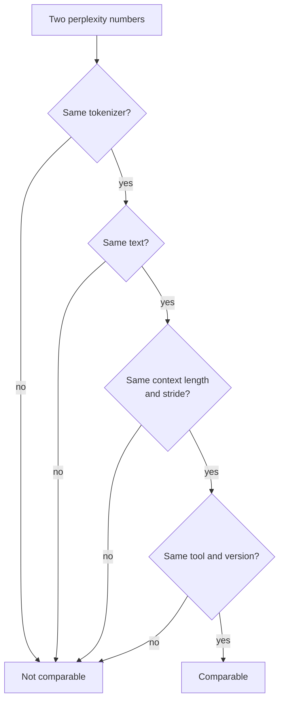

# Lesson 21. Perplexity and Its Limits

**Mission link:** Perplexity is the number every quantization table quotes first, so you need to know exactly what it can and cannot tell you before you trust a "no quality loss" claim.
**Primary source:** [Paper: "Accuracy is Not All You Need", Dutta et al., 2024](https://arxiv.org/abs/2407.09141)
**Prerequisites:** [Lesson 20](0020-hardware-and-kernel-support.md), [Perplexity](../GLOSSARY.md), [Calibration set](../GLOSSARY.md)

## Warm-up

1. ▢ A 4-bit scheme stores one 16-bit scale for every group of 32 weights. What are its effective bits per weight?

<details markdown="1"><summary>Check</summary>

It is 4.5. The scale adds 16 / 32 = 0.5 bits per weight on top of the 4 bits of each value (lessons 1 and 6).

</details>

2. ▢ What does a post-training method read from the calibration set, and what does it not do with it?

<details markdown="1"><summary>Check</summary>

It reads activation statistics from a small sample of inputs, to choose ranges or to weigh rounding errors. It never trains on it or backpropagates through it (lesson 12).

</details>

3. ▢ Weight-only int4 makes batch-1 decode faster. Which property of that workload explains it?

<details markdown="1"><summary>Check</summary>

Batch-1 decode is memory-bound: every weight is read once per token, so fewer weight bytes means less time reading (lessons 1 and 19).

</details>

## Know this

### What perplexity is

**Perplexity** is the exponentiated average negative log-likelihood of a text. The [Hugging Face Transformers docs](https://huggingface.co/docs/transformers/main/en/perplexity) define it for a tokenized sequence `X = (x_0, ..., x_t)`, and note it equals the exponential of the cross-entropy between the data and the model's predictions:

```text
perplexity(X) = exp( -(1/t) * sum_i log p(x_i | x_<i) )
```

Read it as how many equally likely tokens the model is choosing among at each step. A model that gave every token probability 0.25 would score exactly 4. Lower is better.

### What changes the number

The number depends on more than the model. The same docs list the main dials:

- **Tokenizer.** The docs say tokenization "has a direct impact" on perplexity and must be considered when comparing models. llama.cpp's tool README adds that perplexity is not directly comparable between models with different tokenizers ([llama.cpp perplexity README](https://github.com/ggml-org/llama.cpp/blob/master/tools/perplexity/README.md)).
- **Window and stride.** A model has a fixed context length, so a long text is scored in windows. Scoring disjoint chunks gives each token less context and "will typically yield a higher (worse)" value. A sliding window with a smaller stride gives more context and a lower value. For GPT-2 large on WikiText-2 the docs report 19.44 at stride 1024 (no overlap) and 16.44 at stride 512, from the same model and text.
- **Text.** The llama.cpp README says contributors use the WikiText-2 test set by convention, and that its numbers are not comparable to other projects', because the exact values depend strongly on implementation details.



So a quantization comparison measures the baseline and the quantized model in one run configuration, and quotes neither number alone.

### What perplexity is good for

llama.cpp uses it "to judge the quality loss from e.g. quantized models vs. FP16", on base models, and notes that finetunes typically score higher perplexity even when human-rated quality rises. The README's scoreboard for Llama 3 8B shows the shape of the trade: perplexity 6.233 at f16, 6.234 at q8_0, 6.253 at q6_K and 6.407 at q4_K_M without an importance matrix, then 60.69 at iq1_S, the smallest type shown, built with an importance matrix. For ranking schemes by size on one model and one text, that is useful and cheap.

### What perplexity hides

Perplexity is an average, and averages cancel. Dutta et al. point out that lower probabilities on some tokens "may be cancelled by higher probabilities of other tokens", so perplexity alone is inadequate for judging compression. They show the same effect on answers. Across six quantization schemes and seven tasks, accuracy moved by 0 to 2 percent, yet answers changed far more. They call an answer that goes from correct to incorrect, or from incorrect to correct, a **flip**, and report flips of up to 13.6 percent for most schemes. The exception was GPTQ at 8-bit weights and 16-bit activations, which kept accuracy with negligible flips.

Why do flips cancel in accuracy? Quantization noise moves each question's answer scores a little. Where the model was sure, nothing changes. Where its top two options were close, the noise decides. Dutta et al. observe that roughly as many answers go from incorrect to correct as from correct to incorrect, and they measure the gap between the best and second-best option, the top margin, and find it low on questions the model gets wrong, so those are the answers that move.

Two distance metrics follow, both measured against the baseline rather than against the truth:

- **Flips**: the percentage of answers that changed between correct and incorrect. Easy to explain to a non-specialist.
- **KL divergence** between the baseline's and the quantized model's output distributions, averaged over the dataset. On MMLU the paper reports a Spearman correlation of 0.981 between KL divergence and flips.

On free-form generation the picture is worse. On MT-Bench, scored with GPT-4 as judge, most methods degraded the larger models, by 5 percent for Llama 2 70B and 1.5 percent for Yi 34B, and by up to 10 percent and 5 percent on the harder second turn. These were the Llama 2 and Yi chat models and the quantization methods of 2024, so read the percentages as an existence proof, not a forecast for your model.

llama.cpp's perplexity tool can compute the same kind of distance. Run once on the FP16 model with `--kl-divergence-base` to save its logits, then on the quantized model with `--kl-divergence`, and it reports KL divergence, the change in the correct token's probability, and "same top p", the percentage of positions where both models rank the same token first. On the README's table for Llama 3 8B at q4_K_M, perplexity is 2.8 percent above FP16 (ratio 1.028160) and same top p is 91.901 percent, so the top token changes at roughly one position in twelve. At q8_0 the ratio is 1.000425 and same top p is 97.674 percent.

## Practice

1. ▢ A model assigns probability 0.25 to every token of a text. What is its perplexity?

<details markdown="1"><summary>Check</summary>

It is 4. The average negative log-likelihood is `-log(0.25)`, and exponentiating it gives `1 / 0.25 = 4`. Perplexity is the effective number of equally likely choices per token.

</details>

2. ▢ Which pair of perplexity numbers can you compare directly?

    - a) A llama.cpp score against a Transformers score on Wikitext-2 text
    - b) Baseline and quantized runs sharing tokenizer, text, window and stride
    - c) Two models with different tokenizers scored on identical held-out text
    - d) The identical checkpoint evaluated using stride 1024 versus stride 512

<details markdown="1"><summary>Check</summary>

**b)** It is the only pair where nothing but the model changed. (a) mixes two implementations, and llama.cpp says its numbers are not comparable to other projects'. (c) is wrong because different tokenizers change the number itself. (d) is wrong because stride alone moved GPT-2 large from 19.44 to 16.44 in the Transformers docs.

</details>

3. ▢ Predict, then run. Four tokens have probability 0.5 under the baseline. After quantization their probabilities become 0.625, 0.4, 0.625 and 0.4. Will the quantized model's perplexity be higher, lower or the same? Then run it.

    ```python
    import numpy as np

    base = np.array([0.5, 0.5, 0.5, 0.5])
    quant = np.array([0.625, 0.4, 0.625, 0.4])


    def perplexity(p):
        return np.exp(-np.mean(np.log(p)))


    print("baseline perplexity:", round(perplexity(base), 4))
    print("quantized perplexity:", round(perplexity(quant), 4))
    print("tokens whose probability changed:", int(np.sum(base != quant)), "of", len(base))
    ```

<details markdown="1"><summary>Hint</summary>

Perplexity is the inverse of the geometric mean of the token probabilities. Multiply the four new probabilities and take the fourth root.

</details>

<details markdown="1"><summary>Check</summary>

It prints 2.0 for both, and "4 of 4" tokens changed. The geometric mean of 0.625, 0.4, 0.625 and 0.4 is `sqrt(0.625 * 0.4) = 0.5`, so every token's probability moved and the perplexity did not. Dutta et al. describe this cancellation: gains on some tokens hide losses on others.

</details>

4. ▢ Predict, then run. A simulated four-option test has 5000 questions. For 60 percent of them the baseline is sure of the right answer. For the rest it is guessing. The "quantized model" is the baseline's scores plus small noise. Predict the accuracy gap in points and the share of questions that flip, then run it. This is a simulation, not a measurement of any real model.

    ```python
    import numpy as np

    rng = np.random.default_rng(0)
    n_questions, n_options = 5000, 4

    logits = rng.normal(size=(n_questions, n_options))
    easy = rng.random(n_questions) < 0.6
    logits[easy, 0] += 6.0  # easy questions: the model is sure
    noisy = logits + rng.normal(scale=0.5, size=logits.shape)

    base_correct = logits.argmax(axis=1) == 0
    quant_correct = noisy.argmax(axis=1) == 0

    print(f"baseline accuracy:  {base_correct.mean():.3f}")
    print(f"quantized accuracy: {quant_correct.mean():.3f}")
    print(f"flips (correct <-> incorrect): {(base_correct != quant_correct).mean():.3f}")
    print(f"correct -> incorrect: {(base_correct & ~quant_correct).mean():.3f}")
    print(f"incorrect -> correct: {(~base_correct & quant_correct).mean():.3f}")
    ```

<details markdown="1"><summary>Hint</summary>

Which questions can the noise actually change: the ones the model is sure of, or the ones it is guessing?

</details>

<details markdown="1"><summary>Check</summary>

Baseline accuracy 0.709 and quantized accuracy 0.705, a gap of 0.4 points, yet 0.059 of the questions flip: 0.031 from correct to incorrect and 0.028 the other way. About 295 of 5000 answers changed while the accuracy barely moved, because the two flip directions nearly cancel. Only the guessed questions can flip, and noise is as likely to push a guess toward the right option as away from it. The paper reports the same pattern on real models: accuracy within 2 percent, flips above 5 percent.

</details>

5. ▢ A review says: "At q4_K_M perplexity rose only 2.8 percent over FP16, so the model behaves the same." Using the llama.cpp numbers above, what do you reply?

<details markdown="1"><summary>Check</summary>

Same top p is 91.901 percent, so the two models disagree about the most likely next token at about 8 percent of positions. Perplexity is an average over all tokens and hides how often the choice changes. That is per token, not per answer, so it does not give a flip rate on any task, but it shows "2.8 percent worse" does not mean "behaves the same". Measure the task, as the next lesson does.

</details>

6. ▢ A teammate reports baseline perplexity 6.2 at stride 1024 and quantized perplexity 7.1 at stride 512, and calls the gap 0.9. What is wrong, and which way does the error go?

<details markdown="1"><summary>Check</summary>

The two runs use different strides, so the numbers are not comparable. A smaller stride gives more context and typically a lower perplexity (19.44 to 16.44 for GPT-2 large), so the baseline at stride 512 would probably score below 6.2. The true gap is likely larger than 0.9. Rerun both at one stride.

</details>

## Real-world reps

- [ ] Run the Transformers docs' perplexity code on the smallest GPT-2 model with `stride` equal to the window length and again with `stride = 512`, and confirm the number drops. Your values will differ from the docs' GPT-2 large figures.
- [ ] If you have llama.cpp, record FP16 logits with `--kl-divergence-base` on a small GGUF model, then run a Q4_K_M copy with `--kl-divergence` and read "same top p" and the perplexity ratio.
- [ ] Tomorrow: without notes, list the four things that must match before two perplexity numbers can be compared, and the two distance metrics that sit beside perplexity.

## Going further

- [Measuring and Storing](../reference/measuring-and-storing.md)
- [Paper: "Accuracy is Not All You Need", Dutta et al., 2024](https://arxiv.org/abs/2407.09141)
- [Docs: "Perplexity of fixed-length models", Hugging Face Transformers](https://huggingface.co/docs/transformers/main/en/perplexity)
- [Docs: llama.cpp perplexity tool README](https://github.com/ggml-org/llama.cpp/blob/master/tools/perplexity/README.md)
- [Resources](../RESOURCES.md)

---

Not landing? Reread the primary source at the top, since this lesson compresses it and compression is where understanding leaks. Check the [glossary](../GLOSSARY.md) for any term that felt slippery.

If the lesson itself is unclear rather than the material, that is a defect: [open an issue](https://github.com/TokenCemetery/teach/issues).
