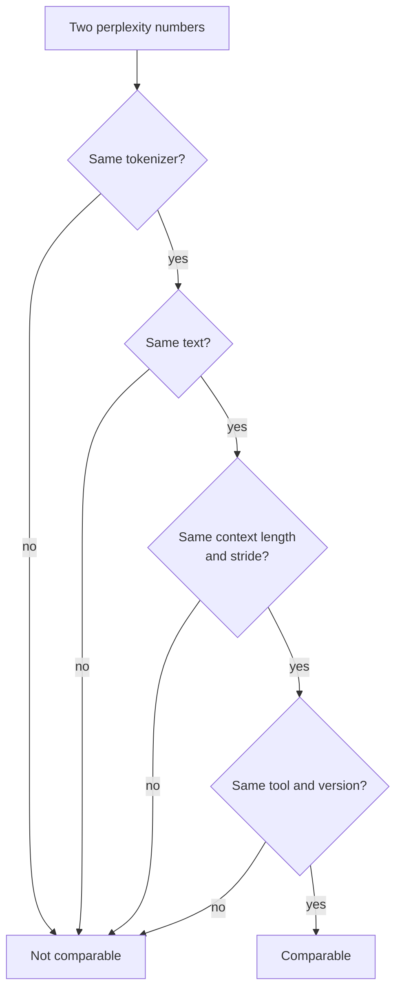

# Lição 21. Perplexity e seus limites

**Ligação com a missão:** A perplexity é o número que toda tabela de quantização cita primeiro, então você precisa saber exatamente o que ela pode e não pode dizer antes de confiar em uma alegação de "nenhuma perda de qualidade".
**Fonte principal:** [Artigo científico: "Accuracy is Not All You Need", Dutta et al., 2024](https://arxiv.org/abs/2407.09141)
**Pré-requisitos:** [Lição 20](0020-hardware-and-kernel-support.md), [Perplexity](../GLOSSARY.md), [Calibration set](../GLOSSARY.md)

## Aquecimento

1. ▢ Um esquema de 4 bits armazena uma scale de 16 bits para cada grupo de 32 pesos. Quais são os seus bits efetivos por peso?

<details markdown="1"><summary>Verificação</summary>

São 4.5. A scale acrescenta 16 / 32 = 0.5 bit por peso além dos 4 bits de cada valor (lições 1 e 6).

</details>

2. ▢ O que um método post-training lê do calibration set, e o que ele não faz com ele?

<details markdown="1"><summary>Verificação</summary>

Ele lê estatísticas de ativação de uma pequena amostra de entradas, para escolher faixas ou ponderar erros de arredondamento. Ele nunca treina nela nem faz backpropagation por ela (lição 12).

</details>

3. ▢ O int4 somente de pesos deixa o decode com batch 1 mais rápido. Qual propriedade dessa carga de trabalho explica isso?

<details markdown="1"><summary>Verificação</summary>

O decode com batch 1 é limitado pela largura de banda de memória: cada peso é lido uma vez por token, então menos bytes de pesos significa menos tempo lendo (lições 1 e 19).

</details>

## Saiba isto

### O que é a perplexity

A **perplexity** é a exponencial da média do log-likelihood negativo de um texto. A [documentação do Hugging Face Transformers](https://huggingface.co/docs/transformers/main/en/perplexity) a define para uma sequência tokenizada `X = (x_0, ..., x_t)` e observa que ela é igual à exponencial da cross-entropy entre os dados e as previsões do modelo:

```text
perplexity(X) = exp( -(1/t) * sum_i log p(x_i | x_<i) )
```

Leia-a como entre quantos tokens igualmente prováveis o modelo está escolhendo a cada passo. Um modelo que desse a todo token probabilidade 0.25 marcaria exatamente 4. Quanto menor, melhor.

### O que muda o número

O número depende de mais do que o modelo. A mesma documentação lista os principais botões:

- **Tokenizer.** A documentação diz que a tokenização "tem um impacto direto" na perplexity e precisa ser considerada ao comparar modelos. O README da ferramenta do llama.cpp acrescenta que a perplexity não é diretamente comparável entre modelos com tokenizers diferentes ([README de perplexity do llama.cpp](https://github.com/ggml-org/llama.cpp/blob/master/tools/perplexity/README.md)).
- **Janela e stride.** Um modelo tem um comprimento de contexto fixo, então um texto longo é pontuado em janelas. Pontuar blocos disjuntos dá a cada token menos contexto e "tipicamente produzirá um valor mais alto (pior)". Uma janela deslizante com stride menor dá mais contexto e um valor mais baixo. Para o GPT-2 large no WikiText-2, a documentação relata 19.44 com stride 1024 (sem sobreposição) e 16.44 com stride 512, do mesmo modelo e texto.
- **Texto.** O README do llama.cpp diz que os contribuidores usam o conjunto de teste do WikiText-2 por convenção, e que os seus números não são comparáveis aos de outros projetos, porque os valores exatos dependem fortemente de detalhes de implementação.



Então uma comparação de quantização mede o baseline e o modelo quantizado em uma única configuração de execução, e não cita nenhum dos números isoladamente.

### Para que a perplexity serve

O llama.cpp a usa "para julgar a perda de qualidade de, por exemplo, modelos quantizados contra o FP16", em base models, e observa que os fine-tunes tipicamente marcam perplexity mais alta mesmo quando a qualidade avaliada por humanos sobe. O placar do README para o Llama 3 8B mostra a forma da troca: perplexity 6.233 em f16, 6.234 em q8_0, 6.253 em q6_K e 6.407 em q4_K_M sem uma matriz de importância, depois 60.69 em iq1_S, o menor tipo mostrado, construído com uma matriz de importância. Para ordenar esquemas por tamanho em um modelo e um texto, isso é útil e barato.

### O que a perplexity esconde

A perplexity é uma média, e médias se cancelam. Dutta et al. apontam que probabilidades menores em alguns tokens "podem ser canceladas por probabilidades maiores em outros tokens", então a perplexity sozinha é inadequada para julgar a compressão. Eles mostram o mesmo efeito nas respostas. Em seis esquemas de quantização e sete tarefas, a acurácia se moveu de 0 a 2 por cento, e no entanto as respostas mudaram muito mais. Eles chamam de **flip** uma resposta que vai de correta para incorreta, ou de incorreta para correta, e relatam flips de até 13.6 por cento para a maioria dos esquemas. A exceção foi o GPTQ com pesos de 8 bits e ativações de 16 bits, que manteve a acurácia com flips desprezíveis.

Por que os flips se cancelam na acurácia? O ruído de quantização move um pouco as pontuações de resposta de cada pergunta. Onde o modelo estava seguro, nada muda. Onde as suas duas primeiras opções estavam próximas, o ruído decide. Dutta et al. observam que aproximadamente tantas respostas vão de incorretas para corretas quanto de corretas para incorretas, e eles medem a diferença entre a melhor e a segunda melhor opção, a margem do topo, e a encontram baixa nas perguntas que o modelo erra, então essas são as respostas que se movem.

Duas métricas de distância decorrem disso, ambas medidas contra o baseline e não contra a verdade:

- **Flips**: a porcentagem de respostas que mudaram entre correta e incorreta. Fácil de explicar a um não especialista.
- **Divergência KL** entre as distribuições de saída do baseline e do modelo quantizado, em média sobre o dataset. No MMLU, o artigo relata uma correlação de Spearman de 0.981 entre a divergência KL e os flips.

Na geração livre, o quadro é pior. No MT-Bench, pontuado com o GPT-4 como juiz, a maioria dos métodos degradou os modelos maiores, em 5 por cento para o Llama 2 70B e 1.5 por cento para o Yi 34B, e em até 10 por cento e 5 por cento no segundo turno, mais difícil. Eram os modelos de chat Llama 2 e Yi e os métodos de quantização de 2024, então leia as porcentagens como uma prova de existência, não como uma previsão para o seu modelo.

A ferramenta de perplexity do llama.cpp pode calcular o mesmo tipo de distância. Execute uma vez no modelo FP16 com `--kl-divergence-base` para salvar os seus logits, depois no modelo quantizado com `--kl-divergence`, e ela relata a divergência KL, a mudança na probabilidade do token correto e o "same top p", a porcentagem de posições em que os dois modelos classificam o mesmo token em primeiro lugar. Na tabela do README para o Llama 3 8B em q4_K_M, a perplexity fica 2.8 por cento acima do FP16 (razão 1.028160) e o same top p é 91.901 por cento, então o token principal muda em aproximadamente uma posição a cada doze. Em q8_0 a razão é 1.000425 e o same top p é 97.674 por cento.

## Prática

1. ▢ Um modelo atribui probabilidade 0.25 a todo token de um texto. Qual é a sua perplexity?

<details markdown="1"><summary>Verificação</summary>

É 4. O log-likelihood negativo médio é `-log(0.25)`, e exponenciá-lo dá `1 / 0.25 = 4`. A perplexity é o número efetivo de escolhas igualmente prováveis por token.

</details>

2. ▢ Qual par de números de perplexity você pode comparar diretamente?

    - a) Uma pontuação do llama.cpp contra uma pontuação do Transformers em texto do Wikitext-2
    - b) Execuções de baseline e quantizada que compartilham tokenizer, texto, janela e stride
    - c) Dois modelos com tokenizers diferentes pontuados em texto held-out idêntico
    - d) O checkpoint idêntico avaliado com stride 1024 contra stride 512

<details markdown="1"><summary>Verificação</summary>

**b)** É o único par em que nada além do modelo mudou. (a) mistura duas implementações, e o llama.cpp diz que os seus números não são comparáveis aos de outros projetos. (c) está errada porque tokenizers diferentes mudam o próprio número. (d) está errada porque o stride sozinho moveu o GPT-2 large de 19.44 para 16.44 na documentação do Transformers.

</details>

3. ▢ Preveja e depois execute. Quatro tokens têm probabilidade 0.5 no baseline. Depois da quantização, as suas probabilidades viram 0.625, 0.4, 0.625 e 0.4. A perplexity do modelo quantizado será maior, menor ou igual? Depois execute.

    ```python
    import numpy as np

    base = np.array([0.5, 0.5, 0.5, 0.5])
    quant = np.array([0.625, 0.4, 0.625, 0.4])


    def perplexity(p):
        return np.exp(-np.mean(np.log(p)))


    print("baseline perplexity:", round(perplexity(base), 4))
    print("quantized perplexity:", round(perplexity(quant), 4))
    print("tokens whose probability changed:", int(np.sum(base != quant)), "of", len(base))
    ```

<details markdown="1"><summary>Dica</summary>

A perplexity é o inverso da média geométrica das probabilidades dos tokens. Multiplique as quatro novas probabilidades e tire a raiz quarta.

</details>

<details markdown="1"><summary>Verificação</summary>

Ela imprime 2.0 para ambos, e "4 of 4" tokens mudaram. A média geométrica de 0.625, 0.4, 0.625 e 0.4 é `sqrt(0.625 * 0.4) = 0.5`, então a probabilidade de todo token se moveu e a perplexity não. Dutta et al. descrevem esse cancelamento: ganhos em alguns tokens escondem perdas em outros.

</details>

4. ▢ Preveja e depois execute. Um teste simulado de quatro opções tem 5000 perguntas. Em 60 por cento delas, o baseline tem certeza da resposta certa. No resto, ele está chutando. O "modelo quantizado" são as pontuações do baseline mais um pequeno ruído. Preveja a diferença de acurácia em pontos e a fração de perguntas que dão flip, depois execute. Isto é uma simulação, não uma medição de nenhum modelo real.

    ```python
    import numpy as np

    rng = np.random.default_rng(0)
    n_questions, n_options = 5000, 4

    logits = rng.normal(size=(n_questions, n_options))
    easy = rng.random(n_questions) < 0.6
    logits[easy, 0] += 6.0  # easy questions: the model is sure
    noisy = logits + rng.normal(scale=0.5, size=logits.shape)

    base_correct = logits.argmax(axis=1) == 0
    quant_correct = noisy.argmax(axis=1) == 0

    print(f"baseline accuracy:  {base_correct.mean():.3f}")
    print(f"quantized accuracy: {quant_correct.mean():.3f}")
    print(f"flips (correct <-> incorrect): {(base_correct != quant_correct).mean():.3f}")
    print(f"correct -> incorrect: {(base_correct & ~quant_correct).mean():.3f}")
    print(f"incorrect -> correct: {(~base_correct & quant_correct).mean():.3f}")
    ```

<details markdown="1"><summary>Dica</summary>

Quais perguntas o ruído realmente consegue mudar: aquelas de que o modelo tem certeza, ou aquelas em que ele está chutando?

</details>

<details markdown="1"><summary>Verificação</summary>

Acurácia do baseline 0.709 e acurácia quantizada 0.705, uma diferença de 0.4 ponto, e no entanto 0.059 das perguntas dão flip: 0.031 de correta para incorreta e 0.028 no outro sentido. Cerca de 295 de 5000 respostas mudaram enquanto a acurácia mal se moveu, porque as duas direções de flip quase se cancelam. Só as perguntas chutadas podem dar flip, e o ruído tem tanta chance de empurrar um chute para a opção certa quanto para longe dela. O artigo relata o mesmo padrão em modelos reais: acurácia dentro de 2 por cento, flips acima de 5 por cento.

</details>

5. ▢ Uma revisão diz: "Em q4_K_M a perplexity subiu apenas 2.8 por cento sobre o FP16, então o modelo se comporta do mesmo jeito." Usando os números do llama.cpp acima, o que você responde?

<details markdown="1"><summary>Verificação</summary>

O same top p é 91.901 por cento, então os dois modelos discordam sobre o próximo token mais provável em cerca de 8 por cento das posições. A perplexity é uma média sobre todos os tokens e esconde com que frequência a escolha muda. Isso é por token, não por resposta, então não dá uma taxa de flips em nenhuma tarefa, mas mostra que "2.8 por cento pior" não significa "se comporta do mesmo jeito". Meça a tarefa, como a próxima lição faz.

</details>

6. ▢ Um colega reporta perplexity do baseline de 6.2 com stride 1024 e perplexity quantizada de 7.1 com stride 512, e chama a diferença de 0.9. O que há de errado, e para qual lado o erro vai?

<details markdown="1"><summary>Verificação</summary>

As duas execuções usam strides diferentes, então os números não são comparáveis. Um stride menor dá mais contexto e tipicamente uma perplexity mais baixa (19.44 para 16.44 no GPT-2 large), então o baseline com stride 512 provavelmente marcaria abaixo de 6.2. A diferença verdadeira provavelmente é maior que 0.9. Execute os dois de novo com um único stride.

</details>

## Prática no mundo real

- [ ] Execute o código de perplexity da documentação do Transformers no menor modelo GPT-2 com `stride` igual ao comprimento da janela e de novo com `stride = 512`, e confirme que o número cai. Os seus valores vão diferir dos números do GPT-2 large da documentação.
- [ ] Se você tem o llama.cpp, registre logits FP16 com `--kl-divergence-base` em um modelo GGUF pequeno, depois execute uma cópia Q4_K_M com `--kl-divergence` e leia o "same top p" e a razão de perplexity.
- [ ] Amanhã: sem consultar anotações, liste as quatro coisas que precisam coincidir para dois números de perplexity poderem ser comparados e as duas métricas de distância que ficam ao lado da perplexity.

## Para ir além

- [Medindo e Armazenando](../reference/measuring-and-storing.md)
- [Artigo científico: "Accuracy is Not All You Need", Dutta et al., 2024](https://arxiv.org/abs/2407.09141)
- [Docs: "Perplexity of fixed-length models", Hugging Face Transformers](https://huggingface.co/docs/transformers/main/en/perplexity)
- [Docs: llama.cpp perplexity tool README](https://github.com/ggml-org/llama.cpp/blob/master/tools/perplexity/README.md)
- [Recursos](../RESOURCES.md)

---

Não ficou claro? Releia a fonte principal no topo, já que esta lição a comprime e é na compressão que o entendimento escapa. Consulte o [glossário](../GLOSSARY.md) para qualquer termo que pareceu escorregadio.

Se o problema é a lição em si, e não o material, isso é um defeito: [abra uma issue](https://github.com/TokenCemetery/teach/issues).
