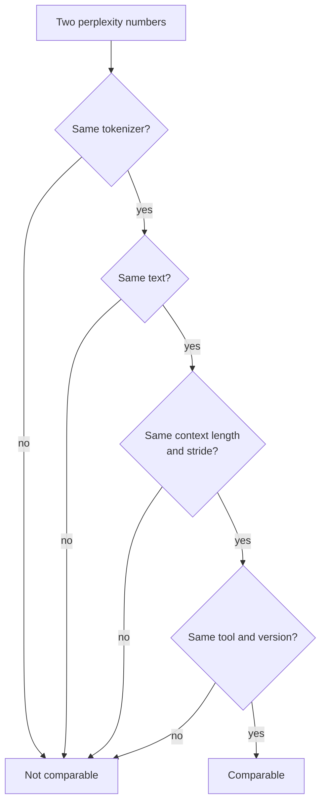

# Урок 21. Перплексия и её пределы

**Связь с целью курса:** Перплексия это число, которое первым приводит каждая таблица по квантизации, поэтому нужно знать, что именно она может и не может вам сказать, прежде чем доверять заявлению «без потери качества».
**Первоисточник:** [Научная статья: "Accuracy is Not All You Need", Dutta et al., 2024](https://arxiv.org/abs/2407.09141)
**Предварительные требования:** [Урок 20](0020-hardware-and-kernel-support.md), [Перплексия](../GLOSSARY.md), [Калибровочный набор](../GLOSSARY.md)

## Разминка

1. ▢ 4-битная схема хранит один 16-битный масштаб на каждую группу из 32 весов. Каково её эффективное число бит на вес?

<details markdown="1"><summary>Проверка</summary>

4,5. Масштаб добавляет 16 / 32 = 0,5 бита на вес к 4 битам каждого значения (уроки 1 и 6).

</details>

2. ▢ Что посттренировочный метод читает из калибровочного набора и чего он с ним не делает?

<details markdown="1"><summary>Проверка</summary>

Он читает статистику активаций из небольшой выборки входов, чтобы выбрать диапазоны или взвесить ошибки округления. Он никогда не обучается на нём и не пропускает через него обратное распространение (урок 12).

</details>

3. ▢ Int4 только для весов ускоряет декодирование при батче 1. Какое свойство этой нагрузки это объясняет?

<details markdown="1"><summary>Проверка</summary>

Декодирование при батче 1 ограничено памятью: каждый вес читается один раз на токен, поэтому меньше байт весов означает меньше времени на чтение (уроки 1 и 19).

</details>

## Что нужно знать

### Что такое перплексия

**Перплексия** это экспонента среднего отрицательного логарифма правдоподобия текста. [Документация Hugging Face Transformers](https://huggingface.co/docs/transformers/main/en/perplexity) определяет её для токенизированной последовательности `X = (x_0, ..., x_t)` и отмечает, что она равна экспоненте кросс-энтропии между данными и предсказаниями модели:

```text
perplexity(X) = exp( -(1/t) * sum_i log p(x_i | x_<i) )
```

Читайте её как то, среди скольких равновероятных токенов модель выбирает на каждом шаге. Модель, которая дала бы каждому токену вероятность 0,25, получила бы ровно 4. Чем меньше, тем лучше.

### Что меняет число

Число зависит не только от модели. Та же документация перечисляет главные рычаги:

- **Токенизатор.** Документация говорит, что токенизация «оказывает прямое влияние» на перплексию и это нужно учитывать при сравнении моделей. README инструмента llama.cpp добавляет, что перплексия напрямую несравнима между моделями с разными токенизаторами ([README инструмента perplexity в llama.cpp](https://github.com/ggml-org/llama.cpp/blob/master/tools/perplexity/README.md)).
- **Окно и шаг.** У модели фиксированная длина контекста, поэтому длинный текст оценивается окнами. Оценка непересекающихся кусков даёт каждому токену меньше контекста и, как правило, даёт более высокое (худшее) значение. Скользящее окно с меньшим шагом даёт больше контекста и более низкое значение. Для GPT-2 large на WikiText-2 документация сообщает 19,44 при шаге 1024 (без перекрытия) и 16,44 при шаге 512, для той же модели и того же текста.
- **Текст.** README llama.cpp говорит, что участники по соглашению используют тестовый набор WikiText-2 и что его числа несравнимы с числами других проектов, потому что точные значения сильно зависят от деталей реализации.



Поэтому сравнение квантизации измеряет базовую и квантизованную модель в одной конфигурации запуска и не приводит ни одно из чисел в одиночку.

### Для чего хороша перплексия

llama.cpp использует её, «чтобы судить о потере качества, например, у квантизованных моделей по сравнению с FP16», на базовых моделях, и отмечает, что у дообученных моделей перплексия обычно выше, даже когда качество по оценке людей растёт. Таблица результатов в README для Llama 3 8B показывает форму компромисса: перплексия 6,233 у f16, 6,234 у q8_0, 6,253 у q6_K и 6,407 у q4_K_M без матрицы важности, затем 60,69 у iq1_S, наименьшего показанного типа, построенного с матрицей важности. Для ранжирования схем по размеру на одной модели и одном тексте это полезно и дёшево.

### Что скрывает перплексия

Перплексия это среднее, а средние сокращаются. Dutta и соавторы указывают, что более низкие вероятности на одних токенах «могут компенсироваться более высокими вероятностями других токенов», поэтому одной перплексии недостаточно, чтобы судить о сжатии. Они показывают тот же эффект на ответах. На шести схемах квантизации и семи задачах точность менялась на 0-2%, однако ответы менялись гораздо сильнее. Ответ, который переходит из верного в неверный или из неверного в верный, они называют **флипом** и сообщают о флипах до 13,6% для большинства схем. Исключением был GPTQ с 8-битными весами и 16-битными активациями, который сохранил точность с пренебрежимыми флипами.

Почему флипы гасятся в точности? Шум квантизации немного сдвигает оценки ответов на каждый вопрос. Там, где модель уверена, ничего не меняется. Там, где два лучших варианта были близки, решает шум. Dutta и соавторы наблюдают, что примерно столько же ответов переходит из неверных в верные, сколько из верных в неверные, и они измеряют разрыв между лучшим и вторым по качеству вариантом, верхнюю разницу, и находят её малой на вопросах, на которых модель ошибается, так что именно эти ответы и сдвигаются.

Отсюда два метрических расстояния, оба измеряются относительно базовой модели, а не относительно истины:

- **Флипы**: процент ответов, изменившихся между верным и неверным. Легко объяснить неспециалисту.
- **KL-дивергенция** между распределениями выхода базовой и квантизованной модели, усреднённая по набору данных. На MMLU статья сообщает коэффициент корреляции Спирмена 0,981 между KL-дивергенцией и флипами.

На свободной генерации картина хуже. На MT-Bench, оцениваемом с GPT-4 в роли судьи, большинство методов ухудшили более крупные модели, на 5% для Llama 2 70B и на 1,5% для Yi 34B, а на более трудном втором ходе до 10% и 5%. Это были чат-модели Llama 2 и Yi и методы квантизации 2024 года, поэтому читайте проценты как доказательство существования, а не прогноз для вашей модели.

Инструмент перплексии llama.cpp может вычислять расстояние того же рода. Запустите его один раз на модели FP16 с `--kl-divergence-base`, чтобы сохранить её логиты, затем на квантизованной модели с `--kl-divergence`, и он сообщит KL-дивергенцию, изменение вероятности верного токена и «same top p», процент позиций, где обе модели ставят на первое место один и тот же токен. В таблице README для Llama 3 8B при q4_K_M перплексия на 2,8% выше FP16 (отношение 1,028160), а same top p равно 91,901%, то есть лучший токен меняется примерно в одной позиции из двенадцати. При q8_0 отношение равно 1,000425, а same top p равно 97,674%.

## Практика

1. ▢ Модель присваивает вероятность 0,25 каждому токену текста. Чему равна её перплексия?

<details markdown="1"><summary>Проверка</summary>

4. Средний отрицательный логарифм правдоподобия равен `-log(0.25)`, а его экспонента даёт `1 / 0.25 = 4`. Перплексия это эффективное число равновероятных вариантов на токен.

</details>

2. ▢ Какую пару чисел перплексии можно сравнивать напрямую?

    - a) Оценку llama.cpp с оценкой Transformers на тексте Wikitext-2
    - b) Запуски базовой и квантизованной моделей с общими токенизатором, текстом, окном и шагом
    - c) Две модели с разными токенизаторами на одном и том же отложенном тексте
    - d) Один и тот же чекпоинт, оценённый с шагом 1024 против шага 512

<details markdown="1"><summary>Проверка</summary>

**b)** Это единственная пара, где изменилась только модель. (a) смешивает две реализации, а llama.cpp говорит, что его числа несравнимы с числами других проектов. (c) неверно, потому что разные токенизаторы меняют само число. (d) неверно, потому что один только шаг сдвинул GPT-2 large с 19,44 до 16,44 в документации Transformers.

</details>

3. ▢ Предскажите, затем запустите. У четырёх токенов вероятность 0,5 у базовой модели. После квантизации их вероятности становятся 0,625, 0,4, 0,625 и 0,4. Будет ли перплексия квантизованной модели выше, ниже или такой же? Затем запустите.

    ```python
    import numpy as np

    base = np.array([0.5, 0.5, 0.5, 0.5])
    quant = np.array([0.625, 0.4, 0.625, 0.4])


    def perplexity(p):
        return np.exp(-np.mean(np.log(p)))


    print("baseline perplexity:", round(perplexity(base), 4))
    print("quantized perplexity:", round(perplexity(quant), 4))
    print("tokens whose probability changed:", int(np.sum(base != quant)), "of", len(base))
    ```

<details markdown="1"><summary>Подсказка</summary>

Перплексия это обратная величина к среднему геометрическому вероятностей токенов. Перемножьте четыре новые вероятности и извлеките корень четвёртой степени.

</details>

<details markdown="1"><summary>Проверка</summary>

Он печатает 2.0 в обоих случаях и «4 of 4» токена изменились. Среднее геометрическое 0,625, 0,4, 0,625 и 0,4 равно `sqrt(0.625 * 0.4) = 0.5`, так что вероятность каждого токена сдвинулась, а перплексия нет. Dutta и соавторы описывают это гашение: выигрыши на одних токенах скрывают потери на других.

</details>

4. ▢ Предскажите, затем запустите. В имитированном тесте с четырьмя вариантами 5000 вопросов. В 60% из них базовая модель уверена в правильном ответе. В остальных она угадывает. «Квантизованная модель» это оценки базовой плюс небольшой шум. Предскажите разрыв точности в пунктах и долю вопросов, которые флипаются, затем запустите. Это симуляция, а не измерение какой-либо настоящей модели.

    ```python
    import numpy as np

    rng = np.random.default_rng(0)
    n_questions, n_options = 5000, 4

    logits = rng.normal(size=(n_questions, n_options))
    easy = rng.random(n_questions) < 0.6
    logits[easy, 0] += 6.0  # easy questions: the model is sure
    noisy = logits + rng.normal(scale=0.5, size=logits.shape)

    base_correct = logits.argmax(axis=1) == 0
    quant_correct = noisy.argmax(axis=1) == 0

    print(f"baseline accuracy:  {base_correct.mean():.3f}")
    print(f"quantized accuracy: {quant_correct.mean():.3f}")
    print(f"flips (correct <-> incorrect): {(base_correct != quant_correct).mean():.3f}")
    print(f"correct -> incorrect: {(base_correct & ~quant_correct).mean():.3f}")
    print(f"incorrect -> correct: {(~base_correct & quant_correct).mean():.3f}")
    ```

<details markdown="1"><summary>Подсказка</summary>

Какие вопросы шум действительно может изменить: те, в которых модель уверена, или те, которые она угадывает?

</details>

<details markdown="1"><summary>Проверка</summary>

Точность базовой модели 0,709, а квантизованной 0,705, разрыв 0,4 пункта, однако флипается 0,059 вопросов: 0,031 из верного в неверный и 0,028 в другую сторону. Около 295 из 5000 ответов изменились, а точность почти не сдвинулась, потому что два направления флипов почти сокращаются. Флипаться могут только угаданные вопросы, а шум с равной вероятностью толкает догадку к верному варианту и от него. Статья сообщает ту же картину на настоящих моделях: точность в пределах 2%, флипы выше 5%.

</details>

5. ▢ Ревью говорит: «При q4_K_M перплексия выросла всего на 2,8% по сравнению с FP16, так что модель ведёт себя так же». Что вы ответите, опираясь на числа llama.cpp выше?

<details markdown="1"><summary>Проверка</summary>

Same top p равно 91,901%, поэтому две модели расходятся в том, какой токен следующий наиболее вероятен, примерно в 8% позиций. Перплексия это среднее по всем токенам, и она скрывает, как часто выбор меняется. Это по токенам, а не по ответам, поэтому оно не даёт доли флипов ни на какой задаче, но показывает, что «на 2,8% хуже» не означает «ведёт себя так же». Измеряйте задачу, как это делает следующий урок.

</details>

6. ▢ Коллега сообщает перплексию базовой модели 6,2 при шаге 1024 и перплексию квантизованной 7,1 при шаге 512 и называет разрыв 0,9. Что не так и в какую сторону уходит ошибка?

<details markdown="1"><summary>Проверка</summary>

Два запуска используют разные шаги, поэтому числа несравнимы. Меньший шаг даёт больше контекста и, как правило, более низкую перплексию (с 19,44 до 16,44 у GPT-2 large), поэтому базовая модель при шаге 512, вероятно, показала бы ниже 6,2. Настоящий разрыв, скорее всего, больше 0,9. Повторите оба запуска с одним шагом.

</details>

## Практика в реальной работе

- [ ] Запустите код перплексии из документации Transformers на самой малой модели GPT-2 с `stride`, равным длине окна, и снова с `stride = 512` и убедитесь, что число падает. Ваши значения будут отличаться от цифр документации для GPT-2 large.
- [ ] Если у вас есть llama.cpp, запишите логиты FP16 с `--kl-divergence-base` на небольшой модели GGUF, затем запустите копию Q4_K_M с `--kl-divergence` и прочитайте «same top p» и отношение перплексии.
- [ ] Завтра, без заметок, перечислите четыре вещи, которые должны совпадать, чтобы два числа перплексии можно было сравнить, и две метрики расстояния рядом с перплексией.

## Что почитать дальше

- [Измерение и хранение](../reference/measuring-and-storing.md)
- [Научная статья: "Accuracy is Not All You Need", Dutta et al., 2024](https://arxiv.org/abs/2407.09141)
- [Документация: "Perplexity of fixed-length models", Hugging Face Transformers](https://huggingface.co/docs/transformers/main/en/perplexity)
- [Документация: README инструмента perplexity в llama.cpp](https://github.com/ggml-org/llama.cpp/blob/master/tools/perplexity/README.md)
- [Ресурсы](../RESOURCES.md)

---

Не доходит? Перечитайте первоисточник в начале: этот урок его сжимает, а при сжатии понимание как раз и теряется. Загляните в [глоссарий](../GLOSSARY.md), если какой-то термин показался скользким.

Если неясен сам урок, а не материал, это дефект: [откройте issue](https://github.com/TokenCemetery/teach/issues).
