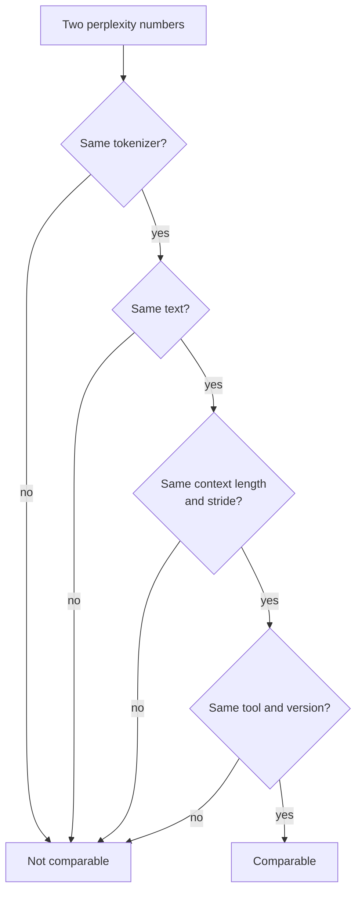

# 第 21 课：困惑度及其局限

**使命关联:** 困惑度是每一张量化表格首先引用的数字，所以在你相信一项“无质量损失”的声明之前，需要确切地知道它能告诉你什么、不能告诉你什么。
**主要来源:** [论文：“Accuracy is Not All You Need”，Dutta 等，2024](https://arxiv.org/abs/2407.09141)
**前置知识:** [第 20 课](0020-hardware-and-kernel-support.md)、[困惑度](../GLOSSARY.md)、[校准集](../GLOSSARY.md)

## 热身

1. ▢ 一个 4 位方案为每组 32 个权重存一个 16 位缩放因子。它的每个权重的有效位数是多少？

<details markdown="1"><summary>检查</summary>

是 4.5。缩放因子在每个值的 4 位之上，使每个权重多出 16 / 32 = 0.5 位（第 1 和第 6 课）。

</details>

2. ▢ 训练后方法从校准集里读取什么？它不拿校准集做什么？

<details markdown="1"><summary>检查</summary>

它从一小批输入样本中读取激活值的统计量，用来选择范围或给舍入误差加权。它从不在上面训练，也不对它做反向传播（第 12 课）。

</details>

3. ▢ 仅权重的 int4 让批大小为 1 的解码更快。这个工作负载的哪一条性质解释了这一点？

<details markdown="1"><summary>检查</summary>

批大小为 1 的解码受内存带宽限制：每生成一个 token，每个权重都要读取一次，所以权重的字节越少，读取的时间就越少（第 1 和第 19 课）。

</details>

## 要点

### 困惑度是什么

**困惑度**是一段文本的平均负对数似然的指数。[Hugging Face Transformers 文档](https://huggingface.co/docs/transformers/main/en/perplexity)对一个分词后的序列 `X = (x_0, ..., x_t)` 做了定义，并指出它等于数据与模型预测之间交叉熵的指数：

```text
perplexity(X) = exp( -(1/t) * sum_i log p(x_i | x_<i) )
```

可以把它读作模型在每一步是在多少个等可能的 token 之间做选择。一个给每个 token 都赋予 0.25 概率的模型，得分恰好是 4。越低越好。

### 什么会改变这个数字

这个数字取决于的不只是模型。同一份文档列出了主要的旋钮：

- **分词器**。文档说分词对困惑度“有直接的影响”，比较模型时必须考虑。llama.cpp 的工具 README 补充说，不同分词器的模型之间，困惑度不能直接比较（[llama.cpp 困惑度 README](https://github.com/ggml-org/llama.cpp/blob/master/tools/perplexity/README.md)）。
- **窗口和步幅**。模型有固定的上下文长度，所以长文本要分窗口来打分。对互不重叠的块打分，使每个 token 得到的上下文更少，“通常会得到更高（更差）的”值。步幅更小的滑动窗口给出更多上下文，值更低。对 WikiText-2 上的 GPT-2 large，文档报告步幅为 1024（无重叠）时是 19.44，步幅为 512 时是 16.44，模型和文本都相同。
- **文本**。llama.cpp 的 README 说，贡献者按惯例使用 WikiText-2 测试集，它的数字与其他项目的不可比，因为确切的值强烈依赖于实现细节。



所以一次量化的比较，要在同一种运行配置下度量基线和量化模型，并且不单独引用其中任何一个数字。

### 困惑度适合做什么

llama.cpp 用它来“评判例如量化模型相对于 FP16 的质量损失”，用在基础模型上，并指出微调模型的困惑度通常更高，即使人工评定的质量上升了。README 中 Llama 3 8B 的得分榜显示了这种权衡的形态：f16 的困惑度是 6.233，q8_0 是 6.234，q6_K 是 6.253，没有重要性矩阵的 q4_K_M 是 6.407，然后是 iq1_S（所示的最小类型，用重要性矩阵构建）的 60.69。对于在一个模型和一段文本上按大小给各方案排序，这是有用而且便宜的。

### 困惑度掩盖了什么

困惑度是一个平均值，而平均值会相互抵消。Dutta 等人指出，某些 token 上较低的概率“可能被其他 token 更高的概率抵消”，所以光靠困惑度，不足以评判压缩。他们在答案上展示了同样的效应。在六种量化方案和七项任务上，准确率只变化了 0 到 2%，答案的改变却要多得多。他们把一个答案从正确变成错误、或从错误变成正确，称为**翻转**，并报告大多数方案的翻转最高达 13.6%。例外是 8 位权重加 16 位激活值的 GPTQ，它保住了准确率，翻转可以忽略。

为什么翻转在准确率里会抵消？量化噪声让每个问题的答案得分稍有移动。在模型很有把握的地方，什么都不变。在它的前两个选项很接近的地方，由噪声来决定。Dutta 等人观察到，从错误变成正确的答案，与从正确变成错误的答案，数量大致相当，并且他们度量了最佳选项与次佳选项之间的差距，即头部间隔，发现它在模型答错的问题上很低，所以那些就是会移动的答案。

由此得到两个距离度量，都是对照基线，而不是对照真相来度量的：

- **翻转**：答案在正确与错误之间发生改变的百分比。很容易向非专业人士解释。
- 基线与量化模型输出分布之间的 **KL 散度**，在数据集上取平均。在 MMLU 上，论文报告 KL 散度与翻转之间的 Spearman 相关系数为 0.981。

在自由形式的生成上，情况更糟。在以 GPT-4 作裁判打分的 MT-Bench 上，大多数方法让较大的模型变差了，Llama 2 70B 差 5%，Yi 34B 差 1.5%，在更难的第二轮上最高差 10% 和 5%。这些是 Llama 2 和 Yi 的对话模型，用的是 2024 年的量化方法，所以请把这些百分比读作一个存在性证明，而不是对你的模型的预测。

llama.cpp 的困惑度工具可以计算同一类距离。先在 FP16 模型上用 `--kl-divergence-base` 运行一次，保存它的 logit，再在量化模型上用 `--kl-divergence` 运行，它就会报告 KL 散度、正确 token 概率的变化，以及“same top p”，即两个模型把同一个 token 排在第一位的位置所占的百分比。在 README 中 Llama 3 8B 的 q4_K_M 那张表里，困惑度比 FP16 高 2.8%（比值 1.028160），same top p 是 91.901%，所以头部 token 大约每十二个位置就变一次。在 q8_0 时比值是 1.000425，same top p 是 97.674%。

## 练习

1. ▢ 一个模型给一段文本的每个 token 都赋予 0.25 的概率。它的困惑度是多少？

<details markdown="1"><summary>检查</summary>

是 4。平均负对数似然是 `-log(0.25)`，取指数得 `1 / 0.25 = 4`。困惑度就是每个 token 上等可能选择的有效数目。

</details>

2. ▢ 哪一对困惑度数字可以直接比较？

    - a) 在 Wikitext-2 文本上，llama.cpp 的得分与 Transformers 的得分
    - b) 共用分词器、文本、窗口和步幅的基线与量化运行
    - c) 在同一段留出文本上打分的、分词器不同的两个模型
    - d) 同一个检查点，分别用步幅 1024 和步幅 512 评测

<details markdown="1"><summary>检查</summary>

**b)** 这是唯一一对除了模型之外什么都没变的。(a) 混用了两种实现，而 llama.cpp 说它的数字与其他项目的不可比。(c) 是错的，因为不同的分词器会改变数字本身。(d) 是错的，因为在 Transformers 文档里，光是步幅就让 GPT-2 large 从 19.44 变成了 16.44。

</details>

3. ▢ 先预测，再运行。四个 token 在基线下的概率都是 0.5。量化之后，它们的概率变成 0.625、0.4、0.625 和 0.4。量化模型的困惑度会更高、更低还是相同？然后运行它。

    ```python
    import numpy as np

    base = np.array([0.5, 0.5, 0.5, 0.5])
    quant = np.array([0.625, 0.4, 0.625, 0.4])


    def perplexity(p):
        return np.exp(-np.mean(np.log(p)))


    print("baseline perplexity:", round(perplexity(base), 4))
    print("quantized perplexity:", round(perplexity(quant), 4))
    print("tokens whose probability changed:", int(np.sum(base != quant)), "of", len(base))
    ```

<details markdown="1"><summary>提示</summary>

困惑度是各 token 概率的几何平均的倒数。把四个新概率相乘，再开四次方根。

</details>

<details markdown="1"><summary>检查</summary>

两个都打印出 2.0，并且“4 of 4”个 token 发生了变化。0.625、0.4、0.625 和 0.4 的几何平均是 `sqrt(0.625 * 0.4) = 0.5`，所以每个 token 的概率都动了，而困惑度没动。Dutta 等人描述的就是这种抵消：某些 token 上的收益，掩盖了另一些 token 上的损失。

</details>

4. ▢ 先预测，再运行。一个模拟的四选项测试有 5000 道题。其中 60% 的题，基线对正确答案很有把握。其余的它是在猜。“量化模型”就是基线的得分加上小的噪声。预测准确率差距有多少个点，以及翻转的题目占多大比例，然后运行它。这是一个模拟，不是对任何真实模型的度量。

    ```python
    import numpy as np

    rng = np.random.default_rng(0)
    n_questions, n_options = 5000, 4

    logits = rng.normal(size=(n_questions, n_options))
    easy = rng.random(n_questions) < 0.6
    logits[easy, 0] += 6.0  # easy questions: the model is sure
    noisy = logits + rng.normal(scale=0.5, size=logits.shape)

    base_correct = logits.argmax(axis=1) == 0
    quant_correct = noisy.argmax(axis=1) == 0

    print(f"baseline accuracy:  {base_correct.mean():.3f}")
    print(f"quantized accuracy: {quant_correct.mean():.3f}")
    print(f"flips (correct <-> incorrect): {(base_correct != quant_correct).mean():.3f}")
    print(f"correct -> incorrect: {(base_correct & ~quant_correct).mean():.3f}")
    print(f"incorrect -> correct: {(~base_correct & quant_correct).mean():.3f}")
    ```

<details markdown="1"><summary>提示</summary>

噪声实际上能改变哪些题：模型有把握的，还是它在猜的？

</details>

<details markdown="1"><summary>检查</summary>

基线准确率 0.709，量化后准确率 0.705，差距 0.4 个点，但有 0.059 的题目发生了翻转：0.031 从正确变成错误，0.028 是反方向。5000 个答案中约 295 个变了，而准确率几乎没动，因为两个翻转方向几乎抵消了。只有猜的那些题能翻转，而噪声把一个猜测推向正确选项，与推离它的可能性一样大。论文在真实模型上报告了同样的规律：准确率在 2% 之内，翻转在 5% 以上。

</details>

5. ▢ 一份评审意见说：“在 q4_K_M 上，困惑度只比 FP16 高了 2.8%，所以模型的表现是一样的。”根据上面 llama.cpp 的数字，你怎么回复？

<details markdown="1"><summary>检查</summary>

same top p 是 91.901%，所以这两个模型在大约 8% 的位置上，对最可能的下一个 token 有分歧。困惑度是对所有 token 的平均，掩盖了选择多频繁地变化。这是逐 token 的，不是逐答案的，所以它没有给出任何任务上的翻转率，但它表明“差 2.8%”并不意味着“表现一样”。要去度量任务，下一课就是这样做的。

</details>

6. ▢ 一位队友报告基线困惑度在步幅 1024 时为 6.2，量化后的困惑度在步幅 512 时为 7.1，并把差距称为 0.9。错在哪里？误差朝哪个方向偏？

<details markdown="1"><summary>检查</summary>

两次运行用了不同的步幅，所以这两个数字不可比。更小的步幅给出更多上下文，通常困惑度更低（GPT-2 large 从 19.44 到 16.44），所以步幅 512 下的基线很可能得分低于 6.2。真实的差距很可能比 0.9 更大。把两者用同一个步幅重新运行。

</details>

## 实战练习

- [ ] 在最小的 GPT-2 模型上运行 Transformers 文档里的困惑度代码，先让 `stride` 等于窗口长度，再让 `stride = 512`，确认数字下降了。你的值会与文档里 GPT-2 large 的数字不同。
- [ ] 如果你有 llama.cpp，在一个小的 GGUF 模型上用 `--kl-divergence-base` 记录 FP16 的 logit，再用 `--kl-divergence` 运行一个 Q4_K_M 副本，读取“same top p”和困惑度比值。
- [ ] 明天：不看笔记，列出两个困惑度数字要能比较必须一致的四件事，以及与困惑度并列的两个距离度量。

## 延伸阅读

- [度量与存储](../reference/measuring-and-storing.md)
- [论文：“Accuracy is Not All You Need”，Dutta 等，2024](https://arxiv.org/abs/2407.09141)
- [文档：“Perplexity of fixed-length models”，Hugging Face Transformers](https://huggingface.co/docs/transformers/main/en/perplexity)
- [文档：llama.cpp 困惑度工具 README](https://github.com/ggml-org/llama.cpp/blob/master/tools/perplexity/README.md)
- [资源](../RESOURCES.md)

---

没学明白？请重读顶部的主要来源，因为本课是对它的压缩，而理解正是在压缩中流失的。如果有哪个术语觉得含糊，可以查看[术语表](../GLOSSARY.md)。

如果问题出在课程本身，而不是学习材料，那就是一个缺陷：[提交 issue](https://github.com/TokenCemetery/teach/issues)。
