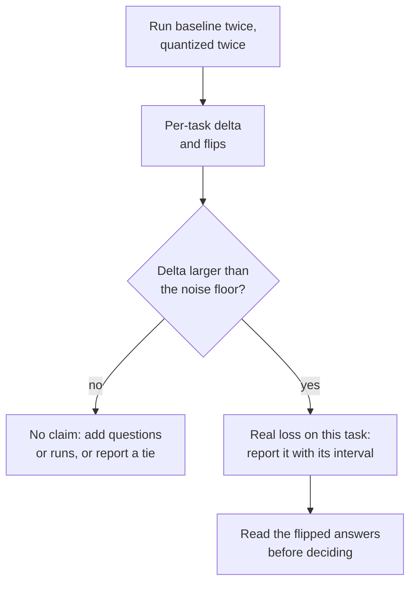

# Lección 22. Una eval honesta de cuantización

**Vínculo con la misión:** "Medir lo que costó" es la mitad de la misión que hace defendible a la otra mitad, y una comparación cuidadosa es lo que separa una medición de una cifra de marketing.
**Fuente principal:** [Paper: "Give Me BF16 or Give Me Death? Accuracy-Performance Trade-Offs in LLM Quantization", Kurtic et al., 2024](https://arxiv.org/abs/2411.02355)
**Requisitos previos:** [Lección 21](0021-perplexity-and-its-limits.md), [Perplexity](../GLOSSARY.md), [Calibration set](../GLOSSARY.md)

## Calentamiento

1. ▢ Nombra las cuatro cosas que deben coincidir antes de poder comparar dos números de perplexity.

<details markdown="1"><summary>Comprobación</summary>

El tokenizer, el texto, la longitud de contexto y el stride, y la herramienta que lo calculó (lección 21). Cambia una cualquiera y el número se mueve sin que cambie el modelo.

</details>

2. ▢ ¿Qué es un flip, y por qué puede un modelo hacer flip en muchas respuestas mientras su accuracy se queda quieto?

<details markdown="1"><summary>Comprobación</summary>

Un flip es una respuesta que cambia entre correcta e incorrecta respecto del baseline. Los flips de correcta a incorrecta y de incorrecta a correcta se cancelan aproximadamente en el promedio de accuracy, así que el promedio los oculta (lección 21).

</details>

3. ▢ Un modelo cuantizado se calibró con texto web y se evalúa con código fuente. ¿Qué deberías esperar, y por qué?

<details markdown="1"><summary>Comprobación</summary>

Posiblemente más pérdida de la que sugiere la cifra principal. El método ajustó sus rangos o sus pesos de error a las estadísticas del texto de calibración, y las activaciones del código pueden diferir de ellas (lección 12). El remedio es calibrar con texto parecido al texto del despliegue y evaluar con tareas que se parezcan al despliegue.

</details>

## Qué debes saber

El track de evals enseña cómo construir una eval: elegir métricas, dimensionar un conjunto de prueba y defender una decisión de go/no-go. Esta lección usa una. Para la maquinaria consulta las hojas [Métricas](../../evals/reference/metrics.md) y [Go/No-Go](../../evals/reference/go-no-go.md), y aquí tómalas como dadas.

### Mantén fijo todo salvo los pesos

El baseline es el mismo checkpoint en su formato original de 16 bits, no un modelo distinto. Todo lo demás de la ejecución debe ser idéntico, o la diferencia mide tu configuración y no la cuantización:

| Mantener fijo | Porque |
|---|---|
| Harness y versión | El código de puntuación difiere entre herramientas |
| Prompts, ejemplos few-shot y chat template | Ambos cambian la respuesta antes de que importen los pesos |
| Ajustes de generación (regla de decodificación, longitud máxima) | Una ejecución muestreada y una voraz son experimentos distintos |
| Lista de tareas y número de muestras | Un subconjunto distinto es una prueba distinta |
| Backend de inferencia, donde puedas | Un segundo backend es una segunda variable |

Kurtic et al. muestran el patrón. Siguen las directrices de prompts de Meta para que el baseline coincida con sus puntuaciones publicadas, evalúan con muestreo voraz cuando comparan texto generado, y pasan el baseline y cada variante cuantizada por la misma suite. El [lm-evaluation-harness](https://github.com/EleutherAI/lm-evaluation-harness) es una herramienta muy usada para esto. Su README muestra modelos cargados mediante `transformers` (incluido GPTQ), mediante vLLM, y como archivos GGUF mediante el backend `hf` o un servidor de llama.cpp. Para la ruta del servidor documenta su propia ruta de puntuación, lo que recuerda que un backend distinto no es un intercambio neutral.

### Cubre varias clases de tarea

Una suite de opción múltiple no es el modelo. La suite del paper abarca varias clases, y el resultado de MT-Bench de la lección 21 es la razón de que importe:

| Clase | Ejemplo en el paper | Notas |
|---|---|---|
| Académicas, sobre todo de opción múltiple y matemáticas | Open LLM Leaderboard V1 y V2 | Baratas, y donde los flips se esconden en el promedio |
| Calidad de chat, juzgada por otro modelo | Arena-Hard-Auto-v0.1 | El paper promedia dos ejecuciones por modelo |
| Código, ejecutado contra pruebas | HumanEval y HumanEval+ (pass@1) | La respuesta se ejecuta o no |
| Contexto largo | RULER | La única clase aquí que pone a prueba entradas largas |
| Similitud de la salida con el baseline | ROUGE, BERTScore, similitud semántica | Necesita decodificación voraz para ser reproducible |

Si cuantizaste la KV cache (lección 16), el contexto largo es donde se nota su costo, porque la caché crece con la longitud del contexto (lección 1).

### Informa de deltas por tarea y flips, no de un promedio

Un número de recuperación promedio parece un veredicto y no lo es. Aquí están los números de la Tabla 2 de Kurtic et al. para Llama-3.1-8B-Instruct, BF16 frente a pesos de 4 bits con activaciones de 16 bits (W4A16-INT):

| Tarea | BF16 | W4A16-INT | Delta |
|---|---|---|---|
| MMLU, 5-shot | 68.3 | 66.9 | -1.4 |
| MMLU CoT, 0-shot | 72.8 | 71.1 | -1.7 |
| ARC-Challenge, 0-shot | 81.4 | 80.2 | -1.2 |
| GSM8k CoT, 8-shot | 82.8 | 82.9 | +0.1 |
| HellaSwag, 10-shot | 80.5 | 79.9 | -0.6 |
| Winogrande, 5-shot | 78.1 | 78.0 | -0.1 |
| TruthfulQA, 0-shot | 54.5 | 52.8 | -1.7 |
| Promedio | 74.06 | 73.11 | -0.95 |

La recuperación promedio del paper para esta fila es 98.72 por ciento, y su menor recuperación por tarea, 96.88 por ciento, es TruthfulQA. Un informe que da solo el promedio oculta qué tarea pagó. Registra además las salidas por pregunta de cada modelo (el harness tiene `--log_samples`) para poder contar flips, como los definió la lección 21, además de la puntuación.

### El piso de ruido

Cualquier puntuación tiene un margen de error antes de que la cuantización la toque. Kurtic et al. dan un caso concreto. Sus dos ejecuciones de Arena-Hard-Auto para el modelo BF16 de 8B obtuvieron 25.1 y 26.5, y para el modelo BF16 de 70B 55.8 y 58.2, con intervalos de confianza del 95 por ciento de unos más o menos 2 a 3 puntos en torno a cada puntuación. Su modelo W8A8-INT de 8B promedió 27.2 frente a los 25.8 del baseline, y una diferencia de 1.4 puntos queda dentro del intervalo y dentro de la propia dispersión entre ejecuciones del baseline. El paper advierte además de que los modelos más pequeños muestran mayor varianza en tareas difíciles como GPQA y MuSR, donde incluso los modelos de precisión completa están cerca del baseline aleatorio.

Para una tarea puntuada como acierto o fallo sobre `N` preguntas con una tasa de aciertos `p`, el error estándar es aproximadamente `sqrt(p * (1 - p) / N)`, tal como lo expone la hoja [Go/No-Go](../../evals/reference/go-no-go.md). Cuando el modelo baseline y el cuantizado responden a las mismas preguntas, una comparación pareada mira solo las preguntas en las que discrepan, que es otra vez el recuento de flips, y da un intervalo más estrecho.



### Qué encontró una evaluación cuidadosa

Kurtic et al. ejecutaron más de 500,000 evaluaciones sobre la familia Llama 3.1. Su resumen informa de tres hallazgos: los pesos y las activaciones en FP8 (W8A8-FP) son "efectivamente sin pérdida" en todos los tamaños de modelo, los pesos y activaciones en INT8 bien ajustados (W8A8-INT) pierden de 1 a 3 por ciento de accuracy, y INT4 solo de pesos (W4A16-INT) es más competitivo de lo esperado, rivalizando con 8 bits. Lee esto dentro de sus condiciones. Es una familia de modelos, y las recetas importan: GPTQ con un rango de recorte por error cuadrático medio, SmoothQuant añadido en 70B para INT8, y datos de calibración elegidos por esquema. El paper señala que la calibración con tokens aleatorios degrada los modelos de 4 bits, y que los modelos más pequeños en INT4 muestran caídas algo mayores. Una afirmación que ignora su receta es la que revisas en las lecciones 26 y 27.

### Ejecutar ambos modelos

Una comparación necesita un comando por modelo con los mismos flags, aparte del propio modelo. Ambos escriben logs por muestra. Este par usa un modelo de chat pequeño y una copia GPTQ de 4 bits del mismo checkpoint. Los comandos siguen los ejemplos del README del harness y no se ejecutaron en una GPU para esta lección.

```bash
lm_eval --model hf --model_args pretrained=TinyLlama/TinyLlama-1.1B-Chat-v1.0 --tasks hellaswag --batch_size 8 --log_samples --output_path results/baseline
lm_eval --model hf --model_args pretrained=TheBloke/TinyLlama-1.1B-Chat-v1.0-GPTQ --tasks hellaswag --batch_size 8 --log_samples --output_path results/gptq
```

## Práctica

1. ▢ ¿Qué diferencia entre las dos ejecuciones vuelve injusta una comparación de cuantización?

    - a) Ambas ejecuciones reutilizan los mismos ejemplos few-shot y la misma plantilla
    - b) El baseline muestrea con temperatura 0.7 mientras que el cuantizado usa decodificación voraz
    - c) Ambas ejecuciones escriben después la salida de cada muestra en disco
    - d) Ambas ejecuciones puntúan una misma lista fija de tareas

<details markdown="1"><summary>Comprobación</summary>

**b)** Las dos ejecuciones difieren ahora en la decodificación, así que la diferencia mezcla cuantización con ruido de muestreo. (a) es lo que requiere una comparación justa. (c) solo registra salidas y no cambia nada de la ejecución. (d) también es obligatorio, ya que una lista de tareas distinta cambia la puntuación por sí sola.

</details>

2. ▢ Para Llama-3.1-8B-Instruct, un modelo de solo pesos de 4 bits obtiene 66.9 en MMLU, 82.9 en GSM8k y 52.8 en TruthfulQA, frente a los 68.3, 82.8 y 54.5 del baseline BF16. Informa del resultado de manera honesta, en una frase.

<details markdown="1"><summary>Comprobación</summary>

Por tarea: MMLU -1.4, GSM8k +0.1, TruthfulQA -1.7, un promedio de -1.0 sobre las tres. El informe honesto da los tres deltas y nombra TruthfulQA y MMLU como las tareas que más perdieron, en lugar de citar "cerca de 1 punto de promedio". El +0.1 en GSM8k no es una ganancia: está muy dentro de cualquier piso de ruido.

</details>

3. ▢ En las ejecuciones de Arena-Hard-Auto de Kurtic et al., el modelo BF16 de 8B obtuvo 25.1 y 26.5, y el modelo W8A8-INT de 8B obtuvo 27.6 y 26.7. Los promedios son 25.8 y 27.2. ¿Mejoró INT8 el modelo?

<details markdown="1"><summary>Comprobación</summary>

No hay evidencia de ello. Las dos ejecuciones BF16 difieren entre sí en 1.4 puntos, el mismo tamaño que la diferencia de 1.4 puntos entre los promedios, y el intervalo del 95 por ciento del paper para el modelo INT8 es de unos más o menos 2. Una diferencia dentro de la dispersión entre ejecuciones es un empate. Trata del mismo modo una "recuperación" superior al 100 por ciento: es ruido, no mejora.

</details>

4. ▢ Predice y luego ejecuta. Reutiliza la prueba simulada de la lección 21, donde el accuracy cayó 0.4 puntos y cerca del 5.9 por ciento de las respuestas hicieron flip. Predice si el error estándar pareado de la diferencia de accuracy es mayor o menor que el no pareado, y en aproximadamente qué factor. Luego ejecútalo.

    ```python
    import numpy as np

    rng = np.random.default_rng(0)
    n_questions, n_options = 5000, 4

    logits = rng.normal(size=(n_questions, n_options))
    easy = rng.random(n_questions) < 0.6
    logits[easy, 0] += 6.0
    noisy = logits + rng.normal(scale=0.5, size=logits.shape)

    base_correct = logits.argmax(axis=1) == 0
    quant_correct = noisy.argmax(axis=1) == 0

    n = n_questions
    p1, p2 = base_correct.mean(), quant_correct.mean()
    b = int(np.sum(base_correct & ~quant_correct))  # correct -> incorrect
    c = int(np.sum(~base_correct & quant_correct))  # incorrect -> correct

    gap = p2 - p1
    unpaired_se = np.sqrt(p1 * (1 - p1) / n + p2 * (1 - p2) / n)
    paired_se = np.sqrt(b + c - (b - c) ** 2 / n) / n

    print(f"accuracy gap: {gap:+.4f}")
    print(f"discordant questions: {b} lost, {c} gained")
    print(f"unpaired standard error: {unpaired_se:.4f}")
    print(f"paired standard error:   {paired_se:.4f}")
    ```

<details markdown="1"><summary>Pista</summary>

La fórmula no pareada trata los dos accuracies como independientes. Ambos modelos respondieron a las mismas 5000 preguntas, y la mayoría de esas respuestas no cambiaron.

</details>

<details markdown="1"><summary>Comprobación</summary>

La diferencia es -0.0034, con 155 preguntas perdidas y 138 ganadas. El error estándar no pareado es 0.0091 y el pareado es 0.0034, unas 2.7 veces menor. La versión pareada depende solo de las 293 preguntas en las que los modelos discrepan, así que la dificultad que ambos comparten se cancela. Aquí la diferencia es de cerca de un error estándar pareado, todavía indistinguible del ruido, pero la estimación pareada es la más ajustada y honesta. Son números simulados, no un modelo real.

</details>

5. ▢ Tu jefe pregunta: "¿Pierde algo la versión int4 de nuestro modelo?" Escribe el plan para responderlo, en seis líneas o menos.

<details markdown="1"><summary>Comprobación</summary>

Un buen plan nombra: el baseline (el mismo checkpoint en su formato de 16 bits); un harness, un conjunto de prompts y un ajuste de decodificación para ambos; varias clases de tarea, incluida una generativa y una de contexto largo si la longitud del contexto te importa; una repetición de cada modelo para medir el piso de ruido; deltas por tarea con intervalos, más flips a partir de las muestras registradas; y un umbral acordado antes de la ejecución. La regla de decisión en sí es el trabajo de go/no-go del track de evals.

</details>

6. ▢ Puntúas el baseline con el backend `hf` y el GGUF cuantizado mediante un servidor de llama.cpp con el backend `gguf`, y el modelo cuantizado queda 3 puntos por debajo. ¿Qué haces antes de culpar a la cuantización?

<details markdown="1"><summary>Pista</summary>

¿Qué cambio único separaría "el backend difiere" de "los pesos difieren"?

</details>

<details markdown="1"><summary>Comprobación</summary>

Puntúa el GGUF de 16 bits sin cuantizar por la misma ruta del servidor. La diferencia entre esa ejecución y el baseline `hf` es el costo del backend y de su ruta de puntuación, y la diferencia entre el GGUF de 16 bits y el GGUF cuantizado es el costo de la cuantización. El README documenta una ruta de puntuación específica para el servidor de llama.cpp, así que un efecto del backend es plausible y no hipotético.

</details>

## Prácticas en el mundo real

- [ ] Ejecuta los dos comandos `lm_eval` de arriba en un portátil o en un notebook con GPU gratuita si puedes, y luego calcula el delta de cada tarea y el error estándar con `sqrt(p * (1 - p) / N)`.
- [ ] Elige una afirmación publicada de "sin pérdida" para un modelo cuantizado y lista cuáles de los cinco elementos mantenidos fijos enuncia su model card y cuáles omite.
- [ ] Mañana: sin apuntes, escribe las cinco cosas que hay que mantener fijas, las tres cosas que informar por tarea y la cantidad que fija cuán grande debe ser una diferencia para contar.

## Para profundizar

- [Medir y almacenar](../reference/measuring-and-storing.md)
- [Paper: "Give Me BF16 or Give Me Death? Accuracy-Performance Trade-Offs in LLM Quantization", Kurtic et al., 2024](https://arxiv.org/abs/2411.02355)
- [Repo: lm-evaluation-harness, EleutherAI](https://github.com/EleutherAI/lm-evaluation-harness)
- Evals: [Go/No-Go](../../evals/reference/go-no-go.md), para la significancia, la comparación pareada y los umbrales
- Evals: [Métricas](../../evals/reference/metrics.md), para elegir una métrica por tarea
- [Recursos](../RESOURCES.md)

---

¿No termina de quedar claro? Vuelve a leer la fuente primaria de arriba, ya que esta lección la comprime y en la compresión es donde se escapa la comprensión. Consulta el [glosario](../GLOSSARY.md) por si algún término te resultó resbaladizo.

Si lo poco claro es la propia lección y no el material, eso es un defecto: [abre un issue](https://github.com/TokenCemetery/teach/issues).
