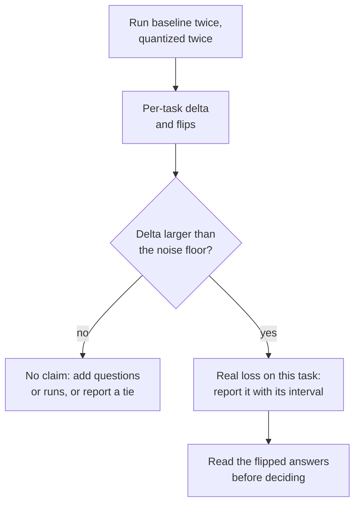

# Leçon 22. Une eval de quantification honnête

**Lien avec la mission :** « Mesurer ce que cela a coûté » est la moitié de la mission qui rend l'autre moitié défendable, et une comparaison soignée est ce qui sépare une mesure d'un chiffre marketing.
**Source primaire :** [Article : "Give Me BF16 or Give Me Death? Accuracy-Performance Trade-Offs in LLM Quantization", Kurtic et al., 2024](https://arxiv.org/abs/2411.02355)
**Prérequis :** [Leçon 21](0021-perplexity-and-its-limits.md), [Perplexity](../GLOSSARY.md), [Calibration set](../GLOSSARY.md)

## Échauffement

1. ▢ Nommez les quatre choses qui doivent concorder avant de pouvoir comparer deux chiffres de perplexity.

<details markdown="1"><summary>Vérifier</summary>

Le tokenizer, le texte, la longueur de contexte et le stride, et l'outil qui l'a calculée (leçon 21). Changez-en une seule et le chiffre bouge sans que le modèle change.

</details>

2. ▢ Qu'est-ce qu'un flip, et pourquoi un modèle peut-il flipper beaucoup de réponses alors que son accuracy reste stable ?

<details markdown="1"><summary>Vérifier</summary>

Un flip est une réponse qui change entre correcte et incorrecte par rapport à la référence. Les flips de correcte à incorrecte et d'incorrecte à correcte s'annulent à peu près dans la moyenne d'accuracy, donc la moyenne les cache (leçon 21).

</details>

3. ▢ Un modèle quantifié a été calibré sur du texte web et est évalué sur du code source. À quoi vous attendre, et pourquoi ?

<details markdown="1"><summary>Vérifier</summary>

Possiblement plus de perte que ne le suggère le chiffre d'en-tête. La méthode a réglé ses plages ou ses pondérations d'erreur sur les statistiques du texte de calibration, et les activations du code peuvent en différer (leçon 12). Le remède est de calibrer sur un texte semblable au texte de déploiement et d'évaluer sur des tâches qui ressemblent au déploiement.

</details>

## À savoir

Le parcours evals enseigne comment construire une eval : choisir des métriques, dimensionner un jeu de test et défendre une décision go/no-go. Cette leçon en utilise une. Pour la mécanique, voir la fiche [Métriques](../../evals/reference/metrics.md) et la fiche [Go/No-Go](../../evals/reference/go-no-go.md), et traitez-les ici comme acquises.

### Fixer tout sauf les poids

La référence est le même checkpoint dans son format d'origine en 16 bits, pas un autre modèle. Tout le reste de l'exécution doit être identique, sinon l'écart mesure votre configuration au lieu de la quantification :

| À fixer | Parce que |
|---|---|
| Harness et version | Le code de notation diffère d'un outil à l'autre |
| Prompts, exemples few-shot et chat template | Les deux changent la réponse avant même que les poids comptent |
| Réglages de génération (règle de décodage, longueur maximale) | Une exécution échantillonnée et une exécution gloutonne sont des expériences différentes |
| Liste de tâches et nombre d'échantillons | Un autre sous-ensemble est un autre test |
| Backend d'inférence, quand c'est possible | Un second backend est une seconde variable |

Kurtic et al. montrent le schéma. Ils suivent les directives de prompt de Meta pour que la référence corresponde à ses scores publiés, évaluent avec un échantillonnage glouton quand ils comparent du texte généré, et font passer la référence et chaque variante quantifiée par la même suite. Le [lm-evaluation-harness](https://github.com/EleutherAI/lm-evaluation-harness) est un outil très utilisé pour cela. Son README montre des modèles chargés via `transformers` (y compris GPTQ), via vLLM, et en fichiers GGUF via le backend `hf` ou un serveur llama.cpp. Pour la voie serveur, il documente son propre chemin de notation, ce qui rappelle qu'un backend différent n'est pas un échange neutre.

### Couvrir plusieurs sortes de tâches

Une seule suite à choix multiples n'est pas le modèle. La suite de l'article couvre plusieurs sortes, et le résultat MT-Bench de la leçon 21 explique pourquoi cela compte :

| Sorte | Exemple dans l'article | Remarques |
|---|---|---|
| Académique, surtout choix multiples et maths | Open LLM Leaderboard V1 et V2 | Bon marché, et c'est là que les flips se cachent dans la moyenne |
| Qualité de conversation, jugée par un autre modèle | Arena-Hard-Auto-v0.1 | L'article fait la moyenne de deux exécutions par modèle |
| Code, exécuté contre des tests | HumanEval et HumanEval+ (pass@1) | La réponse s'exécute ou non |
| Contexte long | RULER | La seule sorte ici qui sollicite de longues entrées |
| Similarité de sortie avec la référence | ROUGE, BERTScore, similarité sémantique | Exige un décodage glouton pour être reproductible |

Si vous avez quantifié le KV cache (leçon 16), le contexte long est là où son coût se voit, parce que le cache croît avec la longueur de contexte (leçon 1).

### Rapporter des deltas par tâche et des flips, pas une moyenne

Un chiffre de récupération moyenne ressemble à un verdict et n'en est pas un. Voici les chiffres du tableau 2 de Kurtic et al. pour Llama-3.1-8B-Instruct, BF16 contre des poids en 4 bits avec des activations en 16 bits (W4A16-INT) :

| Tâche | BF16 | W4A16-INT | Delta |
|---|---|---|---|
| MMLU, 5-shot | 68.3 | 66.9 | -1.4 |
| MMLU CoT, 0-shot | 72.8 | 71.1 | -1.7 |
| ARC-Challenge, 0-shot | 81.4 | 80.2 | -1.2 |
| GSM8k CoT, 8-shot | 82.8 | 82.9 | +0.1 |
| HellaSwag, 10-shot | 80.5 | 79.9 | -0.6 |
| Winogrande, 5-shot | 78.1 | 78.0 | -0.1 |
| TruthfulQA, 0-shot | 54.5 | 52.8 | -1.7 |
| Moyenne | 74.06 | 73.11 | -0.95 |

La récupération moyenne de l'article pour cette ligne est de 98.72 pour cent, et sa plus basse récupération par tâche, 96.88 pour cent, est TruthfulQA. Un rapport qui ne donne que la moyenne cache quelle tâche a payé. Enregistrez aussi les sorties par question de chaque modèle (le harness a `--log_samples`) pour pouvoir compter les flips, tels que les a définis la leçon 21, en plus du score.

### Le seuil de bruit

Tout score a une marge d'erreur avant même que la quantification y touche. Kurtic et al. donnent un cas concret. Leurs deux exécutions d'Arena-Hard-Auto pour le modèle 8B en BF16 ont obtenu 25.1 et 26.5, et pour le modèle 70B en BF16 55.8 et 58.2, avec des intervalles de confiance à 95 pour cent d'environ plus ou moins 2 à 3 points autour de chaque score. Leur modèle 8B en W8A8-INT a obtenu en moyenne 27.2 contre 25.8 pour la référence, et un écart de 1.4 point se trouve à l'intérieur de l'intervalle et à l'intérieur de la dispersion d'une exécution à l'autre de la référence elle-même. L'article avertit aussi que les petits modèles montrent une plus grande variance sur les tâches difficiles comme GPQA et MuSR, où même les modèles en pleine précision sont proches de la référence aléatoire.

Pour une tâche notée juste ou faux sur `N` questions avec un taux de réussite `p`, l'erreur standard est d'environ `sqrt(p * (1 - p) / N)`, comme le dit la fiche [Go/No-Go](../../evals/reference/go-no-go.md). Quand la référence et le modèle quantifié répondent aux mêmes questions, une comparaison appariée ne regarde que les questions sur lesquelles ils divergent, c'est-à-dire de nouveau le nombre de flips, et donne un intervalle plus serré.



### Ce qu'a trouvé une évaluation soignée

Kurtic et al. ont mené plus de 500,000 évaluations sur la famille Llama 3.1. Leur résumé rapporte trois constats : les poids et activations FP8 (W8A8-FP) sont « effectivement sans perte » à toutes les tailles de modèle, les poids et activations INT8 bien réglés (W8A8-INT) perdent 1 à 3 pour cent d'accuracy, et l'INT4 weight-only (W4A16-INT) est plus compétitif que prévu, rivalisant avec le 8 bits. Lisez cela dans leurs conditions. C'est une seule famille de modèles, et les recettes comptent : GPTQ avec une plage d'écrêtage à erreur quadratique moyenne, SmoothQuant ajouté à 70B pour l'INT8, et des données de calibration choisies par schéma. L'article note qu'une calibration par tokens aléatoires dégrade les modèles en 4 bits, et que les plus petits modèles en INT4 montrent des baisses un peu plus grandes. Une affirmation qui ignore sa recette est celle que vous relisez aux leçons 26 et 27.

### Exécuter les deux modèles

Une comparaison demande une commande par modèle avec les mêmes options, hormis le modèle lui-même. Les deux écrivent des journaux par échantillon. Cette paire utilise un petit modèle de chat et une copie GPTQ en 4 bits du même checkpoint. Les commandes suivent les exemples du README du harness et n'ont pas été exécutées sur un GPU pour cette leçon.

```bash
lm_eval --model hf --model_args pretrained=TinyLlama/TinyLlama-1.1B-Chat-v1.0 --tasks hellaswag --batch_size 8 --log_samples --output_path results/baseline
lm_eval --model hf --model_args pretrained=TheBloke/TinyLlama-1.1B-Chat-v1.0-GPTQ --tasks hellaswag --batch_size 8 --log_samples --output_path results/gptq
```

## Pratique

1. ▢ Quelle différence entre les deux exécutions rend une comparaison de quantification injuste ?

    - a) Les deux exécutions réutilisent les mêmes exemples few-shot et le même gabarit
    - b) La référence échantillonne à une température de 0.7 tandis que la version quantifiée est gloutonne
    - c) Les deux exécutions écrivent ensuite la sortie de chaque échantillon sur disque
    - d) Les deux exécutions notent une même liste fixe de tâches

<details markdown="1"><summary>Vérifier</summary>

**b)** Les deux exécutions diffèrent désormais par le décodage, donc l'écart mêle la quantification et le bruit d'échantillonnage. (a) est ce qu'exige une comparaison équitable. (c) ne fait qu'enregistrer des sorties et ne change rien à l'exécution. (d) est aussi exigé, puisqu'une liste de tâches différente change le score à elle seule.

</details>

2. ▢ Pour Llama-3.1-8B-Instruct, un modèle à poids seuls en 4 bits obtient 66.9 sur MMLU, 82.9 sur GSM8k et 52.8 sur TruthfulQA, contre 68.3, 82.8 et 54.5 pour la référence BF16. Rapportez le résultat honnêtement, en une phrase.

<details markdown="1"><summary>Vérifier</summary>

Par tâche : MMLU -1.4, GSM8k +0.1, TruthfulQA -1.7, une moyenne de -1.0 sur les trois. Le rapport honnête donne les trois deltas et nomme TruthfulQA et MMLU comme les tâches qui ont le plus perdu, plutôt que de citer « environ 1 point en moyenne ». Le +0.1 sur GSM8k n'est pas un gain : il est très en deçà de tout seuil de bruit.

</details>

3. ▢ Dans les exécutions d'Arena-Hard-Auto de Kurtic et al., le modèle 8B en BF16 a obtenu 25.1 et 26.5, et le modèle 8B en W8A8-INT 27.6 et 26.7. Les moyennes sont 25.8 et 27.2. L'INT8 a-t-il amélioré le modèle ?

<details markdown="1"><summary>Vérifier</summary>

Aucune preuve en ce sens. Les deux exécutions BF16 diffèrent entre elles de 1.4 point, soit la taille de l'écart de 1.4 point entre les moyennes, et l'intervalle à 95 pour cent de l'article pour le modèle INT8 est d'environ plus ou moins 2. Un écart à l'intérieur de la dispersion d'une exécution à l'autre est une égalité. Traitez de la même façon une « récupération » supérieure à 100 pour cent : c'est du bruit, pas une amélioration.

</details>

4. ▢ Prédisez, puis exécutez. Reprenez le test simulé de la leçon 21, où l'accuracy a baissé de 0.4 point et où environ 5.9 pour cent des réponses ont flippé. Prédisez si l'erreur standard appariée de l'écart d'accuracy est plus grande ou plus petite que l'erreur non appariée, et d'à peu près quel facteur. Exécutez ensuite.

    ```python
    import numpy as np

    rng = np.random.default_rng(0)
    n_questions, n_options = 5000, 4

    logits = rng.normal(size=(n_questions, n_options))
    easy = rng.random(n_questions) < 0.6
    logits[easy, 0] += 6.0
    noisy = logits + rng.normal(scale=0.5, size=logits.shape)

    base_correct = logits.argmax(axis=1) == 0
    quant_correct = noisy.argmax(axis=1) == 0

    n = n_questions
    p1, p2 = base_correct.mean(), quant_correct.mean()
    b = int(np.sum(base_correct & ~quant_correct))  # correct -> incorrect
    c = int(np.sum(~base_correct & quant_correct))  # incorrect -> correct

    gap = p2 - p1
    unpaired_se = np.sqrt(p1 * (1 - p1) / n + p2 * (1 - p2) / n)
    paired_se = np.sqrt(b + c - (b - c) ** 2 / n) / n

    print(f"accuracy gap: {gap:+.4f}")
    print(f"discordant questions: {b} lost, {c} gained")
    print(f"unpaired standard error: {unpaired_se:.4f}")
    print(f"paired standard error:   {paired_se:.4f}")
    ```

<details markdown="1"><summary>Indice</summary>

La formule non appariée traite les deux accuracies comme indépendantes. Les deux modèles ont répondu aux mêmes 5000 questions, et la plupart de ces réponses n'ont pas changé.

</details>

<details markdown="1"><summary>Vérifier</summary>

L'écart est -0.0034, avec 155 questions perdues et 138 gagnées. L'erreur standard non appariée est 0.0091 et l'appariée 0.0034, environ 2.7 fois plus petite. La version appariée ne dépend que des 293 questions où les modèles divergent, donc la difficulté qu'ils partagent s'annule. Ici l'écart vaut environ une erreur standard appariée, encore indiscernable du bruit, mais l'estimation appariée est la plus serrée et la plus honnête. Ce sont des chiffres simulés, pas un vrai modèle.

</details>

5. ▢ Votre manager demande : « La version int4 de notre modèle perd-elle quelque chose ? » Écrivez le plan pour y répondre, en six lignes ou moins.

<details markdown="1"><summary>Vérifier</summary>

Un bon plan nomme : la référence (le même checkpoint dans son format 16 bits) ; un seul harness, un seul jeu de prompts et un seul réglage de décodage pour les deux ; plusieurs sortes de tâches dont une générative et une à contexte long si la longueur de contexte compte pour vous ; une nouvelle exécution de chaque modèle pour mesurer le seuil de bruit ; des deltas par tâche avec intervalles, plus les flips à partir des échantillons enregistrés ; et un seuil convenu avant l'exécution. La règle de décision elle-même relève du travail go/no-go du parcours evals.

</details>

6. ▢ Vous notez la référence avec le backend `hf` et le GGUF quantifié via un serveur llama.cpp avec le backend `gguf`, et le modèle quantifié est 3 points plus bas. Que faites-vous avant d'incriminer la quantification ?

<details markdown="1"><summary>Indice</summary>

Quel changement unique séparerait « le backend diffère » de « les poids diffèrent » ?

</details>

<details markdown="1"><summary>Vérifier</summary>

Notez le GGUF 16 bits non quantifié par le même chemin serveur. L'écart entre cette exécution et la référence `hf` est le coût du backend et de son chemin de notation, et l'écart entre le GGUF 16 bits et le GGUF quantifié est le coût de la quantification. Le README documente un chemin de notation dédié pour le serveur llama.cpp, donc un effet de backend est plausible et non hypothétique.

</details>

## Exercices en situation réelle

- [ ] Exécutez les deux commandes `lm_eval` ci-dessus sur un portable ou un notebook GPU gratuit si vous le pouvez, puis calculez le delta de chaque tâche et l'erreur standard avec `sqrt(p * (1 - p) / N)`.
- [ ] Choisissez une affirmation « sans perte » publiée pour un modèle quantifié et listez lesquels des cinq éléments à fixer sa fiche de modèle indique et lesquels elle omet.
- [ ] Demain : sans notes, écrivez les cinq choses à fixer, les trois choses à rapporter par tâche, et la quantité qui fixe la taille qu'un écart doit avoir pour compter.

## Pour aller plus loin

- [Mesurer et stocker](../reference/measuring-and-storing.md)
- [Article : "Give Me BF16 or Give Me Death? Accuracy-Performance Trade-Offs in LLM Quantization", Kurtic et al., 2024](https://arxiv.org/abs/2411.02355)
- [Dépôt : lm-evaluation-harness, EleutherAI](https://github.com/EleutherAI/lm-evaluation-harness)
- Evals : [Go/No-Go](../../evals/reference/go-no-go.md), pour la significativité, la comparaison appariée et les seuils
- Evals : [Métriques](../../evals/reference/metrics.md), pour choisir une métrique par tâche
- [Ressources](../RESOURCES.md)

---

Ça ne passe pas ? Relisez la source primaire en haut de page, car cette leçon la condense et c'est dans la condensation que la compréhension s'échappe. Consultez le [glossaire](../GLOSSARY.md) pour tout terme qui vous a paru glissant.

Si c'est la leçon elle-même qui n'est pas claire plutôt que la matière, c'est un défaut : [ouvrez une issue](https://github.com/TokenCemetery/teach/issues).
