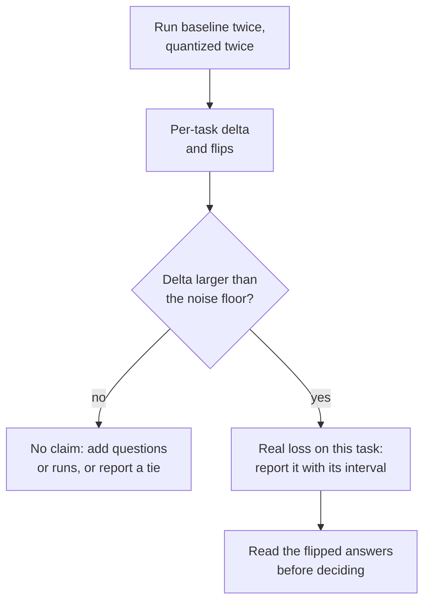

# पाठ 22. ईमानदार Quantization Eval

**मिशन से संबंध:** "मापें कि क्या क़ीमत चुकानी पड़ी" मिशन का वह आधा हिस्सा है जो दूसरे आधे को बचाव-योग्य बनाता है, और सावधान तुलना ही माप को marketing की संख्या से अलग करती है।
**मुख्य स्रोत:** [पेपर: "Give Me BF16 or Give Me Death? Accuracy-Performance Trade-Offs in LLM Quantization", Kurtic et al., 2024](https://arxiv.org/abs/2411.02355)
**पूर्व-आवश्यकताएँ:** [पाठ 21](0021-perplexity-and-its-limits.md), [Perplexity](../GLOSSARY.md), [Calibration set](../GLOSSARY.md)

## वार्म-अप

1. ▢ वे चार चीज़ें बताएँ जिन्हें मेल खाना चाहिए इससे पहले कि दो perplexity संख्याएँ तुलना की जा सकें।

<details markdown="1"><summary>जाँचें</summary>

Tokenizer, text, context length और stride, और वह tool जिसने उसे compute किया (पाठ 21)। इनमें से कोई एक बदलें और model बदले बिना संख्या हिल जाती है।

</details>

2. ▢ Flip क्या है, और model कई उत्तर flip करके भी अपनी accuracy को स्थिर कैसे रख सकता है?

<details markdown="1"><summary>जाँचें</summary>

Flip वह उत्तर है जो baseline के सापेक्ष सही और ग़लत के बीच बदल जाए। सही-से-ग़लत और ग़लत-से-सही flips accuracy के औसत में लगभग कट जाती हैं, इसलिए औसत उन्हें छिपा देता है (पाठ 21)।

</details>

3. ▢ किसी quantized model को web text पर calibrate किया गया था और source code पर evaluate किया जाता है। आपको क्या उम्मीद करनी चाहिए, और क्यों?

<details markdown="1"><summary>जाँचें</summary>

संभवतः मुख्य संख्या के संकेत से ज़्यादा हानि। Method ने अपनी ranges या error weights calibration text की statistics के हिसाब से tune किए थे, और code की activations उनसे अलग हो सकती हैं (पाठ 12)। इलाज यह है कि deployment text जैसे text पर calibrate करें और deployment जैसे दिखने वाले tasks पर evaluate करें।

</details>

## यह जानें

evals track सिखाता है कि eval कैसे बनाएँ: metrics चुनना, test set का आकार तय करना, और go/no-go फ़ैसले का बचाव करना। यह पाठ एक का इस्तेमाल करता है। मशीनरी के लिए [Metrics शीट](../../evals/reference/metrics.md) और [Go/No-Go शीट](../../evals/reference/go-no-go.md) देखें, और यहाँ उन्हें दिया हुआ मानें।

### Weights को छोड़कर सब कुछ तय रखें

Baseline वही checkpoint है अपने मूल 16-bit format में, कोई दूसरा model नहीं। Run में बाक़ी सब कुछ एक जैसा होना चाहिए, वरना फ़ासला quantization नहीं बल्कि आपकी setup को मापता है:

| तय रखें | क्योंकि |
|---|---|
| Harness और version | Scoring code tools के बीच अलग होता है |
| Prompts, few-shot examples और chat template | दोनों weights के मायने रखने से पहले ही उत्तर बदल देते हैं |
| Generation settings (decoding rule, अधिकतम लंबाई) | Sampled run और greedy run अलग experiments हैं |
| Task सूची और sample count | अलग उपसमूह अलग test है |
| Inference backend, जहाँ आप कर सकें | दूसरा backend दूसरा variable है |

Kurtic et al. यह pattern दिखाते हैं। वे Meta के prompt दिशानिर्देश अपनाते हैं ताकि baseline उसके प्रकाशित scores से मेल खाए, generated text की तुलना करते समय greedy sampling से evaluate करते हैं, और baseline और हर quantized variant को एक ही suite से गुज़ारते हैं। [lm-evaluation-harness](https://github.com/EleutherAI/lm-evaluation-harness) इसके लिए व्यापक रूप से इस्तेमाल होने वाला tool है। उसकी README models को `transformers` से load करना (GPTQ समेत), vLLM से, और GGUF files के रूप में `hf` backend या llama.cpp server से दिखाती है। Server वाले रास्ते के लिए वह अपना scoring route documented करता है, जो याद दिलाता है कि अलग backend तटस्थ अदला-बदली नहीं है।

### कई तरह के task कवर करें

एक multiple-choice suite model नहीं है। पेपर का suite कई तरह को फैलाता है, और पाठ 21 का MT-Bench नतीजा बताता है कि यह क्यों मायने रखता है:

| प्रकार | पेपर में उदाहरण | टिप्पणी |
|---|---|---|
| Academic, ज़्यादातर multiple choice और math | Open LLM Leaderboard V1 और V2 | सस्ता, और जहाँ flips औसत में छिप जाती हैं |
| Chat quality, किसी दूसरे model से आँकी गई | Arena-Hard-Auto-v0.1 | पेपर हर model के दो runs का औसत लेता है |
| Code, tests के मुक़ाबले चलाया गया | HumanEval और HumanEval+ (pass@1) | उत्तर या तो चलता है या नहीं |
| लंबा context | RULER | यहाँ अकेला प्रकार जो लंबे inputs पर दबाव डालता है |
| Baseline से output की समानता | ROUGE, BERTScore, semantic similarity | दोहराए जाने योग्य होने के लिए greedy decoding चाहिए |

अगर आपने KV cache को quantize किया (पाठ 16), तो लंबे context में उसकी क़ीमत दिखती है, क्योंकि cache context length के साथ बढ़ता है (पाठ 1)।

### औसत नहीं, प्रति-task deltas और flips बताएँ

औसत recovery की संख्या फ़ैसले जैसी दिखती है और होती नहीं। Llama-3.1-8B-Instruct के लिए Kurtic et al. की Table 2 की संख्याएँ ये हैं, BF16 बनाम 16-bit activations के साथ 4-bit weights (W4A16-INT):

| Task | BF16 | W4A16-INT | Delta |
|---|---|---|---|
| MMLU, 5-shot | 68.3 | 66.9 | -1.4 |
| MMLU CoT, 0-shot | 72.8 | 71.1 | -1.7 |
| ARC-Challenge, 0-shot | 81.4 | 80.2 | -1.2 |
| GSM8k CoT, 8-shot | 82.8 | 82.9 | +0.1 |
| HellaSwag, 10-shot | 80.5 | 79.9 | -0.6 |
| Winogrande, 5-shot | 78.1 | 78.0 | -0.1 |
| TruthfulQA, 0-shot | 54.5 | 52.8 | -1.7 |
| औसत | 74.06 | 73.11 | -0.95 |

इस पंक्ति के लिए पेपर की औसत recovery 98.72 प्रतिशत है, और उसकी सबसे कम प्रति-task recovery, 96.88 प्रतिशत, TruthfulQA की है। जो रिपोर्ट सिर्फ़ औसत देती है वह छिपाती है कि किस task ने क़ीमत चुकाई। साथ ही हर model के प्रति-सवाल outputs भी log करें (harness में `--log_samples` है) ताकि आप score के ऊपर flips गिन सकें, जैसा पाठ 21 ने परिभाषित किया।

### Noise floor

हर score में quantization के छूने से पहले ही एक margin of error होती है। Kurtic et al. एक ठोस मामला देते हैं। BF16 8B model के लिए Arena-Hard-Auto के उनके दो runs ने 25.1 और 26.5 score किए, और BF16 70B model के लिए 55.8 और 58.2, हर score के आसपास लगभग प्लस-माइनस 2 से 3 अंक के 95 प्रतिशत confidence intervals के साथ। उनके W8A8-INT 8B model का औसत 27.2 रहा जबकि baseline का 25.8, और 1.4 अंक का फ़ासला interval के भीतर और baseline के अपने run-to-run फैलाव के भीतर बैठता है। पेपर यह चेतावनी भी देता है कि छोटे models GPQA और MuSR जैसे कठिन tasks पर ज़्यादा variance दिखाते हैं, जहाँ full-precision models भी random baseline के पास हैं।

`N` सवालों पर सही या ग़लत score होने वाले task के लिए, pass rate `p` के साथ, standard error लगभग `sqrt(p * (1 - p) / N)` है, जैसा [Go/No-Go शीट](../../evals/reference/go-no-go.md) कहती है। जब baseline और quantized models उन्हीं सवालों के जवाब देते हैं, तो paired तुलना सिर्फ़ उन सवालों को देखती है जहाँ वे असहमत हैं, जो फिर flip की गिनती है, और कसा हुआ interval देती है।



### सावधान evaluation ने क्या पाया

Kurtic et al. ने Llama 3.1 परिवार पर 500,000 से ज़्यादा evaluations चलाए। उनका abstract तीन निष्कर्ष बताता है: FP8 weights और activations (W8A8-FP) model आकारों में "प्रभावी रूप से lossless" हैं, ठीक से tune किए INT8 weights और activations (W8A8-INT) 1 से 3 प्रतिशत accuracy खोते हैं, और INT4 weight-only (W4A16-INT) अपेक्षा से ज़्यादा प्रतिस्पर्धी है, 8-bit को टक्कर देता हुआ। इन्हें उनकी शर्तों के भीतर पढ़ें। यह एक model परिवार है, और नुस्ख़े मायने रखते हैं: mean-squared-error clipping range के साथ GPTQ, INT8 के लिए 70B पर जोड़ा गया SmoothQuant, और हर scheme के लिए चुना गया calibration data। पेपर ध्यान दिलाता है कि random-token calibration 4-bit models को बिगाड़ता है, और INT4 पर सबसे छोटे models में कुछ ज़्यादा गिरावट दिखती है। जो दावा अपने नुस्ख़े को अनदेखा करता है वही वह है जिसकी समीक्षा आप पाठ 26 और 27 में करते हैं।

### दोनों models को चलाना

तुलना को हर model के लिए एक command चाहिए, model को छोड़कर उन्हीं flags के साथ। दोनों प्रति-sample logs लिखते हैं। यह जोड़ी एक छोटे chat model और उसी checkpoint की 4-bit GPTQ copy का इस्तेमाल करती है। Commands harness README के उदाहरणों का पालन करते हैं और इस पाठ के लिए GPU पर चलाए नहीं गए थे।

```bash
lm_eval --model hf --model_args pretrained=TinyLlama/TinyLlama-1.1B-Chat-v1.0 --tasks hellaswag --batch_size 8 --log_samples --output_path results/baseline
lm_eval --model hf --model_args pretrained=TheBloke/TinyLlama-1.1B-Chat-v1.0-GPTQ --tasks hellaswag --batch_size 8 --log_samples --output_path results/gptq
```

## अभ्यास

1. ▢ दोनों runs में कौन-सा अंतर quantization की तुलना को अनुचित बनाता है?

    - a) दोनों runs वही few-shot examples और template दोबारा इस्तेमाल करते हैं
    - b) Baseline temperature 0.7 पर sample करता है जबकि quantized greedy इस्तेमाल करता है
    - c) दोनों runs बाद में हर sample का output disk पर लिखते हैं
    - d) दोनों runs tasks की एक ही तय सूची पर score करते हैं

<details markdown="1"><summary>जाँचें</summary>

**b)** दोनों runs अब decoding में अलग हैं, इसलिए फ़ासला quantization को sampling noise से मिला देता है। (a) वह है जो निष्पक्ष तुलना माँगती है। (c) सिर्फ़ outputs दर्ज करता है और run के बारे में कुछ नहीं बदलता। (d) भी ज़रूरी है, क्योंकि अलग task सूची अकेले score बदल देती है।

</details>

2. ▢ Llama-3.1-8B-Instruct के लिए, 4-bit weight-only model MMLU पर 66.9, GSM8k पर 82.9 और TruthfulQA पर 52.8 score करता है, जबकि BF16 baseline के 68.3, 82.8 और 54.5 हैं। नतीजा ईमानदार तरीक़े से एक वाक्य में बताएँ।

<details markdown="1"><summary>जाँचें</summary>

प्रति task: MMLU -1.4, GSM8k +0.1, TruthfulQA -1.7, तीनों पर औसत -1.0। ईमानदार रिपोर्ट तीनों deltas देती है और TruthfulQA और MMLU को वे tasks बताती है जिन्होंने सबसे ज़्यादा खोया, "औसतन लगभग 1 अंक" उद्धृत करने की जगह। GSM8k पर +0.1 फ़ायदा नहीं है: वह किसी भी noise floor के बहुत भीतर है।

</details>

3. ▢ Kurtic et al. के Arena-Hard-Auto runs में, BF16 8B model ने 25.1 और 26.5 score किए, और W8A8-INT 8B model ने 27.6 और 26.7। औसत 25.8 और 27.2 हैं। क्या INT8 ने model को सुधारा?

<details markdown="1"><summary>जाँचें</summary>

इसका कोई सबूत नहीं। दोनों BF16 runs एक-दूसरे से 1.4 अंक अलग हैं, औसतों के 1.4 अंक के फ़ासले जितना ही, और INT8 model के लिए पेपर का 95 प्रतिशत interval लगभग प्लस-माइनस 2 है। Run-to-run फैलाव के भीतर का फ़ासला बराबरी है। 100 प्रतिशत से ऊपर की "recovery" को भी ऐसे ही लें: वह noise है, सुधार नहीं।

</details>

4. ▢ पहले अनुमान लगाएँ, फिर चलाएँ। पाठ 21 का simulated test दोबारा इस्तेमाल करें, जहाँ accuracy 0.4 अंक गिरी और लगभग 5.9 प्रतिशत उत्तर flip हुए। अनुमान लगाएँ कि accuracy के फ़ासले की paired standard error unpaired से बड़ी है या छोटी, और लगभग किस गुणक से। फिर चलाएँ।

    ```python
    import numpy as np

    rng = np.random.default_rng(0)
    n_questions, n_options = 5000, 4

    logits = rng.normal(size=(n_questions, n_options))
    easy = rng.random(n_questions) < 0.6
    logits[easy, 0] += 6.0
    noisy = logits + rng.normal(scale=0.5, size=logits.shape)

    base_correct = logits.argmax(axis=1) == 0
    quant_correct = noisy.argmax(axis=1) == 0

    n = n_questions
    p1, p2 = base_correct.mean(), quant_correct.mean()
    b = int(np.sum(base_correct & ~quant_correct))  # correct -> incorrect
    c = int(np.sum(~base_correct & quant_correct))  # incorrect -> correct

    gap = p2 - p1
    unpaired_se = np.sqrt(p1 * (1 - p1) / n + p2 * (1 - p2) / n)
    paired_se = np.sqrt(b + c - (b - c) ** 2 / n) / n

    print(f"accuracy gap: {gap:+.4f}")
    print(f"discordant questions: {b} lost, {c} gained")
    print(f"unpaired standard error: {unpaired_se:.4f}")
    print(f"paired standard error:   {paired_se:.4f}")
    ```

<details markdown="1"><summary>संकेत</summary>

Unpaired formula दोनों accuracies को स्वतंत्र मानता है। दोनों models ने वही 5000 सवाल हल किए, और उनमें से ज़्यादातर उत्तर नहीं बदले।

</details>

<details markdown="1"><summary>जाँचें</summary>

फ़ासला -0.0034 है, 155 सवाल खोए और 138 पाए। Unpaired standard error 0.0091 है और paired वाली 0.0034, लगभग 2.7 गुना छोटी। Paired version सिर्फ़ उन 293 सवालों पर निर्भर करती है जहाँ models असहमत हैं, इसलिए जो कठिनाई दोनों साझा करते हैं वह कट जाती है। यहाँ फ़ासला लगभग एक paired standard error है, जो अब भी noise से अलग नहीं पहचाना जा सकता, पर paired अनुमान ज़्यादा कसा और ईमानदार है। ये simulated संख्याएँ हैं, असली model नहीं।

</details>

5. ▢ आपका manager पूछता है: "क्या हमारे model का int4 build कुछ खोता है?" उसका जवाब देने की योजना छह या कम पंक्तियों में लिखें।

<details markdown="1"><summary>जाँचें</summary>

अच्छी योजना ये बताती है: baseline (वही checkpoint अपने 16-bit format में); दोनों के लिए एक harness, prompt set और decoding setting; कई तरह के task, जिनमें एक generative और अगर context length आपके लिए मायने रखती है तो एक लंबे-context वाला; noise floor मापने के लिए हर model का दोबारा run; intervals के साथ प्रति-task deltas, और logged samples से flips; और run से पहले तय की गई सीमा। फ़ैसले का नियम ख़ुद evals track का go/no-go काम है।

</details>

6. ▢ आप baseline को `hf` backend से और quantized GGUF को `gguf` backend वाले llama.cpp server से score करते हैं, और quantized model 3 अंक नीचे है। Quantization को दोष देने से पहले आप क्या करते हैं?

<details markdown="1"><summary>संकेत</summary>

कौन-सा एक बदलाव "backend अलग है" को "weights अलग हैं" से अलग करेगा?

</details>

<details markdown="1"><summary>जाँचें</summary>

बिना quantize किए 16-bit GGUF को उसी server रास्ते से score करें। उस run और `hf` baseline के बीच का फ़ासला backend और उसके scoring route की क़ीमत है, और 16-bit GGUF और quantized GGUF के बीच का फ़ासला quantization की क़ीमत है। README llama.cpp server के लिए समर्पित scoring रास्ता documented करती है, इसलिए backend का असर काल्पनिक नहीं बल्कि संभावित है।

</details>

## असली दुनिया का अभ्यास

- [ ] ऊपर के दोनों `lm_eval` commands laptop या मुफ़्त GPU notebook पर चलाएँ अगर आप चला सकें, फिर हर task पर delta और `sqrt(p * (1 - p) / N)` से standard error निकालें।
- [ ] किसी quantized model के लिए प्रकाशित एक "कोई हानि नहीं" दावा चुनें और सूची बनाएँ कि पाँच तय रखी जाने वाली चीज़ों में से उसका model card कौन-सी बताता है और कौन-सी छोड़ देता है।
- [ ] कल: बिना नोट्स के तय रखने वाली पाँच चीज़ें, प्रति task बताने वाली तीन चीज़ें, और वह राशि लिखें जो तय करती है कि कोई फ़ासला गिनने लायक़ होने के लिए कितना बड़ा होना चाहिए।

## आगे बढ़ने के लिए

- [मापना और Store करना शीट](../reference/measuring-and-storing.md)
- [पेपर: "Give Me BF16 or Give Me Death? Accuracy-Performance Trade-Offs in LLM Quantization", Kurtic et al., 2024](https://arxiv.org/abs/2411.02355)
- [Repo: lm-evaluation-harness, EleutherAI](https://github.com/EleutherAI/lm-evaluation-harness)
- [Evals: Go/No-Go](../../evals/reference/go-no-go.md), significance, paired तुलना और सीमाओं के लिए
- [Evals: Metrics](../../evals/reference/metrics.md), हर task के लिए metric चुनने के लिए
- [संसाधन](../RESOURCES.md)

---

बात नहीं बन रही? ऊपर दिए मुख्य स्रोत को दोबारा पढ़ें, क्योंकि यह पाठ उसे संक्षिप्त करता है और समझ संक्षेप में ही रिसती है। जो शब्द फिसलन भरा लगे, उसके लिए [शब्दावली](../GLOSSARY.md) देखें।

अगर दिक़्क़त सामग्री की नहीं बल्कि पाठ की ही है, तो वह एक खोट है: [issue खोलें](https://github.com/TokenCemetery/teach/issues)।
