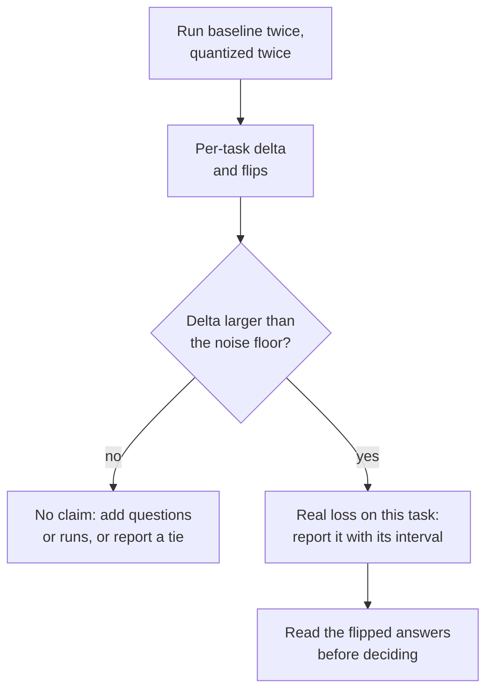

# Lesson 22. An Honest Quantization Eval

**Mission link:** "Measure what it cost" is the half of the mission that makes the other half defensible, and a careful comparison is what separates a measurement from a marketing number.
**Primary source:** [Paper: "Give Me BF16 or Give Me Death? Accuracy-Performance Trade-Offs in LLM Quantization", Kurtic et al., 2024](https://arxiv.org/abs/2411.02355)
**Prerequisites:** [Lesson 21](0021-perplexity-and-its-limits.md), [Perplexity](../GLOSSARY.md), [Calibration set](../GLOSSARY.md)

## Warm-up

1. ▢ Name the four things that must match before two perplexity numbers can be compared.

<details markdown="1"><summary>Check</summary>

The tokenizer, the text, the context length and stride, and the tool that computed it (lesson 21). Change any one and the number moves without the model changing.

</details>

2. ▢ What is a flip, and why can a model flip many answers while its accuracy stays put?

<details markdown="1"><summary>Check</summary>

A flip is an answer that changes between correct and incorrect relative to the baseline. Correct-to-incorrect and incorrect-to-correct flips roughly cancel in the accuracy average, so the average hides them (lesson 21).

</details>

3. ▢ A quantized model was calibrated on web text and is evaluated on source code. What should you expect, and why?

<details markdown="1"><summary>Check</summary>

Possibly more loss than the headline suggests. The method tuned its ranges or error weights to the statistics of the calibration text, and code activations can differ from them (lesson 12). The remedy is to calibrate on text like the deployment text and to evaluate on tasks that look like the deployment.

</details>

## Know this

The evals track teaches how to build an eval: choosing metrics, sizing a test set, and defending a go/no-go call. This lesson uses one. For the machinery see the [Metrics sheet](../../evals/reference/metrics.md) and the [Go/No-Go sheet](../../evals/reference/go-no-go.md), and here treat them as given.

### Hold everything but the weights fixed

The baseline is the same checkpoint in its original 16-bit format, not a different model. Everything else in the run must be identical, or the gap measures your setup instead of the quantization:

| Hold fixed | Because |
|---|---|
| Harness and version | Scoring code differs between tools |
| Prompts, few-shot examples and chat template | Both change the answer before the weights matter |
| Generation settings (decoding rule, maximum length) | A sampled run and a greedy run are different experiments |
| Task list and sample count | A different subset is a different test |
| Inference backend, where you can | A second backend is a second variable |

Kurtic et al. show the pattern. They follow Meta's prompt guidelines so the baseline matches its published scores, evaluate with greedy sampling when they compare generated text, and run the baseline and every quantized variant through the same suite. The [lm-evaluation-harness](https://github.com/EleutherAI/lm-evaluation-harness) is a widely used tool for this. Its README shows models loaded through `transformers` (including GPTQ), through vLLM, and as GGUF files through the `hf` backend or a llama.cpp server. For the server path it documents its own scoring route, which is a reminder that a different backend is not a neutral swap.

### Cover several kinds of task

One multiple-choice suite is not the model. The paper's suite spans several kinds, and lesson 21's MT-Bench result is why that matters:

| Kind | Example in the paper | Notes |
|---|---|---|
| Academic, mostly multiple choice and math | Open LLM Leaderboard V1 and V2 | Cheap, and where flips hide in the average |
| Chat quality, judged by another model | Arena-Hard-Auto-v0.1 | The paper averages two runs per model |
| Code, run against tests | HumanEval and HumanEval+ (pass@1) | The answer either executes or not |
| Long context | RULER | The only kind here that stresses long inputs |
| Output similarity to the baseline | ROUGE, BERTScore, semantic similarity | Needs greedy decoding to be reproducible |

If you quantized the KV cache (lesson 16), long context is where its cost shows, because the cache grows with context length (lesson 1).

### Report per-task deltas and flips, not an average

An average recovery number looks like a verdict and is not one. Here are Kurtic et al.'s Table 2 numbers for Llama-3.1-8B-Instruct, BF16 against 4-bit weights with 16-bit activations (W4A16-INT):

| Task | BF16 | W4A16-INT | Delta |
|---|---|---|---|
| MMLU, 5-shot | 68.3 | 66.9 | -1.4 |
| MMLU CoT, 0-shot | 72.8 | 71.1 | -1.7 |
| ARC-Challenge, 0-shot | 81.4 | 80.2 | -1.2 |
| GSM8k CoT, 8-shot | 82.8 | 82.9 | +0.1 |
| HellaSwag, 10-shot | 80.5 | 79.9 | -0.6 |
| Winogrande, 5-shot | 78.1 | 78.0 | -0.1 |
| TruthfulQA, 0-shot | 54.5 | 52.8 | -1.7 |
| Average | 74.06 | 73.11 | -0.95 |

The paper's average recovery for this row is 98.72 percent, and its lowest per-task recovery, 96.88 percent, is TruthfulQA. A report that gives only the average hides which task paid. Also log each model's per-question outputs (the harness has `--log_samples`) so you can count flips, as lesson 21 defined them, on top of the score.

### The noise floor

Any score has a margin of error before quantization touches it. Kurtic et al. give a concrete case. Their two runs of Arena-Hard-Auto for the BF16 8B model scored 25.1 and 26.5, and for the BF16 70B model 55.8 and 58.2, with 95 percent confidence intervals of about plus or minus 2 to 3 points around each score. Their W8A8-INT 8B model averaged 27.2 against the baseline's 25.8, and a gap of 1.4 points sits inside the interval and inside the baseline's own run-to-run spread. The paper also warns that smaller models show higher variance on hard tasks such as GPQA and MuSR, where even full-precision models are near the random baseline.

For a task scored right or wrong over `N` questions with pass rate `p`, the standard error is about `sqrt(p * (1 - p) / N)`, as the [Go/No-Go sheet](../../evals/reference/go-no-go.md) puts it. When baseline and quantized models answer the same questions, a paired comparison looks only at the questions where they disagree, which is the flip count again, and gives a tighter interval.



### What a careful evaluation found

Kurtic et al. ran more than 500,000 evaluations across the Llama 3.1 family. Their abstract reports three findings: FP8 weights and activations (W8A8-FP) are "effectively lossless" across model sizes, well-tuned INT8 weights and activations (W8A8-INT) lose 1 to 3 percent accuracy, and INT4 weight-only (W4A16-INT) is more competitive than expected, rivaling 8-bit. Read those inside their conditions. It is one model family, and the recipes matter: GPTQ with a mean-squared-error clipping range, SmoothQuant added at 70B for INT8, and calibration data chosen per scheme. The paper notes that random-token calibration degrades the 4-bit models, and that the smallest models at INT4 show somewhat larger drops. A claim that ignores its recipe is the one you review in lessons 26 and 27.

### Running both models

A comparison needs one command per model with the same flags, apart from the model itself. Both write per-sample logs. This pair uses a small chat model and a 4-bit GPTQ copy of the same checkpoint. The commands follow the harness README's examples and were not run on a GPU for this lesson.

```bash
lm_eval --model hf --model_args pretrained=TinyLlama/TinyLlama-1.1B-Chat-v1.0 --tasks hellaswag --batch_size 8 --log_samples --output_path results/baseline
lm_eval --model hf --model_args pretrained=TheBloke/TinyLlama-1.1B-Chat-v1.0-GPTQ --tasks hellaswag --batch_size 8 --log_samples --output_path results/gptq
```

## Practice

1. ▢ Which difference between the two runs makes a quantization comparison unfair?

    - a) Both runs reuse the same few-shot examples and template
    - b) Baseline samples at temperature 0.7 while quantized uses greedy
    - c) Both runs write every sample's output to disk afterwards
    - d) Both runs score one identical, fixed list of tasks

<details markdown="1"><summary>Check</summary>

**b)** The two runs now differ in decoding, so the gap mixes quantization with sampling noise. (a) is what a fair comparison requires. (c) only records outputs and changes nothing about the run. (d) is also required, since a different task list changes the score by itself.

</details>

2. ▢ For Llama-3.1-8B-Instruct, a 4-bit weight-only model scores 66.9 on MMLU, 82.9 on GSM8k and 52.8 on TruthfulQA, against the BF16 baseline's 68.3, 82.8 and 54.5. Report the result the honest way, in a sentence.

<details markdown="1"><summary>Check</summary>

Per task: MMLU -1.4, GSM8k +0.1, TruthfulQA -1.7, an average of -1.0 over the three. The honest report gives the three deltas and names TruthfulQA and MMLU as the tasks that lost the most, rather than quoting "about 1 point on average". The +0.1 on GSM8k is not a gain: it is far inside any noise floor.

</details>

3. ▢ In Kurtic et al.'s Arena-Hard-Auto runs, the BF16 8B model scored 25.1 and 26.5, and the W8A8-INT 8B model scored 27.6 and 26.7. The averages are 25.8 and 27.2. Did INT8 improve the model?

<details markdown="1"><summary>Check</summary>

No evidence of it. The two BF16 runs differ from each other by 1.4 points, the same size as the 1.4-point gap between the averages, and the paper's 95 percent interval for the INT8 model is about plus or minus 2. A gap inside the run-to-run spread is a tie. Treat a "recovery" above 100 percent the same way: it is noise, not improvement.

</details>

4. ▢ Predict, then run. Reuse lesson 21's simulated test, where accuracy fell by 0.4 points and about 5.9 percent of answers flipped. Predict whether the paired standard error of the accuracy gap is larger or smaller than the unpaired one, and roughly by what factor. Then run it.

    ```python
    import numpy as np

    rng = np.random.default_rng(0)
    n_questions, n_options = 5000, 4

    logits = rng.normal(size=(n_questions, n_options))
    easy = rng.random(n_questions) < 0.6
    logits[easy, 0] += 6.0
    noisy = logits + rng.normal(scale=0.5, size=logits.shape)

    base_correct = logits.argmax(axis=1) == 0
    quant_correct = noisy.argmax(axis=1) == 0

    n = n_questions
    p1, p2 = base_correct.mean(), quant_correct.mean()
    b = int(np.sum(base_correct & ~quant_correct))  # correct -> incorrect
    c = int(np.sum(~base_correct & quant_correct))  # incorrect -> correct

    gap = p2 - p1
    unpaired_se = np.sqrt(p1 * (1 - p1) / n + p2 * (1 - p2) / n)
    paired_se = np.sqrt(b + c - (b - c) ** 2 / n) / n

    print(f"accuracy gap: {gap:+.4f}")
    print(f"discordant questions: {b} lost, {c} gained")
    print(f"unpaired standard error: {unpaired_se:.4f}")
    print(f"paired standard error:   {paired_se:.4f}")
    ```

<details markdown="1"><summary>Hint</summary>

The unpaired formula treats the two accuracies as independent. Both models answered the same 5000 questions, and most of those answers did not change.

</details>

<details markdown="1"><summary>Check</summary>

The gap is -0.0034, with 155 questions lost and 138 gained. The unpaired standard error is 0.0091 and the paired one is 0.0034, about 2.7 times smaller. The paired version depends only on the 293 questions where the models disagree, so the difficulty both share cancels. Here the gap is about one paired standard error, still not distinguishable from noise, but the paired estimate is the tighter and honest one. These are simulated numbers, not a real model.

</details>

5. ▢ Your manager asks: "Does the int4 build of our model lose anything?" Write the plan for answering it, in six or fewer lines.

<details markdown="1"><summary>Check</summary>

A good plan names: the baseline (the same checkpoint in its 16-bit format); one harness, prompt set and decoding setting for both; several task kinds including a generative one and a long-context one if context length matters to you; a rerun of each model to measure the noise floor; per-task deltas with intervals, plus flips from logged samples; and a threshold agreed before the run. The decision rule itself is the evals track's go/no-go work.

</details>

6. ▢ You score the baseline with the `hf` backend and the quantized GGUF through a llama.cpp server with the `gguf` backend, and the quantized model is 3 points lower. What do you do before blaming quantization?

<details markdown="1"><summary>Hint</summary>

Which single change would separate "the backend differs" from "the weights differ"?

</details>

<details markdown="1"><summary>Check</summary>

Score the unquantized 16-bit GGUF through the same server path. The gap between that run and the `hf` baseline is the cost of the backend and its scoring route, and the gap between the 16-bit GGUF and the quantized GGUF is the cost of quantization. The README documents a dedicated scoring path for the llama.cpp server, so a backend effect is plausible rather than hypothetical.

</details>

## Real-world reps

- [ ] Run the two `lm_eval` commands above on a laptop or a free GPU notebook if you can, then compute the delta on each task and the standard error from `sqrt(p * (1 - p) / N)`.
- [ ] Pick one published "no loss" claim for a quantized model and list which of the five held-fixed items its model card states and which it leaves out.
- [ ] Tomorrow: without notes, write the five things to hold fixed, the three things to report per task, and the quantity that sets how big a gap must be to count.

## Going further

- [Measuring and Storing](../reference/measuring-and-storing.md)
- [Paper: "Give Me BF16 or Give Me Death? Accuracy-Performance Trade-Offs in LLM Quantization", Kurtic et al., 2024](https://arxiv.org/abs/2411.02355)
- [Repo: lm-evaluation-harness, EleutherAI](https://github.com/EleutherAI/lm-evaluation-harness)
- [Evals: Go/No-Go](../../evals/reference/go-no-go.md), for significance, paired comparison and thresholds
- [Evals: Metrics](../../evals/reference/metrics.md), for choosing a metric per task
- [Resources](../RESOURCES.md)

---

Not landing? Reread the primary source at the top, since this lesson compresses it and compression is where understanding leaks. Check the [glossary](../GLOSSARY.md) for any term that felt slippery.

If the lesson itself is unclear rather than the material, that is a defect: [open an issue](https://github.com/TokenCemetery/teach/issues).
