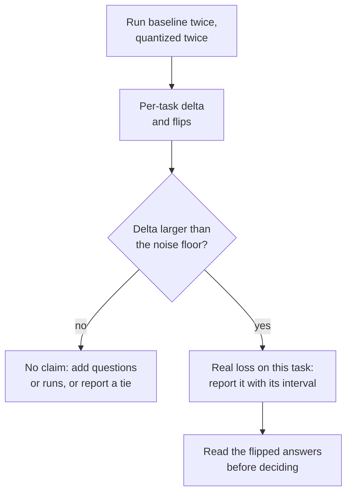

# Lição 22. Um eval honesto de quantização

**Ligação com a missão:** "Medir o que custou" é a metade da missão que torna a outra metade defensável, e uma comparação cuidadosa é o que separa uma medição de um número de marketing.
**Fonte principal:** [Artigo científico: "Give Me BF16 or Give Me Death? Accuracy-Performance Trade-Offs in LLM Quantization", Kurtic et al., 2024](https://arxiv.org/abs/2411.02355)
**Pré-requisitos:** [Lição 21](0021-perplexity-and-its-limits.md), [Perplexity](../GLOSSARY.md), [Calibration set](../GLOSSARY.md)

## Aquecimento

1. ▢ Nomeie as quatro coisas que precisam coincidir para dois números de perplexity poderem ser comparados.

<details markdown="1"><summary>Verificação</summary>

O tokenizer, o texto, o comprimento de contexto e o stride, e a ferramenta que o calculou (lição 21). Mude qualquer um e o número se move sem o modelo mudar.

</details>

2. ▢ O que é um flip, e por que um modelo pode dar flip em muitas respostas enquanto a sua acurácia fica parada?

<details markdown="1"><summary>Verificação</summary>

Um flip é uma resposta que muda entre correta e incorreta em relação ao baseline. Os flips de correta para incorreta e de incorreta para correta aproximadamente se cancelam na média de acurácia, então a média os esconde (lição 21).

</details>

3. ▢ Um modelo quantizado foi calibrado em texto da web e é avaliado em código-fonte. O que você deve esperar, e por quê?

<details markdown="1"><summary>Verificação</summary>

Possivelmente mais perda do que o número de destaque sugere. O método ajustou as suas faixas ou pesos de erro às estatísticas do texto de calibração, e as ativações de código podem diferir delas (lição 12). O remédio é calibrar em texto parecido com o texto de deployment e avaliar em tarefas que se pareçam com o deployment.

</details>

## Saiba isto

A trilha de evals ensina como construir um eval: escolher métricas, dimensionar um conjunto de teste e defender uma decisão de go/no-go. Esta lição usa um. Para a mecânica, veja a [folha de Métricas](../../evals/reference/metrics.md) e a [folha de Go/No-Go](../../evals/reference/go-no-go.md), e aqui trate-as como dadas.

### Mantenha tudo fixo, exceto os pesos

O baseline é o mesmo checkpoint no seu formato original de 16 bits, não um modelo diferente. Todo o resto da execução precisa ser idêntico, ou a diferença mede o seu setup em vez da quantização:

| Mantenha fixo | Porque |
|---|---|
| Harness e versão | O código de pontuação difere entre ferramentas |
| Prompts, exemplos few-shot e chat template | Ambos mudam a resposta antes de os pesos importarem |
| Configurações de geração (regra de decodificação, comprimento máximo) | Uma execução amostrada e uma gulosa são experimentos diferentes |
| Lista de tarefas e contagem de amostras | Um subconjunto diferente é um teste diferente |
| Backend de inferência, quando possível | Um segundo backend é uma segunda variável |

Kurtic et al. mostram o padrão. Eles seguem as diretrizes de prompt da Meta para que o baseline coincida com as pontuações publicadas, avaliam com amostragem gulosa quando comparam texto gerado e passam o baseline e toda variante quantizada pela mesma suíte. O [lm-evaluation-harness](https://github.com/EleutherAI/lm-evaluation-harness) é uma ferramenta amplamente usada para isso. O seu README mostra modelos carregados pelo `transformers` (incluindo GPTQ), pelo vLLM e como arquivos GGUF pelo backend `hf` ou por um servidor llama.cpp. Para o caminho do servidor, ele documenta a sua própria rota de pontuação, o que é um lembrete de que um backend diferente não é uma troca neutra.

### Cubra vários tipos de tarefa

Uma suíte de múltipla escolha não é o modelo. A suíte do artigo abrange vários tipos, e o resultado do MT-Bench da lição 21 é o motivo de isso importar:

| Tipo | Exemplo no artigo | Observações |
|---|---|---|
| Acadêmica, principalmente múltipla escolha e matemática | Open LLM Leaderboard V1 e V2 | Barata, e onde os flips se escondem na média |
| Qualidade de chat, avaliada por outro modelo | Arena-Hard-Auto-v0.1 | O artigo tira a média de duas execuções por modelo |
| Código, executado contra testes | HumanEval e HumanEval+ (pass@1) | A resposta executa ou não |
| Contexto longo | RULER | O único tipo aqui que estressa entradas longas |
| Similaridade de saída com o baseline | ROUGE, BERTScore, similaridade semântica | Precisa de decodificação gulosa para ser reproduzível |

Se você quantizou o KV cache (lição 16), o contexto longo é onde o custo dele aparece, porque o cache cresce com o tamanho do contexto (lição 1).

### Reporte deltas por tarefa e flips, não uma média

Um número de recuperação média parece um veredito e não é um. Aqui estão os números da Tabela 2 de Kurtic et al. para o Llama-3.1-8B-Instruct, BF16 contra pesos de 4 bits com ativações de 16 bits (W4A16-INT):

| Tarefa | BF16 | W4A16-INT | Delta |
|---|---|---|---|
| MMLU, 5-shot | 68.3 | 66.9 | -1.4 |
| MMLU CoT, 0-shot | 72.8 | 71.1 | -1.7 |
| ARC-Challenge, 0-shot | 81.4 | 80.2 | -1.2 |
| GSM8k CoT, 8-shot | 82.8 | 82.9 | +0.1 |
| HellaSwag, 10-shot | 80.5 | 79.9 | -0.6 |
| Winogrande, 5-shot | 78.1 | 78.0 | -0.1 |
| TruthfulQA, 0-shot | 54.5 | 52.8 | -1.7 |
| Média | 74.06 | 73.11 | -0.95 |

A recuperação média do artigo para esta linha é 98.72 por cento, e a sua menor recuperação por tarefa, 96.88 por cento, é o TruthfulQA. Um relatório que dá apenas a média esconde qual tarefa pagou. Registre também as saídas por pergunta de cada modelo (o harness tem `--log_samples`) para poder contar flips, como a lição 21 os definiu, além da pontuação.

### O piso de ruído

Toda pontuação tem uma margem de erro antes de a quantização tocá-la. Kurtic et al. dão um caso concreto. As duas execuções deles do Arena-Hard-Auto para o modelo BF16 de 8B marcaram 25.1 e 26.5, e para o modelo BF16 de 70B 55.8 e 58.2, com intervalos de confiança de 95 por cento de cerca de mais ou menos 2 a 3 pontos em torno de cada pontuação. O modelo W8A8-INT de 8B deles teve média de 27.2 contra 25.8 do baseline, e uma diferença de 1.4 ponto fica dentro do intervalo e dentro da própria dispersão entre execuções do baseline. O artigo também avisa que modelos menores mostram variância maior em tarefas difíceis como GPQA e MuSR, onde até os modelos de precisão total ficam perto do baseline aleatório.

Para uma tarefa pontuada como certo ou errado em `N` perguntas com taxa de acerto `p`, o erro padrão é cerca de `sqrt(p * (1 - p) / N)`, como a [folha de Go/No-Go](../../evals/reference/go-no-go.md) coloca. Quando o baseline e os modelos quantizados respondem às mesmas perguntas, uma comparação pareada olha apenas para as perguntas em que eles discordam, que é de novo a contagem de flips, e dá um intervalo mais estreito.



### O que uma avaliação cuidadosa encontrou

Kurtic et al. executaram mais de 500.000 avaliações na família Llama 3.1. O resumo deles relata três achados: pesos e ativações em FP8 (W8A8-FP) são "efetivamente sem perdas" entre os tamanhos de modelo, pesos e ativações INT8 bem ajustados (W8A8-INT) perdem de 1 a 3 por cento de acurácia, e o INT4 somente de pesos (W4A16-INT) é mais competitivo do que o esperado, rivalizando com o de 8 bits. Leia isso dentro das condições deles. É uma família de modelos, e as receitas importam: GPTQ com uma faixa de clipping por erro quadrático médio, SmoothQuant acrescentado em 70B para o INT8 e dados de calibração escolhidos por esquema. O artigo observa que a calibração com tokens aleatórios degrada os modelos de 4 bits, e que os menores modelos em INT4 mostram quedas um pouco maiores. Uma alegação que ignora a sua receita é a que você revisa nas lições 26 e 27.

### Executando os dois modelos

Uma comparação precisa de um comando por modelo com as mesmas flags, exceto o próprio modelo. Ambos escrevem logs por amostra. Este par usa um pequeno modelo de chat e uma cópia GPTQ de 4 bits do mesmo checkpoint. Os comandos seguem os exemplos do README do harness e não foram executados em uma GPU para esta lição.

```bash
lm_eval --model hf --model_args pretrained=TinyLlama/TinyLlama-1.1B-Chat-v1.0 --tasks hellaswag --batch_size 8 --log_samples --output_path results/baseline
lm_eval --model hf --model_args pretrained=TheBloke/TinyLlama-1.1B-Chat-v1.0-GPTQ --tasks hellaswag --batch_size 8 --log_samples --output_path results/gptq
```

## Prática

1. ▢ Qual diferença entre as duas execuções torna injusta uma comparação de quantização?

    - a) Ambas as execuções reutilizam os mesmos exemplos few-shot e o mesmo template
    - b) O baseline amostra com temperatura 0.7 enquanto o quantizado usa decodificação gulosa
    - c) Ambas as execuções escrevem a saída de cada amostra em disco depois
    - d) Ambas as execuções pontuam uma única lista idêntica e fixa de tarefas

<details markdown="1"><summary>Verificação</summary>

**b)** As duas execuções agora diferem na decodificação, então a diferença mistura quantização com ruído de amostragem. (a) é o que uma comparação justa exige. (c) só registra saídas e não muda nada na execução. (d) também é exigida, já que uma lista de tarefas diferente muda a pontuação por si só.

</details>

2. ▢ Para o Llama-3.1-8B-Instruct, um modelo de pesos de 4 bits marca 66.9 no MMLU, 82.9 no GSM8k e 52.8 no TruthfulQA, contra 68.3, 82.8 e 54.5 do baseline BF16. Reporte o resultado do jeito honesto, em uma frase.

<details markdown="1"><summary>Verificação</summary>

Por tarefa: MMLU -1.4, GSM8k +0.1, TruthfulQA -1.7, uma média de -1.0 nas três. O relatório honesto dá os três deltas e nomeia o TruthfulQA e o MMLU como as tarefas que mais perderam, em vez de citar "cerca de 1 ponto em média". O +0.1 no GSM8k não é um ganho: está muito dentro de qualquer piso de ruído.

</details>

3. ▢ Nas execuções do Arena-Hard-Auto de Kurtic et al., o modelo BF16 de 8B marcou 25.1 e 26.5, e o modelo W8A8-INT de 8B marcou 27.6 e 26.7. As médias são 25.8 e 27.2. O INT8 melhorou o modelo?

<details markdown="1"><summary>Verificação</summary>

Nenhuma evidência disso. As duas execuções BF16 diferem entre si em 1.4 ponto, o mesmo tamanho da diferença de 1.4 ponto entre as médias, e o intervalo de 95 por cento do artigo para o modelo INT8 é cerca de mais ou menos 2. Uma diferença dentro da dispersão entre execuções é um empate. Trate uma "recuperação" acima de 100 por cento do mesmo modo: é ruído, não melhoria.

</details>

4. ▢ Preveja e depois execute. Reutilize o teste simulado da lição 21, em que a acurácia caiu 0.4 ponto e cerca de 5.9 por cento das respostas deram flip. Preveja se o erro padrão pareado da diferença de acurácia é maior ou menor que o não pareado, e aproximadamente por qual fator. Depois execute.

    ```python
    import numpy as np

    rng = np.random.default_rng(0)
    n_questions, n_options = 5000, 4

    logits = rng.normal(size=(n_questions, n_options))
    easy = rng.random(n_questions) < 0.6
    logits[easy, 0] += 6.0
    noisy = logits + rng.normal(scale=0.5, size=logits.shape)

    base_correct = logits.argmax(axis=1) == 0
    quant_correct = noisy.argmax(axis=1) == 0

    n = n_questions
    p1, p2 = base_correct.mean(), quant_correct.mean()
    b = int(np.sum(base_correct & ~quant_correct))  # correct -> incorrect
    c = int(np.sum(~base_correct & quant_correct))  # incorrect -> correct

    gap = p2 - p1
    unpaired_se = np.sqrt(p1 * (1 - p1) / n + p2 * (1 - p2) / n)
    paired_se = np.sqrt(b + c - (b - c) ** 2 / n) / n

    print(f"accuracy gap: {gap:+.4f}")
    print(f"discordant questions: {b} lost, {c} gained")
    print(f"unpaired standard error: {unpaired_se:.4f}")
    print(f"paired standard error:   {paired_se:.4f}")
    ```

<details markdown="1"><summary>Dica</summary>

A fórmula não pareada trata as duas acurácias como independentes. Ambos os modelos responderam às mesmas 5000 perguntas, e a maioria dessas respostas não mudou.

</details>

<details markdown="1"><summary>Verificação</summary>

A diferença é -0.0034, com 155 perguntas perdidas e 138 ganhas. O erro padrão não pareado é 0.0091 e o pareado é 0.0034, cerca de 2.7 vezes menor. A versão pareada depende apenas das 293 perguntas em que os modelos discordam, então a dificuldade que ambos compartilham se cancela. Aqui a diferença é cerca de um erro padrão pareado, ainda não distinguível de ruído, mas a estimativa pareada é a mais estreita e honesta. Esses são números simulados, não um modelo real.

</details>

5. ▢ Seu gerente pergunta: "A versão int4 do nosso modelo perde alguma coisa?" Escreva o plano para responder, em seis linhas ou menos.

<details markdown="1"><summary>Verificação</summary>

Um bom plano nomeia: o baseline (o mesmo checkpoint no seu formato de 16 bits); um harness, um conjunto de prompts e uma configuração de decodificação para ambos; vários tipos de tarefa, incluindo uma generativa e uma de contexto longo se o tamanho do contexto importa para você; uma nova execução de cada modelo para medir o piso de ruído; deltas por tarefa com intervalos, mais flips a partir de amostras registradas; e um limite acordado antes da execução. A regra de decisão em si é o trabalho de go/no-go da trilha de evals.

</details>

6. ▢ Você pontua o baseline com o backend `hf` e o GGUF quantizado por um servidor llama.cpp com o backend `gguf`, e o modelo quantizado fica 3 pontos abaixo. O que você faz antes de culpar a quantização?

<details markdown="1"><summary>Dica</summary>

Qual mudança isolada separaria "o backend difere" de "os pesos diferem"?

</details>

<details markdown="1"><summary>Verificação</summary>

Pontue o GGUF de 16 bits não quantizado pelo mesmo caminho do servidor. A diferença entre essa execução e o baseline `hf` é o custo do backend e da sua rota de pontuação, e a diferença entre o GGUF de 16 bits e o GGUF quantizado é o custo da quantização. O README documenta um caminho de pontuação dedicado para o servidor llama.cpp, então um efeito de backend é plausível e não hipotético.

</details>

## Prática no mundo real

- [ ] Execute os dois comandos `lm_eval` acima em um laptop ou em um notebook com GPU gratuita, se puder, e depois calcule o delta em cada tarefa e o erro padrão a partir de `sqrt(p * (1 - p) / N)`.
- [ ] Escolha uma alegação publicada de "sem perda" para um modelo quantizado e liste quais dos cinco itens mantidos fixos o seu model card declara e quais deixa de fora.
- [ ] Amanhã: sem consultar anotações, escreva as cinco coisas a manter fixas, as três coisas a reportar por tarefa e a grandeza que define o tamanho que uma diferença precisa ter para contar.

## Para ir além

- [Medindo e Armazenando](../reference/measuring-and-storing.md)
- [Artigo científico: "Give Me BF16 or Give Me Death? Accuracy-Performance Trade-Offs in LLM Quantization", Kurtic et al., 2024](https://arxiv.org/abs/2411.02355)
- [Repositório: lm-evaluation-harness, EleutherAI](https://github.com/EleutherAI/lm-evaluation-harness)
- [Evals: Go/No-Go](../../evals/reference/go-no-go.md), para significância, comparação pareada e limites
- [Evals: Métricas](../../evals/reference/metrics.md), para escolher uma métrica por tarefa
- [Recursos](../RESOURCES.md)

---

Não ficou claro? Releia a fonte principal no topo, já que esta lição a comprime e é na compressão que o entendimento escapa. Consulte o [glossário](../GLOSSARY.md) para qualquer termo que pareceu escorregadio.

Se o problema é a lição em si, e não o material, isso é um defeito: [abra uma issue](https://github.com/TokenCemetery/teach/issues).
