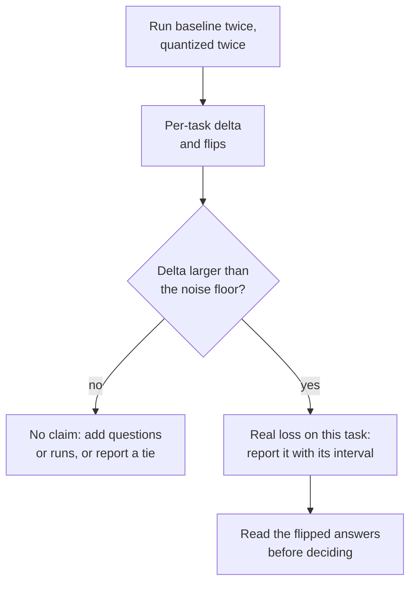

# Урок 22. Честная оценка квантизации

**Связь с целью курса:** «Измерить, чего это стоило» это половина цели курса, которая делает защитимой другую половину, а аккуратное сравнение отличает измерение от маркетингового числа.
**Первоисточник:** [Научная статья: "Give Me BF16 or Give Me Death? Accuracy-Performance Trade-Offs in LLM Quantization", Kurtic et al., 2024](https://arxiv.org/abs/2411.02355)
**Предварительные требования:** [Урок 21](0021-perplexity-and-its-limits.md), [Перплексия](../GLOSSARY.md), [Калибровочный набор](../GLOSSARY.md)

## Разминка

1. ▢ Назовите четыре вещи, которые должны совпадать, чтобы два числа перплексии можно было сравнивать.

<details markdown="1"><summary>Проверка</summary>

Токенизатор, текст, длина контекста и шаг и инструмент, который её вычислил (урок 21). Измените любое одно, и число сдвинется без изменения модели.

</details>

2. ▢ Что такое флип и почему модель может флипнуть много ответов, а её точность остаётся на месте?

<details markdown="1"><summary>Проверка</summary>

Флип это ответ, который меняется между верным и неверным относительно базовой модели. Флипы из верного в неверный и из неверного в верный примерно взаимно гасятся в средней точности, поэтому среднее их скрывает (урок 21).

</details>

3. ▢ Квантизованная модель была откалибрована на веб-тексте и оценивается на исходном коде. Чего следует ожидать и почему?

<details markdown="1"><summary>Проверка</summary>

Возможно, больше потери, чем предполагает заголовочное число. Метод настроил диапазоны или веса ошибок под статистику калибровочного текста, а активации кода могут от неё отличаться (урок 12). Средство: калибровать на тексте, похожем на текст развёртывания, и оценивать на задачах, похожих на развёртывание.

</details>

## Что нужно знать

Курс по эвалам учит, как построить эвал: выбор метрик, определение размера тестового набора и защита решения «выпускать или нет». Этот урок использует готовый. Механику см. в листе [Метрики](../../evals/reference/metrics.md) и листе [Выпускать или нет](../../evals/reference/go-no-go.md), а здесь считайте их данностью.

### Зафиксировать всё, кроме весов

Базовая модель это тот же чекпоинт в исходном 16-битном формате, а не другая модель. Всё остальное в запуске должно быть одинаковым, иначе разрыв измеряет вашу постановку, а не квантизацию:

| Что зафиксировать | Почему |
|---|---|
| Обвязка и версия | Код оценки различается между инструментами |
| Промпты, few-shot-примеры и чат-шаблон | И то и другое меняет ответ раньше, чем веса начинают иметь значение |
| Настройки генерации (правило декодирования, максимальная длина) | Запуск с сэмплированием и жадный запуск это разные эксперименты |
| Список задач и число образцов | Другое подмножество это другой тест |
| Бэкенд инференса, где можно | Второй бэкенд это вторая переменная |

Kurtic и соавторы показывают образец. Они следуют рекомендациям Meta по промптам, чтобы базовая модель совпадала с её опубликованными оценками, оценивают с жадным сэмплированием, когда сравнивают сгенерированный текст, и пропускают базовую модель и каждый квантизованный вариант через один и тот же набор. [lm-evaluation-harness](https://github.com/EleutherAI/lm-evaluation-harness) это широко используемый для этого инструмент. Его README показывает модели, загружаемые через `transformers` (включая GPTQ), через vLLM и как файлы GGUF через бэкенд `hf` или сервер llama.cpp. Для пути через сервер он документирует собственный маршрут оценки, что напоминает: другой бэкенд это не нейтральная замена.

### Охватить несколько видов задач

Один набор с выбором ответа это ещё не модель. Набор статьи охватывает несколько видов, и результат MT-Bench из урока 21 объясняет, почему это важно:

| Вид | Пример в статье | Примечания |
|---|---|---|
| Академические, в основном с выбором ответа и математика | Open LLM Leaderboard V1 и V2 | Дёшево, и именно здесь флипы прячутся в среднем |
| Качество чата, оценённое другой моделью | Arena-Hard-Auto-v0.1 | Статья усредняет два запуска на модель |
| Код, прогоняемый по тестам | HumanEval и HumanEval+ (pass@1) | Ответ либо выполняется, либо нет |
| Длинный контекст | RULER | Единственный вид здесь, нагружающий длинные входы |
| Сходство выхода с базовой моделью | ROUGE, BERTScore, семантическое сходство | Для воспроизводимости нужно жадное декодирование |

Если вы квантизовали KV-кеш (урок 16), цена этого проявляется на длинном контексте, потому что кеш растёт с длиной контекста (урок 1).

### Сообщайте дельты по задачам и флипы, а не среднее

Среднее число восстановления выглядит как вердикт, но не является им. Вот числа из таблицы 2 Kurtic и соавторов для Llama-3.1-8B-Instruct, BF16 против 4-битных весов с 16-битными активациями (W4A16-INT):

| Задача | BF16 | W4A16-INT | Дельта |
|---|---|---|---|
| MMLU, 5-shot | 68,3 | 66,9 | -1,4 |
| MMLU CoT, 0-shot | 72,8 | 71,1 | -1,7 |
| ARC-Challenge, 0-shot | 81,4 | 80,2 | -1,2 |
| GSM8k CoT, 8-shot | 82,8 | 82,9 | +0,1 |
| HellaSwag, 10-shot | 80,5 | 79,9 | -0,6 |
| Winogrande, 5-shot | 78,1 | 78,0 | -0,1 |
| TruthfulQA, 0-shot | 54,5 | 52,8 | -1,7 |
| Среднее | 74,06 | 73,11 | -0,95 |

Среднее восстановление статьи для этой строки равно 98,72%, а её самое низкое восстановление по задачам, 96,88%, у TruthfulQA. Отчёт, дающий только среднее, скрывает, какая задача заплатила. Также логируйте выходы каждой модели по вопросам (у обвязки есть `--log_samples`), чтобы помимо оценки можно было посчитать флипы, как их определил урок 21.

### Порог шума

У любой оценки есть погрешность ещё до того, как квантизация её коснулась. Kurtic и соавторы приводят конкретный случай. Два их запуска Arena-Hard-Auto для модели BF16 на 8 млрд дали 25,1 и 26,5, а для модели BF16 на 70 млрд 55,8 и 58,2, с 95-процентными доверительными интервалами около плюс-минус 2-3 пункта вокруг каждой оценки. Их модель W8A8-INT на 8 млрд в среднем дала 27,2 против 25,8 у базовой, а разрыв в 1,4 пункта лежит внутри интервала и внутри собственного разброса базовой модели между запусками. Статья также предупреждает, что малые модели показывают большую дисперсию на трудных задачах вроде GPQA и MuSR, где даже модели в полной точности близки к случайному базовому уровню.

Для задачи с оценкой «верно или неверно» по `N` вопросам с долей прохождения `p` стандартная ошибка около `sqrt(p * (1 - p) / N)`, как её формулирует лист [Выпускать или нет](../../evals/reference/go-no-go.md). Когда базовая и квантизованная модели отвечают на одни и те же вопросы, парное сравнение смотрит только на вопросы, где они расходятся, то есть снова на число флипов, и даёт более тесный интервал.



### Что нашла аккуратная оценка

Kurtic и соавторы провели более 500 000 замеров на семействе Llama 3.1. Их аннотация сообщает три результата: веса и активации FP8 (W8A8-FP) «фактически без потерь» на всех размерах моделей, хорошо настроенные веса и активации INT8 (W8A8-INT) теряют 1-3% точности, а INT4 только для весов (W4A16-INT) конкурентоспособнее, чем ожидалось, и соперничает с 8-битной. Читайте это внутри их условий. Это одно семейство моделей, и рецепты важны: GPTQ с диапазоном отсечения по среднеквадратичной ошибке, SmoothQuant, добавленный на 70 млрд для INT8, и калибровочные данные, выбранные под каждую схему. Статья отмечает, что калибровка на случайных токенах ухудшает 4-битные модели и что самые малые модели в INT4 показывают несколько большие падения. Заявление, игнорирующее свой рецепт, это то, которое вы проверяете в уроках 26 и 27.

### Запуск обеих моделей

Для сравнения нужна одна команда на модель с одними и теми же флагами, кроме самой модели. Обе пишут логи по образцам. В этой паре используются небольшая чат-модель и 4-битная копия GPTQ того же чекпоинта. Команды следуют примерам из README обвязки и для этого урока на GPU не запускались.

```bash
lm_eval --model hf --model_args pretrained=TinyLlama/TinyLlama-1.1B-Chat-v1.0 --tasks hellaswag --batch_size 8 --log_samples --output_path results/baseline
lm_eval --model hf --model_args pretrained=TheBloke/TinyLlama-1.1B-Chat-v1.0-GPTQ --tasks hellaswag --batch_size 8 --log_samples --output_path results/gptq
```

## Практика

1. ▢ Какое различие между двумя запусками делает сравнение квантизации нечестным?

    - a) Оба запуска переиспользуют одни и те же few-shot-примеры и шаблон
    - b) Базовая модель сэмплирует при температуре 0,7, а квантизованная жадно
    - c) Оба запуска затем записывают выход каждого образца на диск
    - d) Оба запуска оценивают один и тот же фиксированный список задач

<details markdown="1"><summary>Проверка</summary>

**b)** Теперь запуски различаются декодированием, поэтому разрыв смешивает квантизацию с шумом сэмплирования. (a) это то, чего требует честное сравнение. (c) лишь записывает выходы и ничего не меняет в запуске. (d) тоже требуется, поскольку другой список задач сам по себе меняет оценку.

</details>

2. ▢ Для Llama-3.1-8B-Instruct 4-битная модель только для весов даёт 66,9 на MMLU, 82,9 на GSM8k и 52,8 на TruthfulQA против 68,3, 82,8 и 54,5 у базовой BF16. Сообщите результат честным способом, одним предложением.

<details markdown="1"><summary>Проверка</summary>

По задачам: MMLU -1,4, GSM8k +0,1, TruthfulQA -1,7, среднее -1,0 по трём. Честный отчёт приводит три дельты и называет TruthfulQA и MMLU задачами, потерявшими больше всего, а не цитирует «около 1 пункта в среднем». +0,1 на GSM8k не выигрыш: это далеко внутри любого порога шума.

</details>

3. ▢ В запусках Arena-Hard-Auto у Kurtic и соавторов модель BF16 на 8 млрд дала 25,1 и 26,5, а модель W8A8-INT на 8 млрд дала 27,6 и 26,7. Средние равны 25,8 и 27,2. Улучшил ли INT8 модель?

<details markdown="1"><summary>Проверка</summary>

Свидетельств этого нет. Два запуска BF16 различаются между собой на 1,4 пункта, столько же, сколько разрыв в 1,4 пункта между средними, а 95-процентный интервал статьи для модели INT8 составляет около плюс-минус 2. Разрыв внутри разброса между запусками это ничья. «Восстановление» выше 100% нужно трактовать так же: это шум, а не улучшение.

</details>

4. ▢ Предскажите, затем запустите. Используйте имитированный тест из урока 21, где точность упала на 0,4 пункта и около 5,9% ответов флипнулись. Предскажите, больше или меньше парная стандартная ошибка разрыва точности, чем непарная, и примерно во сколько раз. Затем запустите.

    ```python
    import numpy as np

    rng = np.random.default_rng(0)
    n_questions, n_options = 5000, 4

    logits = rng.normal(size=(n_questions, n_options))
    easy = rng.random(n_questions) < 0.6
    logits[easy, 0] += 6.0
    noisy = logits + rng.normal(scale=0.5, size=logits.shape)

    base_correct = logits.argmax(axis=1) == 0
    quant_correct = noisy.argmax(axis=1) == 0

    n = n_questions
    p1, p2 = base_correct.mean(), quant_correct.mean()
    b = int(np.sum(base_correct & ~quant_correct))  # correct -> incorrect
    c = int(np.sum(~base_correct & quant_correct))  # incorrect -> correct

    gap = p2 - p1
    unpaired_se = np.sqrt(p1 * (1 - p1) / n + p2 * (1 - p2) / n)
    paired_se = np.sqrt(b + c - (b - c) ** 2 / n) / n

    print(f"accuracy gap: {gap:+.4f}")
    print(f"discordant questions: {b} lost, {c} gained")
    print(f"unpaired standard error: {unpaired_se:.4f}")
    print(f"paired standard error:   {paired_se:.4f}")
    ```

<details markdown="1"><summary>Подсказка</summary>

Непарная формула считает две точности независимыми. Обе модели отвечали на одни и те же 5000 вопросов, и большинство этих ответов не изменилось.

</details>

<details markdown="1"><summary>Проверка</summary>

Разрыв равен -0,0034, потеряно 155 вопросов и выиграно 138. Непарная стандартная ошибка равна 0,0091, а парная 0,0034, примерно в 2,7 раза меньше. Парная версия зависит только от 293 вопросов, на которых модели расходятся, так что общая для обеих трудность сокращается. Здесь разрыв составляет около одной парной стандартной ошибки, всё ещё неотличим от шума, но парная оценка более тесная и честная. Это имитированные числа, а не настоящая модель.

</details>

5. ▢ Ваш менеджер спрашивает: «Теряет ли что-нибудь сборка нашей модели в int4?» Напишите план ответа не более чем в шесть строк.

<details markdown="1"><summary>Проверка</summary>

Хороший план называет: базовую модель (тот же чекпоинт в 16-битном формате); одну обвязку, один набор промптов и одну настройку декодирования для обоих; несколько видов задач, включая генеративный и на длинный контекст, если длина контекста для вас важна; повторный запуск каждой модели для измерения порога шума; дельты по задачам с интервалами, плюс флипы по залогированным образцам; и порог, согласованный до запуска. Само решающее правило это работа курса по эвалам над «выпускать или нет».

</details>

6. ▢ Вы оцениваете базовую модель через бэкенд `hf`, а квантизованную GGUF через сервер llama.cpp с бэкендом `gguf`, и квантизованная модель на 3 пункта ниже. Что вы делаете, прежде чем винить квантизацию?

<details markdown="1"><summary>Подсказка</summary>

Какое единственное изменение отделило бы «бэкенд различается» от «веса различаются»?

</details>

<details markdown="1"><summary>Проверка</summary>

Оцените неквантизованную 16-битную GGUF через тот же путь сервера. Разрыв между этим запуском и базой `hf` это цена бэкенда и его маршрута оценки, а разрыв между 16-битной GGUF и квантизованной GGUF это цена квантизации. README документирует выделенный путь оценки для сервера llama.cpp, поэтому эффект бэкенда правдоподобен, а не гипотетичен.

</details>

## Практика в реальной работе

- [ ] Запустите две команды `lm_eval` выше на ноутбуке или в бесплатном блокноте с GPU, если можете, затем посчитайте дельту по каждой задаче и стандартную ошибку по `sqrt(p * (1 - p) / N)`.
- [ ] Выберите одно опубликованное заявление «без потерь» для квантизованной модели и перечислите, какие из пяти зафиксированных пунктов указаны в её карточке модели, а какие она опускает.
- [ ] Завтра, без заметок, запишите пять вещей, которые нужно зафиксировать, три вещи, о которых нужно сообщать по задачам, и величину, которая определяет, насколько велик должен быть разрыв, чтобы считаться.

## Что почитать дальше

- [Измерение и хранение](../reference/measuring-and-storing.md)
- [Научная статья: "Give Me BF16 or Give Me Death? Accuracy-Performance Trade-Offs in LLM Quantization", Kurtic et al., 2024](https://arxiv.org/abs/2411.02355)
- [Репозиторий: lm-evaluation-harness, EleutherAI](https://github.com/EleutherAI/lm-evaluation-harness)
- [Эвалы: Выпускать или нет](../../evals/reference/go-no-go.md), о значимости, парном сравнении и порогах
- [Эвалы: Метрики](../../evals/reference/metrics.md), о выборе метрики для каждой задачи
- [Ресурсы](../RESOURCES.md)

---

Не доходит? Перечитайте первоисточник в начале: этот урок его сжимает, а при сжатии понимание как раз и теряется. Загляните в [глоссарий](../GLOSSARY.md), если какой-то термин показался скользким.

Если неясен сам урок, а не материал, это дефект: [откройте issue](https://github.com/TokenCemetery/teach/issues).
