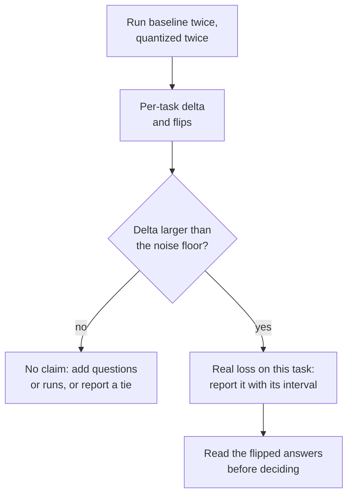

# 第 22 课：一份诚实的量化评测

**使命关联:** “度量它的代价”是使命中让另一半站得住脚的那一半，一次细致的比较，正是把一次度量与一个营销数字区分开的东西。
**主要来源:** [论文：“Give Me BF16 or Give Me Death? Accuracy-Performance Trade-Offs in LLM Quantization”，Kurtic 等，2024](https://arxiv.org/abs/2411.02355)
**前置知识:** [第 21 课](0021-perplexity-and-its-limits.md)、[困惑度](../GLOSSARY.md)、[校准集](../GLOSSARY.md)

## 热身

1. ▢ 说出两个困惑度数字要能比较必须一致的四件事。

<details markdown="1"><summary>检查</summary>

分词器、文本、上下文长度和步幅，以及算出它的工具（第 21 课）。改变其中任何一个，数字都会在模型没变的情况下移动。

</details>

2. ▢ 什么是翻转？为什么一个模型可以翻转很多答案，而准确率却纹丝不动？

<details markdown="1"><summary>检查</summary>

翻转，是相对于基线，一个答案在正确与错误之间发生了改变。从正确变成错误的翻转和从错误变成正确的翻转，在准确率的平均值里大致抵消，所以平均值把它们藏起来了（第 21 课）。

</details>

3. ▢ 一个量化模型是用网页文本校准的，却在源代码上评测。你应该预期什么？为什么？

<details markdown="1"><summary>检查</summary>

损失可能比头条数字所显示的更大。这种方法把它的范围或误差权重调成了适合校准文本的统计量，而代码的激活值可能与之不同（第 12 课）。补救办法是用与部署文本相似的文本来校准，并在看起来像部署场景的任务上评测。

</details>

## 要点

评测系列讲的是如何搭建评测：选择指标、确定测试集的规模，以及为上线与否的决定辩护。本课是在使用一个评测。关于其中的机制，请看[指标](../../evals/reference/metrics.md)参考表和[上线与否](../../evals/reference/go-no-go.md)参考表，这里把它们当作已知。

### 除权重之外，其他一切都保持不变

基线是同一个检查点的原始 16 位格式，而不是另一个模型。运行中的其他一切必须完全一致，否则那个差距度量的就是你的设置，而不是量化：

| 保持不变的东西 | 原因 |
|---|---|
| 测评框架及其版本 | 不同工具的打分代码不同 |
| 提示词、少样本示例和聊天模板 | 它们在权重起作用之前，就已经改变了答案 |
| 生成设置（解码规则、最大长度） | 采样的运行和贪心的运行是不同的实验 |
| 任务清单和样本数 | 不同的子集就是不同的测试 |
| 推理后端，只要能做到 | 第二个后端就是第二个变量 |

Kurtic 等人展示了这种做法。他们遵循 Meta 的提示词指南，使基线与它公布的得分相符，比较生成的文本时用贪心采样来评测，并让基线和每一个量化变体都跑同一套测试。[lm-evaluation-harness](https://github.com/EleutherAI/lm-evaluation-harness) 是一个为此广泛使用的工具。它的 README 展示了通过 `transformers` 加载的模型（包括 GPTQ），通过 vLLM 加载的模型，以及通过 `hf` 后端或 llama.cpp 服务器加载的 GGUF 文件。对于服务器这条路径，它记载了自己的打分路线，这是在提醒你，换一个后端并不是一次中立的替换。

### 覆盖几种不同类型的任务

一套选择题并不等于模型。论文的测试套件涵盖了几种类型，而第 21 课的 MT-Bench 结果就是它为什么要紧的原因：

| 类型 | 论文中的例子 | 说明 |
|---|---|---|
| 学术类，多为选择题和数学 | Open LLM Leaderboard V1 和 V2 | 便宜，也是翻转藏在平均值里的地方 |
| 对话质量，由另一个模型评判 | Arena-Hard-Auto-v0.1 | 论文对每个模型取两次运行的平均 |
| 代码，对照测试运行 | HumanEval 和 HumanEval+（pass@1） | 答案要么能执行，要么不能 |
| 长上下文 | RULER | 这里唯一对长输入构成压力的类型 |
| 与基线的输出相似度 | ROUGE、BERTScore、语义相似度 | 需要贪心解码才能复现 |

如果你量化了 KV 缓存（第 16 课），长上下文就是它的代价显现的地方，因为缓存随上下文长度增长（第 1 课）。

### 报告逐任务的差值和翻转，而不是一个平均值

一个平均的恢复率数字看起来像一份裁决，其实不是。下面是 Kurtic 等人表 2 中 Llama-3.1-8B-Instruct 的数字，BF16 对比 4 位权重配 16 位激活值（W4A16-INT）：

| 任务 | BF16 | W4A16-INT | 差值 |
|---|---|---|---|
| MMLU，5-shot | 68.3 | 66.9 | -1.4 |
| MMLU CoT，0-shot | 72.8 | 71.1 | -1.7 |
| ARC-Challenge，0-shot | 81.4 | 80.2 | -1.2 |
| GSM8k CoT，8-shot | 82.8 | 82.9 | +0.1 |
| HellaSwag，10-shot | 80.5 | 79.9 | -0.6 |
| Winogrande，5-shot | 78.1 | 78.0 | -0.1 |
| TruthfulQA，0-shot | 54.5 | 52.8 | -1.7 |
| 平均 | 74.06 | 73.11 | -0.95 |

论文对这一行的平均恢复率是 98.72%，逐任务恢复率最低的是 TruthfulQA，为 96.88%。一份只给出平均值的报告，隐藏了是哪个任务付出了代价。还要记录每个模型逐个问题的输出（测评框架有 `--log_samples`），这样你就能在分数之外，按第 21 课的定义来统计翻转。

### 噪声底限

任何分数在量化碰到它之前，就已经有一个误差范围。Kurtic 等人给出了一个具体的例子。他们对 BF16 的 8B 模型运行两次 Arena-Hard-Auto，得分是 25.1 和 26.5，对 BF16 的 70B 模型是 55.8 和 58.2，每个得分周围的 95% 置信区间约为正负 2 到 3 个点。他们的 W8A8-INT 8B 模型平均得分 27.2，基线是 25.8，1.4 个点的差距落在区间之内，也落在基线自身多次运行之间的波动之内。论文还警告说，较小的模型在 GPQA 和 MuSR 这类难任务上方差更大，在那里连全精度模型都接近随机基线。

对于一个在 `N` 个问题上按对错打分、通过率为 `p` 的任务，标准误约为 `sqrt(p * (1 - p) / N)`，正如[上线与否](../../evals/reference/go-no-go.md)参考表中所说。当基线与量化模型回答的是同样的问题时，配对比较只看它们意见不一的那些问题，这又回到了翻转的数目，并给出更紧的区间。



### 一次细致的评测发现了什么

Kurtic 等人在 Llama 3.1 系列上运行了超过 500,000 次评测。他们的摘要报告了三项发现：FP8 的权重和激活值（W8A8-FP）在各模型规模上“实际上无损”，调得好的 INT8 权重和激活值（W8A8-INT）损失 1% 到 3% 的精度，而 INT4 仅权重（W4A16-INT）比预期更有竞争力，足以媲美 8 位。请在它们的条件之内去读这些结论。这只是一个模型系列，而且配方很重要：GPTQ 配均方误差截断范围，70B 的 INT8 加了 SmoothQuant，校准数据按方案选定。论文指出，随机 token 的校准会让 4 位模型变差，而最小的模型在 INT4 下的降幅稍大。一项无视自己配方的声明，正是你在第 26 和第 27 课要评审的那种。

### 运行两个模型

一次比较，每个模型需要一条命令，除了模型本身，参数都相同。两者都写出逐样本的日志。这一对用的是一个小型对话模型，以及同一个检查点的 4 位 GPTQ 副本。这些命令遵循测评框架 README 的示例，在写这一课时没有在 GPU 上运行过。

```bash
lm_eval --model hf --model_args pretrained=TinyLlama/TinyLlama-1.1B-Chat-v1.0 --tasks hellaswag --batch_size 8 --log_samples --output_path results/baseline
lm_eval --model hf --model_args pretrained=TheBloke/TinyLlama-1.1B-Chat-v1.0-GPTQ --tasks hellaswag --batch_size 8 --log_samples --output_path results/gptq
```

## 练习

1. ▢ 两次运行之间的哪一种差异，会让量化比较变得不公平？

    - a) 两次运行重复使用相同的少样本示例和模板
    - b) 基线以温度 0.7 采样，而量化模型用贪心
    - c) 两次运行之后都把每个样本的输出写到磁盘上
    - d) 两次运行都对同一份固定的任务清单打分

<details markdown="1"><summary>检查</summary>

**b)** 两次运行现在在解码上不同，所以差距把量化与采样噪声混在了一起。(a) 是公平比较所要求的。(c) 只是记录输出，对运行没有任何改变。(d) 也是必需的，因为任务清单不同，分数本身就会变。

</details>

2. ▢ 对 Llama-3.1-8B-Instruct，一个 4 位仅权重的模型在 MMLU 上得 66.9，GSM8k 上得 82.9，TruthfulQA 上得 52.8，而 BF16 基线分别是 68.3、82.8 和 54.5。用一句话，以诚实的方式报告这个结果。

<details markdown="1"><summary>检查</summary>

逐任务：MMLU -1.4，GSM8k +0.1，TruthfulQA -1.7，三者的平均是 -1.0。诚实的报告给出这三个差值，并指出 TruthfulQA 和 MMLU 是损失最大的任务，而不是引用“平均约 1 个点”。GSM8k 上的 +0.1 不是收益：它远在任何噪声底限之内。

</details>

3. ▢ 在 Kurtic 等人的 Arena-Hard-Auto 运行中，BF16 的 8B 模型得分 25.1 和 26.5，W8A8-INT 的 8B 模型得分 27.6 和 26.7。平均值是 25.8 和 27.2。INT8 改进了模型吗？

<details markdown="1"><summary>检查</summary>

没有证据表明如此。两次 BF16 运行相差 1.4 个点，与平均值之间 1.4 个点的差距一样大，而论文中 INT8 模型的 95% 区间约为正负 2。落在多次运行之间波动之内的差距，就是平手。对高于 100% 的“恢复率”也这样看待：那是噪声，不是改进。

</details>

4. ▢ 先预测，再运行。重用第 21 课的模拟测试，其中准确率下降了 0.4 个点，约 5.9% 的答案发生了翻转。预测准确率差距的配对标准误，比不配对的更大还是更小，大致差多少倍。然后运行它。

    ```python
    import numpy as np

    rng = np.random.default_rng(0)
    n_questions, n_options = 5000, 4

    logits = rng.normal(size=(n_questions, n_options))
    easy = rng.random(n_questions) < 0.6
    logits[easy, 0] += 6.0
    noisy = logits + rng.normal(scale=0.5, size=logits.shape)

    base_correct = logits.argmax(axis=1) == 0
    quant_correct = noisy.argmax(axis=1) == 0

    n = n_questions
    p1, p2 = base_correct.mean(), quant_correct.mean()
    b = int(np.sum(base_correct & ~quant_correct))  # correct -> incorrect
    c = int(np.sum(~base_correct & quant_correct))  # incorrect -> correct

    gap = p2 - p1
    unpaired_se = np.sqrt(p1 * (1 - p1) / n + p2 * (1 - p2) / n)
    paired_se = np.sqrt(b + c - (b - c) ** 2 / n) / n

    print(f"accuracy gap: {gap:+.4f}")
    print(f"discordant questions: {b} lost, {c} gained")
    print(f"unpaired standard error: {unpaired_se:.4f}")
    print(f"paired standard error:   {paired_se:.4f}")
    ```

<details markdown="1"><summary>提示</summary>

不配对的公式把两个准确率当作相互独立的。两个模型回答的是同样的 5000 道题，而这些答案中的大多数并没有变。

</details>

<details markdown="1"><summary>检查</summary>

差距是 -0.0034，丢掉了 155 题，新得了 138 题。不配对的标准误是 0.0091，配对的是 0.0034，小了约 2.7 倍。配对的版本只取决于两个模型意见不一的那 293 道题，所以两者共有的难度被抵消了。这里的差距约为一个配对标准误，仍然与噪声无法区分，但配对的估计更紧，也更诚实。这些是模拟的数字，不是一个真实的模型。

</details>

5. ▢ 你的经理问：“我们模型的 int4 版本会损失什么吗？”用六行或更少的文字，写出回答这个问题的计划。

<details markdown="1"><summary>检查</summary>

一份好的计划应当写明：基线（同一个检查点的 16 位格式）；两者共用一个测评框架、提示词集和解码设置；几种任务类型，如果上下文长度对你要紧，就包括一个生成类的和一个长上下文的；把每个模型各重新运行一次，来度量噪声底限；带区间的逐任务差值，外加根据记录的样本得到的翻转；以及在运行之前商定的阈值。决策规则本身，是评测系列中上线与否的工作。

</details>

6. ▢ 你用 `hf` 后端给基线打分，用带 `gguf` 后端的 llama.cpp 服务器给量化的 GGUF 打分，量化模型低了 3 个点。在把责任归咎于量化之前，你做什么？

<details markdown="1"><summary>提示</summary>

哪一个单一的改动，能把“后端不同”和“权重不同”区分开？

</details>

<details markdown="1"><summary>检查</summary>

通过同一条服务器路径，给未量化的 16 位 GGUF 打分。这次运行与 `hf` 基线之间的差距，是后端及其打分路线的代价，而 16 位 GGUF 与量化 GGUF 之间的差距，才是量化的代价。README 记载了 llama.cpp 服务器专用的打分路径，所以后端的影响是合理的，而不是假设的。

</details>

## 实战练习

- [ ] 如果可以的话，在笔记本电脑或免费的 GPU 笔记本上运行上面这两条 `lm_eval` 命令，然后算出每个任务上的差值，以及根据 `sqrt(p * (1 - p) / N)` 得到的标准误。
- [ ] 挑一项已发布的、关于量化模型“无损”的声明，列出它的模型卡写明了五个保持不变的项目中的哪几项，漏掉了哪几项。
- [ ] 明天：不看笔记，写出要保持不变的五件事、逐任务要报告的三样东西，以及决定一个差距要多大才算数的那个量。

## 延伸阅读

- [度量与存储](../reference/measuring-and-storing.md)
- [论文：“Give Me BF16 or Give Me Death? Accuracy-Performance Trade-Offs in LLM Quantization”，Kurtic 等，2024](https://arxiv.org/abs/2411.02355)
- [仓库：lm-evaluation-harness，EleutherAI](https://github.com/EleutherAI/lm-evaluation-harness)
- [评测：上线与否](../../evals/reference/go-no-go.md)，讲显著性、配对比较和阈值
- [评测：指标](../../evals/reference/metrics.md)，讲怎样为每个任务选择指标
- [资源](../RESOURCES.md)

---

没学明白？请重读顶部的主要来源，因为本课是对它的压缩，而理解正是在压缩中流失的。如果有哪个术语觉得含糊，可以查看[术语表](../GLOSSARY.md)。

如果问题出在课程本身，而不是学习材料，那就是一个缺陷：[提交 issue](https://github.com/TokenCemetery/teach/issues)。
