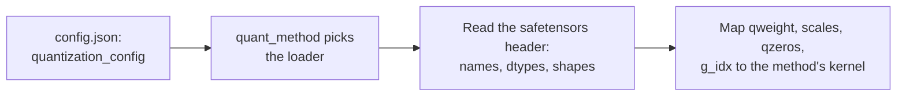

# Lección 23. Checkpoints cuantizados

**Vínculo con la misión:** Todo método de este track acaba como archivos en disco, y para revisar el "modelo de 4 bits" de alguien debes poder abrir el checkpoint y decir qué hay en él, no fiarte de la model card.
**Fuente principal:** [Docs: "Safetensors", Hugging Face](https://huggingface.co/docs/safetensors/index)
**Requisitos previos:** [Lección 22](0022-an-honest-quantization-eval.md), [Tamaño de grupo](../GLOSSARY.md), [Bits efectivos por peso](../GLOSSARY.md), [Zero-point](../GLOSSARY.md)

## Calentamiento

1. ▢ Un esquema de 4 bits almacena un scale de 16 bits por grupo de 128 pesos. ¿Cuáles son sus bits efectivos por peso, contando solo el scale?

<details markdown="1"><summary>Comprobación</summary>

Son 4.125: el scale añade 16 / 128 = 0.125 bits por peso (lecciones 1 y 6).

</details>

2. ▢ ¿Cómo conviertes un entero almacenado `q` de vuelta en un valor real aproximado cuando el cuantizador tiene un scale `s` y un zero-point `z`?

<details markdown="1"><summary>Comprobación</summary>

`x ≈ s * (q - z)`: resta el zero-point y luego multiplica por el scale (lección 4). Con un cuantizador simétrico `z` es cero.

</details>

3. ▢ En una frase, ¿qué hace GPTQ después de redondear una columna de los pesos de una capa?

<details markdown="1"><summary>Comprobación</summary>

Actualiza las columnas aún no cuantizadas para compensar el error de redondeo que acaba de cometer, usando información de segundo orden de las activaciones de calibración (lección 10).

</details>

## Qué debes saber

### Qué almacena safetensors

Un archivo **safetensors** contiene tensores con nombre y nada más que le importe al formato. Según la [descripción del formato](https://github.com/huggingface/safetensors) tiene tres partes, en este orden:

```text
| 8 bytes: N | N bytes: JSON header | byte buffer: tensor data |
```

`N` es un entero de 64 bits sin signo en little-endian que da el tamaño del encabezado. El encabezado es un objeto JSON que asigna a cada nombre de tensor su `dtype`, su `shape` y `data_offsets`, una posición de inicio y de fin dentro del búfer de bytes. Puede contener además una clave `__metadata__` con pares de cadena a cadena de forma libre. Los datos están en orden de filas, en little-endian, y completamente indexados sin huecos. La [documentación](https://huggingface.co/docs/safetensors/index) lo presenta como una alternativa segura a pickle que sigue siendo rápida, con carga zero-copy, y muestra cómo cargar un fragmento de un tensor.

Dos consecuencias importan aquí. Puedes leer solo el encabezado, sin los gigabytes de datos que le siguen, y conocer el nombre, el dtype y la forma de cada tensor. Y un tensor de dtype `I32` no dice nada sobre si contiene enteros de 32 bits u ocho valores de 4 bits empaquetados. El archivo lleva los bytes. Lo que significan hay que registrarlo en otra parte.

### Qué almacena una capa lineal GPTQ de 4 bits

Aquí hay una capa real, leída del encabezado de un checkpoint público GPTQ de 4 bits de TinyLlama 1.1B Chat, cuya `q_proj` asigna 2048 entradas a 2048 salidas con tamaño de grupo 128:

| Tensor | Dtype y forma | Qué contiene |
|---|---|---|
| `qweight` | I32 `[256, 2048]` | Los pesos, empaquetados: 256 x 2048 x 8 = 4,194,304 valores de cuatro bits, toda la matriz de 2048 x 2048 |
| `scales` | F16 `[16, 2048]` | Un scale por grupo y por canal de salida: 2048 / 128 = 16 grupos |
| `qzeros` | I32 `[16, 256]` | Los zero-points, también empaquetados, 8 por entero: 2048 / 8 = 256 |
| `g_idx` | I32 `[2048]` | Para cada canal de entrada, el número del grupo al que pertenece |
| `bias` | F16 `[2048]` | El sesgo de la capa, dejado en 16 bits |

El tensor `g_idx` existe por act-order. El repositorio de los autores de GPTQ describe la opción como cuantizar las columnas en orden decreciente de tamaño de activación, y señala que su opción `--static-groups` evita "cambios en la inferencia (que pueden causar una ralentización)". Una vez cuantizadas las columnas en ese orden, los canales de un grupo ya no son vecinos, así que el cargador necesita un mapa de canal a grupo. La model card de este checkpoint llama a la opción `desc_act` y dice que da mejor accuracy. Un checkpoint cuantizado sin act-order tiene grupos contiguos, así que su mapa simplemente contaría de 0 a 15 en bloques de 128.

El empaquetado es una familia de disposiciones, no un estándar. Un checkpoint FP8 de [compressed-tensors](https://huggingface.co/docs/transformers/main/en/quantization/compressed_tensors), por ejemplo, almacena `weight` como `F8_E4M3` con forma `[4096, 14336]` y un `weight_scale` de forma `[1]`: un único scale para todo el tensor, sin ninguna matriz de grupos. La misma biblioteca cubre además una forma pack-quantized, pesos int4 o int8 empaquetados en enteros de 32 bits.

### Cómo le dice la configuración a un cargador qué significan los bytes

El esquema se registra en el `config.json` del modelo, bajo `quantization_config`. Un cargador lee primero esa clave, elige el método correspondiente por su `quant_method`, y solo entonces asigna los nombres de tensores a kernels:



La documentación de Transformers dice que identifiques un modelo AWQ por la clave `quant_method` de `config.json`. Las tres familias que te encontrarás llevan claves distintas:

| Método | Claves en `quantization_config` | Fuente |
|---|---|---|
| GPTQ | `quant_method: "gptq"`, `bits: 4`, `group_size: 128`, `desc_act: true`, `sym: true`, `damp_percent: 0.1`, `true_sequential: true`, `static_groups: false` | la configuración del checkpoint de arriba |
| AWQ | `quant_method: "awq"`, `bits: 4`, `group_size: 128`, `zero_point: true`, `version: "gemm"` | ejemplo de la [documentación de AWQ de Transformers](https://huggingface.co/docs/transformers/main/en/quantization/awq) |
| compressed-tensors | `quant_method: "compressed-tensors"`, `config_groups` con `weights` e `input_activations` (cada uno con `num_bits`, `strategy`, `type`) y `targets`, además de `ignore`, `format`, `quantization_status` | ejemplo de la [documentación de Transformers](https://huggingface.co/docs/transformers/main/en/quantization/compressed_tensors) |

En compressed-tensors un **config group** nombra los módulos a los que se aplica (`targets`, como `["Linear"]`) y cómo cuantizar sus pesos y, opcionalmente, sus activaciones. La lista `ignore` nombra los módulos que se dejan como están, como `lm_head`. En el ejemplo de FP8 de la documentación, tanto los pesos como las activaciones son floats de 8 bits con una estrategia por tensor, y se omite `lm_head`.

Los tensores y la configuración también pueden discrepar. El archivo GPTQ de arriba repite `gptq_bits`, `gptq_group_size` y `gptq_desc_act` en su `__metadata__` de safetensors además de en `config.json`. Cuando un archivo y su configuración discrepan, lo que el kernel tiene que leer de verdad son las formas de los tensores, así que compruébalas primero.

## Práctica

1. ▢ Un archivo safetensors empieza con los bytes `d8 5c 01 00 00 00 00 00`. ¿Cuánto mide el encabezado JSON, y en qué offset del archivo empiezan los datos de los tensores?

<details markdown="1"><summary>Comprobación</summary>

Los primeros ocho bytes son un entero en little-endian, así que `N = 0xd8 + 0x5c * 256 + 0x01 * 65536 = 216 + 23,552 + 65,536 = 89,304` bytes de encabezado. Los datos empiezan en el offset 8 + 89,304 = 89,312. Son los bytes reales del checkpoint del ejercicio siguiente.

</details>

2. ▢ ¿Dónde averigua un cargador qué método de cuantización usa un checkpoint?

    - a) La clave quant_method dentro de quantization_config en el config.json del modelo
    - b) La cantidad agregada de tensores registrada dentro del encabezado de safetensors
    - c) Las posiciones de los tensores dentro del búfer binario de safetensors
    - d) La extensión del propio nombre del archivo de pesos principal del checkpoint

<details markdown="1"><summary>Comprobación</summary>

**a)** La documentación de Transformers identifica un modelo AWQ por esa clave, y compressed-tensors y GPTQ usan la misma. (b) es incorrecta porque un recuento de tensores es un dato sobre el tamaño, no sobre el método. (c) es incorrecta porque las posiciones en el búfer ya están indexadas por el encabezado y no dicen nada sobre el método. (d) es incorrecta porque los checkpoints de GPTQ, AWQ y compressed-tensors terminan todos en `.safetensors`.

</details>

3. ▢ Predice y luego ejecuta. El script de abajo lee solo el encabezado de un checkpoint GPTQ de 4 bits mediante una petición HTTP por rango, y luego el tensor `g_idx`, de unos 8 KB. El archivo de pesos del modelo pesa cientos de megabytes. Predice los cinco tensores almacenados para `q_proj` en la capa 0, con dtypes y formas, y si `g_idx` está ordenado. Necesita acceso a la red y ningún paquete adicional.

    ```python
    import json
    import struct
    import urllib.request

    URL = "https://huggingface.co/TheBloke/TinyLlama-1.1B-Chat-v1.0-GPTQ/resolve/main/model.safetensors"


    def fetch(start, end):
        req = urllib.request.Request(URL, headers={"Range": f"bytes={start}-{end}", "User-Agent": "Mozilla/5.0"})
        with urllib.request.urlopen(req) as response:
            return response.read()


    (n,) = struct.unpack("<Q", fetch(0, 7))  # first 8 bytes: header length, little-endian
    header = json.loads(fetch(8, 8 + n - 1))  # next n bytes: the JSON header
    print("header bytes:", n, "| tensors:", len(header) - 1)
    print("metadata:", header.pop("__metadata__"))

    layer = "model.layers.0.self_attn.q_proj."
    for name, tensor in header.items():
        if name.startswith(layer):
            print(name, tensor["dtype"], tensor["shape"])

    begin, end = header[layer + "g_idx"]["data_offsets"]  # offsets are relative to the data buffer
    raw = fetch(8 + n + begin, 8 + n + end - 1)
    g_idx = struct.unpack(f"<{len(raw) // 4}i", raw)
    print("first 12 g_idx values:", g_idx[:12])
    print("g_idx sorted:", list(g_idx) == sorted(g_idx))
    print("distinct groups:", len(set(g_idx)))
    ```

<details markdown="1"><summary>Pista</summary>

Ocho valores de 4 bits caben en un entero de 32 bits, y un tamaño de grupo de 128 sobre 2048 entradas da 16 grupos. Si `desc_act` estaba activado, piensa si los canales de un mismo grupo están uno junto a otro.

</details>

<details markdown="1"><summary>Comprobación</summary>

Con el archivo tal como estaba cuando se escribió esta lección, imprime un encabezado de 89304 bytes y 817 tensores, metadatos con `gptq_bits` 4, `gptq_group_size` 128 y `gptq_desc_act` True, y estos tensores en este orden: `g_idx` I32 `[2048]`, `qweight` I32 `[256, 2048]`, `qzeros` I32 `[16, 256]`, `bias` F16 `[2048]`, `scales` F16 `[16, 2048]`. Los primeros valores de g_idx son `(13, 7, 0, 1, 6, 1, 12, 12, 13, 5, 6, 11)`, así que no está ordenado, y hay 16 grupos distintos. El canal 0 pertenece al grupo 13, que es el mapa de canal a grupo revuelto de act-order. Un archivo alojado puede cambiar, así que trata los números exactos como una instantánea.

</details>

4. ▢ Usando las formas del ejercicio anterior, ¿cuáles son los bits efectivos por peso de esta `q_proj`, contando `qweight`, `scales`, `qzeros` y `g_idx` pero no el sesgo? ¿Está más cerca de 4.0, 4.125 o 4.17?

<details markdown="1"><summary>Comprobación</summary>

Cerca de 4.17. Los bytes son 256 x 2048 x 4 = 2,097,152 para `qweight`, 16 x 2048 x 2 = 65,536 para `scales`, 16 x 256 x 4 = 16,384 para `qzeros` y 2048 x 4 = 8,192 para `g_idx`, 2,187,264 en total. Por 8 bits y dividido entre 2048 x 2048 = 4,194,304 pesos da 4.171875. El scale solo da 4.125, y los zero-points empaquetados y el mapa de grupos añaden el resto. Un checkpoint de "4 bits" nunca es exactamente 4 bits por peso.

</details>

5. ▢ Una model card dice tamaño de grupo 128 y `config.json` coincide. El tensor `scales` de una capa con 2048 entradas tiene forma `[64, 2048]`. ¿Qué tamaño de grupo se usó realmente, y qué te dice esto?

<details markdown="1"><summary>Pista</summary>

La primera dimensión de `scales` es el número de grupos a lo largo de los canales de entrada.

</details>

<details markdown="1"><summary>Comprobación</summary>

El tamaño de grupo es 2048 / 64 = 32, no 128. Las formas del encabezado de safetensors son lo que lee el kernel y no pueden equivocarse sobre la disposición, mientras que una configuración o una model card es una afirmación que puede copiarse de otra ejecución. Ni un cargador ni un revisor deberían creer la afirmación antes que los tensores.

</details>

6. ▢ Aquí hay un `quantization_config` de la documentación de Transformers. ¿Qué cuantiza, cómo, y qué deja como está?

    ```json
    "quantization_config": {
      "config_groups": {
        "group_0": {
          "input_activations": {"num_bits": 8, "strategy": "tensor", "type": "float"},
          "targets": ["Linear"],
          "weights": {"num_bits": 8, "strategy": "tensor", "type": "float"}
        }
      },
      "format": "naive-quantized",
      "ignore": ["lm_head"],
      "quant_method": "compressed-tensors",
      "quantization_status": "frozen"
    }
    ```

<details markdown="1"><summary>Comprobación</summary>

Cuantiza todo módulo `Linear`: tanto los pesos como las activaciones de entrada a punto flotante de 8 bits (fp8), con un scale por tensor (`strategy: "tensor"`). Eso lo convierte en un esquema W8A8, y el listado de tensores de la documentación para este modelo muestra `weight_scale` de forma `[1]`. La lista `ignore` deja `lm_head` en su precisión original.

</details>

## Prácticas en el mundo real

- [ ] Abre la página de modelo de cualquier modelo cuantizado del Hugging Face Hub, encuentra su `config.json` y anota `quant_method`, `bits` y `group_size`. Luego abre su listado de tensores desde el visor de archivos y confirma que la forma de `scales` de una capa coincide con el tamaño de grupo.
- [ ] Ejecuta el script del ejercicio 3 contra un segundo checkpoint cuantizado público, como uno de AWQ, y lista en qué se diferencian sus nombres de tensores de los de GPTQ.
- [ ] Mañana: sin apuntes, nombra las tres partes de un archivo safetensors en orden, y los cuatro tensores que almacena una capa lineal GPTQ de 4 bits además de su sesgo.

## Para profundizar

- [Medir y almacenar](../reference/measuring-and-storing.md)
- [Docs: "Safetensors", Hugging Face](https://huggingface.co/docs/safetensors/index)
- [Repo: safetensors, Hugging Face](https://github.com/huggingface/safetensors), para el formato a nivel de byte
- [Docs: "compressed-tensors", Hugging Face Transformers](https://huggingface.co/docs/transformers/main/en/quantization/compressed_tensors)
- [Recursos](../RESOURCES.md)

---

¿No termina de quedar claro? Vuelve a leer la fuente primaria de arriba, ya que esta lección la comprime y en la compresión es donde se escapa la comprensión. Consulta el [glosario](../GLOSSARY.md) por si algún término te resultó resbaladizo.

Si lo poco claro es la propia lección y no el material, eso es un defecto: [abre un issue](https://github.com/TokenCemetery/teach/issues).
